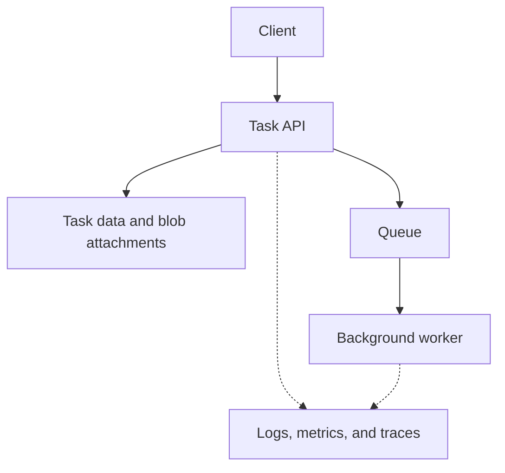

# Azure developer learning labs

**Azure** provides computers and other services you can use over the internet. These labs take the task app you built locally and run it in that environment. Work on one small feature at a time, then explain how you checked it.

**Certification status checked on 14 October 2026:** Microsoft lists Azure Developer Associate and its renewal assessment as retired. This page retains the former AZ-204 learning topics for practical study. It is not a current exam-preparation plan. See the [official certification page](https://learn.microsoft.com/en-us/credentials/certifications/azure-developer/).

**Before you start:** make the task API work on your own computer using the [backend track](../../../system-design/case-studies/task-service.md). You should be able to create a task, read it back, and explain a failed request. Learn cloud deployment after that local flow is clear.

For provider-neutral decisions and prerequisites, start with [Cloud engineering](../../index.md).

## Cloud words in plain language

| Word | Meaning in this project |
| --- | --- |
| Resource | Something you create and use, such as a web app or storage account. |
| Resource group | A group that helps you manage related resources. |
| Region | The geographic area where you choose to run a resource. |
| Deployment | Putting your code or configuration into a running environment. |
| Managed identity | An identity an Azure workload can use when accessing other resources. |
| Blob | A stored file-like object, such as a task attachment. |

## One project throughout the labs

Build a task API. Store attachments as blobs, process a background notification, and trace a request when something fails.



Begin with only the client and API. Add stored task data next, then one attachment. The queue and worker are a later exercise. Pick a service after you can describe the job you need it to do.

## Learning path

| Stage                    | Learn                                                          | Deliverable                                                                |
| ------------------------ | -------------------------------------------------------------- | -------------------------------------------------------------------------- |
| 1. Compute               | App Service, Functions, and Container Apps                     | A deployed API with a working health route                                 |
| 2. Storage               | Blob storage and a database suited to the data                 | Store and retrieve an attachment and task record                           |
| 3. Identity              | Managed identity, role assignments, and Key Vault              | The application reads an allowed resource without a hard-coded credential  |
| 4. Background work       | Storage Queues or Service Bus, retries, and duplicate handling | A worker completes a job and handles a retry                               |
| 5. Events and streams    | Event Grid and Event Hubs use cases                            | Explain whether a scenario needs a notification, a work queue, or a stream |
| 6. Operations            | Application Insights, traces, metrics, and logs                | Find one intentionally failed request                                      |
| 7. Repeatable deployment | Bicep and a deployment workflow                                | Recreate the lab from versioned configuration                              |

For your first pass, deploy one working API, store one record, and inspect one request in the logs. Next, add identity and one background job. Event streams and repeatable infrastructure are deeper study. Finish a stage when you can show its result and explain a failure case.

## Prepare a controlled lab

Use a subscription and resource group intended for practice. Identify the resources you create, check their costs, and remove the lab resources when finished. Some resources keep billing while the application is idle.

With Azure CLI installed, inspect your account and available App Service runtimes before choosing a runtime:

```sh
az login
az account show --output table
az webapp list-runtimes --os linux --output table
```

Choose a currently supported runtime from the returned list and use the same major version locally. Avoid copying an old fixed runtime string from a study guide. See the [Azure CLI web app reference](https://learn.microsoft.com/en-us/cli/azure/webapp#az-webapp-list-runtimes).

Record the subscription, region, resource group, runtime, and resource names in your lab notes. Some Azure names must be globally unique. Keep credentials out of notes and source control.

## Compute: choose how the code runs

| Option         | What you manage                                                | Good exercise                                         |
| -------------- | -------------------------------------------------------------- | ----------------------------------------------------- |
| App Service    | Application deployment and configuration on a managed web host | Deploy an HTTP API and verify its logs.               |
| Functions      | Event-triggered functions and their bindings/configuration     | Process a queue message.                              |
| Container Apps | A container image and managed application configuration        | Deploy a container and inspect its revision behavior. |

Read the current hosting-plan documentation before choosing scaling, networking, or deployment features. Support varies by plan; “serverless” does not mean no limits or no operational work.

## Storage and messaging: match the data

| Need                                    | Service to investigate                              | Question to answer                                                    |
| --------------------------------------- | --------------------------------------------------- | --------------------------------------------------------------------- |
| Files and attachments                   | Blob Storage                                        | Who can read each blob, and when should it expire?                    |
| Application records                     | Azure SQL or Cosmos DB, according to the data model | Which queries, transactions, and consistency guarantees are required? |
| A simple backlog of work                | Storage Queues                                      | How will visibility timeouts and retries affect the worker?           |
| Messaging with broker features          | Service Bus                                         | Do you need sessions, dead-letter handling, or transactions?          |
| Notify consumers that an event happened | Event Grid                                          | Can the handler accept duplicates and retries?                        |
| A stream of many events                 | Event Hubs                                          | How are events partitioned and consumed?                              |

A Cosmos DB partition key should follow access patterns and distribute work. Request units describe resource use, not a universal requests-per-second rate. Measure your actual operations. For any message handler, explain what happens if it finishes its action but fails before acknowledging the message.

## Access, monitoring, and deployment

Give the application an identity, then grant it the permission it needs for one operation. These are separate steps: having an identity does not grant access by itself. Key Vault stores secrets that are still needed; access checks and a plan for replacing those secrets still matter.

Give each request a useful identifier and record its outcome without sensitive data. A **trace** connects the steps of one request. Create a deliberate failure in the lab, find its records, and explain which step failed.

After a manual deployment makes sense, describe the resources in Bicep so you can recreate them. Keep values that differ between environments separate. A deployment workflow should use an appropriate identity setup, such as federation where available; do not copy long-lived credentials into source. Recreate the lab once to test your instructions.

## Practice Problems

| Problem | Level / priority | Practice / notes | Example / answer |
| --- | --- | --- | --- |
| Deploy an API | Practice | Build: A health route and a task route<br />Verify: Call both and inspect the application logs. | — |
| Store an attachment | Practice | Build: Upload and read a blob through an authorized path<br />Verify: An unauthorized caller cannot read it. | — |
| Use managed identity | Practice | Build: Grant the application only the required resource role<br />Verify: The allowed operation works; an unrelated operation is denied. | — |
| Process a message | Practice | Build: A worker with a retry and duplicate-handling policy<br />Verify: Replaying the same job follows the stated contract. | — |
| Investigate a failure | Practice | Build: A failed request and a saved trace query<br />Verify: Identify the failing dependency without exposing secrets. | — |
| Recreate and clean up | Practice | Build: Versioned deployment configuration and a resource inventory<br />Verify: Recreate the lab, then verify its resources are removed. | — |

## Official references

| Topic      | Documentation                                                                                                                                                                                                                                                              |
| ---------- | -------------------------------------------------------------------------------------------------------------------------------------------------------------------------------------------------------------------------------------------------------------------------- |
| Compute    | [App Service](https://learn.microsoft.com/en-us/azure/app-service/overview), [Functions](https://learn.microsoft.com/en-us/azure/azure-functions/functions-overview), [Container Apps](https://learn.microsoft.com/en-us/azure/container-apps/overview)                    |
| Data       | [Storage](https://learn.microsoft.com/en-us/azure/storage/), [Cosmos DB](https://learn.microsoft.com/en-us/azure/cosmos-db/)                                                                                                                                               |
| Messaging  | [Service Bus](https://learn.microsoft.com/en-us/azure/service-bus-messaging/), [Event Grid](https://learn.microsoft.com/en-us/azure/event-grid/), [Event Hubs](https://learn.microsoft.com/en-us/azure/event-hubs/)                                                        |
| Identity   | [Managed identities](https://learn.microsoft.com/en-us/entra/identity/managed-identities-azure-resources/overview), [Key Vault](https://learn.microsoft.com/en-us/azure/key-vault/)                                                                                        |
| Operations | [Application Insights](https://learn.microsoft.com/en-us/azure/azure-monitor/app/app-insights-overview), [API Management](https://learn.microsoft.com/en-us/azure/api-management/), [Bicep](https://learn.microsoft.com/en-us/azure/azure-resource-manager/bicep/overview) |

Continue with [backend engineering](../../../system-design/case-studies/task-service.md) for API design and service operations.

## Completion checkpoint

Record the deployed workflow, your failure investigation, how you recreated the environment, and evidence that the lab resources were removed.

## Failure drill and interview review

The application has a managed identity, but its blob read is denied. Determine the principal in use, the target resource, the granted role, and the scope before adding permissions.

<details>
<summary>Expected investigation</summary>

Authentication establishes the principal; authorization decides the operation. Verify the actual workload identity and the data-access permission at the intended scope. Check propagation and network restrictions using the service's diagnostics. Do not repair the lab by granting subscription-wide access when a narrower permission satisfies the contract.

</details>

<details>
<summary>Why is deleting the application process insufficient cleanup?</summary>

Its plan, storage, retained backups, logs, or network resources may have separate lifetimes. Reconcile the resource inventory and verify deletions. A budget alert informs you about spending; it does not inherently stop consumption.

</details>

**Revision checklist:** deployed request, denied access, duplicate message, failed dependency, recreated environment, and verified cleanup. **Key takeaway:** a working endpoint is one piece of evidence; operation and recovery complete the lab.
