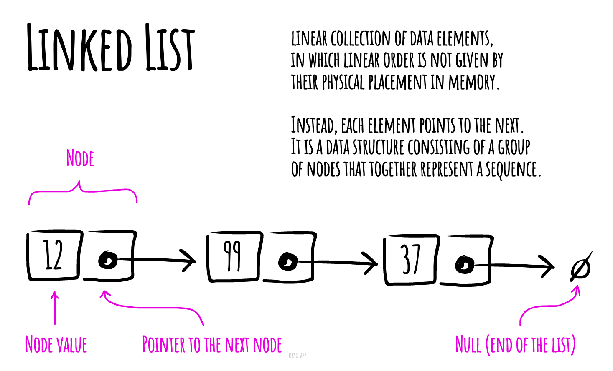

# Linked List

**Read first:** [Linked lists: change connections without losing data](../../linked-list/README.md).

**Practice focus:** Trace append, removal, and reverse reading on three nodes. The historical folder name does not make this a binary-search algorithm.

A linked list stores values in a chain of nodes. Each node points to the next one. To reach the third node, start at the head and follow two links.

Changing a known link is quick, but finding a value takes a walk through the chain. Use an array when you need direct access by index; use a linked list to study how links support insertion and removal.



## JavaScript for Basic Operations {/* #pseudocode-for-basic-operations */}

Each node stores `{ value, next }`; the list stores `head` and `tail`. The following class supports insertion at either end, strict-equality search, removal of the first matching value, and traversal in both directions.

```js runnable
class LinkedList {
  head = null;
  tail = null;

  append(value) {
    const node = { value, next: null };
    if (this.tail === null) this.head = node;
    else this.tail.next = node;
    this.tail = node;
  }

  prepend(value) {
    this.head = { value, next: this.head };
    if (this.tail === null) this.tail = this.head;
  }

  contains(value) {
    for (let node = this.head; node !== null; node = node.next) {
      if (node.value === value) return true;
    }
    return false;
  }

  remove(value) {
    let previous = null;
    let node = this.head;
    while (node !== null && node.value !== value) {
      previous = node;
      node = node.next;
    }
    if (node === null) return false;
    if (previous === null) this.head = node.next;
    else previous.next = node.next;
    if (node === this.tail) this.tail = previous;
    node.next = null;
    return true;
  }

  *values() {
    for (let node = this.head; node !== null; node = node.next) {
      yield node.value;
    }
  }

  *reverseValues() {
    const stack = [...this.values()];
    while (stack.length > 0) yield stack.pop();
  }
}

const list = new LinkedList();
list.append(20);
list.append(30);
list.prepend(10);
console.log(list.contains(20));
console.log(list.remove(20));
console.log([...list.values()].join(','));
console.log([...list.reverseValues()].join(','));
list.remove(10);
list.remove(30);
console.log(list.head === null && list.tail === null);
```

```text output
true
true
10,30
30,10
true
```

### Insert

`append` attaches a node after the tail. `prepend` attaches one before the head. Both also handle an empty list and take O(1) time because the list stores both endpoints.

### Search

`contains` follows `next` links until it finds a match or reaches `null`. It returns `false` for an empty list. Unlike an array, a linked list cannot jump directly to its middle index, so ordinary array binary search does not help here.

### Delete

`remove` keeps the previous node while searching. That lets it bypass the matching node. Removing the head or tail updates the corresponding endpoint; removing the only node clears both. Repeated values are allowed, and each call removes only the first match.

### Traverse

`values` yields items from head to tail in O(n) time with O(1) extra traversal space.

### Traverse in Reverse

A singly linked list has no backward links. `reverseValues` first collects the values in a stack, then pops them in reverse order. It takes O(n) time and O(n) extra space and leaves the original links unchanged. Use a [doubly linked list](../../doubly-linked-list/README.md) when backward traversal is a frequent operation.

## Complexities

### Time Complexity

| Access | Search | Insertion | Deletion |
| :----: | :----: | :-------: | :------: |
|  O(n)  |  O(n)  |   O(1)    |   O(n)   |

Insertion here means appending or prepending. Deletion includes the search for a value.

### Space Complexity

O(n) for the stored nodes. Forward traversal needs O(1) extra space; the reverse traversal above needs an O(n) stack.

## References

- [Wikipedia](https://en.wikipedia.org/wiki/Linked_list)
- [YouTube](https://www.youtube.com/watch?v=njTh_OwMljA&index=2&t=1s&list=PLLXdhg_r2hKA7DPDsunoDZ-Z769jWn4R8)

**Next:** [Doubly Linked List](../../doubly-linked-list/README.md).
