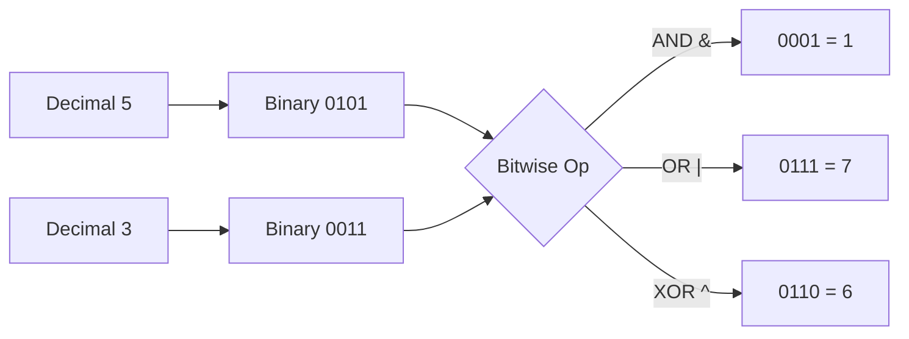

import PracticeProblem from '@site/src/components/PracticeProblem';

import AlgorithmWalkthrough from '@site/src/components/AlgorithmWalkthrough';

# 🔢 Bit Manipulation

**Prerequisites:** [JavaScript numeric limits](../javascript-for-dsa.md), loops, and arrays.

A bit is a single 0 or 1. Bitwise operators compare or change these bits. Start with small positive integers and write their binary forms side by side.

---


<AlgorithmWalkthrough name="bits" />

## Learning steps

A set of on/off switches can fit into bits. A mask records which switches are on; each bit has its own place value.

1. Write small values in binary and compare corresponding bits.
2. Set, clear, or test one bit and explain each result.
3. Respect JavaScript’s 32-bit Number rules before using masks for subsets.

## 🎯 Concept

Bitwise operations act on each binary position. With JavaScript Number values, most bitwise operators first convert the value to a signed 32-bit integer. They can lose higher bits. Use BigInt when you need wider integer bit operations, and do not mix Number and BigInt operands.



### Core Operators

| Operation   | Symbol | Example  | Result | Rule                          |
| ----------- | ------ | -------- | ------ | ----------------------------- |
| AND         | `&`    | `5 & 3`  | `1`    | 1 only if **both** bits are 1 |
| OR          | `\|`   | `5 \| 3` | `7`    | 1 if **either** bit is 1      |
| XOR         | `^`    | `5 ^ 3`  | `6`    | 1 if bits **differ**          |
| NOT         | `~`    | `~5`     | `-6`   | flips every bit               |
| Left shift | `<<` | `5 << 1` | `10` | Shift left; high bits are discarded |
| Right shift | `>>` | `5 >> 1` | `2` | Shift right while preserving the sign |

**Key XOR properties**: `a^a=0`, `a^0=a`, commutative, associative. These make XOR the go-to tool for "find the odd one out" problems.

### Read binary positions before using tricks

Binary uses place values `1, 2, 4, 8, ...` from right to left. `0101` means `0×8 + 1×4 + 0×2 + 1×1 = 5`. We number the rightmost bit 0. AND tests whether two flags are both present; OR combines flags; XOR records differences. A **mask** is an integer whose bits represent yes/no choices.

```text
position:  3 2 1 0
5:         0 1 0 1
3:         0 0 1 1
AND:       0 0 0 1    both inputs have position 0 set
XOR:       0 1 1 0    inputs differ at positions 2 and 1
```

`~` flips all 32 bits of a Number bitwise operand, including its sign bit; it does not flip only the four positions drawn above. That is why `~5` equals -6.

### Essential Bit Tricks (Cheat Sheet)

For positive Number masks here, restrict `n` to 0 through `2**31 - 1` and bit positions to 0 through 30. Number shift counts are reduced modulo 32: shifting by 32 is the same as shifting by 0. Use `2 ** k` for ordinary powers; use BigInt when the problem genuinely requires wider masks.

| Goal                       | Expression                     |
| -------------------------- | ------------------------------ |
| Check if `i`-th bit is set | `(n >> i) & 1`                 |
| Set the `i`-th bit         | `n \| (1 << i)`                |
| Clear the `i`-th bit       | `n & ~(1 << i)`                |
| Toggle the `i`-th bit      | `n ^ (1 << i)`                 |
| Turn off lowest set bit    | `n & (n - 1)`                  |
| Isolate lowest set bit     | `n & (-n)`                     |
| Check power of two         | `n > 0 && (n & (n - 1)) === 0` |
| Shift one place (may overflow) | `n << 1` / `n >> 1` |

---

## ⚡ Time & Space Complexity

| Operation                                      | Time      | Space | Notes                      |
| ---------------------------------------------- | --------- | ----- | -------------------------- |
| Single bitwise op (`&`, `\|`, `^`, `<<`, `>>`) | O(1)      | O(1)  | Fixed-width Number operands        |
| Count set bits (Brian Kernighan)               | O(k)      | O(1)  | k = number of set bits     |
| Count set bits (naive scan)                    | O(log n)  | O(1)  | Iterate over all bits      |
| Iterate all subsets via bitmask                | O(2ⁿ)     | O(1)  | n = number of elements     |
| Subset assignment DP | O(2ⁿ · n) | O(2ⁿ) | See [advanced DP](../dp/advanced.md); classic TSP DP typically needs O(n²·2ⁿ) time |

**Cost model:** a bitwise operation on a fixed-width Number is treated as O(1). BigInt work grows with the number of bits. A loop over n input values still takes O(n), even if each step uses XOR.

---

## Common Patterns

### Find Single Number

```javascript
const singleNumber = (nums) => nums.reduce((acc, n) => acc ^ n, 0);
```

### Check Even/Odd

```javascript
const isEven = (n) => (n & 1) === 0;
```

### Count Set Bits (Brian Kernighan)

```javascript
function countBits(n) {
  let count = 0;
  while (n > 0) {
    n &= n - 1;
    count++;
  }
  return count;
}
```

### Safe power-of-two check for larger integers

For a positive binary power, exactly one bit is set. Subtracting one clears that bit and sets every lower bit; AND then leaves zero. The positive check excludes zero.

```js runnable
function isPowerOfTwo(value) {
  return value > 0n && (value & (value - 1n)) === 0n;
}
console.log(isPowerOfTwo(1n << 40n));
console.log(isPowerOfTwo((1n << 40n) + 1n));
console.log(isPowerOfTwo(0n));
console.log(1 << 32); // Number shift count wraps to zero.
```

```text output
true
false
false
1
```

The contract takes BigInt operands. This avoids truncating a 40-bit value to 32 bits. Cost depends on the number of bits, not constant-size machine arithmetic. XOR swapping variables is omitted from the learning path: use a temporary variable or `[a, b] = [b, a]` for ordinary swaps.

---

## Pitfalls

- JS bitwise ops work on 32-bit signed integers — large numbers get truncated
- `~n = -(n+1)` — use `>>> 0` to convert to unsigned if needed
- `>>>` is unsigned right shift for Number only; BigInt has no `>>>` operator.
- The fixed-width `countBits` snippet above requires a nonnegative value below `2**31`; an unsigned 32-bit version must normalize with `>>> 0` and loop until zero.

---

## 🧪 Worked Examples

### Example 1: Missing Number (XOR)

> Given `n` distinct numbers in range `[0, n]`, find the one missing.

```javascript
function missingNumber(nums) {
  let xor = nums.length; // start with n
  for (let i = 0; i < nums.length; i++) {
    xor ^= i ^ nums[i]; // cancel indices with values
  }
  return xor;
}
// Every present number cancels with its index; the missing one survives.
// Time: O(n), Space: O(1)
```

### Example 2: Generate All Subsets (Bitmask)

> Enumerate the power set of an array of size `n` using bit masks.

```javascript
function subsets(nums) {
  const n = nums.length;
  if (n > 20) throw new RangeError('This teaching example supports at most 20 items');
  const result = [];
  for (let mask = 0; mask < 2 ** n; mask++) {
    const subset = [];
    for (let i = 0; i < n; i++) {
      if (mask & (1 << i)) subset.push(nums[i]);
    }
    result.push(subset);
  }
  return result;
}
// Each of the 2^n masks encodes one subset (bit i => include nums[i]).
// Time: O(2^n * n); up to O(n) current subset plus O(n * 2^n) returned output.
// The practical limit is exponential output size, well before a wide mask is useful.
```

### Example 3: Sum of Two Integers Without `+`

> Add two integers using only bitwise operations.

```javascript
function getSum(a, b) {
  while (b !== 0) {
    const carry = (a & b) << 1; // bits that carry over
    a = a ^ b; // add without carry
    b = carry; // apply carry next round
  }
  return a;
}
// XOR adds bit-by-bit; AND<&lt;1 computes the carry. Repeat until no carry.
// Time: O(1) (fixed 32-bit width), Space: O(1)
```

---

## Practice Problems

{/* BEGIN GENERATED PRACTICE PROBLEMS */}

| Problem | Level / priority | Practice / notes | Example / answer |
| --- | --- | --- | --- |
| <PracticeProblem id={67} title={"Add Binary"} text={"Problem statement\na and b are nonempty strings representing nonnegative binary integers, with no unnecessary\nleading zeros. Add their values and return the sum as a binary string, also without unnecessary\nleading zeros. Inputs may be much longer than an ordinary numeric type can store.\nInput \u0026 expected result\nProcess the strings as binary numerals, where each character is 0 or 1 and the rightmost character\nis the units bit. The output may have one more bit than the longer input because of a final carry.\nEXAMPLE 1\nInput: a = \"101\", b = \"111\"\nOutput: \"1100\"\nExplanation: The inputs represent decimal 5 and 7. Their sum is 12, written as 1100 in binary.\nEXAMPLE 2\nInput: a = \"1111\", b = \"1\"\nOutput: \"10000\"\nExplanation: Adding one carries through all four trailing 1 bits and creates a new leading bit.\nConstraints \u0026 guarantees\n• a.length, b.length: 1 through 10^4 (inclusive)\n• Binary digit strings have no leading zero unless the value is zero\nJavaScript starter\nfunction addBinary(a, b) {\n  // TODO: write your solution.\n}"} /> | Easy | [LeetCode](https://leetcode.com/problems/add-binary/) | — |
| <PracticeProblem id={136} title={"Single Number"} text={"Problem statement\nIn the nonempty integer array nums, every value occurs exactly twice except one value that occurs\nonce. Return the single-occurrence value. Use linear time and constant extra space. Negative\nintegers are allowed.\nInput \u0026 expected result\nThe occurrence guarantee applies to every value in the array, so exactly one answer exists. Return\nthat integer, including its sign when negative. The constant-space requirement excludes a data\nstructure that grows with the number of distinct values.\nEXAMPLE 1\nInput: nums = [9,4,9,6,6]\nOutput: 4\nExplanation: The 9s and 6s each form pairs, leaving 4 as the only value occurring once.\nEXAMPLE 2\nInput: nums = [-3,8,8]\nOutput: -3\nExplanation: The repeated value 8 appears twice; the negative value -3 appears once.\nConstraints \u0026 guarantees\n• nums.length: 1 through 3 * 10^4 (inclusive)\n• nums[i]: -3 * 10^4 through 3 * 10^4 (inclusive)\n• One value occurs once\n• every other value occurs twice\nJavaScript starter\nfunction singleNumber(nums) {\n  // TODO: write your solution.\n}"} /> | Easy | [LeetCode](https://leetcode.com/problems/single-number/) | — |
| <PracticeProblem id={190} title={"Reverse Bits"} text={"Problem statement\nReverse the order of all 32 bits in n, including leading zero bits, and return the resulting integer.\nThe input is an even integer between 0 and 2147483646, so the reversed result is also\nnonnegative and fits a signed 32-bit integer. Reverse bit positions, not decimal digits or only\nsignificant bits.\nInput \u0026 expected result\nTreat n as a fixed-width 32-bit word even when its displayed binary form is short. Original bit\nposition i moves to position 31 - i, counting from the least significant bit at 0. Return the reversed\nword's numeric value.\nEXAMPLE 1\nInput: n = 2\nOutput: 1073741824\nExplanation: The only set bit in 2 is at position 1. Reversal moves it to position 30, giving 2^30 =\n1073741824.\nEXAMPLE 2\nInput: n = 6\nOutput: 1610612736\nExplanation: The set bits at positions 1 and 2 move to positions 30 and 29, whose values sum to\n1610612736.\nConstraints \u0026 guarantees\n• n: 0 through 2^31 - 2 (inclusive)\n• n is divisible by 2\nJavaScript starter\nfunction reverseBits(n) {\n  // TODO: write your solution.\n}"} /> | Easy | [LeetCode](https://leetcode.com/problems/reverse-bits/) | — |
| <PracticeProblem id={191} title={"Number of 1 Bits"} text={"Problem statement\nCount the set bits in the 32-bit binary representation of n and return that count. A set bit is a bit\nequal to 1; zero bits do not contribute. Count binary bits rather than decimal digits.\nInput \u0026 expected result\nThe result counts occurrences of the bit 1, not the number's magnitude or bit length. Leading zero\nbits in the 32-bit representation do not affect the answer. Return a small integer count for the\nsupplied positive integer.\nEXAMPLE 1\nInput: n = 13, binary 1101\nOutput: 3\nExplanation: The binary representation 1101 contains three 1 bits and one 0 bit.\nEXAMPLE 2\nInput: n = 16\nOutput: 1\nExplanation: Sixteen is binary 10000, which has only one set bit despite occupying five\nsignificant positions.\nConstraints \u0026 guarantees\n• n: 1 through 2^31 - 1 (inclusive)\nJavaScript starter\nfunction hammingWeight(n) {\n  // TODO: write your solution.\n}"} /> | Easy | [LeetCode](https://leetcode.com/problems/number-of-1-bits/) | — |
| [LC 231 — Power of Two](https://leetcode.com/problems/power-of-two/) | Easy | [LeetCode](https://leetcode.com/problems/power-of-two/) | — |
| <PracticeProblem id={268} title={"Missing Number"} text={"Problem statement\nnums has length n and contains distinct integers drawn from 0 through n. Exactly one number in\nthat range is absent. Return the missing number. Aim for O(n) running time and O(1) extra space.\nInput \u0026 expected result\nThe allowed range contains n + 1 possible values while nums contains only n distinct entries. Zero\nand n are both possible missing answers. Return the absent value rather than an unused array\nposition or a duplicate.\nEXAMPLE 1\nInput: nums = [0,1,3,4]\nOutput: 2\nExplanation: The full allowed range is 0,1,2,3,4, and only 2 is absent from the input.\nEXAMPLE 2\nInput: nums = [0,1,2]\nOutput: 3\nExplanation: With three array elements, the allowed range extends through 3, which is missing.\nConstraints \u0026 guarantees\n• n == nums.length\n• n: 1 through 10^4 (inclusive)\n• nums[i]: 0 through n (inclusive)\n• Input values do not repeat\nJavaScript starter\nfunction missingNumber(nums) {\n  // TODO: write your solution.\n}"} /> | Easy | [LeetCode](https://leetcode.com/problems/missing-number/) | — |
| <PracticeProblem id={338} title={"Counting Bits"} text={"Problem statement\nGiven a nonnegative integer n, return an array of length n + 1 where position i contains the\nnumber of set bits in i's binary representation. Include the answer for zero. Aim for O(n) total time\nrather than counting every bit independently for every number.\nInput \u0026 expected result\nThe returned array's index determines the integer being described; the value at that index is its\npopulation count. Return all counts from 0 through n inclusive. As an additional challenge, avoid\nbuilt-in bit-count helpers.\nEXAMPLE 1\nInput: n = 6\nOutput: [0,1,1,2,1,2,2]\nExplanation: The integers 0 through 6 have binary forms 0,1,10,11,100,101,110, giving the\nlisted counts.\nEXAMPLE 2\nInput: n = 0\nOutput: [0]\nExplanation: Zero is included and contains no set bits, so the result still has one entry.\nConstraints \u0026 guarantees\n• n: 0 through 10^5 (inclusive)\nJavaScript starter\nfunction countBits(n) {\n  // TODO: write your solution.\n}"} /> | Easy | [LeetCode](https://leetcode.com/problems/counting-bits/) | — |
| [LC 342 — Power of Four](https://leetcode.com/problems/power-of-four/) | Easy | [LeetCode](https://leetcode.com/problems/power-of-four/) | — |
| <PracticeProblem id={137} title={"Single Number II"} text={"Problem statement\nEvery integer in nums appears exactly three times except one value that appears once. Return\nthat exceptional value. Values may be negative signed 32-bit integers. Your algorithm must run in\nlinear time and use constant auxiliary space.\nInput \u0026 expected result\nThere is exactly one single-occurrence value; every other distinct value appears three times.\nPreserve the signed result when it is negative. Additional storage must remain constant as the\ninput length increases, and each input must be handled in linear total time.\nEXAMPLE 1\nInput: nums = [-2,5,-2,-2]\nOutput: 5\nExplanation: Value -2 occurs three times, while 5 appears once, so the exceptional value is 5.\nEXAMPLE 2\nInput: nums = [4,-7,4,4]\nOutput: -7\nExplanation: The three copies of 4 are the repeated group, leaving the negative\nsingle-occurrence value.\nConstraints \u0026 guarantees\n• nums.length: 1 through 3 * 10^4 (inclusive)\n• nums[i]: -2^31 through 2^31 - 1 (inclusive)\n• One value occurs once\n• every other value occurs three times\nJavaScript starter\nfunction singleNumber(nums) {\n  // TODO: write your solution.\n}"} /> | Medium | [LeetCode](https://leetcode.com/problems/single-number-ii/) | — |
| <PracticeProblem id={201} title={"Bitwise AND of Numbers Range"} text={"Problem statement\nCompute the bitwise AND of every integer in the inclusive range from left through right and return\nthe result. The bounds are nonnegative, ordered, and fit in a signed 32-bit integer. The range may\nbe very large, so avoid examining every number separately.\nInput \u0026 expected result\nInclude both endpoints in the AND operation. For a range of one value, return that value itself.\nBitwise AND retains a bit only if that bit is set in every number in the specified range.\nEXAMPLE 1\nInput: left = 12, right = 15\nOutput: 12\nExplanation: The values 12 through 15 share leading binary bits 11, while their two lower bits\nvary, so the AND is binary 1100.\nEXAMPLE 2\nInput: left = 7, right = 8\nOutput: 0\nExplanation: Binary 0111 and 1000 have no set bit in common.\nConstraints \u0026 guarantees\n• 0 \u003c= left \u003c= right \u003c= 2^31 - 1\nJavaScript starter\nfunction rangeBitwiseAnd(left, right) {\n  // TODO: write your solution.\n}"} /> | Medium | [LeetCode](https://leetcode.com/problems/bitwise-and-of-numbers-range/) | — |
| [LC 260 — Single Number III](https://leetcode.com/problems/single-number-iii/) | Medium | [LeetCode](https://leetcode.com/problems/single-number-iii/) | — |
| <PracticeProblem id={371} title={"Sum of Two Integers"} text={"Problem statement\nReturn the sum of signed integers a and b without using the addition or subtraction operators to\ncompute it. Use the binary representation and other allowed operations. The input values and their\nresult fit the problem's signed integer range.\nInput \u0026 expected result\nThe result is ordinary signed arithmetic addition; the restriction concerns how it is computed.\nInputs may have opposite signs or include zero. Do not replace the prohibited operators with an\nequivalent hidden arithmetic call that directly adds the inputs.\nEXAMPLE 1\nInput: a = -4, b = 9\nOutput: 5\nExplanation: Combining -4 and 9 gives the mathematical sum 5, which the permitted operations\nmust reproduce.\nEXAMPLE 2\nInput: a = -6, b = -5\nOutput: -11\nExplanation: Adding two negative values produces the negative of their combined magnitudes.\nConstraints \u0026 guarantees\n• a, b: -1000 through 1000 (inclusive)\nJavaScript starter\nfunction getSum(a, b) {\n  // TODO: write your solution.\n}"} /> | Medium | [LeetCode](https://leetcode.com/problems/sum-of-two-integers/) | — |
| [LC 779 — K-th Symbol in Grammar](https://leetcode.com/problems/k-th-symbol-in-grammar/) | Medium | [LeetCode](https://leetcode.com/problems/k-th-symbol-in-grammar/) | — |
| [LC 898 — Bitwise ORs of Subarrays](https://leetcode.com/problems/bitwise-ors-of-subarrays/) | Medium | [LeetCode](https://leetcode.com/problems/bitwise-ors-of-subarrays/) | — |
| [LC 2275 — Largest Combination With Bitwise AND Greater Than Zero](https://leetcode.com/problems/largest-combination-with-bitwise-and-greater-than-zero/) | Medium | [LeetCode](https://leetcode.com/problems/largest-combination-with-bitwise-and-greater-than-zero/) | — |
| [LC 389 — Find the Difference](https://leetcode.com/problems/find-the-difference/) | Easy | [LeetCode](https://leetcode.com/problems/find-the-difference/) |  |
| [LC 401 — Binary Watch](https://leetcode.com/problems/binary-watch/) | Easy | [LeetCode](https://leetcode.com/problems/binary-watch/) |  |
| [LC 405 — Convert a Number to Hexadecimal](https://leetcode.com/problems/convert-a-number-to-hexadecimal/) | Easy | [LeetCode](https://leetcode.com/problems/convert-a-number-to-hexadecimal/) |  |
| [LC 461 — Hamming Distance](https://leetcode.com/problems/hamming-distance/) | Easy | [LeetCode](https://leetcode.com/problems/hamming-distance/) |  |
| [LC 476 — Number Complement](https://leetcode.com/problems/number-complement/) | Easy | [LeetCode](https://leetcode.com/problems/number-complement/) |  |
| [LC 693 — Binary Number with Alternating Bits](https://leetcode.com/problems/binary-number-with-alternating-bits/) | Easy | [LeetCode](https://leetcode.com/problems/binary-number-with-alternating-bits/) |  |
| [LC 762 — Prime Number of Set Bits](https://leetcode.com/problems/prime-number-of-set-bits-in-binary-representation/) | Easy | [LeetCode](https://leetcode.com/problems/prime-number-of-set-bits-in-binary-representation/) |  |
| [LC 832 — Flipping an Image](https://leetcode.com/problems/flipping-an-image/) | Easy | [LeetCode](https://leetcode.com/problems/flipping-an-image/) |  |
| [LC 868 — Binary Gap](https://leetcode.com/problems/binary-gap/) | Easy | [LeetCode](https://leetcode.com/problems/binary-gap/) |  |
| [LC 1009 — Complement of Base 10 Integer](https://leetcode.com/problems/complement-of-base-10-integer/) | Easy | [LeetCode](https://leetcode.com/problems/complement-of-base-10-integer/) |  |
| [LC 1342 — Number of Steps to Reduce a Number to Zero](https://leetcode.com/problems/number-of-steps-to-reduce-a-number-to-zero/) | Easy | [LeetCode](https://leetcode.com/problems/number-of-steps-to-reduce-a-number-to-zero/) |  |
| [LC 1356 — Sort Integers by The Number of 1 Bits](https://leetcode.com/problems/sort-integers-by-the-number-of-1-bits/) | Easy | [LeetCode](https://leetcode.com/problems/sort-integers-by-the-number-of-1-bits/) |  |
| [LC 1486 — XOR Operation in an Array](https://leetcode.com/problems/xor-operation-in-an-array/) | Easy | [LeetCode](https://leetcode.com/problems/xor-operation-in-an-array/) |  |
| [LC 1720 — Decode XORed Array](https://leetcode.com/problems/decode-xored-array/) | Easy | [LeetCode](https://leetcode.com/problems/decode-xored-array/) |  |
| [LC 2220 — Minimum Bit Flips to Convert Number](https://leetcode.com/problems/minimum-bit-flips-to-convert-number/) | Easy | [LeetCode](https://leetcode.com/problems/minimum-bit-flips-to-convert-number/) |  |
| [LC 2239 — Find Closest Number to Zero](https://leetcode.com/problems/find-closest-number-to-zero/) | Easy | [LeetCode](https://leetcode.com/problems/find-closest-number-to-zero/) |  |
| [CC — Little Elephant and Bits (LEBITS)](https://www.codechef.com/problems/LEBITS) | Easy | — |  |
| [CC — Bit Difference (BITDIFF)](https://www.codechef.com/problems/BITDIFF) | Easy | — |  |
| [CC — Count Set Bits (CNTSETBIT)](https://www.codechef.com/problems/CNTSETBIT) | Easy | — |  |
| [CC — XOR Basics (XORBASIC)](https://www.codechef.com/problems/XORBASIC) | Easy | — |  |
| [LC 318 — Maximum Product of Word Lengths](https://leetcode.com/problems/maximum-product-of-word-lengths/) | Medium | [LeetCode](https://leetcode.com/problems/maximum-product-of-word-lengths/) |  |
| [LC 393 — UTF-8 Validation](https://leetcode.com/problems/utf-8-validation/) | Medium | [LeetCode](https://leetcode.com/problems/utf-8-validation/) |  |
| [LC 477 — Total Hamming Distance](https://leetcode.com/problems/total-hamming-distance/) | Medium | [LeetCode](https://leetcode.com/problems/total-hamming-distance/) |  |
| [LC 1310 — XOR Queries of a Subarray](https://leetcode.com/problems/xor-queries-of-a-subarray/) | Medium | [LeetCode](https://leetcode.com/problems/xor-queries-of-a-subarray/) |  |
| [LC 1318 — Minimum Flips to Make a OR b Equal to c](https://leetcode.com/problems/minimum-flips-to-make-a-or-b-equal-to-c/) | Medium | [LeetCode](https://leetcode.com/problems/minimum-flips-to-make-a-or-b-equal-to-c/) |  |
| [LC 1521 — Find a Value of a Mysterious Function Closest to Target](https://leetcode.com/problems/find-a-value-of-a-mysterious-function-closest-to-target/) | Medium | [LeetCode](https://leetcode.com/problems/find-a-value-of-a-mysterious-function-closest-to-target/) |  |
| [LC 1680 — Concatenation of Consecutive Binary Numbers](https://leetcode.com/problems/concatenation-of-consecutive-binary-numbers/) | Medium | [LeetCode](https://leetcode.com/problems/concatenation-of-consecutive-binary-numbers/) |  |
| [LC 1734 — Decode XORed Permutation](https://leetcode.com/problems/decode-xored-permutation/) | Medium | [LeetCode](https://leetcode.com/problems/decode-xored-permutation/) |  |
| [LC 1829 — Maximum XOR for Each Query](https://leetcode.com/problems/maximum-xor-for-each-query/) | Medium | [LeetCode](https://leetcode.com/problems/maximum-xor-for-each-query/) |  |
| [LC 1835 — Find XOR Sum of All Pairs Bitwise AND](https://leetcode.com/problems/find-xor-sum-of-all-pairs-bitwise-and/) | Medium | [LeetCode](https://leetcode.com/problems/find-xor-sum-of-all-pairs-bitwise-and/) |  |
| [CC — XOR Engine (XORENG)](https://www.codechef.com/problems/XORENG) | Medium | — |  |
| [CC — AND OR Union (ANDORUN)](https://www.codechef.com/problems/ANDORUN) | Medium | — |  |
| [CC — Subset XOR (SUBSETXOR)](https://www.codechef.com/problems/SUBSETXOR) | Medium | — |  |
| [CC — Bit Manipulation Tricks (BITTRICK)](https://www.codechef.com/problems/BITTRICK) | Medium | — |  |
| [LC 1178 — Number of Valid Words for Each Puzzle](https://leetcode.com/problems/number-of-valid-words-for-each-puzzle/) | Hard | [LeetCode](https://leetcode.com/problems/number-of-valid-words-for-each-puzzle/) |  |
| [LC 1255 — Maximum Score Words Formed by Letters](https://leetcode.com/problems/maximum-score-words-formed-by-letters/) | Hard | [LeetCode](https://leetcode.com/problems/maximum-score-words-formed-by-letters/) |  |
| [LC 1542 — Find Longest Awesome Substring](https://leetcode.com/problems/find-longest-awesome-substring/) | Hard | [LeetCode](https://leetcode.com/problems/find-longest-awesome-substring/) |  |
| [LC 1659 — Maximize Grid Happiness](https://leetcode.com/problems/maximize-grid-happiness/) | Hard | [LeetCode](https://leetcode.com/problems/maximize-grid-happiness/) |  |
| [LC 1707 — Maximum XOR With an Element From Array](https://leetcode.com/problems/maximum-xor-with-an-element-from-array/) | Hard | [LeetCode](https://leetcode.com/problems/maximum-xor-with-an-element-from-array/) |  |
| [LC 1915 — Number of Wonderful Substrings](https://leetcode.com/problems/number-of-wonderful-substrings/) | Hard | [LeetCode](https://leetcode.com/problems/number-of-wonderful-substrings/) |  |
| [LC 2003 — Smallest Missing Genetic Value in Each Subtree](https://leetcode.com/problems/smallest-missing-genetic-value-in-each-subtree/) | Hard | [LeetCode](https://leetcode.com/problems/smallest-missing-genetic-value-in-each-subtree/) |  |
| [CC — Complex Bit Operations (COMPLEXBIT)](https://www.codechef.com/problems/COMPLEXBIT) | Hard | — |  |
| [CC — Bit Masking DP (BITMASKDP)](https://www.codechef.com/problems/BITMASKDP) | Hard | — |  |
| [CC — Trie with XOR (TRIEXOR)](https://www.codechef.com/problems/TRIEXOR) | Hard | — |  |
| [CC — Advanced Bitwise (ADVBIT)](https://www.codechef.com/problems/ADVBIT) | Hard | — |  |

{/* END GENERATED PRACTICE PROBLEMS */}

## Related Topics

- [Math](../math/README.md) — modular arithmetic and number theory
- [School Basics](../school-basics/README.md) — XOR swap covered there
- [Dynamic Programming](../dp/README.md) — bitmask DP for subset/state problems
- [Recursion](../recursion/README.md) — subset generation via recursion vs bitmask

[← Back to Home](../index.md) · © sparshjaswal

**Next:** [advanced dynamic-programming states](../dp/advanced.md).
