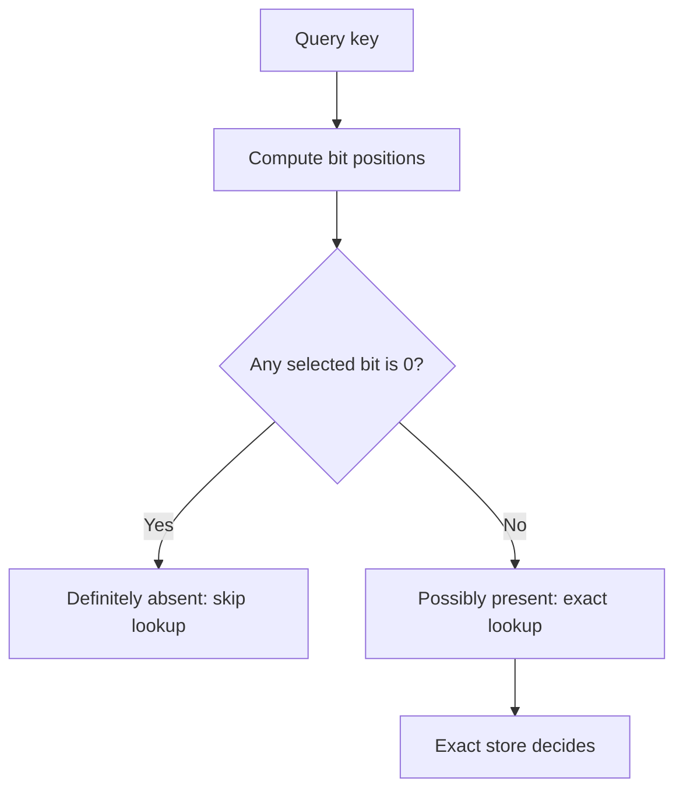

# Bloom Filter

## Overview

A **Bloom filter** is a compact membership precheck. It answers **definitely absent** or **possibly present**. When correctness matters, a possible match still needs an exact lookup.

**Prerequisites:** [arrays](../Array/README.md), [hash functions and collisions](../hash-table/README.md), and basic probability for the optional sizing calculation. After this lesson, you can trace a false positive, estimate memory, and explain when a filter may safely skip a storage lookup.

<span id="learning-steps" />

## Why It Exists

Imagine checking a large file for a key that usually is not there. An exact lookup may read storage even to return “not found.” A small in-memory filter can reject many absent keys first. An exact set is simpler when it fits the memory budget; a filter is useful when avoided lookups justify its memory and CPU cost.

## Mental Model

Think of a shared checklist. Each key marks several positions, but the marks do not record who made them. A missing mark rules a key out; a complete set of marks could have come from other keys. Even **one inserted key** can produce a false positive for another key with the same positions.

The **no-false-negative guarantee** means an inserted key will not be reported absent, provided insertion completed, no required bits were cleared or lost, and queries use the same key encoding and hash configuration. It says nothing about a database key that never reached the filter.

## Visual Explanation

This decision flow assumes a filter built from every key in one fixed dataset:



Only the zero-bit branch saves a lookup. The all-ones branch includes both real matches and **false positives**: keys absent from the dataset that pass the filter.

<span id="algorithm-description" />
<span id="operations" />
<span id="making-the-filter" />

## How It Works

Allocate `m` zero bits. A fixed hash scheme maps each key to `k` positions from `0` through `m - 1`. Hashing must be deterministic: the same encoded key and configuration produce the same positions.

### Insertion

Set all `k` selected bits to `1`. Inserting the same key again leaves the bit array unchanged. Different keys may share positions.

### Search

Compute the same positions. Stop at the first `0` and return “definitely absent.” If every position contains `1`, return “possibly present.” The filter stores neither the original keys nor their values, so it cannot enumerate or retrieve them.

Insertion and lookup take O(k) bit operations plus hashing cost. Space is `m` bits, excluding metadata. Calling lookup O(1) assumes bounded `k` and key length.

### Trace a collision

Use `m = 8`, `k = 3`, and the illustrative positions below. Read each bit string from index 0 on the left to index 7 on the right.

| Action and selected positions | Result |
| --- | --- |
| Start empty | `00000000` |
| Add `tea`: 1, 4, 6 | `01001010` |
| Add `coffee`: 2, 4, 7 | `01101011` |
| Query `cocoa`: 1, 2, 7 | All are 1: false positive |
| Query `milk`: 0, 4, 6 | Position 0 is 0: definitely absent |

The following **runnable teaching example** reproduces that trace. The position table stands in for hashing and accepts only these four keys; `Uint8Array` uses one byte per logical bit here. It is not a general-purpose or bit-packed filter.

```js runnable
const positions = new Map([
  ['tea', [1, 4, 6]],
  ['coffee', [2, 4, 7]],
  ['cocoa', [1, 2, 7]],
  ['milk', [0, 4, 6]],
]);
const bits = new Uint8Array(8);
const exact = new Set();

function positionsFor(key) {
  if (!positions.has(key)) throw new RangeError('Unknown teaching key');
  return positions.get(key);
}

function add(key) {
  for (const index of positionsFor(key)) bits[index] = 1;
  exact.add(key); // Separate reference set, not part of the filter.
}

function mightContain(key) {
  return positionsFor(key).every(index => bits[index] === 1);
}

add('tea');
console.log(bits.join(''));
add('coffee');
console.log(bits.join(''));
for (const key of positions.keys()) {
  console.log(key, mightContain(key), exact.has(key));
}
```

```text output
01001010
01101011
tea true true
coffee true true
cocoa true false
milk false false
```

<span id="applications" />

## Real-World Example

Assume an immutable storage file has one million distinct keys. Build its filter from those keys and publish the file and filter together. Every possible match still searches the file, so false positives cost extra work without changing the answer. RocksDB uses filters with sorted storage files for this purpose. [RocksDB filter lifecycle](https://github.com/facebook/rocksdb/wiki/RocksDB-Bloom-Filter#life-cycle).

For an illustrative workload of 10,000 lookups, assume 9,000 keys are absent and the filter has a 1% false-positive probability on those queries. Expect about 90 absent queries to pass, plus all 1,000 present queries: approximately 1,090 exact lookups instead of 10,000. These are expected counts, not latency measurements; filter checks and cache behavior also cost time.

<span id="false-positives" />

### Size the filter

For `n` distinct inserted keys, `m` bits, and `k` probes, the usual estimate is:

```text
false-positive probability p ≈ (1 - exp(-k * n / m))^k
bits needed m ≈ -n * ln(p) / (ln(2))^2
probes k ≈ (m / n) * ln(2)
```

These are approximations assuming well-distributed, effectively independent hash positions. Round to usable storage and an integer `k`, then recompute the estimate. Here `p` is conditional on a key being absent; it is not the fraction of all positive answers that are wrong. [Bloom filter analysis and parameter choice](https://graphics.stanford.edu/courses/cs321/Private/Readings/bloomfilters.pdf).

<details>
<summary>Reproduce the memory budget for one million keys</summary>

Round the estimated bits per key up to a whole number. This example allocates 10 bits per key and uses 7 probes. The byte estimate covers only a packed bit array, not metadata or the teaching implementation above.

```js runnable
const n = 1_000_000;
const target = 0.01;
const bitsPerKey = Math.ceil(-Math.log(target) / Math.log(2) ** 2);
const m = n * bitsPerKey;
const k = Math.round((m / n) * Math.log(2));
const estimate = count => (1 - Math.exp(-k * count / m)) ** k;

console.log(`bits: ${m}, probes: ${k}`);
console.log(`packed MiB: ${(Math.ceil(m / 8) / 2 ** 20).toFixed(2)}`);
console.log(`at capacity: ${(100 * estimate(n)).toFixed(2)}%`);
console.log(`at twice capacity: ${(100 * estimate(2 * n)).toFixed(2)}%`);
```

```text output
bits: 10000000, probes: 7
packed MiB: 1.19
at capacity: 0.82%
at twice capacity: 13.78%
```

Doubling the distinct keys without increasing memory sharply increases unnecessary lookups. Adding more probes alone is not a fix: beyond the optimum, they fill more bits and can increase false positives. Measure the chosen implementation with representative absent keys.

</details>

## Trade-offs

| Choice | When it fits; main cost |
| --- | --- |
| Exact set or hash table | Exact membership, deletion, or enumeration; retains keys and pays their storage cost |
| Standard Bloom filter | Compact rejection of absent keys; possible matches need verification, and individual deletion is unsafe |
| Counting Bloom filter | Needs deletion of known inserted items; counters use more memory and require overflow and update discipline |

A counting filter replaces bits with counters. Never decrement merely because a query says “possibly present”: deleting a false positive can damage other keys' membership evidence. [Counting filter mechanics](https://www.eecs.harvard.edu/~michaelm/postscripts/dimacs-chapter-08.pdf).

## Failure Scenarios

**Common mistakes** are treating “possibly present” as proof, assuming the filter contains every recent database write, or clearing bits to delete a key.

| Trigger and symptom | Detection and recovery |
| --- | --- |
| Clear shared bits; a retained key becomes absent | Check known retained keys. Rebuild from exact data; standard filters have no safe per-key clear operation |
| A database insert is visible before its filter update; reads miss a real key | Compare sampled negative answers with the database and monitor update lag. Bypass negative shortcuts until coverage is restored |
| Exceed planned capacity; more absent queries reach storage | Track distinct-key estimates, set-bit fraction, and measured false positives. Rebuild larger from source keys |
| Change encoding, seed, or hash version; old keys probe different positions | Verify filter metadata and known-key checks. Reject incompatible filters and use exact lookups while rebuilding |

Keeping bits after a source deletion is safe for membership correctness when positive answers still receive exact verification; it can waste lookups. Resizing cannot just append zero bits: changing `m` changes positions, so rebuild from the original keys.

## Production Considerations

- **Coverage before shortcuts:** immutable file/filter pairs give a clear boundary. With mutable data, coordinate writes so every visible key is covered before allowing negative results to skip storage. During rebuilds or uncertain recovery, use exact reads.
- **Update safety:** concurrent read-modify-write operations on a packed byte can lose each other's bits. Use the library's synchronization contract or publish immutable filters; a partially applied insertion is not covered by the guarantee.
- **Observe useful work:** count filter negatives, positives, and exact misses after positives. False positives divided by all truly absent queries estimates the false-positive rate; dividing by all positives measures a different quantity. Sample negatives against the source to detect missing coverage.
- **Bound the cost:** budget memory, rebuild work, and fallback storage capacity. A filter does not authorize a request, and chosen queries can repeatedly hit false positives. Keep [rate limiting](../../system-design/services/rate-limiting.md) independent of filter effectiveness.

For integration, continue with [absent-key caching](../../system-design/data/caching.md#absent-keys-eviction-and-durable-cache-state) and [crawler completeness](../../system-design/data/search.md#collection-indexing-and-retrieval).

## Exercises

1. **Recall:** Can one inserted key cause a false positive? Give a pair of matching position lists.
2. **Trace:** After adding `tea` and `coffee`, clear positions 1, 4, and 6 to “delete tea.” What happens when querying `coffee`?
3. **Apply:** Of 50,000 queries, 80% are absent. With a 2% false-positive probability, how many exact lookups do you expect?
4. **Debug:** A fresh database key returns “not found,” but bypassing the filter finds it. What invariant failed, and what is the immediate recovery?

<details>
<summary>Check your reasoning</summary>

1. Yes. Two distinct keys can both select `[1, 4, 6]`; the filter cannot distinguish them.
2. `coffee` selects `[2, 4, 7]`. Clearing shared position 4 creates a false negative for a key still present.
3. There are 40,000 absent queries: expect 800 false positives plus 10,000 real matches, or 10,800 exact lookups. This assumes complete coverage and stable query probabilities.
4. The filter does not cover the visible dataset, or its bits/configuration are wrong. Bypass negative shortcuts, inspect update lag and metadata, then rebuild or catch up before enabling them again.

</details>

**Revision checklist:** without looking above, explain both answers, trace a shared bit, state the guarantee's assumptions, distinguish bits from bytes, and name a recovery path for stale coverage.

## Interview Questions & Answers

<details>
<summary>Fundamentals: Why does a zero prove absence, while all ones cannot prove presence?</summary>

Insertion sets every selected bit. A zero contradicts a completed insertion under the same configuration. Ones contain no ownership information, so unrelated keys may have set all of them. Use the [collision trace](#trace-a-collision) to demonstrate both outcomes.

</details>

<details>
<summary>Design: Would you use a Bloom filter as the only record of processed payments?</summary>

No. A false positive could suppress a new payment. Use durable exact idempotency records and atomic uniqueness enforcement for the decision. A filter may accelerate lookups only if its coverage and verification rules preserve that exact decision; see [idempotency](../../system-design/interfaces/api-design.md#idempotency).

</details>

<details>
<summary>Operations: Why might adding a filter make a service slower?</summary>

Mostly-present workloads avoid few exact lookups while still paying hashing and memory-access costs. Saturation, poor hash distribution, cache pressure, or expensive rebuilds can erase the benefit. Compare end-to-end latency and storage work under the real workload, including filter failure and fallback.

</details>

**Interview cheat sheet:** answer contract → coverage invariant → `m / n` bits per key → `k` probes → exact verification → rebuild and fallback. Use the [sizing model](#size-the-filter) and [failure scenarios](#failure-scenarios) to justify each choice.

## Key Takeaways

- A Bloom filter saves work by rejecting absent keys; positive answers need a policy for verification.
- Its guarantee is relative to completed insertions and intact, compatible state.
- Capacity, freshness, and fallback determine whether the optimization remains useful and correct.

<span id="references" />

## Further Reading

- [Broder and Mitzenmacher: Network Applications of Bloom Filters](https://graphics.stanford.edu/courses/cs321/Private/Readings/bloomfilters.pdf) — mathematical model and space/error trade-offs.
- [RocksDB Bloom Filter](https://github.com/facebook/rocksdb/wiki/RocksDB-Bloom-Filter) — storage integration, lifecycle, and measurements.
- [Kirsch, Mitzenmacher, and Varghese: Hash-Based Techniques for High-Speed Packet Processing](https://www.eecs.harvard.edu/~michaelm/postscripts/dimacs-chapter-08.pdf) — Bloom filters and counting variants.

**Next:** [exact key lookup and collisions](../hash-table/README.md).
