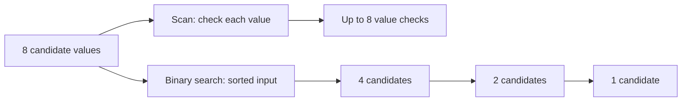

# Time, memory, and correctness

**Before this lesson:** read [JavaScript for DSA](./javascript-for-dsa.md) through loops and arrays. You need addition, multiplication, and the idea of a list. A **problem** describes a desired result. An **algorithm** is a finite set of steps that produces it for every allowed input.

Imagine looking for a name in a class register. Reading each name works. If the names are sorted, opening near the middle lets you discard half of the remaining names. Both methods can be correct, but their work grows differently as the register grows.

## Learning steps

Before measuring seconds, count actions. Comparing two approaches on the same input makes the meaning of “faster as data grows” concrete.

1. Count visits in one loop, then in consecutive and nested loops.
2. Separate work done from memory kept alive.
3. Explain why the steps produce the right answer for every allowed input.



The arrows on the lower branch show shrinking candidate groups, not elapsed seconds. The sorted-input assumption is what makes removing half safe.

## Count work before counting seconds

Let `n` be the number of items. **Time complexity** describes how the amount of work grows with `n`. It does not predict a fixed number of seconds: computers, language engines, and inputs differ.

```text
Find 7 in an unsorted array:
index     0    1    2    3
value   [ 4 ][ 2 ][ 7 ][ 9 ]
check     1 -> 2 -> 3         found

Find 8 in the same array:
check     1 -> 2 -> 3 -> 4    absent
```

An index is a position; a value is what that position holds. The successful example makes three comparisons. An absent target needs all four. For `n` items, the worst case uses `n` comparisons.

```js runnable
function findIndex(values, target) {
  for (let index = 0; index < values.length; index++) {
    if (values[index] === target) return index;
  }
  return -1;
}

console.log(findIndex([4, 2, 7, 9], 7));
console.log(findIndex([4, 2, 7, 9], 8));
console.log(findIndex([], 8));
```

```text output
2
-1
-1
```

The function returns a position, not the number of comparisons. `-1` means no valid position exists. It reads but does not change the array.

## What O means

`O(n)` means the work is bounded above by a constant multiple of `n` once inputs are large enough. We usually report a useful tight upper bound: a scan is O(n), even though O(n²) would also be a loose upper bound. `Θ(n)` says growth is bounded both above and below by constant multiples of `n`; you may see it in formal descriptions.

Drop fixed multipliers and smaller terms when naming growth: `3n + 5` is O(n), and `n² + n` is O(n²). Keep those costs in mind when comparing implementations with the same growth rate.

| Growth | Intuition | Work units at n = 1,000 | Typical example |
| --- | --- | --- | --- |
| O(1) | Fixed work | 1 | Read one array position |
| O(log n) | Repeatedly halve the candidates | About 10 halvings | Binary search |
| O(√n) | Try possible factors up to the square root | About 32 candidates | Trial division |
| O(n) | Visit each item | 1,000 | Scan for a maximum |
| O(n log n) | About log n work per item | About 10,000 | Merge sort |
| O(n²) | Consider pairs | About 1,000,000 | Two nested full scans |
| O(n · 2ⁿ) | Copy every yes/no selection | Already enormous | Materialize all subsets |
| O(n · n!) | Copy every ordering | Already enormous | Materialize all permutations |

These are growth illustrations, not judge timing guarantees. A billion operations will usually be a warning sign; there is no universal “operations per second” budget. Read each problem's size, time, and memory limits.

## Loops: add consecutive work, multiply repeated work

Two separate scans of `n` items cost `n + n`, so O(n). A scan inside another full scan costs `n × n`, so O(n²). If the inner scan visits only positions after the outer position, the count is `(n - 1) + (n - 2) + ... + 1 = n(n - 1)/2`, still O(n²).

A nested loop is not automatically quadratic. In a [sliding window](./sliding-window/README.md), both boundaries only move forward. Across the whole algorithm, the right boundary moves at most `n` times and the left at most `n` times: O(n) total moves.

**Logarithm in plain English:** how many times can you halve a positive quantity before reaching one? For 16 candidates: `16 → 8 → 4 → 2 → 1`, four halvings. This is `log₂(16) = 4`. Other fixed logarithm bases differ by a constant factor, so complexity tables usually write `log n`.

**Square root in plain English:** the number that multiplies by itself to give `n`. If `n = a × b`, both factors cannot exceed `√n`; their product would exceed `n`. This is why [factor tests](./math/primality-test/README.md) can stop there.

## Memory: count what remains alive

**Auxiliary space** means extra working memory beyond the input and required output. **Total space** includes those too. Say which you mean.

| Algorithm action | Extra memory under the usual model |
| --- | --- |
| Keep an index and running sum | O(1) |
| Copy an n-item array | O(n) |
| Store an n-by-m table | O(nm) |
| Recurse down a chain of n nodes | O(n) call frames |
| Keep a BFS queue of up to V vertices | O(V) |

An implementation can save time by storing previous work. A frequency map uses more memory than repeatedly scanning, but often reduces quadratic time to expected linear time. Count the actual entries, including keys and copies.

For JavaScript, ordinary arrays do not promise contiguous storage; we use the standard indexed-array cost model for dense arrays. Map/Set lookups are treated as expected constant time in this course's hash-table analyses, not a language-guaranteed worst-case bound. Built-in sort complexity depends on the engine. BigInt arithmetic grows with the number of digits; it is not constant time for arbitrarily large values.

## Worst case, expected, and amortized are different

**Worst case:** the largest cost among inputs of the same size. Linear search is O(n) worst case but O(1) best case when the first item matches.

**Expected:** an average over an explicitly stated source of randomness or input distribution. Do not assume favorable inputs without a reason.

**Amortized:** spread expensive operations over a whole sequence, without assuming random input. Dynamic arrays sometimes need to grow. In a doubling model, copying `1 + 2 + 4 + ...` old items costs less than twice the final capacity. A long sequence of appends therefore averages O(1) per append, although one append can cost O(n). The [queue lesson](./queue/README.md) applies this reasoning to occasional compaction.

## Why is a solution correct?

Testing checks chosen inputs. A **correctness argument** explains all allowed inputs. Start with three short questions:

1. **Before:** what is true before the first step?
2. **During:** why does each step keep the needed fact true?
3. **After:** why does stopping give the required answer?

For `findIndex`, the **invariant** is: before checking position `index`, every earlier position has been checked and does not contain `target`. Initially there are no earlier positions. A failed comparison extends this fact by one position. A successful comparison returns the first match. If the loop ends, all positions failed, so `-1` is correct. The index increases and is bounded by the array length, so the loop terminates.

Later proofs use the same shape: a [binary search](./binary-search/README.md) keeps all possible answers in its interval; [BFS](./graphs/breadth-first-search/README.md) processes distances in order; [DP](./dp/README.md) builds states from already-correct smaller states.

## Understanding checks

1. A function scans `n` items, then sorts them with an O(n log n) algorithm. What is its total time?
2. A recursive function does O(1) work, makes one call on `n - 1`, and stops at zero. What are its time and auxiliary space?
3. A graph has `V` vertices and `E` edges. Why is visiting all neighbor lists O(V + E), rather than always O(V²)?
4. Why can testing only `[1, 2, 3]` fail to reveal a wrong maximum algorithm initialized with `maximum = 0`?

<details>
<summary>Hints</summary>

Add consecutive phases. Count live calls as well as work. An adjacency list stores existing edges. Try all-negative values.

</details>

<details>
<summary>Answers and reasoning</summary>

1. O(n + n log n) = O(n log n). Sorting dominates for growing n.
2. O(n) time and O(n) call-stack space. JavaScript may overflow its call stack before memory analysis alone suggests a problem. An iterative version can use O(1) auxiliary space.
3. You visit each vertex once and each stored adjacency entry once. An undirected edge is stored twice, a constant factor. Only a dense graph necessarily has on the order of V² edges.
4. For `[-5, -2]`, zero is not even in the input. Initialize from a real first item, or define a suitable sentinel and handle empty input explicitly.

</details>

**Next:** [programming basics](./school-basics/README.md), then [arrays](./Array/README.md). Keep this cost model beside you while reading every later chapter.

**Next:** [first complete problems](./school-basics/README.md).
