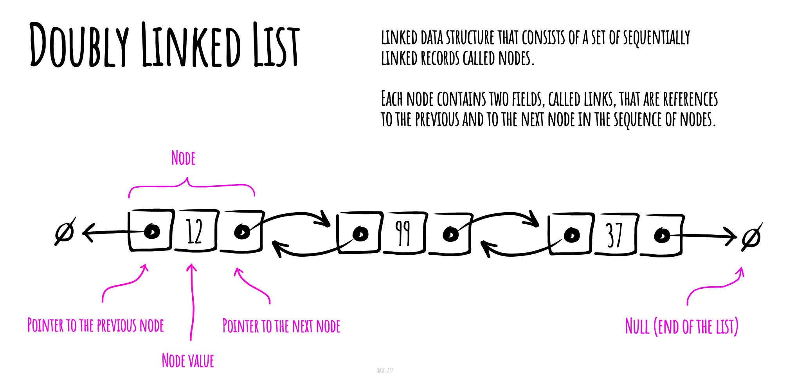

# Doubly Linked List

A doubly linked list is a chain you can follow in both directions. Each node stores a value, a `next` link, and a `previous` link.

For `A ↔ B ↔ C`, removing the known node B means linking A directly to C in both directions. This takes O(1) link changes. Finding B first can still take O(n) time.



_Made with [okso.app](https://okso.app)_

Check the ends separately: removing the head or tail changes the list's stored endpoint. Removing its only node makes both endpoints empty.

## Learning steps

A browser-history model needs both “back” and “forward.” Two links per node let a list move in either direction.

1. Draw the head, tail, next, and previous links.
2. Trace insertion and removal in the middle and at both ends.
3. Remove the only node and check that both endpoints become empty.

## JavaScript for Basic Operations {/* #pseudocode-for-basic-operations */}

The list owns `head` and `tail`. Each node has `{ value, next, previous }`. Empty endpoints are `null`. The class below appends a value, removes its first strict-equality match, and walks backward without changing the list.

```js runnable
class DoublyLinkedList {
  head = null;
  tail = null;

  append(value) {
    const node = { value, next: null, previous: this.tail };
    if (this.tail === null) this.head = node;
    else this.tail.next = node;
    this.tail = node;
  }

  remove(value) {
    let node = this.head;
    while (node !== null && node.value !== value) node = node.next;
    if (node === null) return false;

    if (node.previous === null) this.head = node.next;
    else node.previous.next = node.next;
    if (node.next === null) this.tail = node.previous;
    else node.next.previous = node.previous;

    node.next = null;
    node.previous = null;
    return true;
  }

  *reverseValues() {
    for (let node = this.tail; node !== null; node = node.previous) {
      yield node.value;
    }
  }
}

const list = new DoublyLinkedList();
list.append('A');
list.append('B');
list.append('C');
console.log(list.remove('B'));
console.log([...list.reverseValues()].join(','));
list.remove('A');
list.remove('C');
console.log(list.head === null && list.tail === null);
console.log(list.remove('missing'));
```

```text output
true
C,A
true
false
```

### Insert

`append` connects the old tail to the new node and the new node back to the old tail. For the first insertion, both endpoints refer to that one node.

### Delete

`remove` searches forward. Once it finds the value, it joins the two neighbors. A missing neighbor means an endpoint must change. Removing the only node sets both endpoints to `null`; a missing value returns `false` without changing the list.

### Reverse Traversal

`reverseValues` follows `previous` links from the tail. It takes O(n) time and O(1) extra traversal space. Collecting the results with spread, as above, creates an O(n) output array.

## Complexities

### Time Complexity

| Access | Search | Insertion | Deletion |
| :----: | :----: | :-------: | :------: |
|  O(n)  |  O(n)  |   O(1)    |   O(n)   |

Insertion here means appending to a known tail. Deletion includes searching for the value; unlinking an already known node takes O(1).

### Space Complexity

O(n) for the stored nodes.

## Practice Problems

{/* BEGIN GENERATED PRACTICE PROBLEMS */}

| Problem | Level / priority | Practice / notes | Example / answer |
| --- | --- | --- | --- |
| [LC 430 — Flatten a Multilevel Doubly Linked List](https://leetcode.com/problems/flatten-a-multilevel-doubly-linked-list/) | Medium | [LeetCode](https://leetcode.com/problems/flatten-a-multilevel-doubly-linked-list/) | — |
| [LC 1472 — Design Browser History](https://leetcode.com/problems/design-browser-history/) | Medium | [LeetCode](https://leetcode.com/problems/design-browser-history/) | — |
| [LC 432 — All O\`one Data Structure](https://leetcode.com/problems/all-oone-data-structure/) | Hard | [LeetCode](https://leetcode.com/problems/all-oone-data-structure/) | — |
| [LC 460 — LFU Cache](https://leetcode.com/problems/lfu-cache/) | Hard | [LeetCode](https://leetcode.com/problems/lfu-cache/) | — |
| G46 — Convert an ordered tree into a doubly linked list. | Exercise | Trees and BSTs. Related only: [LC 426](https://leetcode.com/problems/convert-binary-search-tree-to-sorted-doubly-linked-list/) - Convert Binary Search Tree to Sorted Doubly Linked List. Requires the resulting doubly linked list to be circular. | — |

{/* END GENERATED PRACTICE PROBLEMS */}

## References

- [Wikipedia](https://en.wikipedia.org/wiki/Doubly_linked_list)
- [YouTube](https://www.youtube.com/watch?v=JdQeNxWCguQ&t=7s&index=72&list=PLLXdhg_r2hKA7DPDsunoDZ-Z769jWn4R8)

**Next:** [stacks](../stack/README.md).
