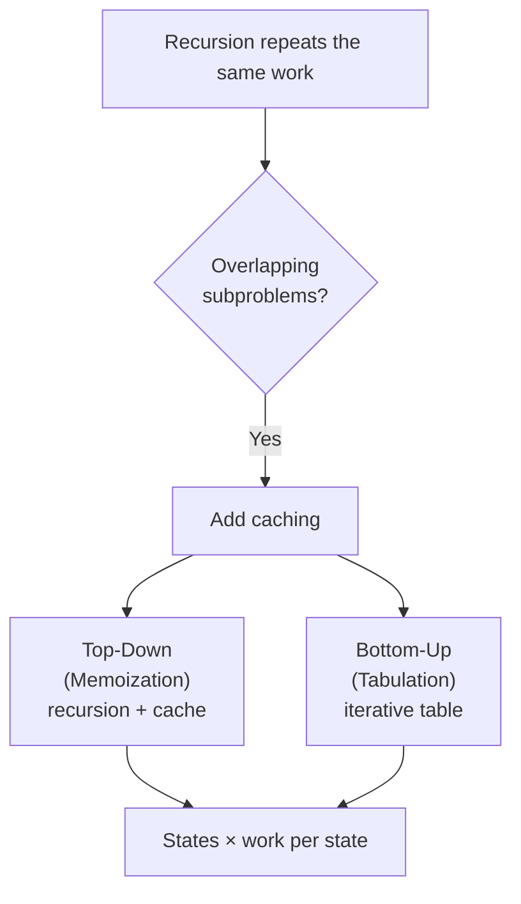

import PracticeProblem from '@site/src/components/PracticeProblem';

import AlgorithmWalkthrough from '@site/src/components/AlgorithmWalkthrough';

# 🧠 Dynamic Programming

**Prerequisites:** [recursion](../recursion/README.md), arrays, and [counting work](../complexity.md). Learn the full table before compressing it.

Dynamic programming saves answers to smaller problems so you can reuse them. First decide exactly what each saved answer means; then work out how to build the next answer.

---


<AlgorithmWalkthrough name="dp" />

## Learning steps

When many ways of making change ask for the best answer for the same smaller amount, calculate that smaller answer once and reuse it.

1. Describe one table entry in a complete sentence.
2. Write the smallest case and the rule that combines earlier answers.
3. Fill a full table before reducing its memory or adding more state dimensions.

## 🎯 Concept

**Dynamic programming (DP)** gives each smaller problem a clear meaning, saves its answer, and reuses that answer later. Two useful ideas are:

1. **Build from smaller answers:** for an optimization problem, the best answer can be built from best answers to smaller problems. For counting, combine the smaller counts.
2. **Repeated work:** the same smaller problem would otherwise be solved more than once.



### Top-Down vs Bottom-Up

| Aspect    | Top-Down (Memoization)          | Bottom-Up (Tabulation)             |
| --------- | ------------------------------- | ---------------------------------- |
| Style     | Recursion + cache               | Iterative table filling            |
| Order     | Solves on demand                | Solves all states in order         |
| Space     | O(states) + call stack          | O(states), often space-optimizable |
| Intuition | Mirrors the recurrence | Avoids recursion overhead but may compute unused states |

### Common DP Categories

1D DP · 2D / grid DP · Knapsack (take / not-take) · LIS · LCS / DP on strings · DP on stocks · Partition / interval DP · Bitmask DP.

## Derive the state before writing the table

Use the [pattern guide](../patterns.md#greedy-or-dp) to decide whether a greedy proof or repeated subproblems drive the solution. For counting and reachability problems, a recurrence combines subproblem results without necessarily optimizing a value.

| Design step | House Robber example |
| --- | --- |
| Contract | Nonnegative house values; adjacent houses cannot both be chosen; empty input returns 0. |
| State | `best[i]` is the maximum value from the first i houses. |
| Transition | Skip house i: `best[i - 1]`; take it: `best[i - 2] + value`. Keep the larger result. |
| Base cases | `best[0] = 0`; `best[1]` is the first house value. |
| Evaluation order | Increasing i, since the recurrence needs the preceding two states. |
| Space reduction | Keep two previous values after verifying that older states are never read again. |

For capacity-based knapsack, O(nW) is **pseudo-polynomial** because W is a numeric value, not its bit length. Bitmask DP may have 2^n states. Caching removes repeated evaluation; it does not guarantee a small state space.

---

## ⚡ Time & Space Complexity

| Pattern                            | Time       | Space              |
| ---------------------------------- | ---------- | ------------------ |
| 1D DP (house robber, climb stairs) | O(n)       | O(1) optimised     |
| 2D DP (grid / string)              | O(m·n)     | O(n) row-optimised |
| 0/1 Knapsack                       | O(n·W)     | O(W)               |
| LIS (DP)                           | O(n²)      | O(n)               |
| LIS (patience/binary search)       | O(n log n) | O(n)               |
| LCS                                | O(m·n)     | O(m·n)             |

**Key Insight**: The number of **distinct states** × **work per state** = total time. Optimize space by keeping only the states you still need (e.g., last row/two variables).

---

## Common Patterns

### 1D DP — House Robber

```javascript
function rob(nums) {
  let prev2 = 0,
    prev1 = 0;
  for (const n of nums) {
    const curr = Math.max(prev1, prev2 + n);
    prev2 = prev1;
    prev1 = curr;
  }
  return prev1;
}
// State: best loot up to house i. Time O(n), Space O(1).
```

### 2D DP — Edit Distance (Levenshtein)

```javascript
function editDistance(w1, w2) {
  const m = w1.length,
    n = w2.length;
  const dp = Array.from({ length: m + 1 }, (_, i) =>
    Array.from({ length: n + 1 }, (_, j) => (i === 0 ? j : j === 0 ? i : 0)),
  );
  for (let i = 1; i <= m; i++)
    for (let j = 1; j <= n; j++)
      dp[i][j] =
        w1[i - 1] === w2[j - 1]
          ? dp[i - 1][j - 1]
          : 1 + Math.min(dp[i - 1][j - 1], dp[i - 1][j], dp[i][j - 1]);
  return dp[m][n];
}
// Time O(m*n), Space O(m*n).
```

### 0/1 Knapsack — take / not-take

```javascript
function knapsack(weights, values, W) {
  const dp = new Array(W + 1).fill(0);
  for (let i = 0; i < weights.length; i++)
    for (let w = W; w >= weights[i]; w--)
      // iterate backwards for 0/1
      dp[w] = Math.max(dp[w], dp[w - weights[i]] + values[i]);
  return dp[W];
}
// Time O(n*W), Space O(W).
```

### LIS — Longest Increasing Subsequence O(n log n)

```javascript
function lengthOfLIS(nums) {
  const tails = [];
  for (const x of nums) {
    let lo = 0,
      hi = tails.length;
    while (lo < hi) {
      const mid = lo + Math.floor((hi - lo) / 2);
      if (tails[mid] < x) lo = mid + 1;
      else hi = mid;
    }
    tails[lo] = x;
  }
  return tails.length;
}
// Binary search keeps the smallest tail per length. Time O(n log n).
```

---

## 🧪 Worked Example: Coin Change (min coins)

> Given coin denominations and an amount, find the fewest coins to make it.

```js runnable
function coinChange(coins, amount) {
  const dp = new Array(amount + 1).fill(Infinity);
  dp[0] = 0; // 0 coins to make amount 0
  for (let a = 1; a <= amount; a++) {
    for (const coin of coins) {
      if (coin <= a) dp[a] = Math.min(dp[a], dp[a - coin] + 1);
    }
  }
  return dp[amount] === Infinity ? -1 : dp[amount];
}
// dp[a] = fewest coins to form amount a. Time O(amount * coins), Space O(amount).

console.log(coinChange([1, 3, 4], 6));
console.log(coinChange([2], 3));
console.log(coinChange([2], 0));
```

```text output
2
-1
0
```

Contract: denominations are positive integers; amount is a nonnegative integer. A zero or negative denomination breaks the dependency argument. Unreachable states stay at `Infinity`; amount zero requires no coins.

**Recurrence**: `dp[a] = min(dp[a - coin] + 1)` over all coins that fit — optimal substructure (best for `a` uses the best for `a - coin`) and overlapping subproblems (`dp[a - coin]` reused).

---

## From basic to advanced states

For the runnable coin example, the saved values for amounts 0 through 6 are `[0, 1, 2, 1, 1, 2, 2]`. At amount 6, using a last coin of 1, 3, or 4 gives candidates 3, 2, and 3 coins. Choosing 3 as the last coin leaves the already-solved amount 3, so the answer is 2. Greedily taking coin 4 first would need three coins: 4 + 1 + 1.

Complete the [knapsack](../sets/knapsack-problem/README.md), [longest common subsequence](../sets/longest-common-subsequence/README.md), and [edit distance](../strings/levenshtein-distance/README.md) examples, then study [interval, tree, and subset DP](./advanced.md). Learn bit masks before the subset chapter. These lessons include full state definitions, proof arguments, runnable code, and reconstruction exercises.

## Pitfalls

- **Wrong iteration order**: 0/1 knapsack must iterate capacity **backwards**; unbounded knapsack forwards.
- **Uninitialized base cases**: forgetting `dp[0]` leads to wrong answers.
- **Not space-optimizing**: many 2D DPs only need the previous row.
- **Confusing subsequence vs substring**: contiguity changes the recurrence.

---

## Worked examples and answers {/* #workbook-practice */}

Attempt the linked [Practice Problems](#practice-problems) before opening their answers. See the [workbook guide](../../javascript/workbook.md) for the A–C exercise format.

### 46. Dynamic programming patterns and state design {/* #workbook-46 */}

<details>
<summary>Worked lesson and setup</summary>

**Goal:** derive the saved answer before choosing a table or cache.

Review [state design](#derive-the-state-before-writing-the-table) and the coin-change example above. For minimum coin count, `dp[a]` means the fewest coins making amount a. Its last coin c leaves amount a−c, so consider `dp[a−c] + 1` for every allowed last coin. Zero needs zero coins; an unreachable amount starts at Infinity. This covers every possible last choice.

Loop order expresses reuse rules. Unbounded coins may be reused; [0/1 knapsack](../sets/knapsack-problem/README.md) visits capacities downward when compressing the table to prevent reuse within one item’s pass. Coin-outer counting typically counts combinations, while amount-outer counting can count ordered sequences. Define what makes two answers different first.

[Longest common subsequence](../sets/longest-common-subsequence/README.md) and [edit distance](../strings/levenshtein-distance/README.md) use two prefix lengths. [Longest increasing subsequence](../sets/longest-increasing-subsequence/README.md) contrasts a quadratic ending-at-i table with a faster boundary method; its boundary array is not automatically the actual answer sequence.

Study [interval, tree, and subset states](./advanced.md) only after the basic table is clear. A state must include everything that changes future choices. Estimate work from the number of states and transitions; include stored answers and recursion depth when counting memory.

**Worked example**

```js
function minCoins(coins, amount) {
  const dp = Array(amount + 1).fill(Infinity);
  dp[0] = 0;
  for (let a = 1; a <= amount; a++) {
    for (const coin of coins) {
      if (coin <= a) dp[a] = Math.min(dp[a], dp[a - coin] + 1);
    }
  }
  return dp[amount] === Infinity ? -1 : dp[amount];
}
console.log(minCoins([1, 3, 4], 6));
console.log(minCoins([2], 3));
```

**Expected output**

```text
2
-1
```

**Why the example works**

The contract requires positive integer coin values and a nonnegative integer amount small enough for the table. At amount 6, choosing last coin 3 uses the already solved amount 3 and yields two coins. With only coin 2, every odd amount remains unreachable. Time is O(amount times coin count), with O(amount) storage.

</details>

Find **46A–C** in the [Practice Problems](#practice-problems) table.

<details id="workbook-46-answer">
<summary>Check your reasoning and answer</summary>

For Node checks, add `import assert from "node:assert/strict";` at the top of your file. Browser and multi-file examples use the setup stated above.

**46A.** The empty choice is a valid way to make zero. It anchors reachable one-coin states; using Infinity would incorrectly make every amount unreachable.

**46B.** Downward iteration reads smaller-capacity states from before the current item was included. Upward iteration can reuse an already updated state and thereby include the same item multiple times.

**46C.** Every element can begin a length-one subsequence. For each earlier strictly smaller value, extend the best subsequence ending there. The maximum ending length is the overall answer, with zero for empty input.

**Reference code**

Use the worked example above first if the answer calls its functions or classes. Run each lesson in its own `.mjs` file.

```js
function lisLength(values) {
  const dp = Array(values.length).fill(1);
  let best = 0;
  for (let i = 0; i < values.length; i++) {
    for (let j = 0; j < i; j++) {
      if (values[j] < values[i]) dp[i] = Math.max(dp[i], dp[j] + 1);
    }
    best = Math.max(best, dp[i]);
  }
  return best;
}
```

**Check the result**

```js
assert.equal(lisLength([10, 9, 2, 5, 3, 7, 101, 18]), 4);
assert.equal(lisLength([2, 2, 2]), 1);
assert.equal(lisLength([]), 0);
assert.equal(minCoins([1, 3, 4], 0), 0);
```

</details>

## Practice Problems

{/* BEGIN GENERATED PRACTICE PROBLEMS */}

| Problem | Level / priority | Practice / notes | Example / answer |
| --- | --- | --- | --- |
| **46A — Why is dp[0] zero rather than Infinity?** | **Must fix** | [Worked example](#workbook-46) | [Answer](#workbook-46-answer) |
| **46B — Why iterate capacities downward in zero-one knapsack?** | **Must fix** | [Worked example](#workbook-46) | [Answer](#workbook-46-answer) |
| **46C — Implement lisLength(values) with the O(n squared) recurrence for strictly increasing subsequences.** | **Must fix** | [Worked example](#workbook-46) | [Answer](#workbook-46-answer) |
| <PracticeProblem id={70} title={"Climbing Stairs"} text={"Problem statement\nA staircase has n steps, with n positive. On each move you may climb either one step or two steps.\nReturn the number of distinct ordered move sequences that land exactly on the top step.\nSequences that use the same moves in different orders count separately.\nInput \u0026 expected result\nA valid sequence starts at ground level and totals exactly n steps without overshooting. Choosing a\none-step move followed by a two-step move differs from choosing those moves in reverse order.\nReturn the number of sequences, not the sequences themselves.\nEXAMPLE 1\nInput: n = 4\nOutput: 5\nExplanation: The five sequences are 1+1+1+1, 1+1+2, 1+2+1, 2+1+1, and 2+2.\nEXAMPLE 2\nInput: n = 3\nOutput: 3\nExplanation: The valid ordered sequences are 1+1+1, 1+2, and 2+1.\nConstraints \u0026 guarantees\n• n: 1 through 45 (inclusive)\nJavaScript starter\nfunction climbStairs(n) {\n  // TODO: write your solution.\n}"} /> | Easy | [LeetCode](https://leetcode.com/problems/climbing-stairs/) | — |
| <PracticeProblem id={746} title={"Min Cost Climbing Stairs"} text={"Problem statement\ncost[i] is paid when using stair i. After paying, you may move up one or two stairs. You may start at\nindex 0 or index 1. Return the minimum total cost to reach the position just beyond the last stair.\nThe starting stair, if used, must also be paid for.\nInput \u0026 expected result\nThe top has index cost.length and carries no cost itself. Pay only for stairs on which you begin a\nmove; skipped stairs cost nothing. Choose whichever permitted starting index leads to the smaller\ntotal cost.\nEXAMPLE 1\nInput: cost = [4,2,7,3]\nOutput: 5, using stairs at indices 1 and 3\nExplanation: Starting at index 1 costs 2, then using index 3 costs 3 before reaching the top,\ntotaling 5.\nEXAMPLE 2\nInput: cost = [10,1]\nOutput: 1\nExplanation: Start on stair 1, pay its cost of 1, and move directly beyond the last stair.\nConstraints \u0026 guarantees\n• cost.length: 2 through 1000 (inclusive)\n• cost[i]: 0 through 999 (inclusive)\nJavaScript starter\nfunction minCostClimbingStairs(cost) {\n  // TODO: write your solution.\n}"} /> | Easy | [LeetCode](https://leetcode.com/problems/min-cost-climbing-stairs/) | — |
| <PracticeProblem id={5} title={"Longest Palindromic Substring"} text={"Problem statement\nReturn a longest nonempty contiguous palindrome in s. The characters must occupy consecutive\npositions, and the string must read the same in both directions. If more than one longest\npalindrome exists, return any one. s is nonempty.\nInput \u0026 expected result\nReturn the palindrome's text rather than its length or its endpoints. Matching is based on exact\ncharacters, including letter case where present. A subsequence that skips characters does not\nqualify as a substring.\nEXAMPLE 1\nInput: s = \"cabbad\"\nOutput: \"abba\"\nExplanation: The consecutive middle characters abba read identically in reverse and are longer\nthan any other palindrome in the input.\nEXAMPLE 2\nInput: s = \"abc\"\nOne valid return: \"a\"\nExplanation: Every single character is a palindrome, and none of the longer substrings is one.\nConstraints \u0026 guarantees\n• s.length: 1 through 1000 (inclusive)\n• Character set: English letters and decimal digits\nJavaScript starter\nfunction longestPalindrome(s) {\n  // TODO: write your solution.\n}"} /> | Medium | [LeetCode](https://leetcode.com/problems/longest-palindromic-substring/) | — |
| <PracticeProblem id={62} title={"Unique Paths"} text={"Problem statement\nA robot starts in the top-left cell of an m by n rectangular grid with no obstacles. Each move goes\nexactly one cell right or one cell down. Return the number of distinct routes to the bottom-right\ncell. Both dimensions are positive, and the starting cell may already be the destination.\nInput \u0026 expected result\nA path consists only of the required rightward and downward moves, in some order. Grid\ndimensions include both endpoint cells. No movement outside the grid, diagonal movement, or\nbackward step is allowed, and every distinct move ordering counts separately.\nEXAMPLE 1\nInput: m = 2, n = 4\nOutput: 4\nExplanation: A 2-by-4 grid requires one down move and three right moves. The down move can\noccupy any of four positions.\nEXAMPLE 2\nInput: m = 1, n = 5\nOutput: 1\nExplanation: Only rightward moves are possible, so there is a single route along the row.\nConstraints \u0026 guarantees\n• m, n: 1 through 100 (inclusive)\nJavaScript starter\nfunction uniquePaths(m, n) {\n  // TODO: write your solution.\n}"} /> | Medium | [LeetCode](https://leetcode.com/problems/unique-paths/) | — |
| <PracticeProblem id={63} title={"Unique Paths II"} text={"Problem statement\nA robot begins at the top-left of obstacleGrid and wants to reach its bottom-right. Cells containing 1\nare blocked; cells containing 0 are usable. The robot moves only right or down. Return the number\nof distinct valid paths. If either endpoint is blocked, there are no valid paths.\nInput \u0026 expected result\nDistinct paths are distinguished by their sequence of moves through usable cells. Obstacles cannot\nbe crossed or occupied. Count routes, not their lengths; for a usable one-cell grid, the zero-move\nroute counts as one valid path.\nEXAMPLE 1\nInput: obstacleGrid = [[0,1],[0,0]]\nOutput: 1\nExplanation: The blocked upper-right cell prevents a right-first route. Moving down and then\nright is the sole valid route.\nEXAMPLE 2\nInput: obstacleGrid = [[1,0],[0,0]]\nOutput: 0\nExplanation: The starting cell is blocked, so no valid route can begin.\nConstraints \u0026 guarantees\n• m == obstacleGrid.length\n• n == obstacleGrid[i].length\n• m, n: 1 through 100 (inclusive)\n• Cell domain: {0, 1}. The path count is at most 2 * 10^9\nJavaScript starter\nfunction uniquePathsWithObstacles(obstacleGrid) {\n  // TODO: write your solution.\n}"} /> | Medium | [LeetCode](https://leetcode.com/problems/unique-paths-ii/) | — |
| <PracticeProblem id={64} title={"Minimum Path Sum"} text={"Problem statement\ngrid is a nonempty rectangle of nonnegative costs. Starting at the top-left cell, reach the\nbottom-right cell by moving only one cell right or down. Return the minimum sum of values along\nsuch a path, counting both the starting and ending cells.\nInput \u0026 expected result\nEach path must remain inside the grid. You cannot move left, up, or diagonally, so revisiting a\nprevious cell is impossible. Return the sum of costs, not the number of moves or the sequence of\ncoordinates.\nEXAMPLE 1\nInput: grid = [[1,4,2],[2,1,1]]\nOutput: 5, for path 1 -\u003e 2 -\u003e 1 -\u003e 1\nExplanation: The path moves down first and then right twice, collecting 1+2+1+1 = 5.\nEXAMPLE 2\nInput: grid = [[5]]\nOutput: 5\nExplanation: The starting cell is already the destination, but its value still contributes to the path\nsum.\nConstraints \u0026 guarantees\n• m == grid.length\n• n == grid[i].length\n• m, n: 1 through 200 (inclusive)\n• grid[i][j]: 0 through 200 (inclusive)\nJavaScript starter\nfunction minPathSum(grid) {\n  // TODO: write your solution.\n}"} /> | Medium | [LeetCode](https://leetcode.com/problems/minimum-path-sum/) | — |
| <PracticeProblem id={72} title={"Edit Distance"} text={"Problem statement\nReturn the minimum number of single-character edits needed to transform word1 into word2. An\nedit may insert one character, delete one character, or replace one character. Each operation costs\none. Either string may be empty, and matching characters need no edit.\nInput \u0026 expected result\nAll edits apply to the current string as it changes. An insertion or deletion can change its length; a\nreplacement cannot. Return the fewest operations among all possible edit sequences, with every\nallowed operation having equal cost.\nEXAMPLE 1\nInput: word1 = \"cat\", word2 = \"cut\"\nOutput: 1\nExplanation: Replacing a with u changes cat to cut in one operation, and no zero-operation\ntransformation is possible.\nEXAMPLE 2\nInput: word1 = \"\", word2 = \"abc\"\nOutput: 3\nExplanation: Starting from an empty string requires inserting all three destination characters.\nConstraints \u0026 guarantees\n• word1.length, word2.length: 0 through 500 (inclusive)\n• Both strings use a-z\nJavaScript starter\nfunction minDistance(word1, word2) {\n  // TODO: write your solution.\n}"} /> | Medium | [LeetCode](https://leetcode.com/problems/edit-distance/) | — |
| <PracticeProblem id={91} title={"Decode Ways"} text={"Problem statement\nDecode a nonempty digit string using A = 1 through Z = 26. Split the entire string into valid\none-digit or two-digit codes and count the possible decodings. A code cannot begin with zero, so\nzero is valid only within 10 or 20. Return 0 when no full decoding exists.\nInput \u0026 expected result\nCodes range from 1 to 26 inclusive and must consume every input digit. Different valid groupings\nproduce different decodings. Do not treat a leading zero as insignificant: strings such as \"06\" do\nnot represent a valid code.\nEXAMPLE 1\nInput: s = \"123\"\nOutput: 3, from 1\u007c2\u007c3, 12\u007c3, and 1\u007c23\nExplanation: The three splits yield letters A,B,C; L,C; and A,W. All consume the entire input using\nvalid codes.\nEXAMPLE 2\nInput: s = \"100\"\nOutput: 0\nExplanation: Using 10 leaves an invalid standalone zero, and no other grouping covers all three\ndigits legally.\nConstraints \u0026 guarantees\n• s.length: 1 through 100 (inclusive)\n• Alphabet: decimal digits, with leading zeros possible in the input\nJavaScript starter\nfunction numDecodings(s) {\n  // TODO: write your solution.\n}"} /> | Medium | [LeetCode](https://leetcode.com/problems/decode-ways/) | — |
| <PracticeProblem id={97} title={"Interleaving String"} text={"Problem statement\nDetermine whether s3 can be formed by interleaving all characters of s1 and s2 while preserving\nthe relative order of characters from each individual source. Characters may switch between\nsources any number of times. Every character from both sources must be used exactly once, so\ntheir lengths must sum to s3.length.\nInput \u0026 expected result\nA source's characters cannot be reordered even when the other source's characters are inserted\nbetween them. Empty source strings are permitted. Return a boolean; matching character\nfrequencies alone does not establish that a valid order-preserving interleaving exists.\nEXAMPLE 1\nInput: s1 = \"ab\", s2 = \"cd\", s3 = \"acbd\"\nOutput: true\nExplanation: Take a from s1, c from s2, then b from s1 and d from s2. Both sources keep their\noriginal order.\nEXAMPLE 2\nInput: s1 = \"ab\", s2 = \"cd\", s3 = \"adbc\"\nOutput: false\nExplanation: The only c and d come from s2, but s3 places d before c, reversing their required\norder.\nConstraints \u0026 guarantees\n• s1.length, s2.length: 0 through 100 (inclusive)\n• s3.length: 0 through 200 (inclusive)\n• All three strings use a-z\nJavaScript starter\nfunction isInterleave(s1, s2, s3) {\n  // TODO: write your solution.\n}"} /> | Medium | [LeetCode](https://leetcode.com/problems/interleaving-string/) | — |
| <PracticeProblem id={120} title={"Triangle"} text={"Problem statement\ntriangle contains rows of lengths 1, 2, 3, and so on. Start at its top and move down one row at a\ntime, from index j to index j or j + 1 in the next row. Return the smallest possible sum along a path\nending in the last row. Values may be negative.\nInput \u0026 expected result\nChoose exactly one entry from each row while respecting the two allowed child positions. Start with\ntriangle[0][0], and include the last-row value in the sum. As a follow-up, target extra space\nproportional to the number of rows.\nEXAMPLE 1\nInput: triangle = [[1],[2,3],[4,5,6]]\nOutput: 7\nExplanation: The path using 1,2,4 has sum 7 and is smaller than every other permitted\ntop-to-bottom path.\nEXAMPLE 2\nInput: triangle = [[-2],[3,1]]\nOutput: -1\nExplanation: Choosing the right child gives -2 + 1 = -1, smaller than the left-child path's sum of\n1.\nConstraints \u0026 guarantees\n• triangle.length: 1 through 200 (inclusive)\n• triangle[0].length == 1\n• triangle[i].length == triangle[i - 1].length + 1\n• triangle[i][j]: -10^4 through 10^4 (inclusive)\nJavaScript starter\nfunction minimumTotal(triangle) {\n  // TODO: write your solution.\n}"} /> | Medium | [LeetCode](https://leetcode.com/problems/triangle/) | — |
| <PracticeProblem id={198} title={"House Robber"} text={"Problem statement\nnums records the nonnegative money stored in houses along a line. You may select houses to rob,\nbut selecting two neighboring houses triggers an alarm. Return the greatest sum obtainable\nwithout selecting adjacent positions. You are allowed to skip any number of houses.\nInput \u0026 expected result\nAdjacency refers to neighboring array positions, not equal money values. The first and last houses\nare not neighbors unless the array has only two houses. Return the maximum amount; reporting\nthe selected indices is unnecessary.\nEXAMPLE 1\nInput: nums = [3,8,4,9]\nOutput: 17, from the houses containing 8 and 9\nExplanation: The houses containing 8 and 9 occupy indices 1 and 3, which are not adjacent, and\ntogether yield 17.\nEXAMPLE 2\nInput: nums = [5,1,1,5]\nOutput: 10\nExplanation: The first and last houses can both be chosen in a line and yield more than any\nother legal selection.\nConstraints \u0026 guarantees\n• nums.length: 1 through 100 (inclusive)\n• nums[i]: 0 through 400 (inclusive)\nJavaScript starter\nfunction rob(nums) {\n  // TODO: write your solution.\n}"} /> | Medium | [LeetCode](https://leetcode.com/problems/house-robber/) | — |
| <PracticeProblem id={213} title={"House Robber II"} text={"Problem statement\nHouses lie around a circle, with nonnegative money values in nums. You cannot rob neighboring\nhouses, and the first and last houses are neighbors. Return the maximum total that can be taken\nwithout triggering the alarm. A single house may be robbed on its own.\nInput \u0026 expected result\nThe circular adjacency rule applies in addition to every ordinary neighboring pair. You may skip\nhouses, and each chosen house contributes its money once. The two endpoints cannot both be\nselected when they represent different houses around the circle.\nEXAMPLE 1\nInput: nums = [4,1,2,7]\nOutput: 8, by choosing the second and fourth houses\nExplanation: Selecting values 1 and 7 yields 8. Selecting both endpoint values 4 and 7 would\nviolate their circular adjacency.\nEXAMPLE 2\nInput: nums = [5,1,1,5]\nOutput: 6\nExplanation: The two endpoint 5s are neighbors, so the best legal selection pairs one 5 with a\nnonadjacent 1.\nConstraints \u0026 guarantees\n• nums.length: 1 through 100 (inclusive)\n• nums[i]: 0 through 1000 (inclusive)\nJavaScript starter\nfunction rob(nums) {\n  // TODO: write your solution.\n}"} /> | Medium | [LeetCode](https://leetcode.com/problems/house-robber-ii/) | — |
| <PracticeProblem id={221} title={"Maximal Square"} text={"Problem statement\nmatrix is a rectangular grid of character digits \"0\" and \"1\". Find the largest square containing only\n\"1\" cells and return its area, not its side length. The square's sides must follow the grid axes.\nReturn 0 if no cell contains \"1\".\nInput \u0026 expected result\nCells contain strings rather than numeric bits. Every cell inside the chosen axis-aligned square\nmust be \"1\"; a rectangle with unequal sides is not eligible. Convert the maximum side length to\narea before returning it.\nEXAMPLE 1\nInput: matrix = [[\"1\",\"1\",\"0\"],[\"1\",\"1\",\"1\"]]\nOutput: 4\nExplanation: The upper-left 2-by-2 block contains only \"1\" cells, so its area is 4.\nEXAMPLE 2\nInput: matrix = [[\"1\",\"1\",\"1\"]]\nOutput: 1\nExplanation: A single row cannot contain a square of side length greater than one.\nConstraints \u0026 guarantees\n• m == matrix.length\n• n == matrix[i].length\n• m, n: 1 through 300 (inclusive)\n• Cell domain: character digits \"0\" and \"1\"\nJavaScript starter\nfunction maximalSquare(matrix) {\n  // TODO: write your solution.\n}"} /> | Medium | [LeetCode](https://leetcode.com/problems/maximal-square/) | — |
| <PracticeProblem id={279} title={"Perfect Squares"} text={"Problem statement \u0026 expected result\nRepresent positive integer n as a sum of positive perfect squares, allowing reuse. Return the smallest number of\nsquare terms needed. The result is a count, not the chosen terms.\nEXAMPLE 1\nInput: n = 12\nOutput: 3\nExplanation: 12 = 4 + 4 + 4, and two squares cannot total 12.\nEXAMPLE 2\nInput: n = 13\nOutput: 2\nExplanation: 13 = 4 + 9, so two terms suffice.\nConstraints \u0026 guarantees\n- 1 \u003c= n \u003c= 10^4\nJavaScript starter\nfunction numSquares(n) {\n// TODO: write your solution.\n}"} /> | Medium | [LeetCode](https://leetcode.com/problems/perfect-squares/) | — |
| <PracticeProblem id={300} title={"Longest Increasing Subsequence"} text={"Problem statement\nReturn the length of the longest strictly increasing subsequence in nums. A subsequence may skip\nelements but keeps their original relative order. Equal neighboring selections do not qualify as an\nincrease. Aim for O(n log n) time if possible.\nInput \u0026 expected result\nA subsequence is selected by increasing input indices, so sorting nums would change the task.\nStrict increase excludes equal consecutive selected values. Return a length, and remember that\nseveral different subsequences can share the maximum length.\nEXAMPLE 1\nInput: nums = [4,1,3,2,5]\nOutput: 3, for example [1,3,5]\nExplanation: Selecting 1,3,5 preserves input order and gives three strictly increasing values; no\nlonger valid subsequence exists.\nEXAMPLE 2\nInput: nums = [2,2,2]\nOutput: 1\nExplanation: Equal values do not form a strict increase, so at most one occurrence may be\nselected.\nConstraints \u0026 guarantees\n• nums.length: 1 through 2500 (inclusive)\n• nums[i]: -10^4 through 10^4 (inclusive)\nJavaScript starter\nfunction lengthOfLIS(nums) {\n  // TODO: write your solution.\n}"} /> | Medium | [LeetCode](https://leetcode.com/problems/longest-increasing-subsequence/) | — |
| <PracticeProblem id={309} title={"Best Time to Buy and Sell Stock with Cooldown"} text={"Problem statement\nYou may buy and sell one stock repeatedly using daily prices, holding at most one share at any\ntime. After selling, you must wait through the following day before buying again. Return the\nmaximum total profit. Buying and selling must occur in chronological order; making no trades is\nallowed.\nInput \u0026 expected result\nA sale on day i prohibits buying on day i + 1; the earliest next purchase is day i + 2. There is no\nfixed limit on the number of transactions. Return total realized profit with at most one share held at\nany time.\nEXAMPLE 1\nInput: prices = [1,4,2,1,5]\nOutput: 7, with a cooldown on the middle day\nExplanation: Buy at 1, sell at 4, wait through the price-2 day, then buy at 1 and sell at 5. The\nprofits 3 and 4 total 7.\nEXAMPLE 2\nInput: prices = [1,3,1,5]\nOutput: 4\nExplanation: Selling at 3 would block buying on the next day. Buying initially and selling at 5\nyields the maximum profit 4.\nConstraints \u0026 guarantees\n• prices.length: 1 through 5000 (inclusive)\n• prices[i]: 0 through 1000 (inclusive)\nJavaScript starter\nfunction maxProfit(prices) {\n  // TODO: write your solution.\n}"} /> | Medium | [LeetCode](https://leetcode.com/problems/best-time-to-buy-and-sell-stock-with-cooldown/) | — |
| <PracticeProblem id={322} title={"Coin Change"} text={"Problem statement\ncoins contains positive denominations, each available without limit. Return the fewest coins\nneeded to total amount exactly. Return -1 if the amount cannot be formed, and return 0 for\namount 0. The choice of coin order is irrelevant.\nInput \u0026 expected result\nMinimize the number of coin occurrences rather than the number of distinct denominations. Every\nchosen coin contributes its full denomination, and overpaying is not permitted. Unlimited supply\ndoes not guarantee a solution when the denominations cannot form the requested total.\nEXAMPLE 1\nInput: coins = [2,5], amount = 9\nOutput: 3, using 5 + 2 + 2\nExplanation: One 5 and two 2s total 9 using three coins. No one-coin or two-coin choice reaches\n9.\nEXAMPLE 2\nInput: coins = [4,6], amount = 5\nOutput: -1\nExplanation: No combination of these even denominations can produce the odd amount 5.\nConstraints \u0026 guarantees\n• coins.length: 1 through 12 (inclusive)\n• coins[i]: 1 through 2^31 - 1 (inclusive)\n• amount: 0 through 10^4 (inclusive)\nJavaScript starter\nfunction coinChange(coins, amount) {\n  // TODO: write your solution.\n}"} /> | Medium | [LeetCode](https://leetcode.com/problems/coin-change/) | — |
| [LC 337 — House Robber III](https://leetcode.com/problems/house-robber-iii/) | Medium | [LeetCode](https://leetcode.com/problems/house-robber-iii/) | — |
| [LC 343 — Integer Break](https://leetcode.com/problems/integer-break/) | Medium | [LeetCode](https://leetcode.com/problems/integer-break/) | — |
| [LC 368 — Largest Divisible Subset](https://leetcode.com/problems/largest-divisible-subset/) | Medium | [LeetCode](https://leetcode.com/problems/largest-divisible-subset/) | — |
| [LC 376 — Wiggle Subsequence](https://leetcode.com/problems/wiggle-subsequence/) | Medium | [LeetCode](https://leetcode.com/problems/wiggle-subsequence/) | — |
| <PracticeProblem id={377} title={"Combination Sum IV"} text={"Problem statement\nCount the ordered sequences drawn from nums whose values total target. You may reuse an input\nnumber any number of times. Different orders count separately. All candidates are distinct and\npositive, and the answer fits a signed 32-bit integer.\nInput \u0026 expected result\nReturn a count, not the sequences themselves.\nEXAMPLE 1\nInput: nums = [1,3], target = 4\nOutput: 3\nExplanation: The sequences are [1,1,1,1], [1,3], and [3,1].\nEXAMPLE 2\nInput: nums = [2,4], target = 3\nOutput: 0\nExplanation: A sum of positive even numbers cannot equal 3.\nConstraints \u0026 guarantees\n• 1 \u003c= nums.length \u003c= 200\n• 1 \u003c= nums[i] \u003c= 1000\n• Every nums value is distinct\n• 1 \u003c= target \u003c= 1000\nJavaScript starter\nfunction combinationSum4(nums, target) {\n  // TODO: write your solution.\n}"} /> | Medium | [LeetCode](https://leetcode.com/problems/combination-sum-iv/) | — |
| <PracticeProblem id={416} title={"Partition Equal Subset Sum"} text={"Problem statement\nnums contains positive integers. Determine whether every value can be assigned to one of two\ndisjoint subsets so that the subset sums are equal. Each input occurrence must be used exactly\nonce, and element order does not matter. Return a boolean.\nInput \u0026 expected result\nEach array occurrence belongs to exactly one of the two groups, even when values repeat. Equal\ntotal counts of elements are not required; only their sums must match. Return false when no\ncomplete partition satisfies the equality.\nEXAMPLE 1\nInput: nums = [2,3,3,4]\nOutput: true, using [2,4] and [3,3]\nExplanation: The groups 2+4 and 3+3 both total 6 and together use all four input occurrences.\nEXAMPLE 2\nInput: nums = [1,2,4]\nOutput: false\nExplanation: The total is 7, which cannot be divided into two equal integer sums.\nConstraints \u0026 guarantees\n• nums.length: 1 through 200 (inclusive)\n• nums[i]: 1 through 100 (inclusive)\nJavaScript starter\nfunction canPartition(nums) {\n  // TODO: write your solution.\n}"} /> | Medium | [LeetCode](https://leetcode.com/problems/partition-equal-subset-sum/) | — |
| [LC 464 — Can I Win](https://leetcode.com/problems/can-i-win/) | Medium | [LeetCode](https://leetcode.com/problems/can-i-win/) | — |
| [LC 474 — Ones and Zeroes](https://leetcode.com/problems/ones-and-zeroes/) | Medium | [LeetCode](https://leetcode.com/problems/ones-and-zeroes/) | — |
| <PracticeProblem id={494} title={"Target Sum"} text={"Problem statement\nPlace a plus sign or a minus sign before every element of nums, keeping every occurrence and its\noriginal order. Count the sign assignments whose resulting expression evaluates to target. nums\ncontains nonnegative integers; assignments differing only in the sign of a zero still count\nseparately.\nInput \u0026 expected result\nEvery input occurrence receives exactly one sign; you cannot omit elements or reorder them.\nCount assignments by position, so equal-valued entries can create different assignments. Return\nzero when no signed expression reaches the requested target.\nEXAMPLE 1\nInput: nums = [1,2,1], target = 2\nOutput: 2\nExplanation: The expressions +1+2-1 and -1+2+1 both equal 2, and they use different signs at\nthe two 1 positions.\nEXAMPLE 2\nInput: nums = [0,1], target = 1\nOutput: 2\nExplanation: Both +0+1 and -0+1 evaluate to 1, and the different zero signs count separately.\nConstraints \u0026 guarantees\n• nums.length: 1 through 20 (inclusive)\n• nums[i]: 0 through 1000 (inclusive)\n• sum(nums[i]): 0 through 1000 (inclusive)\n• target: -1000 through 1000 (inclusive)\nJavaScript starter\nfunction findTargetSumWays(nums, target) {\n  // TODO: write your solution.\n}"} /> | Medium | [LeetCode](https://leetcode.com/problems/target-sum/) | — |
| [LC 516 — Longest Palindromic Subsequence](https://leetcode.com/problems/longest-palindromic-subsequence/) | Medium | [LeetCode](https://leetcode.com/problems/longest-palindromic-subsequence/) | — |
| <PracticeProblem id={518} title={"Coin Change II"} text={"Problem statement\ncoins contains distinct positive denominations, each usable any number of times. Count the\ndifferent combinations totaling amount exactly. Order does not matter: using a 2 and a 5 is the\nsame combination as using a 5 and a 2. There is one combination for amount 0: choose no coins.\nInput \u0026 expected result\nTwo combinations differ by how many coins of each denomination they use. Reordering the same\nchosen coins produces no new combination. Return zero for an unreachable positive amount; for\namount zero, count the empty selection once.\nEXAMPLE 1\nInput: amount = 6, coins = [1,3,4]\nOutput: 4\nExplanation: The combinations are six 1s; one 3 with three 1s; two 3s; and one 4 with two 1s.\nEXAMPLE 2\nInput: amount = 0, coins = [2,5]\nOutput: 1\nExplanation: Selecting no coins is the single combination whose total is zero.\nConstraints \u0026 guarantees\n• coins.length: 1 through 300 (inclusive)\n• coins[i]: 1 through 5000 (inclusive)\n• amount: 0 through 5000 (inclusive)\n• Coin denominations do not repeat. The count fits a signed 32-bit integer\nJavaScript starter\nfunction change(amount, coins) {\n  // TODO: write your solution.\n}"} /> | Medium | [LeetCode](https://leetcode.com/problems/coin-change-ii/) | — |
| [LC 583 — Delete Operation for Two Strings](https://leetcode.com/problems/delete-operation-for-two-strings/) | Medium | [LeetCode](https://leetcode.com/problems/delete-operation-for-two-strings/) | — |
| <PracticeProblem id={647} title={"Palindromic Substrings"} text={"Problem statement\nCount all nonempty contiguous substrings of s that are palindromes. Substrings occupying different\npositions count separately even if their text is identical. Every single character is a palindrome.\nReturn the total count.\nInput \u0026 expected result\nCount by start and end positions, so identical palindrome text at different locations contributes\nmultiple times. A substring is contiguous and nonempty. Return the count of all palindromes, not\nonly the longest or the distinct textual values.\nEXAMPLE 1\nInput: s = \"aba\"\nOutput: 4: the three single characters and \"aba\"\nExplanation: The three one-character positions contribute three palindromes, and the whole\nstring aba contributes one more.\nEXAMPLE 2\nInput: s = \"aaa\"\nOutput: 6\nExplanation: There are three length-1 palindromes, two length-2 palindromes, and one length-3\npalindrome.\nConstraints \u0026 guarantees\n• s.length: 1 through 1000 (inclusive)\n• Alphabet: a-z\nJavaScript starter\nfunction countSubstrings(s) {\n  // TODO: write your solution.\n}"} /> | Medium | [LeetCode](https://leetcode.com/problems/palindromic-substrings/) | — |
| [LC 673 — Number of Longest Increasing Subsequence](https://leetcode.com/problems/number-of-longest-increasing-subsequence/) | Medium | [LeetCode](https://leetcode.com/problems/number-of-longest-increasing-subsequence/) | — |
| [LC 714 — Best Time to Buy and Sell Stock with Transaction Fee](https://leetcode.com/problems/best-time-to-buy-and-sell-stock-with-transaction-fee/) | Medium | [LeetCode](https://leetcode.com/problems/best-time-to-buy-and-sell-stock-with-transaction-fee/) | — |
| [LC 764 — Largest Plus Sign](https://leetcode.com/problems/largest-plus-sign/) | Medium | [LeetCode](https://leetcode.com/problems/largest-plus-sign/) | — |
| [LC 931 — Minimum Falling Path Sum](https://leetcode.com/problems/minimum-falling-path-sum/) | Medium | [LeetCode](https://leetcode.com/problems/minimum-falling-path-sum/) | — |
| [LC 1035 — Uncrossed Lines](https://leetcode.com/problems/uncrossed-lines/) | Medium | [LeetCode](https://leetcode.com/problems/uncrossed-lines/) | — |
| [LC 1043 — Partition Array for Maximum Sum](https://leetcode.com/problems/partition-array-for-maximum-sum/) | Medium | [LeetCode](https://leetcode.com/problems/partition-array-for-maximum-sum/) | — |
| [LC 1048 — Longest String Chain](https://leetcode.com/problems/longest-string-chain/) | Medium | [LeetCode](https://leetcode.com/problems/longest-string-chain/) | — |
| [LC 1049 — Last Stone Weight II](https://leetcode.com/problems/last-stone-weight-ii/) | Medium | [LeetCode](https://leetcode.com/problems/last-stone-weight-ii/) | — |
| <PracticeProblem id={1143} title={"Longest Common Subsequence"} text={"Problem statement\nReturn the length of the longest subsequence common to text1 and text2. A subsequence\npreserves character order but may omit any characters. The chosen subsequence must appear in\nboth strings; it need not be contiguous. Return 0 if no character can be shared.\nInput \u0026 expected result\nThe common sequence may use different index positions in the two strings. Each source's selected\nindices must increase, and equality requires matching characters in the same order. Return the\nmaximum length rather than one example sequence.\nEXAMPLE 1\nInput: text1 = \"abcde\", text2 = \"bed\"\nOutput: 2, for \"bd\"\nExplanation: The sequence bd appears in both inputs in order. A three-character common\nsubsequence cannot be formed from these strings.\nEXAMPLE 2\nInput: text1 = \"abc\", text2 = \"xyz\"\nOutput: 0\nExplanation: The strings share no character, so their longest common subsequence is empty.\nConstraints \u0026 guarantees\n• text1.length, text2.length: 1 through 1000 (inclusive)\n• Both strings use a-z\nJavaScript starter\nfunction longestCommonSubsequence(text1, text2) {\n  // TODO: write your solution.\n}"} /> | Medium | [LeetCode](https://leetcode.com/problems/longest-common-subsequence/) | — |
| [LC 1277 — Count Square Submatrices with All Ones](https://leetcode.com/problems/count-square-submatrices-with-all-ones/) | Medium | [LeetCode](https://leetcode.com/problems/count-square-submatrices-with-all-ones/) | — |
| <PracticeProblem id={10} title={"Regular Expression Matching"} text={"Problem statement\nDetermine whether pattern p matches all of s. Lowercase letters match themselves, \".\" matches\nany one character, and \"*\" means zero or more repetitions of the immediately preceding element.\nA star always has a valid preceding element. This is a full-string match, not a search for a matching\nsubstring. A starred element may match no characters.\nInput \u0026 expected result\nAn ordinary letter or dot consumes one character unless followed by a star, which can repeat that\nelement any nonnegative number of times. A star does not act independently. Return true only\nwhen the pattern accounts for the whole input string.\nEXAMPLE 1\nInput: s = \"aaab\", p = \"a*b\"\nOutput: true\nExplanation: The a* portion consumes all three a characters and the final b matches the last\ncharacter.\nEXAMPLE 2\nInput: s = \"ab\", p = \".*c\"\nOutput: false\nExplanation: The repeated dot may consume arbitrary characters, but the pattern still requires a\nfinal c that the input lacks.\nConstraints \u0026 guarantees\n• s.length: 1 through 20 (inclusive)\n• p.length: 1 through 20 (inclusive)\n• s uses a-z\n• p additionally permits . and *. Every star follows a valid pattern element\nJavaScript starter\nfunction isMatch(s, p) {\n  // TODO: write your solution.\n}"} /> | Hard | [LeetCode](https://leetcode.com/problems/regular-expression-matching/) | — |
| <PracticeProblem id={32} title={"Longest Valid Parentheses"} text={"Problem statement\nFind the longest contiguous substring of s that forms a balanced sequence of parentheses. Every\nopening parenthesis must be matched in the correct order. Return the substring's length;\ncharacters cannot be skipped to form a subsequence.\nInput \u0026 expected result\nReturn 0 if there is no nonempty valid substring.\nEXAMPLE 1\nInput: s = \"(()())(\"\nOutput: 6\nExplanation: The first six characters form (()()); the trailing opening parenthesis is unmatched.\nEXAMPLE 2\nInput: s = \")((\"\nOutput: 0\nExplanation: No adjacent portion forms a matched pair.\nConstraints \u0026 guarantees\n• 0 \u003c= s.length \u003c= 3 * 10^4\n• s[i] is '(', or ')'\nJavaScript starter\nfunction longestValidParentheses(s) {\n  // TODO: write your solution.\n}"} /> | Hard | [LeetCode](https://leetcode.com/problems/longest-valid-parentheses/) | — |
| [LC 44 — Wildcard Matching](https://leetcode.com/problems/wildcard-matching/) | Hard | [LeetCode](https://leetcode.com/problems/wildcard-matching/) | — |
| [LC 87 — Scramble String](https://leetcode.com/problems/scramble-string/) | Hard | [LeetCode](https://leetcode.com/problems/scramble-string/) | — |
| <PracticeProblem id={115} title={"Distinct Subsequences"} text={"Problem statement\nCount how many distinct selections of character positions from s form t as a subsequence. Selected\npositions must increase, but they may skip characters. Different position selections count\nseparately even when letters repeat. Return the total number of ways, or 0 if t cannot be formed.\nInput \u0026 expected result\nEvery character of t must be matched in order by a distinct later position in s. Extra characters in s\nmay be skipped, but t cannot be rearranged. Count index selections rather than different resulting\ntexts; the answer fits a signed 32-bit integer.\nEXAMPLE 1\nInput: s = \"aaaa\", t = \"aa\"\nOutput: 6\nExplanation: Any two increasing positions among the four a characters form aa. There are six\nsuch position pairs.\nEXAMPLE 2\nInput: s = \"abc\", t = \"ac\"\nOutput: 1\nExplanation: Selecting the first and third source positions is the only way to produce ac.\nConstraints \u0026 guarantees\n• s.length, t.length: 1 through 1000 (inclusive)\n• Both strings use English letters. The count fits a signed 32-bit integer\nJavaScript starter\nfunction numDistinct(s, t) {\n  // TODO: write your solution.\n}"} /> | Hard | [LeetCode](https://leetcode.com/problems/distinct-subsequences/) | — |
| <PracticeProblem id={123} title={"Best Time to Buy and Sell Stock III"} text={"Problem statement\nprices gives daily stock prices. Return the maximum profit achievable with at most two\ntransactions, each consisting of a purchase followed by a later sale. Hold at most one share at a\ntime; finish one transaction before starting another. You may use fewer than two transactions or\nmake no trades.\nInput \u0026 expected result\nA transaction's profit is its sale price minus its purchase price. You may hold no stock between\ntransactions, but you cannot open two purchases simultaneously. Return total maximum profit,\nwith zero as the best answer when all available trades lose money.\nEXAMPLE 1\nInput: prices = [1,5,2,7]\nOutput: 9\nExplanation: Buy at 1 and sell at 5 for profit 4, then buy at 2 and sell at 7 for profit 5, totaling 9.\nEXAMPLE 2\nInput: prices = [9,6,3]\nOutput: 0\nExplanation: Prices only decrease, so making no trades is better than any completed\ntransaction.\nConstraints \u0026 guarantees\n• prices.length: 1 through 10^5 (inclusive)\n• prices[i]: 0 through 10^5 (inclusive)\nJavaScript starter\nfunction maxProfit(prices) {\n  // TODO: write your solution.\n}"} /> | Hard | [LeetCode](https://leetcode.com/problems/best-time-to-buy-and-sell-stock-iii/) | — |
| [LC 132 — Palindrome Partitioning II](https://leetcode.com/problems/palindrome-partitioning-ii/) | Hard | [LeetCode](https://leetcode.com/problems/palindrome-partitioning-ii/) | — |
| [LC 174 — Dungeon Game](https://leetcode.com/problems/dungeon-game/) | Hard | [LeetCode](https://leetcode.com/problems/dungeon-game/) | — |
| <PracticeProblem id={188} title={"Best Time to Buy and Sell Stock IV"} text={"Problem statement\nGiven daily stock prices and a positive integer k, return the maximum profit from at most k\ncompleted purchase-and-sale transactions. You may hold only one share at a time and must sell\nbefore buying another. A sale must follow its purchase. Choosing fewer transactions is allowed.\nInput \u0026 expected result\nk limits completed buy/sell pairs rather than individual daily actions. Unused transaction capacity is\nallowed, and the final profit must come from completed sales. No cooldown or transaction fee is\nimposed in this version.\nEXAMPLE 1\nInput: k = 2, prices = [2,6,1,5,3,8]\nOutput: 11\nExplanation: Selling the first purchase from 2 at 6 earns 4; buying at 1 and selling at 8 earns 7,\ntotaling 11.\nEXAMPLE 2\nInput: k = 1, prices = [5,2,7,1,4]\nOutput: 5\nExplanation: With only one transaction, buying at 2 and selling at 7 gives the greatest profit.\nConstraints \u0026 guarantees\n• k: 1 through 100 (inclusive)\n• prices.length: 1 through 1000 (inclusive)\n• prices[i]: 0 through 1000 (inclusive)\nJavaScript starter\nfunction maxProfit(k, prices) {\n  // TODO: write your solution.\n}"} /> | Hard | [LeetCode](https://leetcode.com/problems/best-time-to-buy-and-sell-stock-iv/) | — |
| <PracticeProblem id={312} title={"Burst Balloons"} text={"Problem statement\nnums gives values on balloons in a line. Bursting balloon i earns the product of its value and the\nvalues of its currently adjacent surviving balloons. A missing neighbor outside the line has value 1.\nRemove the burst balloon, making its neighbors adjacent. Choose an order that bursts every\nballoon and return the maximum total coins.\nInput \u0026 expected result\nAfter each burst, compute later gains using the surviving neighbors, not the original adjacent\nindices. The two outside boundaries always contribute a value of 1. Every balloon must eventually\nbe removed, including balloons with value zero.\nEXAMPLE 1\nInput: nums = [2,3]\nOutput: 9, by bursting 2 before 3\nExplanation: Bursting 2 first earns 1*2*3 = 6. The remaining 3 earns 1*3*1 = 3, for a total of 9.\nEXAMPLE 2\nInput: nums = [5]\nOutput: 5\nExplanation: The single balloon has two boundary neighbors of value 1 and earns 1*5*1 coins.\nConstraints \u0026 guarantees\n• n == nums.length\n• n: 1 through 300 (inclusive)\n• nums[i]: 0 through 100 (inclusive)\nJavaScript starter\nfunction maxCoins(nums) {\n  // TODO: write your solution.\n}"} /> | Hard | [LeetCode](https://leetcode.com/problems/burst-balloons/) | — |
| <PracticeProblem id={329} title={"Longest Increasing Path in a Matrix"} text={"Problem statement\nReturn the greatest number of cells in a strictly increasing path through matrix. Begin at any cell\nand move horizontally or vertically to a larger value. Diagonal moves and wrapping across\nboundaries are not allowed. Path length counts cells, and a path containing one cell is valid.\nInput \u0026 expected result\nThe answer measures the number of visited cells rather than the sum of their values. Equal-valued\nneighbors cannot extend a strictly increasing path. The chosen start and end may be anywhere in\nthe grid and need not be corners.\nEXAMPLE 1\nInput: matrix = [[1,2],[4,3]]\nOutput: 4, for 1 -\u003e 2 -\u003e 3 -\u003e 4\nExplanation: Moving right, down, then left follows values 1,2,3,4, giving a four-cell increasing\npath.\nEXAMPLE 2\nInput: matrix = [[2,2],[2,2]]\nOutput: 1\nExplanation: No adjacent move reaches a larger value, so each valid increasing path contains\nonly its starting cell.\nConstraints \u0026 guarantees\n• m = matrix.length\n• n = matrix[r].length\n• m and n: 1 through 200\n• Cell values: 0 through 2^31 - 1\nJavaScript starter\nfunction longestIncreasingPath(matrix) {\n  // TODO: write your solution.\n}"} /> | Hard | [LeetCode](https://leetcode.com/problems/longest-increasing-path-in-a-matrix/) | — |
| <PracticeProblem id={410} title={"Split Array Largest Sum"} text={"Problem statement \u0026 expected result\nPartition nums into exactly k nonempty contiguous pieces, retaining input order. For a partition, consider its\nlargest piece sum. Return the smallest possible value of that largest sum over all valid partitions.\nEXAMPLE 1\nInput: nums = [7,2,5,10,8], k = 2\nOutput: 18\nExplanation: The split [7,2,5] / [10,8] has largest sum 18.\nEXAMPLE 2\nInput: nums = [1,2,3,4,5], k = 2\nOutput: 9\nExplanation: The split [1,2,3] / [4,5] has largest sum 9.\nConstraints \u0026 guarantees\n- 1 \u003c= nums.length \u003c= 1000\n- 0 \u003c= nums[i] \u003c= 10^6\n- 1 \u003c= k \u003c= min(50, nums.length)\nJavaScript starter\nfunction splitArray(nums, k) {\n// TODO: write your solution.\n}"} /> | Hard | [LeetCode](https://leetcode.com/problems/split-array-largest-sum/) | — |
| [LC 741 — Cherry Pickup](https://leetcode.com/problems/cherry-pickup/) | Hard | [LeetCode](https://leetcode.com/problems/cherry-pickup/) | — |
| [LC 879 — Profitable Schemes](https://leetcode.com/problems/profitable-schemes/) | Hard | [LeetCode](https://leetcode.com/problems/profitable-schemes/) | — |
| [LC 1012 — Numbers With Repeated Digits](https://leetcode.com/problems/numbers-with-repeated-digits/) | Hard | [LeetCode](https://leetcode.com/problems/numbers-with-repeated-digits/) | — |
| [LC 1092 — Shortest Common Supersequence](https://leetcode.com/problems/shortest-common-supersequence/) | Hard | [LeetCode](https://leetcode.com/problems/shortest-common-supersequence/) | — |
| [LC 1125 — Smallest Sufficient Team](https://leetcode.com/problems/smallest-sufficient-team/) | Hard | [LeetCode](https://leetcode.com/problems/smallest-sufficient-team/) | — |
| [LC 1223 — Dice Roll Simulation](https://leetcode.com/problems/dice-roll-simulation/) | Hard | [LeetCode](https://leetcode.com/problems/dice-roll-simulation/) | — |
| <PracticeProblem id={1235} title={"Maximum Profit in Job Scheduling"} text={"Problem statement\nEach job has a start time, end time, and profit at the same index in three arrays. Choose a subset\nof jobs with no overlapping working times to maximize total profit. A job may start exactly when\nanother selected job ends.\nInput \u0026 expected result\nReturn the maximum profit, not the chosen job indices.\nEXAMPLE 1\nInput: startTime = [1,2,4], endTime = [3,5,6],\nprofit = [5,9,6]\nOutput: 11\nExplanation: Choose the first and third jobs for 5 + 6, exceeding the second job's profit.\nEXAMPLE 2\nInput: startTime = [1,3], endTime = [3,4],\nprofit = [4,7]\nOutput: 11\nExplanation: The jobs touch at time 3 without overlapping, so both may be selected.\nConstraints \u0026 guarantees\n• 1 \u003c= startTime.length == endTime.length == profit.length \u003c= 5 * 10^4\n• 1 \u003c= startTime[i] \u003c endTime[i] \u003c= 10^9\n• 1 \u003c= profit[i] \u003c= 10^4\nJavaScript starter\nfunction jobScheduling(startTime, endTime, profit) {\n  // TODO: write your solution.\n}"} /> | Hard | [LeetCode](https://leetcode.com/problems/maximum-profit-in-job-scheduling/) | — |
| [LC 1312 — Minimum Insertion Steps to Make a String Palindrome](https://leetcode.com/problems/minimum-insertion-steps-to-make-a-string-palindrome/) | Hard | [LeetCode](https://leetcode.com/problems/minimum-insertion-steps-to-make-a-string-palindrome/) | — |
| [LC 1463 — Cherry Pickup II](https://leetcode.com/problems/cherry-pickup-ii/) | Hard | [LeetCode](https://leetcode.com/problems/cherry-pickup-ii/) | — |
| [LC 1547 — Minimum Cost to Cut a Stick](https://leetcode.com/problems/minimum-cost-to-cut-a-stick/) | Hard | [LeetCode](https://leetcode.com/problems/minimum-cost-to-cut-a-stick/) | — |
| [LC 1595 — Minimum Cost to Connect Two Groups of Points](https://leetcode.com/problems/minimum-cost-to-connect-two-groups-of-points/) | Hard | [LeetCode](https://leetcode.com/problems/minimum-cost-to-connect-two-groups-of-points/) | — |
| G19 — Maximize packed value using each item at most once. | Exercise | Dynamic programming | — |
| G20 — Determine whether a subset totals a target. | Exercise | Dynamic programming. Related only: [LC 416](https://leetcode.com/problems/partition-equal-subset-sum/) - Partition Equal Subset Sum. Uses half of the total as the target, rather than an arbitrary target. | — |
| G21 — Choose matrix-multiplication grouping with least arithmetic cost. | Exercise | Dynamic programming | — |
| G22 — Find the longest contiguous substring shared by two strings. | Exercise | Dynamic programming. Related only: [LC 718](https://leetcode.com/problems/maximum-length-of-repeated-subarray/) - Maximum Length of Repeated Subarray. Equivalent contiguous-match idea on integer arrays rather than strings. | — |
| G23 — Find the longest subsequence occurring at different index positions. | Exercise | Dynamic programming | — |
| G24 — Find the longest subsequence increasing then decreasing. | Exercise | Dynamic programming | — |
| G25 — Maximize the sum of a strictly increasing subsequence. | Exercise | Dynamic programming | — |
| G26 — Partition values to minimize their sum difference. | Exercise | Dynamic programming. Related only: [LC 2035](https://leetcode.com/problems/partition-array-into-two-arrays-to-minimize-sum-difference/) - Partition Array Into Two Arrays to Minimize Sum Difference. Also requires equal-sized groups, which the general exercise does not. | — |
| G27 — Count binary strings having no adjacent ones. | Exercise | Dynamic programming. Related only: [LC 600](https://leetcode.com/problems/non-negative-integers-without-consecutive-ones/) - Non-negative Integers without Consecutive Ones. Counts integers up to n, rather than all binary strings of a fixed length. | — |
| G28 — Choose rod cuts maximizing sale revenue. | Exercise | Dynamic programming | — |
| G31 — Compute shortest paths between every pair of vertices. | Exercise | Dynamic programming. Related only: [LC 1334](https://leetcode.com/problems/find-the-city-with-the-smallest-number-of-neighbors-at-a-threshold-distance/) - Find the City With the Smallest Number of Neighbors at a Threshold Distance. A city-selection application; it does not ask for the full all-pairs distance table. | — |
| G32 — Compute source distances while handling negative-weight edges. | Exercise | Dynamic programming. Related only: [LC 787](https://leetcode.com/problems/cheapest-flights-within-k-stops/) - Cheapest Flights Within K Stops. A stop-limited flight application; it is not the general negative-edge shortest-path exercise. | — |
| G01 — Minimize jump energy between stones of varying heights. | Exercise | Advanced optimization. Minimum-energy jumps between stone heights; this is not LeetCode 403 Frog Jump. | — |
| G02 — Count ordered dice outcomes totaling a target. | Exercise | Advanced optimization | — |
| G04 — Count tree-node selections with no adjacent chosen nodes. | Exercise | Advanced optimization | — |
| G05 — Minimize elevator trips under a weight limit. | Exercise | Advanced optimization | — |
| G07 — Minimize steps subtracting one current digit at a time. | Exercise | Advanced optimization | — |
| [LC 96 — Unique Binary Search Trees](https://leetcode.com/problems/unique-binary-search-trees/) | Medium | [LeetCode](https://leetcode.com/problems/unique-binary-search-trees/) |  |
| [LC 740 — Delete and Earn](https://leetcode.com/problems/delete-and-earn/) | Medium | [LeetCode](https://leetcode.com/problems/delete-and-earn/) |  |
| [LC 140 — Word Break II](https://leetcode.com/problems/word-break-ii/) | Hard | [LeetCode](https://leetcode.com/problems/word-break-ii/) |  |
| [LC 354 — Russian Doll Envelopes](https://leetcode.com/problems/russian-doll-envelopes/) | Hard | [LeetCode](https://leetcode.com/problems/russian-doll-envelopes/) |  |
| [LC 446 — Arithmetic Slices II - Subsequence](https://leetcode.com/problems/arithmetic-slices-ii-subsequence/) | Hard | [LeetCode](https://leetcode.com/problems/arithmetic-slices-ii-subsequence/) |  |
| [LC 472 — Concatenated Words](https://leetcode.com/problems/concatenated-words/) | Hard | [LeetCode](https://leetcode.com/problems/concatenated-words/) |  |
| [LC 546 — Remove Boxes](https://leetcode.com/problems/remove-boxes/) | Hard | [LeetCode](https://leetcode.com/problems/remove-boxes/) |  |
| [LC 664 — Strange Printer](https://leetcode.com/problems/strange-printer/) | Hard | [LeetCode](https://leetcode.com/problems/strange-printer/) |  |
| [LC 689 — Maximum Sum of 3 Non-Overlapping Subarrays](https://leetcode.com/problems/maximum-sum-of-3-non-overlapping-subarrays/) | Hard | [LeetCode](https://leetcode.com/problems/maximum-sum-of-3-non-overlapping-subarrays/) |  |
| [LC 1000 — Minimum Cost to Merge Stones](https://leetcode.com/problems/minimum-cost-to-merge-stones/) | Hard | [LeetCode](https://leetcode.com/problems/minimum-cost-to-merge-stones/) |  |
| [CC — LCS (LCSSTR)](https://www.codechef.com/problems/LCSSTR) | Hard | — |  |
| [CC — Advanced DP (ADVDP)](https://www.codechef.com/problems/ADVDP) | Hard | — |  |
| [CC — Matrix Chain Multiplication (MATCHAIN)](https://www.codechef.com/problems/MATCHAIN) | Hard | — |  |

{/* END GENERATED PRACTICE PROBLEMS */}

## Related Topics

- [Recursion](../recursion/README.md) — memoisation is recursion + cache
- [Kadane's Algorithm](../kadanes-algorithm/README.md) — 1D DP solved greedily
- [Backtracking](../backtracking/README.md) — DP prunes redundant states; backtracking explores all

[← Back to Home](../index.md) · © sparshjaswal

**Next:** [a small DP example: Kadane’s algorithm](../kadanes-algorithm/README.md).
