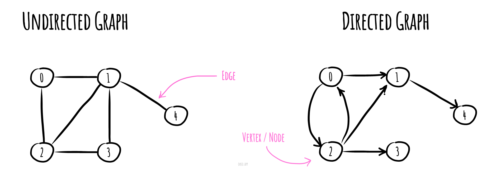

import PracticeProblem from '@site/src/components/PracticeProblem';

import AlgorithmWalkthrough from '@site/src/components/AlgorithmWalkthrough';

# Graphs

A **graph** stores items and the connections between them. Imagine towns and roads: you might ask whether a town is reachable, how many roads a shortest route uses, or whether a route returns to where it began. The same model describes friendships, game states, grid cells, and tasks with prerequisites.

**Before this lesson:** know arrays, loops, functions, [stacks](../stack/README.md), and [queues](../queue/README.md). Learn iterative traversal first. Read [recursion](../recursion/README.md) before writing recursive DFS, and [heaps](../heap/README.md) before heap-based shortest paths.

## Learning steps

A map of towns is a graph. A route uses connections, so choosing the right algorithm begins with what those connections mean.

1. Label vertices and edges, then write the neighbor lists.
2. Trace BFS by layers and DFS by branches.
3. Choose a separate method for weights, dependencies, or groups.

## Read a graph before choosing an algorithm

A **vertex**, also called a **node**, is one item. An **edge** is one connection. A **neighbor** can be reached along an outgoing edge. A **path** follows consecutive edges; a **cycle** follows edges back to its starting vertex. A **self-loop** joins a vertex to itself. An isolated vertex has no connections and still belongs to the graph.

- **Directed:** an edge has a direction, like a one-way road. An arrow from 0 to 1 does not promise an edge from 1 to 0.
- **Undirected:** a connection works both ways. We normally store each edge in both endpoint lists.
- **Weighted:** an edge has a cost, such as travel time. Unweighted shortest paths count edges instead.
- **DAG:** a directed acyclic graph, meaning no directed cycle; useful for dependencies.

Here is the directed graph used by the runnable BFS example below:

```text
+---+       +---+       +---+
| 0 | ----> | 1 | ----> | 3 |
+---+       +---+       +---+
  |                      ^
  |         +---+        |
  +-------> | 2 | -------+
            +---+

+---+
| 4 |    isolated vertex
+---+
```

There are five vertices, labeled 0 through 4, and four directed edges. From 0, both 1 and 2 are one edge away, and 3 is two edges away. There is no path from 0 to 4. Labels are identities, not distances.

## Store the connections as adjacency lists

An **adjacency list** stores an array of outgoing neighbors for each vertex. For the diagram:

```text
vertex       outgoing neighbors
  0          [1, 2]
  1          [3]
  2          [3]
  3          []
  4          []

JavaScript: [[1, 2], [3], [3], [], []]
```

`graph[2]` is `[3]`: from vertex 2, the only outgoing step reaches 3. A vertex with no outgoing edges still has an empty list. For arbitrary string labels, a `Map` from labels to neighbor arrays is another useful representation; this chapter uses integer labels to make the state easier to inspect.

Use `Array.from({ length: vertexCount }, () => [])` to create independent neighbor lists. `Array(vertexCount).fill([])` would share one mutable list, accidentally adding every edge to every vertex. An edge list can be converted into adjacency lists in O(V + E) time:

```js runnable
function buildUndirectedGraph(vertexCount, edges) {
  const graph = Array.from({ length: vertexCount }, () => []);
  for (const [first, second] of edges) {
    graph[first].push(second);
    graph[second].push(first);
  }
  return graph;
}
console.log(JSON.stringify(buildUndirectedGraph(4, [[0, 1], [1, 2]])));
console.log(JSON.stringify(buildUndirectedGraph(0, [])));
```

```text output
[[1],[0,2],[1],[]]
[]
```

Here `vertexCount` is a nonnegative integer and each endpoint must be an integer from 0 through `vertexCount - 1`. The function assumes that contract. Vertex 3 remains present even though it appears in no edge. For directed edges, append only `second` to `graph[first]`. An undirected self-loop would appear twice with this representation; visited checks keep traversal safe.

`V` means the number of vertices and `E` the number of edges. Adjacency lists use O(V + E) storage. An **adjacency matrix** stores a cell for every vertex pair and uses O(V²) storage; it supports direct edge checks but scans V positions to enumerate a vertex's neighbors. Lists suit sparse graphs, where relatively few possible edges exist. Complexity statements below assume adjacency lists.

## BFS grows a circle of reachable vertices

**Breadth-first search**, or BFS, explores distance 0, then distance 1, then distance 2, and so on. Put the start in a FIFO queue. Remove one vertex, discover its unseen neighbors, and append those neighbors at the back. Mark a neighbor as discovered immediately, so two different paths cannot schedule it twice.

For the diagram, the waiting queue changes from `[0]` to `[1, 2]` after exploring 0. Exploring 1 adds 3, giving `[2, 3]`. Exploring 2 finds 3 already discovered, so it does not add 3 again. Exploring 3 empties the queue. Vertex 4 is never scheduled.

<AlgorithmWalkthrough name="bfs" />

The interactive example shows the same rule on labeled vertices. A stored distance of `-1` in the runnable example means “not discovered.” A distance is a count of edges; the start has distance 0 because no movement is needed.

**Why the first distance is shortest:** the queue always processes vertices in nondecreasing distance order. A newly discovered neighbor of distance-d vertex receives d + 1 and joins behind the existing frontier. If it had a shorter path, its predecessor on that path would have belonged to an earlier layer and would already have discovered it. That contradicts it still being unseen. The start is correct at distance 0, so this argument extends layer by layer to every reachable vertex.

This argument requires equal edge costs. One expensive edge may cost more than three cheap edges; BFS minimizes edge count, not arbitrary weight. For a weighted graph with nonnegative costs, study [Dijkstra](./dijkstra/README.md). Negative costs need a different argument, such as [Bellman–Ford](./bellman-ford/README.md).

## Choose the next technique deliberately

| Need | Start with | Important condition |
| --- | --- | --- |
| Fewest edges from one start | [BFS](./breadth-first-search/README.md) with a queue | Every edge has the same cost. |
| Reachability or connected components | [DFS](./depth-first-search/README.md) with a stack | Mark discovered vertices; one start reaches only its reachable set. |
| Find a cycle | DFS with the appropriate state | In undirected graphs distinguish the parent edge; directed graphs need active/finished state. |
| Cheapest weighted route | [Dijkstra](./dijkstra/README.md) | All weights are nonnegative. |
| Order tasks with prerequisites | [Topological sorting](./topological-sorting/README.md) | A complete ordering exists only for a DAG. |
| Maintain merged connectivity groups | [Disjoint sets](../disjoint-set/README.md) | Does not itself give a path or a directed reachability answer. |

DFS explores using a last-in, first-out stack, making it a useful alternative when distance layers are unnecessary. An explicit stack avoids JavaScript's recursion-depth limit. A simple vertex stack is enough for reachability; algorithms needing the moment a vertex finishes need explicit entry/exit state or stack frames. Learn the invariant required by the particular task before reusing a traversal template.

Topological sorting and disjoint sets are later lessons. Kahn's topological algorithm maintains incoming-edge counts and repeatedly chooses an available zero-count vertex. Disjoint sets maintain groups through merges; path compression plus union by size/rank supports the amortized bound below. The linked chapters provide complete implementations rather than leaving an incomplete snippet to memorize.

## Time and space complexity

The table counts **auxiliary storage beyond the input adjacency lists**. Add O(V + E) when reporting total storage including the graph. All comparisons and edge arithmetic are assumed constant-time; integer distances must stay within the chosen numeric type's range.

| Algorithm | Time | Auxiliary space |
| --- | --- | --- |
| BFS / DFS | O(V + E) worst case | O(V), including discovery state and queue/stack |
| Dijkstra with an indexed binary heap | O((V + E) log(V + 1)) | O(V); one heap entry per vertex, with decrease-key |
| Dijkstra with a lazy binary heap | O(V + E log(E + 2)) | O(V + E); old distance records can remain in the heap |
| Dijkstra by scanning for the next minimum | O(V² + E) | O(V) |
| Kahn's topological sort | O(V + E) | O(V), if adjacency lists already exist |
| Disjoint sets, compression plus rank/size | O(α(V)) amortized per operation | O(V) |

A lazy heap inserts an improved distance instead of locating and updating the old heap entry; it discards stale entries when they are removed. Up to O(E) entries can accumulate, so an O(V) heap-space claim is incorrect for that implementation. For simple graphs, the logarithmic time term is often written using log V because E is at most V². `α` is the inverse Ackermann function, which grows extremely slowly; its bound is amortized over a sequence, not a promise that every individual operation is constant-time.

## Common mistakes

- Discover a vertex when scheduling it, not after removing it. Cycles and duplicate edges should not cause repeated visits.
- Include isolated vertices when constructing the graph. Counting only vertices seen in edges loses them.
- A single traversal does not cover disconnected parts. To count undirected components, start another traversal from each still-unvisited vertex.
- Check whether a pair means “from, to” or “dependent, prerequisite.” Reversing edges can answer the opposite question.
- An undirected parent edge is expected; it is not by itself a cycle. Parallel edges require tracking edge identities if the task distinguishes them.

## Practice the reasoning before the code

1. **Read:** Write the outgoing neighbor list of vertex 2 in the diagram. Can vertex 3 reach vertex 0?
2. **Predict:** What distances should BFS return when starting at isolated vertex 4?
3. **Explain:** If both 1 and 2 lead to 3, why is 3 queued only once?
4. **Transfer:** A maze allows only side-to-side moves of cost one. Which cells become vertices, which moves become edges, and which traversal finds the fewest moves?
5. **Extend:** Count all connected components in an undirected graph, including isolated vertices. Then try a directed cycle problem; explain why the same component interpretation is insufficient.

<details>
<summary>Hints</summary>

Follow arrow directions exactly. The starting vertex is distance 0 from itself even when isolated. A distance changes from -1 at discovery. A grid can describe neighbors without constructing a separate edge list. For components, scan all vertex labels and start a traversal only at one not already discovered.

</details>

<details>
<summary>Answers and next steps</summary>

Vertex 2 has list `[3]`. Vertex 3 has no outgoing edges and cannot reach 0. Starting at 4 gives `[-1, -1, -1, -1, 0]`. Vertex 1 discovers 3 first; when vertex 2 later sees it, its distance is already set. For a maze, passable cells are vertices, permitted neighboring moves are edges, and BFS minimizes the number of moves. A path of d moves visits d + 1 cells, so match the problem's requested unit.

For undirected components, increment a count before each traversal from a still-unseen vertex and mark its whole reachable component. Every component contributes exactly one such start. In a directed graph, reachability need not be mutual: 0 can reach 1 without 1 reaching 0. Read [connected-component and traversal examples](./depth-first-search/README.md), then [directed cycles](./detect-cycle/README.md). The workbook below contains complete BFS code and an iterative DFS exercise with its answer.

</details>

## Worked examples and answers {/* #workbook-practice */}

Attempt the linked [Practice Problems](#practice-problems) before opening their answers. See the [workbook guide](../../javascript/workbook.md) for the A–C exercise format.

### 40. Graphs breadth first and depth first search {/* #workbook-40 */}

<details>
<summary>Worked lesson and setup</summary>

**Goal:** choose a visit order and explain which vertices it reaches.

Review [adjacency lists](#store-the-connections-as-adjacency-lists) and [BFS layers](#bfs-grows-a-circle-of-reachable-vertices). The example uses integer vertex IDs from 0 through V−1. Undirected edges appear in both neighbor lists; directed edges appear only in the forward direction. A traversal from one start reaches only that start’s reachable vertices. Restart from unvisited vertices to cover the whole graph.

BFS marks a vertex when adding it to the queue. This avoids repeated entries and gives fewest-edge distances when edges have equal cost. Parent links can reconstruct an actual route. A moving head avoids repeated front shifts, although the consumed array remains allocated during the traversal.

DFS follows a branch using recursion or an explicit stack. Neighbor order and the moment of marking affect its visit order. If an algorithm needs finishing order, record entry/exit state or full frames; a plain stack of vertex IDs does not automatically reproduce recursive postorder. Both traversals take O(V + E) for a complete adjacency-list traversal, with O(V) extra tracking space.

**Worked example**

```js runnable
function bfsDistances(graph, start = 0) {
  if (graph.length === 0) return [];
  if (!Number.isInteger(start) || start < 0 || start >= graph.length) {
    throw new RangeError("Start must name a vertex in the graph");
  }
  const distance = Array(graph.length).fill(-1);
  const queue = [start];
  distance[start] = 0;
  for (let head = 0; head < queue.length; head++) {
    const vertex = queue[head];
    for (const next of graph[vertex]) {
      if (distance[next] !== -1) continue;
      distance[next] = distance[vertex] + 1;
      queue.push(next);
    }
  }
  return distance;
}
const graph = [[1, 2], [3], [3], [], []];
console.log(bfsDistances(graph, 0).join(","));
console.log(bfsDistances(graph, 4).join(","));
console.log(JSON.stringify(bfsDistances([])));
console.log(bfsDistances([[0]], 0).join(","));
```

```text output
0,1,1,2,-1
-1,-1,-1,-1,0
[]
0
```

**Why the example works**

Vertices 1 and 2 enter the queue at distance 1. Vertex 3 is discovered through 1, so the later edge from 2 does not enqueue it again. Vertex 4 is unreachable and keeps the sentinel -1. The function accepts a valid adjacency list with integer vertex labels. Every neighbor must be in range. For a nonempty graph, an invalid start throws `RangeError`; for `[]`, it returns `[]` because there are no vertices to discover. The original graph is unchanged. A self-loop does not enqueue its vertex again because it is already discovered.

For the first call, initialization writes `[0, -1, -1, -1, -1]`. Processing 0 writes distance 1 to vertices 1 and 2; processing 1 writes distance 2 to vertex 3. Processing 2 leaves that earlier discovery unchanged. The second call begins at the isolated vertex 4, so all other vertices stay unreachable. Initialization needs O(V) time even when the reachable set is small; each reachable vertex is then queued once and each of its outgoing entries inspected once. Worst-case time is O(V + E) and auxiliary space O(V).

</details>

Find **40A–C** in the [Practice Problems](#practice-problems) table.

<details id="workbook-40-answer">
<summary>Check your reasoning and answer</summary>

For Node checks, add `import assert from "node:assert/strict";` at the top of your file. Browser and multi-file examples use the setup stated above.

**40A.** Several frontier vertices may share a neighbor. Immediate marking ensures that the neighbor enters the queue once and gets its distance from the earliest layer.

**40B.** BFS orders paths by edge count. A path with fewer expensive edges can cost more than a longer path with cheap edges, so edge count no longer proves minimal cost.

**40C.** Mark each vertex when pushing it so it is scheduled once. Pop a vertex and schedule its unseen neighbors. The final set size counts reachable identities rather than counting paths.

**Reference code**

Use the worked example above first if the answer calls its functions or classes. Run each lesson in its own `.mjs` file.

```js runnable
function dfsReachable(graph, start = 0) {
  if (graph.length === 0) return 0;
  if (!Number.isInteger(start) || start < 0 || start >= graph.length) {
    throw new RangeError("Start must name a vertex in the graph");
  }
  const seen = new Set([start]);
  const stack = [start];
  while (stack.length) {
    const vertex = stack.pop();
    for (const next of graph[vertex]) {
      if (seen.has(next)) continue;
      seen.add(next);
      stack.push(next);
    }
  }
  return seen.size;
}
console.log(dfsReachable([[1, 2], [3], [3], [], []], 0));
console.log(dfsReachable([[1, 2], [3], [3], [], []], 4));
console.log(dfsReachable([]));
```

```text output
4
1
0
```

**Check the result**

```js
assert.equal(dfsReachable(graph, 0), 4);
assert.equal(dfsReachable([[0]], 0), 1);
assert.equal(dfsReachable([[]], 0), 1);
assert.equal(dfsReachable([]), 0);
assert.throws(() => dfsReachable([[]], 1), RangeError);
```

At every step, `seen` contains exactly the vertices already scheduled, and `stack` contains scheduled work still to explore. Any path from the start can be followed one edge at a time, so every reachable vertex is eventually scheduled. No unreachable vertex is scheduled because every new one is a neighbor of a reachable vertex. Marking at insertion schedules each vertex once. This proves the returned count and gives O(V + E) worst-case time and O(V) auxiliary space. It does not produce shortest distances or recursive finishing order.

</details>

## Practice Problems

{/* BEGIN GENERATED PRACTICE PROBLEMS */}

| Problem | Level / priority | Practice / notes | Example / answer |
| --- | --- | --- | --- |
| **40A — Why mark discovered when enqueuing?** | **Must fix** | [Worked example](#workbook-40) | [Answer](#workbook-40-answer) |
| **40B — Why does BFS fail for arbitrary weighted shortest paths?** | **Must fix** | [Worked example](#workbook-40) | [Answer](#workbook-40-answer) |
| **40C — Write dfsReachable(graph, start), returning the number of reachable vertices using an explicit stack.** | **Must fix** | [Worked example](#workbook-40) | [Answer](#workbook-40-answer) |
| <PracticeProblem id={130} title={"Surrounded Regions"} text={"Problem statement\nboard contains \"X\" and \"O\". An O-region uses horizontal or vertical connections. Capture every\nregion that cannot reach a boundary O by changing its cells to X. Keep boundary-connected O cells\nunchanged. Modify board in place, evaluating connectivity before changing the captured cells.\nInput \u0026 expected result\nA region is safe if any of its cells has an all-O path to any outer edge. Preserve all X cells. The\nfunction returns no separate board; the supplied matrix itself must contain the captured result.\nEXAMPLE 1\nInput rows: \"XXXX\", \"XOOX\", \"XXXX\", \"XOXX\"\nOutput rows: \"XXXX\", \"XXXX\", \"XXXX\", \"XOXX\"\nExplanation: The middle O pair has no route to the boundary and is captured. The O in the\nbottom row touches the boundary and remains.\nEXAMPLE 2\nInput rows: \"XOX\", \"XOX\", \"XXX\"\nOutput rows: \"XOX\", \"XOX\", \"XXX\"\nExplanation: The center O connects upward to a boundary O, so neither cell is captured.\nConstraints \u0026 guarantees\n• m == board.length\n• n == board[i].length\n• m, n: 1 through 200 (inclusive)\n• Cell domain: \"X\" and \"O\"\nJavaScript starter\nfunction solve(board) {\n  // TODO: write your solution.\n}"} /> | Medium | [LeetCode](https://leetcode.com/problems/surrounded-regions/) | — |
| <PracticeProblem id={133} title={"Clone Graph"} text={"Problem statement\nGiven a node in a connected undirected graph, create a deep copy of the graph and return the\ncorresponding copied node. Each node has val and an array neighbors. Preserve values and\nadjacency, but allocate new nodes; no copied reference may target an original node. A null input\nreturns null.\nInput \u0026 expected result\nNeighbors must refer to copied nodes consistently, including when several paths reach the same\noriginal node. The graph may contain cycles. Example adjacency lists describe the input; the\nfunction receives a Node reference, not the adjacency list itself.\nEXAMPLE 1\nInput adjacency: 1 is connected to 2 and 3; 2 and 3 connect back to 1\nResult: an independent graph with those same connections\nExplanation: The new center has two new neighbors, and their return edges point to the copied\ncenter rather than the original one.\nEXAMPLE 2\nInput: one node with val = 1 and neighbors = []\nResult: a new node with val = 1 and neighbors = []\nExplanation: The isolated node must be copied even though there are no edges to recreate.\nConstraints \u0026 guarantees\n• Node.val: 1 through 100 (inclusive)\n• Graph size: 0 through 100 nodes. Node labels are distinct. No self-edge or repeated edge exists. A\nnonempty graph is connected\nJavaScript starter\nfunction cloneGraph(node) {\n  // TODO: write your solution.\n}"} /> | Medium | [LeetCode](https://leetcode.com/problems/clone-graph/) | — |
| <PracticeProblem id={200} title={"Number of Islands"} text={"Problem statement\ngrid is a rectangular array of \"1\" for land and \"0\" for water. An island is a group of land cells\nconnected vertically or horizontally. Diagonal contact does not connect islands, and everything\noutside the grid is water. Return the number of islands.\nInput \u0026 expected result\nEvery land cell belongs to exactly one island. The grid contains character digits, not numeric 0 and\n1. Return the number of connected land groups, regardless of the area or shape of any individual\ngroup.\nEXAMPLE 1\nInput: grid = [[\"1\",\"1\",\"0\"],[\"0\",\"0\",\"1\"],[\"1\",\"0\",\"1\"]]\nOutput: 3\nExplanation: The top-left pair forms one island, the right-column pair forms another, and the\nbottom-left cell forms a third.\nEXAMPLE 2\nInput: grid = [[\"1\",\"0\"],[\"0\",\"1\"]]\nOutput: 2\nExplanation: The land cells touch only diagonally, so they are separate islands.\nConstraints \u0026 guarantees\n• m == grid.length\n• n == grid[i].length\n• m, n: 1 through 300 (inclusive)\n• Cell domain: character digits \"0\" and \"1\"\nJavaScript starter\nfunction numIslands(grid) {\n  // TODO: write your solution.\n}"} /> | Medium | [LeetCode](https://leetcode.com/problems/number-of-islands/) | — |
| <PracticeProblem id={207} title={"Course Schedule"} text={"Problem statement\nThere are numCourses courses numbered from 0. Each prerequisite pair [a,b] means course b\nmust be completed before course a. Determine whether it is possible to complete every course\nwhile respecting all prerequisites. Dependencies may form a cycle, which makes completion\nimpossible.\nInput \u0026 expected result\nEvery listed pair must be satisfied, including those in disconnected groups of courses. A course\nwith no prerequisites can be completed independently. Return only feasibility; you do not need to\noutput the order of study.\nEXAMPLE 1\nInput: numCourses = 3, prerequisites = [[1,0],[2,1]]\nOutput: true\nExplanation: Completing 0, then 1, then 2 meets both prerequisites, so all three courses can be\nfinished.\nEXAMPLE 2\nInput: numCourses = 2, prerequisites = [[1,0],[0,1]]\nOutput: false\nExplanation: Each course requires the other first, so neither can be completed before the other.\nConstraints \u0026 guarantees\n• numCourses: 1 through 2000 (inclusive)\n• prerequisites.length: 0 through 5000 (inclusive)\n• prerequisites[i].length == 2\n• 0 \u003c= a_i, b_i \u003c numCourses\n• No prerequisite pair repeats\nJavaScript starter\nfunction canFinish(numCourses, prerequisites) {\n  // TODO: write your solution.\n}"} /> | Medium | [LeetCode](https://leetcode.com/problems/course-schedule/) | — |
| <PracticeProblem id={210} title={"Course Schedule II"} text={"Problem statement\nThere are numCourses courses labeled 0 through numCourses - 1. Each pair [a,b] requires taking b\nbefore a. Return an ordering containing every course exactly once that respects all requirements.\nAny valid ordering is acceptable. If no ordering exists because of cyclic dependencies, return an\nempty array.\nInput \u0026 expected result\nInclude courses even when they never appear in prerequisites. The output must contain\nnumCourses distinct course numbers if completion is possible. Multiple orders may be valid;\nnumerical sorting alone does not define a valid answer.\nEXAMPLE 1\nInput: numCourses = 3, prerequisites = [[2,0],[2,1]]\nOne valid result: [0,1,2]\nExplanation: Courses 0 and 1 have no prerequisites and can precede 2 in either order. The\nshown order satisfies both requirements.\nEXAMPLE 2\nInput: numCourses = 2, prerequisites = [[0,1],[1,0]]\nOutput: []\nExplanation: The two requirements form a cycle, so no complete ordering exists.\nConstraints \u0026 guarantees\n• numCourses: 1 through 2000 (inclusive)\n• prerequisites.length: 0 through numCourses * (numCourses - 1) (inclusive)\n• prerequisites[i].length == 2\n• 0 \u003c= a_i, b_i \u003c numCourses\n• a_i != b_i\n• No prerequisite pair repeats\nJavaScript starter\nfunction findOrder(numCourses, prerequisites) {\n  // TODO: write your solution.\n}"} /> | Medium | [LeetCode](https://leetcode.com/problems/course-schedule-ii/) | — |
| <PracticeProblem id={286} title={"Walls and Gates"} text={"Problem statement\nrooms is a grid containing walls (-1), gates (0), and empty rooms (2147483647). Fill each empty\nroom with its shortest number of horizontal or vertical steps to any gate, without passing through\nwalls. Leave unreachable rooms at 2147483647 and preserve walls and gates. Modify the grid in\nplace.\nInput \u0026 expected result\nA step crosses one grid edge to a neighboring room or gate, never diagonally. When several gates\nare reachable, use the shortest distance to any of them. Return no separate matrix; update only\ncells that originally represent empty rooms.\nEXAMPLE 1\nInput: rooms = [[2147483647,0],[2147483647,-1]]\nAfter the call: [[1,0],[2,-1]]\nExplanation: The upper-left room is one step from the gate. The lower-left room reaches that\ngate in two steps via the upper-left room.\nEXAMPLE 2\nInput: rooms = [[0,-1,2147483647]]\nAfter the call: [[0,-1,2147483647]]\nExplanation: The wall blocks the only route from the empty room to the gate, so its sentinel\nvalue remains.\nConstraints \u0026 guarantees\n• rooms is rectangular. Cells are -1, 0, or 2147483647\n• Only horizontal and vertical moves are allowed\nPremium source: current numeric bounds could not be publicly verified.\nJavaScript starter\nfunction wallsAndGates(rooms) {\n  // TODO: write your solution.\n}"} /> | Medium · Premium | [LeetCode](https://leetcode.com/problems/walls-and-gates/) | — |
| <PracticeProblem id={310} title={"Minimum Height Trees"} text={"Problem statement\nChoose a root for an undirected tree with nodes 0 through n - 1. Its height is the greatest number\nof edges from that root to any leaf. Return all roots that achieve the smallest possible height.\nInput \u0026 expected result\nReturn node labels in any order. edges lists undirected connections; the input is guaranteed to be a\ntree.\nEXAMPLE 1\nInput: n = 4, edges = [[0,1],[1,2],[2,3]]\nOutput: [1,2]\nExplanation: Either middle node gives height 2; an endpoint gives height 3.\nEXAMPLE 2\nInput: n = 1, edges = []\nOutput: [0]\nExplanation: The single-node tree has height 0.\nConstraints \u0026 guarantees\n• 1 \u003c= n \u003c= 2 * 10^4\n• edges.length == n - 1\n• 0 \u003c= ai, bi \u003c n\n• ai != bi\n• Edges do not repeat\n• The input forms a tree without repeated edges\nJavaScript starter\nfunction findMinHeightTrees(n, edges) {\n  // TODO: write your solution.\n}"} /> | Medium | [LeetCode](https://leetcode.com/problems/minimum-height-trees/) | — |
| <PracticeProblem id={399} title={"Evaluate Division"} text={"Problem statement\nEach pair [a,b] in equations states a / b = values[i], with positive ratios and no contradictions. For\neach query [c,d], return the implied value c / d. If the relationship cannot be determined, including\nan unknown variable, return -1.0. A known variable divided by itself is 1.0.\nInput \u0026 expected result\nVariable names are symbols, not values to parse. Answers may use chains of equations and\nreverse ratios. Return one numeric result per query in its original order; disconnected known\nvariables have an undetermined ratio just like unknown ones.\nEXAMPLE 1\nInput: equations = [[\"a\",\"b\"],[\"b\",\"c\"]], values = [2,4]\nQueries: [[\"a\",\"c\"],[\"c\",\"a\"],[\"x\",\"x\"]]; return [8,0.125,-1]\nExplanation: The ratios imply a/c = 2 * 4 = 8, so c/a = 1/8. Variable x has no defined\nrelationship.\nEXAMPLE 2\nInput: equations = [[\"x\",\"y\"]], values = [3]\nQueries: [[\"y\",\"x\"],[\"x\",\"x\"],[\"x\",\"z\"]]\nOutput: [0.3333333333,1,-1]\nExplanation: Reverse the known ratio, use self-division for x, and report z as unknown.\nConstraints \u0026 guarantees\n• equations.length: 1 through 20 (inclusive)\n• equations[i].length == 2\n• A_i.length, B_i.length: 1 through 5 (inclusive)\n• values.length == equations.length\n• 0.0 \u003c values[i] \u003c= 20.0\n• queries.length: 1 through 20 (inclusive)\n• queries[i].length == 2\n• C_j.length, D_j.length: 1 through 5 (inclusive)\n• Variable names use a-z and decimal digits. A_i/B_i are equation endpoints\n• C_j/D_j are query endpoints. Equations are consistent and never divide by zero\nJavaScript starter\nfunction calcEquation(equations, values, queries) {\n  // TODO: write your solution.\n}"} /> | Medium | [LeetCode](https://leetcode.com/problems/evaluate-division/) | — |
| <PracticeProblem id={417} title={"Pacific Atlantic Water Flow"} text={"Problem statement\nheights is a rectangular elevation map. The Pacific borders the top and left edges; the Atlantic\nborders the bottom and right edges. Water moves between horizontally or vertically neighboring\ncells only when the destination height is no greater. Return all coordinates from which water can\nreach both oceans. The result may be in any order.\nInput \u0026 expected result\nCoordinates use zero-based [row, column] pairs. A qualifying cell may use different water paths to\nreach the two oceans; it does not need one path that visits both. Equal-height moves are allowed,\nand each result coordinate appears once.\nEXAMPLE 1\nInput: heights = [[1,2],[4,3]]\nOutput: [[0,1],[1,0],[1,1]]\nExplanation: Cells [0,1], [1,0], and [1,1] can reach both ocean borders. Water from [0,0] cannot\nmove uphill toward the Atlantic.\nEXAMPLE 2\nInput: heights = [[5,5,5]]\nOutput: [[0,0],[0,1],[0,2]]\nExplanation: Every cell lies on both a top border and a bottom border, so each touches both\noceans.\nConstraints \u0026 guarantees\n• m = heights.length\n• n = heights[r].length\n• m and n: 1 through 200\n• Cell heights: 0 through 10^5\nJavaScript starter\nfunction pacificAtlantic(heights) {\n  // TODO: write your solution.\n}"} /> | Medium | [LeetCode](https://leetcode.com/problems/pacific-atlantic-water-flow/) | — |
| <PracticeProblem id={433} title={"Minimum Genetic Mutation"} text={"Problem statement\nA gene is an eight-character string over A, C, G, and T. One mutation changes exactly one\ncharacter. Starting from startGene, find the fewest mutations needed to reach endGene, with every\nchanged-to gene appearing in bank. The start need not be in bank. Return -1 if the destination\ncannot be reached.\nInput \u0026 expected result\nA mutation has cost one regardless of which position changes. Bank membership is required for\nevery resulting gene, including the destination. Return the minimum number of changes, not the\nnumber of genes in the sequence.\nEXAMPLE 1\nInput: startGene = \"AAAAAAAA\", endGene = \"AAAAAACC\", bank = [\"AAAAAAAC\",\"AAAAAACC\"]\nOutput: 2\nExplanation: Change the last character first, then the second-to-last character. Both resulting\ngenes occur in the bank, giving two mutations.\nEXAMPLE 2\nInput: startGene = \"CCCCCCCC\", endGene = \"CCCCCCCA\", bank = []\nOutput: -1\nExplanation: The different destination is absent from the bank, so no permitted mutation can\nreach it.\nConstraints \u0026 guarantees\n• bank.length: 0 through 10 (inclusive)\n• startGene.length == endGene.length == bank[i].length == 8\n• Gene alphabet: A, C, G, T\nJavaScript starter\nfunction minMutation(startGene, endGene, bank) {\n  // TODO: write your solution.\n}"} /> | Medium | [LeetCode](https://leetcode.com/problems/minimum-genetic-mutation/) | — |
| [LC 694 — Number of Distinct Islands](https://leetcode.com/problems/number-of-distinct-islands/) | Medium · Premium | [LeetCode](https://leetcode.com/problems/number-of-distinct-islands/) | — |
| <PracticeProblem id={695} title={"Max Area of Island"} text={"Problem statement\ngrid contains 1 for land and 0 for water. Connected land cells share a horizontal or vertical edge.\nThe area of an island is its number of cells. Return the greatest island area, or 0 if the grid contains\nno land. Diagonal connections do not count.\nInput \u0026 expected result\nReturn the size of a single largest island, not the combined number of land cells. Unlike Number of\nIslands, cells are numeric here. An island can be irregularly shaped, and each of its cells\ncontributes one unit of area.\nEXAMPLE 1\nInput: grid = [[1,0,1],[1,1,0]]\nOutput: 3\nExplanation: The three land cells on the left are connected; the upper-right land cell is separate,\nso the largest area is 3.\nEXAMPLE 2\nInput: grid = [[0,0],[0,0]]\nOutput: 0\nExplanation: There are no land cells and therefore no island with positive area.\nConstraints \u0026 guarantees\n• m == grid.length\n• n == grid[i].length\n• m, n: 1 through 50 (inclusive)\n• Cell domain: {0, 1}\nJavaScript starter\nfunction maxAreaOfIsland(grid) {\n  // TODO: write your solution.\n}"} /> | Medium | [LeetCode](https://leetcode.com/problems/max-area-of-island/) | — |
| <PracticeProblem id={743} title={"Network Delay Time"} text={"Problem statement\nThere are n network nodes labeled 1 through n. Each directed edge [u,v,w] in times carries a signal\nfrom u to v in w time units. Send a signal from node k at time 0; it may spread along multiple\nroutes. Return the time when every node has received it, or -1 if some node is unreachable.\nInput \u0026 expected result\nEdge direction matters: a connection from u to v does not imply a reverse connection. Node k\nreceives the signal immediately. For every other node, use its earliest possible arrival time, then\nreport when the last reachable requirement is met.\nEXAMPLE 1\nInput: times = [[1,2,2],[1,3,6],[2,3,1]], n = 3, k = 1\nOutput: 3\nExplanation: Node 2 receives the signal at time 2. Node 3 receives it at time 3 through node 2,\nearlier than the direct route.\nEXAMPLE 2\nInput: times = [[1,2,5]], n = 2, k = 2\nOutput: -1\nExplanation: The edge cannot be traversed backward, so the signal starting at node 2 never\nreaches node 1.\nConstraints \u0026 guarantees\n• 1 \u003c= k \u003c= n \u003c= 100\n• times.length: 1 through 6000 (inclusive)\n• times[i].length == 3\n• u_i, v_i: 1 through n (inclusive)\n• u_i != v_i\n• w_i: 0 through 100 (inclusive)\n• Each ordered endpoint pair has at most one directed edge\nJavaScript starter\nfunction networkDelayTime(times, n, k) {\n  // TODO: write your solution.\n}"} /> | Medium | [LeetCode](https://leetcode.com/problems/network-delay-time/) | — |
| [LC 752 — Open the Lock](https://leetcode.com/problems/open-the-lock/) | Medium | [LeetCode](https://leetcode.com/problems/open-the-lock/) | — |
| [LC 785 — Is Graph Bipartite?](https://leetcode.com/problems/is-graph-bipartite/) | Medium | [LeetCode](https://leetcode.com/problems/is-graph-bipartite/) | — |
| <PracticeProblem id={787} title={"Cheapest Flights Within K Stops"} text={"Problem statement\nflights contains directed flights [from,to,price] between n cities numbered from 0. Find the\ncheapest route from src to dst using at most k intermediate stops, equivalent to at most k + 1\nflights. Return its total price, or -1 when no permitted route exists. Flight prices are positive.\nInput \u0026 expected result\nCount stops only at intermediate cities; src and dst are not stops. A route with more than k stops is\ninvalid even when it is cheaper. Return the sum of flight prices for the cheapest valid route, not its\nlength.\nEXAMPLE 1\nInput: flights = [[0,1,50],[1,2,50],[0,2,150]], n = 3, src = 0, dst = 2, k = 1\nOutput: 100\nExplanation: The route 0 -\u003e 1 -\u003e 2 costs 100 and uses one intermediate stop, which the limit\npermits.\nEXAMPLE 2\nInput: flights = [[0,1,20],[1,2,20],[0,2,90]], n = 3\nsrc = 0, dst = 2, k = 0; return: 90\nExplanation: With no intermediate stops allowed, only the direct flight to city 2 is eligible.\nConstraints \u0026 guarantees\n• n: 2 through 100 (inclusive)\n• flights.length: 0 through (n * (n - 1) / 2) (inclusive)\n• flights[i].length == 3\n• 0 \u003c= from_i, to_i \u003c n\n• from_i != to_i\n• price_i: 1 through 10^4 (inclusive)\n• 0 \u003c= src, dst, k \u003c n\n• src != dst\n• A directed city pair has at most one flight\nJavaScript starter\nfunction findCheapestPrice(n, flights, src, dst, k) {\n  // TODO: write your solution.\n}"} /> | Medium | [LeetCode](https://leetcode.com/problems/cheapest-flights-within-k-stops/) | — |
| [LC 797 — All Paths From Source to Target](https://leetcode.com/problems/all-paths-from-source-to-target/) | Medium | [LeetCode](https://leetcode.com/problems/all-paths-from-source-to-target/) | — |
| <PracticeProblem id={802} title={"Find Eventual Safe States"} text={"Problem statement \u0026 expected result\nReturn the vertices from which every possible directed path eventually terminates. A vertex that can reach a\ndirected cycle is unsafe, even if another route terminates. graph[i] lists outgoing neighbors. Return safe vertex\nindices in ascending order.\nEXAMPLE 1\nInput: graph = [[1,2],[2,3],[5],[0],[5],[],[]]\nOutput: [2,4,5,6]\nExplanation: Vertices 2 and 4 lead to terminal 5; 5 and 6 are terminal.\nEXAMPLE 2\nInput: graph = [[1,2,3,4],[1,2],[3,4],[0,4],[]]\nOutput: [4]\nExplanation: Every vertex except 4 has a possible path into a cycle.\nConstraints \u0026 guarantees\n- n == graph.length\n- 1 \u003c= n \u003c= 10^4\n- 0 \u003c= graph[i].length \u003c= n\n- 0 \u003c= graph[i][j] \u003c= n - 1\n- graph[i] is sorted in a strictly increasing order.\n- The graph may contain self-loops.\n- The number of edges in the graph will be in the range [1, 4 * 10^4].\nJavaScript starter\nfunction eventualSafeNodes(graph) {\n// TODO: write your solution.\n}"} /> | Medium | [LeetCode](https://leetcode.com/problems/find-eventual-safe-states/) | — |
| [LC 886 — Possible Bipartition](https://leetcode.com/problems/possible-bipartition/) | Medium | [LeetCode](https://leetcode.com/problems/possible-bipartition/) | — |
| <PracticeProblem id={909} title={"Snakes and Ladders"} text={"Problem statement\nA square board numbers cells from 1 at bottom left in alternating row directions, ending at n\nsquared. Start at 1. Each move chooses a destination from one to six positions ahead without\nexceeding the end. If that cell contains a snake or ladder destination instead of -1, move there\nonce; do not chain another jump that turn. Return the fewest moves to finish, or -1 if impossible.\nInput \u0026 expected result\nA cell value is a destination label, not a row or column coordinate. A die move uses a choice of\ndistance from 1 through 6; take at most one forced jump after landing. Count die moves, not the\ndistance traveled or jump count.\nEXAMPLE 1\nInput: board = [[-1,-1],[-1,-1]]\nOutput: 1, by moving from square 1 to square 4\nExplanation: The final square is 4, which is within one die move of square 1. No snakes or\nladders change the landing.\nEXAMPLE 2\nInput: board = [[-1,-1,-1],[-1,-1,-1],[-1,-1,-1]]\nOutput: 2\nExplanation: From square 1, at most square 7 is reachable in one move; square 9 can be\nreached in a second.\nConstraints \u0026 guarantees\n• n == board.length == board[i].length\n• n: 2 through 20 (inclusive)\n• Each cell is -1 or a destination label from 1 through n^2. Squares 1 and n^2 never initiate a snake or ladder\nJavaScript starter\nfunction snakesAndLadders(board) {\n  // TODO: write your solution.\n}"} /> | Medium | [LeetCode](https://leetcode.com/problems/snakes-and-ladders/) | — |
| [LC 934 — Shortest Bridge](https://leetcode.com/problems/shortest-bridge/) | Medium | [LeetCode](https://leetcode.com/problems/shortest-bridge/) | — |
| <PracticeProblem id={994} title={"Rotting Oranges"} text={"Problem statement\ngrid contains 0 for an empty cell, 1 for a fresh orange, and 2 for a rotten orange. Each minute,\nevery rotten orange rots adjacent fresh oranges horizontally and vertically. Updates for a minute\nhappen together. Return the minutes until no fresh orange remains, or -1 if some can never rot. If\nnone are initially fresh, return 0.\nInput \u0026 expected result\nEach minute uses the set of oranges rotten by the start of that minute. Fresh oranges infected\nduring a minute begin spreading in the next one. Empty cells do not transmit rot, and diagonal\nneighbors do not infect each other.\nEXAMPLE 1\nInput: grid = [[2,1,1]]\nOutput: 2\nExplanation: The middle orange rots after one minute and then infects the last orange during\nthe second minute.\nEXAMPLE 2\nInput: grid = [[2,0,1]]\nOutput: -1\nExplanation: The empty cell separates the fresh orange from all sources of rot.\nConstraints \u0026 guarantees\n• m == grid.length\n• n == grid[i].length\n• m, n: 1 through 10 (inclusive)\n• Cell domain: {0, 1, 2}\nJavaScript starter\nfunction orangesRotting(grid) {\n  // TODO: write your solution.\n}"} /> | Medium | [LeetCode](https://leetcode.com/problems/rotting-oranges/) | — |
| [LC 1042 — Flower Planting With No Adjacent](https://leetcode.com/problems/flower-planting-with-no-adjacent/) | Medium | [LeetCode](https://leetcode.com/problems/flower-planting-with-no-adjacent/) | — |
| [LC 1136 — Parallel Courses](https://leetcode.com/problems/parallel-courses/) | Medium · Premium | [LeetCode](https://leetcode.com/problems/parallel-courses/) | — |
| <PracticeProblem id={1197} title={"Minimum Knight Moves"} text={"Problem statement\nA knight starts at (0,0) on an infinite chessboard. One move changes one coordinate by 2 and the\nother by 1, with either sign. Return the smallest number of moves needed to reach (x,y). Negative\ncoordinates are valid, and there are no obstacles.\nInput \u0026 expected result\nReturn the number of moves. The board has no outer boundary.\nEXAMPLE 1\nInput: x = 2, y = 1\nOutput: 1\nExplanation: The target is reachable by one legal knight move.\nEXAMPLE 2\nInput: x = 0, y = 0\nOutput: 0\nExplanation: The starting position already equals the target.\nConstraints \u0026 guarantees\n• x and y are integers; negative coordinates are permitted.\n• The board is infinite and unobstructed.\nPremium source: current numeric bounds could not be publicly verified.\nJavaScript starter\nfunction minKnightMoves(x, y) {\n  // TODO: write your solution.\n}"} /> | Medium · Premium | [LeetCode](https://leetcode.com/problems/minimum-knight-moves/) | — |
| <PracticeProblem id={1254} title={"Number of Closed Islands"} text={"Problem statement \u0026 expected result\nHere zero denotes land and one denotes water. A land island uses four-directional connectivity. Count islands\nthat do not touch the grid boundary, so the entire island is enclosed by water.\nEXAMPLE 1\nInput: grid =\n[[1,1,1,1,1,1,1,0],[1,0,0,0,0,1,1,0],[1,0,1,0,1,1,1,0],[1,0,0,0,0,1,0,1],[1,1,1,1,1,1,1,0]]\nOutput: 2\nExplanation: Two zero-valued components avoid the boundary.\nEXAMPLE 2\nInput: grid = [[0,0,1,0,0],[0,1,0,1,0],[0,1,1,1,0]]\nOutput: 1\nExplanation: The central isolated zero is enclosed; the outer land touches edges.\nConstraints \u0026 guarantees\n- 1 \u003c= grid.length, grid[0].length \u003c= 100\n- 0 \u003c= grid[i][j] \u003c=1\nJavaScript starter\nfunction closedIsland(grid) {\n// TODO: write your solution.\n}"} /> | Medium | [LeetCode](https://leetcode.com/problems/number-of-closed-islands/) | — |
| <PracticeProblem id={1334} title={"Find the City With the Smallest Number of Neighbors at a Threshold Distance"} text={"Problem statement \u0026 expected result\nFor each city, count other cities reachable with total path weight at most distanceThreshold in the undirected\nweighted graph. Return the city with the fewest such neighbors. Resolve a tie by choosing the greatest city index.\nEXAMPLE 1\nInput: n = 4, edges = [[0,1,3],[1,2,1],[1,3,4],[2,3,1]], distanceThreshold = 4\nOutput: 3\nExplanation: Cities 0 and 3 tie with two reachable neighbors; choose index 3.\nEXAMPLE 2\nInput: n = 5, edges = [[0,1,2],[0,4,8],[1,2,3],[1,4,2],[2,3,1],[3,4,1]], distanceThreshold =\n2\nOutput: 0\nExplanation: City 0 has only one neighbor within total distance 2.\nConstraints \u0026 guarantees\n- 2 \u003c= n \u003c= 100\n- 1 \u003c= edges.length \u003c= n * (n - 1) / 2\n- edges[i].length == 3\n- 0 \u003c= fromi \u003c toi \u003c n\n- 1 \u003c= weighti, distanceThreshold \u003c= 10^4\n- All pairs (fromi, toi) are distinct.\nJavaScript starter\nfunction findTheCity(n, edges, distanceThreshold) {\n// TODO: write your solution.\n}"} /> | Medium | [LeetCode](https://leetcode.com/problems/find-the-city-with-the-smallest-number-of-neighbors-at-a-threshold-distance/) | — |
| <PracticeProblem id={1462} title={"Course Schedule IV"} text={"Problem statement \u0026 expected result\nAn edge [a,b] means a must precede b. For each query [u,v], return whether u is a direct or indirect prerequisite\nof v. The prerequisite graph has no directed cycle. Return boolean answers in query order.\nEXAMPLE 1\nInput: numCourses = 2, prerequisites = [[1,0]], queries = [[0,1],[1,0]]\nOutput: [false,true]\nExplanation: The only edge goes from course 1 to course 0.\nEXAMPLE 2\nInput: numCourses = 2, prerequisites = [], queries = [[1,0],[0,1]]\nOutput: [false,false]\nExplanation: Without edges, neither distinct course is a prerequisite of the other.\nConstraints \u0026 guarantees\n- 2 \u003c= numCourses \u003c= 100\n- 0 \u003c= prerequisites.length \u003c= (numCourses * (numCourses - 1) / 2)\n- prerequisites[i].length == 2\n- 0 \u003c= ai, bi \u003c= numCourses - 1\n- ai != bi\n- All the pairs [ai, bi] are unique.\n- The prerequisites graph has no cycles.\n- 1 \u003c= queries.length \u003c= 10^4\n- 0 \u003c= ui, vi \u003c= numCourses - 1\n- ui != vi\nJavaScript starter\nfunction checkIfPrerequisite(numCourses, prerequisites, queries) {\n// TODO: write your solution.\n}"} /> | Medium | [LeetCode](https://leetcode.com/problems/course-schedule-iv/) | — |
| <PracticeProblem id={1631} title={"Path With Minimum Effort"} text={"Problem statement \u0026 expected result\nMove in four directions from the upper-left to the lower-right cell. A route's effort is its largest absolute height\ndifference between consecutive cells. Return the minimum achievable effort. A route with a single cell has effort\nzero.\nEXAMPLE 1\nInput: heights = [[1,2,2],[3,8,2],[5,3,5]]\nOutput: 2\nExplanation: The route with heights [1,3,5,3,5] has maximum step difference 2.\nEXAMPLE 2\nInput: heights = [[1,2,3],[3,8,4],[5,3,5]]\nOutput: 1\nExplanation: The route with heights [1,2,3,4,5] has maximum step difference 1.\nConstraints \u0026 guarantees\n- rows == heights.length\n- columns == heights[i].length\n- 1 \u003c= rows, columns \u003c= 100\n- 1 \u003c= heights[i][j] \u003c= 10^6\nJavaScript starter\nfunction minimumEffortPath(heights) {\n// TODO: write your solution.\n}"} /> | Medium | [LeetCode](https://leetcode.com/problems/path-with-minimum-effort/) | — |
| <PracticeProblem id={1730} title={"Shortest Path to Get Food"} text={"Problem statement\nIn a rectangular grid, * marks your starting cell, # marks food, O marks open space, and X marks a\nblocked cell. Move one cell up, down, left, or right without entering X. Return the fewest steps to\nany food cell, or -1 if none is reachable.\nInput \u0026 expected result\nThere is one starting position. Each move costs one step; diagonal movement is not allowed.\nEXAMPLE 1\nInput: grid = [[\"*\",\"O\",\"#\"]]\nOutput: 2\nExplanation: Move right twice to reach food.\nEXAMPLE 2\nInput: grid = [[\"*\",\"X\",\"#\"]]\nOutput: -1\nExplanation: The blocked middle cell separates the start from the food.\nConstraints \u0026 guarantees\n• The grid is rectangular and uses *, #, O, and X.\n• Exactly one cell contains *. There may be multiple food cells.\nPremium source: current numeric bounds could not be publicly verified.\nJavaScript starter\nfunction getFood(grid) {\n  // TODO: write your solution.\n}"} /> | Medium · Premium | [LeetCode](https://leetcode.com/problems/shortest-path-to-get-food/) | — |
| <PracticeProblem id={1976} title={"Number of Ways to Arrive at Destination"} text={"Problem statement \u0026 expected result\nRoads form a connected undirected graph of cities 0 through n-1 with positive travel times. Count distinct routes\nfrom city 0 to city n-1 whose total time is minimum. Return that count modulo 1000000007.\nEXAMPLE 1\nInput: n = 7, roads =\n[[0,6,7],[0,1,2],[1,2,3],[1,3,3],[6,3,3],[3,5,1],[6,5,1],[2,5,1],[0,4,5],[4,6,2]]\nOutput: 4\nExplanation: Four routes have total time 7, the minimum possible.\nEXAMPLE 2\nInput: n = 2, roads = [[1,0,10]]\nOutput: 1\nExplanation: The single road is the only route between the two cities.\nConstraints \u0026 guarantees\n- 1 \u003c= n \u003c= 200\n- n - 1 \u003c= roads.length \u003c= n * (n - 1) / 2\n- roads[i].length == 3\n- 0 \u003c= ui, vi \u003c= n - 1\n- 1 \u003c= timei \u003c= 10^9\n- ui != vi\n- There is at most one road connecting any two intersections.\n- You can reach any intersection from any other intersection.\nJavaScript starter\nfunction countPaths(n, roads) {\n// TODO: write your solution.\n}"} /> | Medium | [LeetCode](https://leetcode.com/problems/number-of-ways-to-arrive-at-destination/) | — |
| <PracticeProblem id={2115} title={"Find All Possible Recipes from Given Supplies"} text={"Problem statement \u0026 expected result\nA recipe becomes available when every listed ingredient is available. Initial supplies are unlimited, and an\navailable recipe may serve as another recipe's ingredient. Return all producible recipe names in any order.\nCircular dependencies alone cannot create a missing ingredient.\nEXAMPLE 1\nInput: recipes = [\"bread\"], ingredients = [[\"yeast\",\"flour\"]], supplies =\n[\"yeast\",\"flour\",\"corn\"]\nOutput: [\"bread\"]\nExplanation: Both ingredients needed for bread are initially available.\nEXAMPLE 2\nInput: recipes = [\"bread\",\"sandwich\"], ingredients = [[\"yeast\",\"flour\"],[\"bread\",\"meat\"]],\nsupplies = [\"yeast\",\"flour\",\"meat\"]\nOutput: [\"bread\",\"sandwich\"]\nExplanation: Make bread first; bread and meat then make sandwich possible.\nConstraints \u0026 guarantees\n- n == recipes.length == ingredients.length\n- 1 \u003c= n \u003c= 100\n- 1 \u003c= ingredients[i].length, supplies.length \u003c= 100\n- 1 \u003c= recipes[i].length, ingredients[i][j].length, supplies[k].length \u003c= 10\n- recipes[i], ingredients[i][j], and supplies[k] consist only of lowercase English letters.\n- All the values of recipes and supplies combined are unique.\n- Each ingredients[i] does not contain any duplicate values.\nJavaScript starter\nfunction findAllRecipes(recipes, ingredients, supplies) {\n// TODO: write your solution.\n}"} /> | Medium | [LeetCode](https://leetcode.com/problems/find-all-possible-recipes-from-given-supplies/) | — |
| [LC 126 — Word Ladder II](https://leetcode.com/problems/word-ladder-ii/) | Hard | [LeetCode](https://leetcode.com/problems/word-ladder-ii/) | — |
| <PracticeProblem id={127} title={"Word Ladder"} text={"Problem statement\nTransform beginWord into endWord by changing exactly one letter per step. Every word after the\nstarting word must appear in wordList. All words have the same length. Return the number of\nwords in the shortest valid sequence, including both endpoints, or 0 when no sequence exists.\nInput \u0026 expected result\nbeginWord need not be in wordList, but endWord must be available as a permitted changed-to\nword. Count both the start and end in the sequence length. Changing a letter must produce a\ndifferent word rather than leaving it unchanged.\nEXAMPLE 1\nInput: beginWord = \"cat\", endWord = \"dog\", wordList = [\"cot\",\"cog\",\"dog\"]\nOutput: 4, for cat -\u003e cot -\u003e cog -\u003e dog\nExplanation: The sequence has three single-letter transformations but four words, so the\nrequired answer is 4.\nEXAMPLE 2\nInput: beginWord = \"map\", endWord = \"cap\", wordList = [\"cap\"]\nOutput: 2\nExplanation: One letter change reaches the destination, and the sequence contains two words.\nConstraints \u0026 guarantees\n• beginWord.length: 1 through 10 (inclusive)\n• endWord.length == beginWord.length\n• wordList.length: 1 through 5000 (inclusive)\n• wordList[i].length == beginWord.length\n• beginWord != endWord\n• All words use a-z\n• dictionary entries are distinct\nJavaScript starter\nfunction ladderLength(beginWord, endWord, wordList) {\n  // TODO: write your solution.\n}"} /> | Hard | [LeetCode](https://leetcode.com/problems/word-ladder/) | — |
| <PracticeProblem id={332} title={"Reconstruct Itinerary"} text={"Problem statement\nEach ticket is a directed flight [from,to]. Construct a route beginning at \"JFK\" that uses every ticket\nexactly once. Duplicate tickets, if present, are separate tickets to use. A valid route is guaranteed.\nIf several routes work, return the lexicographically smallest sequence of airport codes.\nInput \u0026 expected result\nThe result contains one more airport than the number of tickets. Consecutive airport pairs must\nconsume available tickets with their multiplicities. Compare valid complete itineraries\nlexicographically, choosing the first smaller airport code at the earliest differing position.\nEXAMPLE 1\nInput: tickets = [[\"JFK\",\"BOS\"],[\"BOS\",\"JFK\"],[\"JFK\",\"ATL\"]]\nOutput: [\"JFK\",\"BOS\",\"JFK\",\"ATL\"]\nExplanation: Starting with ATL would strand unused tickets. Visiting BOS and returning to JFK\nfirst allows all three tickets to be used.\nEXAMPLE 2\nInput: tickets = [[\"JFK\",\"ATL\"],[\"ATL\",\"JFK\"],[\"JFK\",\"BOS\"],[\"BOS\",\"JFK\"]]\nOutput: [\"JFK\",\"ATL\",\"JFK\",\"BOS\",\"JFK\"]\nExplanation: Both round trips are possible; taking ATL first gives the smaller complete itinerary.\nConstraints \u0026 guarantees\n• tickets.length: 1 through 300 (inclusive)\n• tickets[i].length == 2\n• from_i.length == 3\n• to_i.length == 3\n• from_i != to_i\n• Airport identifiers use A-Z. At least one complete valid itinerary exists\nJavaScript starter\nfunction findItinerary(tickets) {\n  // TODO: write your solution.\n}"} /> | Hard | [LeetCode](https://leetcode.com/problems/reconstruct-itinerary/) | — |
| [LC 773 — Sliding Puzzle](https://leetcode.com/problems/sliding-puzzle/) | Hard | [LeetCode](https://leetcode.com/problems/sliding-puzzle/) | — |
| <PracticeProblem id={815} title={"Bus Routes"} text={"Problem statement\nEach listed bus route repeats cyclically forever. Start at source without boarding a bus. You may\nride a route between any of its stops and transfer where routes intersect. Find the minimum\nnumber of buses boarded to reach target; return -1 if it cannot be reached.\nInput \u0026 expected result\nCount buses, not stops or transfers. When source equals target, return 0.\nEXAMPLE 1\nInput: routes = [[1,2,4],[4,6]], source = 1, target = 6\nOutput: 2\nExplanation: Ride the first route to 4, then the second route to 6.\nEXAMPLE 2\nInput: routes = [[1,2],[3,4]], source = 1, target = 4\nOutput: -1\nExplanation: The two routes have no shared stop.\nConstraints \u0026 guarantees\n• 1 \u003c= routes.length \u003c= 500\n• 1 \u003c= routes[i].length \u003c= 10^5\n• Stops do not repeat within one route\n• sum(routes[i].length) \u003c= 10^5\n• 0 \u003c= routes[i][j] \u003c 10^6\n• 0 \u003c= source, target \u003c 10^6\nJavaScript starter\nfunction numBusesToDestination(routes, source, target) {\n  // TODO: write your solution.\n}"} /> | Hard | [LeetCode](https://leetcode.com/problems/bus-routes/) | — |
| [LC 847 — Shortest Path Visiting All Nodes](https://leetcode.com/problems/shortest-path-visiting-all-nodes/) | Hard | [LeetCode](https://leetcode.com/problems/shortest-path-visiting-all-nodes/) | — |
| [LC 1192 — Critical Connections in a Network](https://leetcode.com/problems/critical-connections-in-a-network/) | Hard | [LeetCode](https://leetcode.com/problems/critical-connections-in-a-network/) | — |
| <PracticeProblem id={1203} title={"Sort Items by Groups Respecting Dependencies"} text={"Problem statement \u0026 expected result\nOrder every item exactly once so that all items in each assigned group form one contiguous block and each\nprerequisite appears before its dependent item. group[i] = -1 denotes an ungrouped item. Return any valid\nordering, or [] when none exists.\nEXAMPLE 1\nInput: n = 8, m = 2, group = [-1,-1,1,0,0,1,0,-1], beforeItems =\n[[],[6],[5],[6],[3,6],[],[],[]]\nOutput: [6,3,4,1,5,2,0,7]\nExplanation: Group blocks remain consecutive and every listed prerequisite appears earlier.\nEXAMPLE 2\nInput: n = 8, m = 2, group = [-1,-1,1,0,0,1,0,-1], beforeItems =\n[[],[6],[5],[6],[3],[],[4],[]]\nOutput: []\nExplanation: Dependencies 6 before 3, 3 before 4, and 4 before 6 form a cycle.\nConstraints \u0026 guarantees\n- 1 \u003c= m \u003c= n \u003c= 3 * 10^4\n- group.length == beforeItems.length == n\n- -1 \u003c= group[i] \u003c= m - 1\n- 0 \u003c= beforeItems[i].length \u003c= n - 1\n- 0 \u003c= beforeItems[i][j] \u003c= n - 1\n- i != beforeItems[i][j]\n- beforeItems[i] does not contain duplicates elements.\nJavaScript starter\nfunction sortItems(n, m, group, beforeItems) {\n// TODO: write your solution.\n}"} /> | Hard | [LeetCode](https://leetcode.com/problems/sort-items-by-groups-respecting-dependencies/) | — |
| [LC 1293 — Shortest Path in a Grid with Obstacles Elimination](https://leetcode.com/problems/shortest-path-in-a-grid-with-obstacles-elimination/) | Hard | [LeetCode](https://leetcode.com/problems/shortest-path-in-a-grid-with-obstacles-elimination/) | — |
| [LC 1368 — Minimum Cost to Make at Least One Valid Path in a Grid](https://leetcode.com/problems/minimum-cost-to-make-at-least-one-valid-path-in-a-grid/) | Hard | [LeetCode](https://leetcode.com/problems/minimum-cost-to-make-at-least-one-valid-path-in-a-grid/) | — |
| G03 — Find the largest set of vertex-disjoint tree edges. | Exercise | Advanced optimization | — |
| [CC — Grid Escape (GRIDECP)](https://www.codechef.com/problems/GRIDECP) | Medium | — |  |
| [CC — Dijkstra (DIJKST)](https://www.codechef.com/problems/DIJKST) | Hard | — |  |
| [LC 1020 — Number of Enclaves](https://leetcode.com/problems/number-of-enclaves/) | Medium | [LeetCode](https://leetcode.com/problems/number-of-enclaves/) |  |
| [LC 1466 — Reorder Routes to Make All Paths Lead to Zero](https://leetcode.com/problems/reorder-routes-to-make-all-paths-lead-to-the-city-zero/) | Medium | [LeetCode](https://leetcode.com/problems/reorder-routes-to-make-all-paths-lead-to-the-city-zero/) |  |
| [LC 1557 — Minimum Number of Vertices to Reach All Nodes](https://leetcode.com/problems/minimum-number-of-vertices-to-reach-all-nodes/) | Medium | [LeetCode](https://leetcode.com/problems/minimum-number-of-vertices-to-reach-all-nodes/) |  |
| [CC — Chef and Graph Queries (CHEFGRAPH)](https://www.codechef.com/problems/CHEFGRAPH) | Hard | — |  |
| [CC — Roads and Libraries (ROADS)](https://www.codechef.com/problems/ROADS) | Medium | — |  |
| [CC — Shortest Path (SHORTPATH)](https://www.codechef.com/problems/SHORTPATH) | Medium | — |  |

{/* END GENERATED PRACTICE PROBLEMS */}

## Related Topics

- [Trees](../trees/README.md) — trees are acyclic connected graphs
- [Heap](../heap/README.md) — Dijkstra requires min-heap
- [Dynamic Programming](../dp/README.md) — DP on DAGs

---

## Graph Data Structure Reference

Follow these guides for explanations and implementation source: [`Graph.js`](./Graph.js), [`GraphVertex.js`](./GraphVertex.js), [`GraphEdge.js`](./GraphEdge.js), plus algorithm folders such as `dijkstra/`, `bellman-ford/`, `kruskal/`, `prim/`, `topological-sorting/`, and more.

In computer science, a **graph** is an abstract data type that is meant to implement the undirected graph and directed graph concepts from mathematics, specifically the field of graph theory.

A graph data structure consists of a finite (and possibly mutable) set of vertices or nodes or points, together with a set of unordered pairs of these vertices for an undirected graph or a set of ordered pairs for a directed graph. These pairs are known as edges, arcs, or lines for an undirected graph and as arrows, directed edges, directed arcs, or directed lines for a directed graph. The vertices may be part of the graph structure, or may be external entities represented by integer indices or references.



### References

- [Wikipedia](<https://en.wikipedia.org/wiki/Graph_(abstract_data_type)>)
- [Introduction to Graphs on YouTube](https://www.youtube.com/watch?v=gXgEDyodOJU&index=9&list=PLLXdhg_r2hKA7DPDsunoDZ-Z769jWn4R8)
- [Graphs representation on YouTube](https://www.youtube.com/watch?v=k1wraWzqtvQ&index=10&list=PLLXdhg_r2hKA7DPDsunoDZ-Z769jWn4R8)

[← Back to Home](../index.md) · © sparshjaswal

**Next:** [connected groups with union–find](../disjoint-set/README.md).
