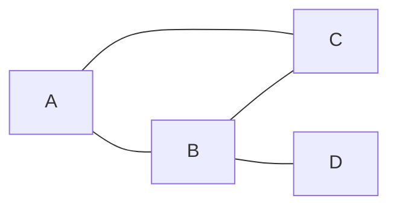

# Articulation Points (or Cut Vertices)

**Practice focus:** Remove a vertex on paper, then compare the DFS root rule with the non-root rule.

An articulation point is a vertex whose removal, together with its incident edges, increases the number of connected components in an undirected graph. It is useful for finding a node whose failure disconnects a network.

**Before you start:** learn the `discovery` and `low` values in [bridge detection](../bridges/README.md). A bridge removes an edge; an articulation point removes a vertex. The conditions are related but different.

## Work through a small graph



Removing B leaves the connected pair A—C and the isolated node D. Removing A leaves C—B—D connected. Only B is an articulation point.

## DFS conditions

| Vertex type | Condition | Reason |
| --- | --- | --- |
| Non-root vertex `u` | A DFS child `v` has `low[v] >= discovery[u]` | The child cannot reach an ancestor of `u` after `u` is removed. |
| Root of a DFS tree | It has at least two DFS children | The separate child subtrees cannot connect without the root. |

A DFS child means a recursive tree edge, not every adjacent vertex. A root may have many neighbors but only one DFS child if those neighbors are connected below it.

The JavaScript below accepts vertex IDs from 0 through `vertexCount - 1` and undirected edge pairs. Edge IDs distinguish parallel edges. A boolean array prevents duplicate results, and the outer loop covers disconnected components.

```js runnable
function findArticulationPoints(vertexCount, edges) {
  const graph = Array.from({ length: vertexCount }, () => []);
  edges.forEach(([u, v], id) => {
    graph[u].push([v, id]);
    graph[v].push([u, id]);
  });
  const discovery = Array(vertexCount).fill(-1);
  const low = Array(vertexCount).fill(-1);
  const marked = Array(vertexCount).fill(false);
  let time = 0;

  function visit(u, incomingEdge) {
    discovery[u] = low[u] = time++;
    let children = 0;
    for (const [v, edgeId] of graph[u]) {
      if (edgeId === incomingEdge) continue;
      if (discovery[v] === -1) {
        children++;
        visit(v, edgeId);
        low[u] = Math.min(low[u], low[v]);
        if (incomingEdge !== -1 && low[v] >= discovery[u]) marked[u] = true;
      } else {
        low[u] = Math.min(low[u], discovery[v]);
      }
    }
    if (incomingEdge === -1 && children >= 2) marked[u] = true;
  }

  for (let u = 0; u < vertexCount; u++) {
    if (discovery[u] === -1) visit(u, -1);
  }
  return marked.flatMap((isPoint, vertex) => isPoint ? [vertex] : []);
}

console.log(JSON.stringify(findArticulationPoints(4, [[0, 1], [1, 2], [2, 0], [1, 3]])));
console.log(JSON.stringify(findArticulationPoints(3, [[0, 1], [1, 2], [2, 0]])));
```

```text output
[1]
[]
```

## Trace the distinction from bridges

In a triangle attached to the rest of a graph through vertex `u`, a child subtree may reach `u` itself but no earlier ancestor. Its low value equals `discovery[u]`. The edge into the triangle is not a bridge because another edge returns to `u`; removing `u` still separates the triangle. That is why the vertex test uses `>=` while the bridge test uses `>`.

## Cost and checks

Time is O(V + E), with O(V) DFS bookkeeping plus the adjacency list. Run DFS on every connected component. Deduplicate the marked vertices, since several child subtrees may identify the same vertex. The implementation handles parallel edges and self-loops. Its recursive DFS can exceed the JavaScript call-stack limit on very deep graphs; use an explicit stack for those inputs.

Check a single vertex, a chain, a cycle, two cycles sharing one vertex, and a disconnected graph. As a small-input oracle, remove each vertex and count components again; compare the increase with the DFS result.

## References

- [GeeksForGeeks](https://www.geeksforgeeks.org/articulation-points-or-cut-vertices-in-a-graph/)
- [YouTube](https://www.youtube.com/watch?v=2kREIkF9UAs&list=PLLXdhg_r2hKA7DPDsunoDZ-Z769jWn4R8)

**Next:** [Strongly Connected Component](../strongly-connected-components/README.md).
