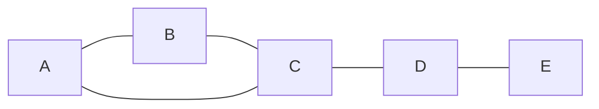

# Bridges in Graph

**Practice focus:** Trace when a branch can return to an earlier vertex without using its parent edge.

A bridge is an edge whose removal increases the number of connected components in an undirected graph. It identifies a connection with no alternative route. In a triangle no edge is a bridge; in a chain every edge is.

**Before you start:** understand [depth-first search](../depth-first-search/README.md). The code below accepts a simple undirected graph with vertices `0` through `n - 1`, no self-loops, and no parallel edges.

## See the alternative route



Removing A—B still allows travel through C. Removing C—D separates D and E from the triangle. Removing D—E isolates E.

## Record discovery and low values

`discovery[u]` is the time DFS first visits `u`. `low[u]` is the earliest discovery time reachable from `u`'s DFS subtree using tree edges and at most one back edge. Initialize both when visiting a node.

After exploring a child `v`, update `low[u]` with `low[v]`. An already visited neighbor other than the parent can lower `low[u]` with its discovery time. The tree edge `u—v` is a bridge exactly when `low[v] > discovery[u]`: the child's subtree cannot get back to `u` or an earlier ancestor without that edge.

## Implementation

```js runnable
function findBridges(n, edges) {
  const graph = Array.from({ length: n }, () => []);
  for (const [u, v] of edges) {
    graph[u].push(v);
    graph[v].push(u);
  }
  const discovery = Array(n).fill(-1);
  const low = Array(n).fill(-1);
  const bridges = [];
  let time = 0;
  function visit(u, parent) {
    discovery[u] = low[u] = time++;
    for (const v of graph[u]) {
      if (v === parent) continue;
      if (discovery[v] === -1) {
        visit(v, u);
        low[u] = Math.min(low[u], low[v]);
        if (low[v] > discovery[u]) bridges.push([u, v]);
      } else low[u] = Math.min(low[u], discovery[v]);
    }
  }
  for (let u = 0; u < n; u++) if (discovery[u] === -1) visit(u, -1);
  return bridges;
}
const edges = [[0, 1], [1, 2], [2, 0], [2, 3], [3, 4]];
console.log(JSON.stringify(findBridges(5, edges)));
console.log(JSON.stringify(findBridges(3, [[0, 1], [1, 2], [2, 0]])));
```

```text output
[[3,4],[2,3]]
[]
```

## Cost and edge cases

Time is O(V + E). The adjacency list uses O(V + E) space; DFS bookkeeping and recursion use O(V). Start DFS from every unvisited vertex to handle disconnected graphs. For very deep graphs, an explicit stack avoids JavaScript call-stack limits.

For parallel edges, track edge IDs and skip only the exact incoming edge. Skipping all edges to the parent would miss the alternative parallel connection. For cut vertices, continue with [articulation points](../articulation-points/README.md): the test differs from the bridge test.

## References

- [GeeksForGeeks on YouTube](https://www.youtube.com/watch?v=thLQYBlz2DM&list=PLLXdhg_r2hKA7DPDsunoDZ-Z769jWn4R8)
- [Wikipedia](https://en.wikipedia.org/wiki/Bridge_%28graph_theory%29#Tarjan.27s_Bridge-finding_algorithm)
- [GeeksForGeeks](https://www.geeksforgeeks.org/bridge-in-a-graph/)

**Next:** [Articulation Points (or Cut Vertices)](../articulation-points/README.md).
