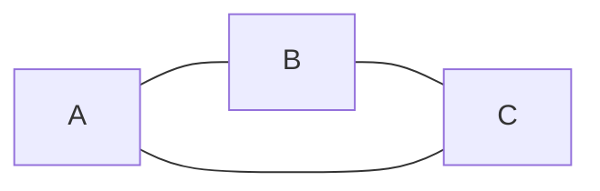
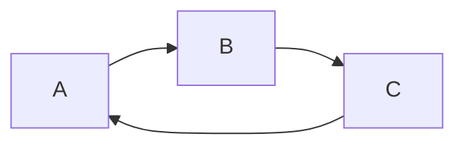

import AlgorithmWalkthrough from '@site/src/components/AlgorithmWalkthrough';

# Detect Cycle in Graphs

**Read first:** [Depth-First Search (DFS)](../depth-first-search/README.md).

**Practice focus:** Compare an undirected parent edge with a directed edge back to an active ancestor.

A cycle is a route that returns to its starting node. In an undirected graph, do not mistake the edge back to the parent for a new cycle. In a directed graph, returning to a node still on the current DFS path signals a cycle.

## Definitions

A **closed walk** consists of a sequence of vertices starting
and ending at the same vertex, with each two consecutive vertices
in the sequence adjacent to each other in the graph. In a directed graph,
each edge must be traversed by the walk consistently with its direction:
the edge must be oriented from the earlier of two consecutive vertices
to the later of the two vertices in the sequence.
The choice of starting vertex is not important: traversing the same cyclic
sequence of edges from different starting vertices produces the same closed walk.

A **simple cycle may** be defined either as a closed walk with no repetitions of
vertices and edges allowed, other than the repetition of the starting and ending
vertex, or as the set of edges in such a walk. The two definitions are equivalent
in directed graphs, where simple cycles are also called directed cycles: the cyclic
sequence of vertices and edges in a walk is completely determined by the set of
edges that it uses. In undirected graphs the set of edges of a cycle can be
traversed by a walk in either of two directions, giving two possible directed cycles
for every undirected cycle. A circuit can be a closed walk allowing repetitions of
vertices but not edges; however, it can also be a simple cycle, so explicit
definition is recommended when it is used.

## Example

<AlgorithmWalkthrough name="cycleDetection" />

The walkthrough records which vertices are on the active DFS path. The rules below distinguish undirected and directed graphs.

### Cycle in undirected graph

When visiting C from B, A is already visited and is not C's parent, so the triangle contains a cycle. The edge from C back to B alone does not prove a cycle.

### Cycle in directed graph

Use three states: unvisited, active, and finished. An edge to an active vertex closes a cycle. An edge to a finished vertex need not do so. Both traversal variants take O(V + E) time with adjacency lists.

## References

General information:

- [Wikipedia](<https://en.wikipedia.org/wiki/Cycle_(graph_theory)>)

Cycles in undirected graphs:

- [Detect Cycle in Undirected Graph on GeeksForGeeks](https://www.geeksforgeeks.org/detect-cycle-undirected-graph/)
- [Detect Cycle in Undirected Graph Algorithm on YouTube](https://www.youtube.com/watch?v=n_t0a_8H8VY&list=PLLXdhg_r2hKA7DPDsunoDZ-Z769jWn4R8)

Cycles in directed graphs:

- [Detect Cycle in Directed Graph on GeeksForGeeks](https://www.geeksforgeeks.org/detect-cycle-in-a-graph/)
- [Detect Cycle in Directed Graph Algorithm on YouTube](https://www.youtube.com/watch?v=rKQaZuoUR4M&list=PLLXdhg_r2hKA7DPDsunoDZ-Z769jWn4R8)

**Next:** [Topological Sorting](../topological-sorting/README.md).
