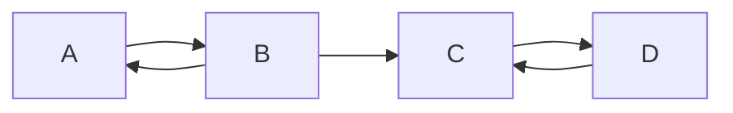

# Strongly Connected Component

**Practice focus:** Group vertices that can reach one another in both directions, then inspect the links between groups.

A strongly connected component (SCC) is a maximal group in a directed graph where every vertex can reach every other vertex. “Maximal” means you cannot add another vertex while keeping that property. A single isolated vertex is also an SCC.

**Before you start:** understand [DFS](../depth-first-search/README.md) and directed edges.

## See why direction matters



The groups are `{A, B}` and `{C, D}`. B reaches C, but C cannot return to B. Ignoring arrow directions would incorrectly combine all four vertices.

## Kosaraju's two passes

1. Run DFS on the original graph from every unvisited vertex. Record each vertex when its DFS call finishes, after its children.
2. Reverse every edge to make the transposed graph.
3. Process vertices in reverse finishing order. Each DFS on the transposed graph visits one previously unassigned SCC.

Finishing order puts a source component of the original component graph first. After reversing edges, that group cannot escape to any unassigned group. Repeat for the remaining components.

## Implementation

The input is an adjacency list indexed by vertex number. The two passes need separate visited sets.

```js runnable
function stronglyConnectedComponents(graph) {
  const seen = new Set();
  const order = [];
  function finish(u) {
    seen.add(u);
    for (const v of graph[u]) if (!seen.has(v)) finish(v);
    order.push(u);
  }
  for (let u = 0; u < graph.length; u++) if (!seen.has(u)) finish(u);
  const reversed = Array.from({ length: graph.length }, () => []);
  graph.forEach((neighbors, u) => neighbors.forEach(v => reversed[v].push(u)));
  seen.clear();
  function collect(u, component) {
    seen.add(u);
    component.push(u);
    for (const v of reversed[u]) if (!seen.has(v)) collect(v, component);
  }
  const components = [];
  for (const u of order.reverse()) {
    if (seen.has(u)) continue;
    const component = [];
    collect(u, component);
    components.push(component);
  }
  return components;
}
console.log(JSON.stringify(stronglyConnectedComponents([[1], [0, 2], [3], [2]])));
console.log(JSON.stringify(stronglyConnectedComponents([[]])));
```

```text output
[[0,1],[2,3]]
[[0]]
```

## Cost and checks

The two DFS passes and edge reversal take O(V + E) time and space. Recursive depth can reach V; use explicit DFS frames for deep inputs. For the first pass, a stack implementation must record **finishing** order, not just discovery order.

Test an empty graph, isolated vertices, a directed cycle, and disconnected cycles. Contracting each SCC into one vertex always produces a directed acyclic graph. That condensed graph helps organize dependency groups without confusing them with an order inside a cycle.

## References

- [Wikipedia](https://en.wikipedia.org/wiki/Strongly_connected_component)
- [YouTube](https://www.youtube.com/watch?v=RpgcYiky7uw&list=PLLXdhg_r2hKA7DPDsunoDZ-Z769jWn4R8)

**Next:** [Eulerian Path](../eulerian-path/README.md).
