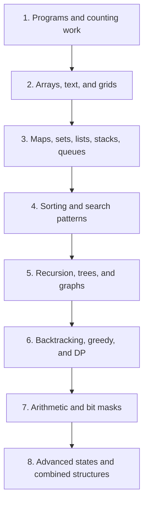

# JavaScript data structures & algorithms

Start from your first program and learn to represent a problem, choose an algorithm, and explain why it works. This path focuses on **JavaScript for LeetCode and CodeChef**. You only need basic arithmetic to begin; programming prerequisites are taught before the algorithms that use them.

**Start here:** [JavaScript for DSA](./javascript-for-dsa.md) → [time, memory, and correctness](./complexity.md) → [programming basics](./school-basics/README.md). If you already write loops and functions, use the checks in those lessons to find gaps before skipping ahead.

The course was compared with the official [CodeChef DSA roadmap](https://www.codechef.com/roadmap/data-structures-and-algorithms) on **23 October 2026**. The [coverage checklist and revision notes](./roadmap-coverage.md) map all 32 current roadmap entries to local lessons and explain additions and optional material. The teaching order below includes extra JavaScript prerequisites and useful LeetCode techniques.

The table below gives the lessons and checkpoint for each stage. Optional application topics branch off after their listed prerequisites.

## Your first study session

Open [JavaScript for DSA](./javascript-for-dsa.md), create a plain-text file named `lesson.mjs`, paste its first runnable example, and run `node lesson.mjs` in a terminal in that folder. A terminal accepts commands; Node executes the file. The expected output appears directly below each example. If Node is unavailable, use the [official CodeChef JavaScript compiler](https://www.codechef.com/javascript-online-compiler) for the small self-contained language examples. The standard-input downloads run in Node and use its standard library; no extra packages are needed.

Read the language chapter in small sections and alter each sample before continuing. Do not memorize every pitfall on the first day. Explain the count loop aloud, change its threshold, test an empty array, and only then start complexity. Use [assessment 1](./assessments/README.md) after stage 1. Every later stage has its own independent assessment and a separate solution page.

## How to study a lesson

Begin with the small example and its diagram. Explain what each box, arrow, and variable means. Predict the next state before running the code. Then read the correctness argument, count the work, and attempt the understanding checks with the answers closed.

The **Next step** walkthroughs use black-and-white outlines and explicit state labels. Use **Previous** to revisit a state, **Play** for a requested replay, or **Read all steps with diagrams** for a transcript. Printing includes all walkthrough steps. Arrows represent relationships or movement, not physical JavaScript memory addresses. The first index is 0 unless the problem says otherwise.

Blocks labeled `js runnable` are complete checked examples with exact output. Judge adapters explain whether a platform expects a returned value or standard output. Other excerpts and exercise starters are labeled separately; never assume a fragment is a full submission.

## Learning path

Follow the stages in order, moving on when you can meet the checkpoint. A **prerequisite** is something you need to understand first. Earlier stages provide the prerequisites for later stages; the advanced DP chapter explicitly requires bit masks from stage 7. Topic pages keep their existing practice problems and worked solutions.

| Stage | Topics, in order | Checkpoint |
| --- | --- | --- |
| 1. First programs | [JavaScript for DSA](./javascript-for-dsa.md), [complexity and correctness](./complexity.md), [programming basics and simulation](./school-basics/README.md) | Explain every symbol in a loop; run both a function and a standard-input program; trace state and count work. |
| 2. Represent and scan data | [Arrays](./Array/README.md), [strings](./strings/README.md), [matrices](./matrix/README.md) | Distinguish position from value, copy from shared reference, and one row from the whole grid. |
| 3. Store useful state | [Hashing](./hashing/README.md), [hash tables](./hash-table/README.md), [sets](./sets/README.md), [linked lists](./linked-list/README.md), [doubly linked lists](./doubly-linked-list/README.md), [stacks](./stack/README.md), [queues](./queue/README.md) | Choose between membership, frequency, order, and node access; explain the tradeoff. |
| 4. Reduce repeated work | [Sorting](./sorting/README.md), [search](./search/README.md), [two pointers](./two-pointers/README.md), [sliding window](./sliding-window/README.md), [prefix sums](./prefix-sum/README.md), [binary search](./binary-search/README.md) | Prove why moving a boundary or discarding candidates cannot lose the answer. Revisit merge/quick sort after recursion. |
| 5. Explore structured state | [Recursion](./recursion/README.md), [trees](./trees/README.md), [binary search trees](./trees/binary-search-tree/README.md), [heaps](./heap/README.md), [priority queues](./priority-queue/README.md), [graphs](./graphs/README.md), [disjoint sets](./disjoint-set/README.md), [tries](./trie/README.md) | Choose DFS, BFS, a priority queue, or union-find from the required operations; handle deep inputs safely. |
| 6. Search and optimize choices | [Backtracking](./backtracking/README.md), [greedy](./greedy/README.md), [dynamic programming](./dp/README.md), [Kadane's algorithm](./kadanes-algorithm/README.md), [monotonic stacks](./monotonic-stack/README.md) | Define a complete search state, justify pruning or a greedy choice, and derive a recurrence before coding. |
| 7. Contest arithmetic and masks | [Number theory and combinatorics](./math/README.md), [bit manipulation](./bit-manipulation/README.md) | Check precision before arithmetic; justify modular inverses and counting formulas; represent a small subset as bits. |
| 8. Combine advanced tools | [Interval, tree, and subset DP](./dp/advanced.md), [Fenwick trees](./trees/fenwick-tree/README.md), [segment trees](./trees/segment-tree/README.md), then [lazy range updates](./trees/segment-tree/range-updates.md), [KMP](./strings/knuth-morris-pratt/README.md), [Z algorithm](./strings/z-algorithm/README.md), [LRU cache](./lru-cache/README.md) | Handle changing ranges, string matches, and combined state; reconstruct answers and compare against simpler solutions on small inputs. |

Use the [eight stage assessments](./assessments/README.md) to demonstrate each checkpoint with a fresh problem. Read [hints and solutions](./assessments/solutions.md) only after an attempt.

Use the [graduated practice plan](./practice-plan.md) for direct applications, variations, mixed exercises, hints, and separately presented answers. The [pattern selection guide](./patterns.md) helps once you understand the input and need an approach. [Pseudocode](../pseudocode/index.md) is optional extra support for expressing steps before translating them to JavaScript.

## Prerequisites that deserve a second pass

| Before studying… | Be able to explain… | Preparation |
| --- | --- | --- |
| Linked lists | Two names can point to the same object; copying a reference does not copy a node. | [JavaScript references](./javascript-for-dsa.md), [assessment 2](./assessments/README.md) |
| Merge sort and quicksort implementations | A base case stops recursive calls; unfinished calls retain state. | [Recursion](./recursion/README.md); stage 4 first teaches sorting behavior and simpler iterative sorts. |
| Heap-based Dijkstra | A heap returns the smallest priority, but a first discovered route may improve. | [Heap](./heap/README.md), then [scan-to-heap shortest paths](./graphs/dijkstra/README.md) |
| Knapsack and string DP | A state has one precise meaning; every dependency must be ready before use. | [Basic DP](./dp/README.md) before [knapsack](./sets/knapsack-problem/README.md) and [LCS](./sets/longest-common-subsequence/README.md) |
| Subset DP and Fenwick low bits | Number bitwise operations coerce to 32 bits; distinguish a rank or mask from the original value. | [Bits](./bit-manipulation/README.md) before [advanced DP](./dp/advanced.md) and [Fenwick](./trees/fenwick-tree/README.md) |
| Lazy propagation | A parent summarizes disjoint child ranges; the endpoint convention is consistent. | [Point-update segment trees](./trees/segment-tree/README.md) before [range updates](./trees/segment-tree/range-updates.md) |

These are dependency checks, not additional mandatory courses. Return to the linked explanation if you cannot yet answer one.

## Choose an approach

Write what the answer must contain, then inspect the input rules. A word such as “minimum” does not select an algorithm by itself. For example, a minimum number of unweighted hops suggests BFS, while minimum travel cost with nonnegative weights suggests Dijkstra.

Use the [pattern-selection guide](./patterns.md) for the decision table, required assumptions, and counterexamples. It compares windows with prefix sums, greedy choices with DP, and enumeration with counting. Keeping those comparisons in one place makes it easier to revisit the reason behind a choice.

## Work through a problem

1. **Write the contract.** Specify output, empty-input behavior, duplicate handling, allowed mutation, and numeric bounds.
2. **Describe a baseline.** State a correct brute-force solution and count its repeated work.
3. **Choose a state.** Decide what to retain: two indices, a frequency map, a stack, a frontier, or a DP state.
4. **State the invariant.** Explain what remains true after each step and why the next step preserves it.
5. **Trace a small case.** Include a case that challenges the assumption, such as a negative value or duplicate boundary.
6. **Implement and verify.** Check ordinary and boundary cases; compare with brute force on small inputs when practical.
7. **Account for cost.** Include sorting, allocation, recursion depth, and the cost of each feasibility check.

## Practice

Each concept has one **Practice Problems** table with levels, practice links, and examples where available. The imported catalog contains **487 distinct LeetCode questions** and **47 general exercises**, each with one main practice home. Select a question title to open any of the **329 full statements** directly in its row. **Bold questions marked “Must fix”** come from the JavaScript workbook and should be completed first. See [source and scope notes](./practice-sources.md) for the snapshot and its limitations.

Choose one recognition problem, one variation, and one problem that requires a different approach despite similar wording. Explain the invariant before coding, then return to a missed problem later without looking at the solution. Use the [pattern practice sequence](./patterns.md#practice-progression) for starting points.

The [JavaScript workbook](../javascript/workbook.md) provides shorter exercises. Begin with [stack tracing](./stack/README.md#trace-a-stack-and-account-for-work), then use [topological sort](./graphs/topological-sorting/README.md#kahns-algorithm-count-unfinished-prerequisites) and [Bellman–Ford](./graphs/bellman-ford/README.md#a-complete-javascript-example) when studying graphs.

## Complexity reference

Return to [time, memory, and correctness](./complexity.md) for growth rates and the distinction between worst-case, expected, and amortized work. Count the size that your algorithm actually uses: n items, V vertices and E edges, or a numeric capacity W. A cost belongs to a particular method and its assumptions, not to an entire topic.

Each lesson gives the cost of its implementation. Include preparation and output: sorting before a scan still costs sorting time, and listing every subset must pay for every returned value.

## Useful words in simple English

| Term | Meaning |
| --- | --- |
| State | The information you keep while solving the problem. |
| Invariant | A fact that stays true after every step. |
| Time complexity | How the amount of work grows as the input grows. |
| Space complexity | How much memory the algorithm needs as the input grows. |
| Amortized | The average cost per operation across a whole sequence, including occasional expensive operations. |
| Contiguous | Next to each other, with no gaps. |
| Monotonic | Moves in one direction; it does not switch back. |
| Recurrence | A rule that builds an answer from smaller answers. |
| Base case | A small case you can answer directly, without another recursive call. |
| Prune | Stop exploring a choice once you know it cannot lead to a useful answer. |
| Memoization | Save an answer so you do not calculate the same thing again. |
| Traverse | Visit items in a chosen order. |
| Contract | The accepted inputs and the exact result a function promises. |
| Candidate | A choice that has not yet been ruled out. |
| Prefix / suffix | A part starting at the beginning / ending at the end of a sequence. |
| Half-open range | Includes its left endpoint and excludes its right endpoint, as in `[left, right)`. |
| Sentinel | An extra marker or helper position that simplifies a boundary case. |
| Frontier | Items found but still waiting to be processed. |
| Identity | A value that leaves a combination unchanged, such as zero for addition. |
| Mutation | Changing an existing array or object. |
| In place | Updating the supplied structure directly; check the stated extra-memory allowance. |

## Optional applications

Browser, DOM, UI, asynchronous programming, and application tooling belong to the wider [JavaScript course](../javascript/index.md); they are optional for this DSA path. Specialized math and heap extensions are labeled in their own chapters.

After the core path, explore [statistics](./statistics/README.md), [pattern printing](./printing-pattern/README.md), [Bloom filters](./bloom-filter/README.md), [cryptography](./cryptography/README.md), [image processing](./image-processing/README.md), and [machine learning algorithms](./ml/README.md). [More practice](./uncategorized/README.md) collects problems that combine techniques.

For broader engineering trade-offs, continue to [system design](../system-design/README.md).

## Build a student-club toolkit {/* #club-toolkit */}

Combine the lessons in a small program before adding a website. Keep each feature as a function so you can test it with ordinary arrays and objects.

| Feature | Build after | Acceptance check |
| --- | --- | --- |
| Attendance report | Arrays, Maps, and Sets | Count visits by student ID, preserve the input, and distinguish total visits from distinct students. |
| Reading-log totals | Prefix sums | Return pages read between two valid day boundaries, including an empty range. Compare every tiny range with direct addition. |
| Activity prerequisites | Graphs and topological sorting | Return each activity once after its prerequisites; report a cycle instead of returning a partial plan. |
| Urgent-task list | Heaps and priority queues | Serve smaller priority numbers first and preserve arrival order for ties. Check empty, repeated, and interleaved operations. |

Start with the attendance report. Add one feature only after you can explain its input rules, state, cost, and edge cases. For each feature, keep a simple comparison implementation for small inputs and write one test that would catch a plausible mistake. A UI, server, and external database are optional later work.

## Completion checkpoint

Use the [practice checkpoints](./practice-plan.md) to demonstrate independent problem-solving. Reading alone does not establish proficiency: explain, implement, test, revisit, and solve unfamiliar variations.

## 10 Key Data Structures We Use Every Day

Use the [pattern selection guide](./patterns.md) to connect required operations to structures. Choose a bounded undo history, a priority job queue, and nearest-location search. State operation complexity and explain why one structure need not solve all three.

Expected design reasoning

A bounded stack-like history handles undo; a heap-based priority queue orders jobs while a separate policy handles equal priorities. Spatial search needs a distance and update contract; use [geospatial indexing](../system-design/distributed/geospatial.md) for the system-level choices. The requirement determines what to optimize, and bounds determine whether a simpler scan is sufficient.

