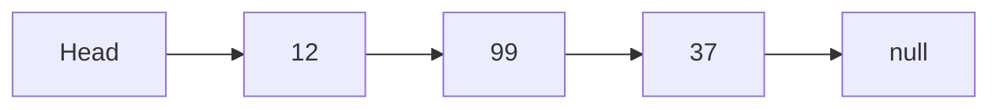

# Linked List Traversal

**Read first:** [Linked lists: change connections without losing data](../README.md).

**Practice focus:** Move a temporary reference through the nodes while keeping every next link unchanged.

A singly linked list stores a value and a `next` reference in each node. Start at the head, read its value, and follow `next` until it is `null`. Unlike an array, reaching the third node requires following the first two links.

## Follow the links



## Implementation

This version collects the values without changing the list. Its input must be an acyclic list whose final `next` is `null`.

```js runnable
function listValues(head) {
  const result = [];
  for (let node = head; node !== null; node = node.next) {
    result.push(node.value);
  }
  return result;
}
const head = { value: 12, next: { value: 99, next: { value: 37, next: null } } };
console.log(listValues(head).join(' → '));
console.log(JSON.stringify(listValues(null)));
```

```text output
12 → 99 → 37
[]
```

## Cost and boundaries

Every node is visited once: O(n) time. The cursor needs O(1) space, while the returned array needs O(n). If you process one value at a time instead of collecting them, no result array is needed.

An empty list has a `null` head. A cycle never reaches `null`, so validate that contract or use [cycle detection](../../graphs/detect-cycle/README.md#cycle-in-directed-graph) adapted to next references. Reassigning the local cursor is safe; changing `node.next` changes the list itself.

## Check your understanding

Trace an empty list and a one-node list. Explain why a condition such as `while (node.next)` would skip the last node and fail when the head is null. Continue with [reverse traversal](../reverse-traversal/README.md) to read values backward.

## Reference

- [Wikipedia](https://en.wikipedia.org/wiki/Linked_list)

## Exercise and failure drill

Traverse an empty list, a one-node list, and a list whose final node points back to the head.

<details>
<summary>Expected trace and debugging checks</summary>

The first two cases stop at null under an acyclic-list contract. The cycle never reaches null, so detect or reject cycles when they are possible. A traversal limit is a diagnostic bound, not proof of an acyclic list.

</details>

## Interview reasoning

Why not use repeated indexed access? A linked list must follow links to reach an index. Repeatedly restarting from the head can turn a linear traversal into quadratic work.

**Next:** [Reversed Linked List Traversal](../reverse-traversal/README.md).
