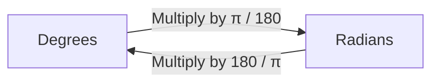

# Radian

**Read first:** [Liu Huis π Algorithm](../liu-hui/README.md).

**Practice focus:** Measure an angle by arc length divided by radius, then convert a half-turn in both units.

A radian measures an angle using a circle's arc length. Divide the arc length by the radius: **angle = arc length / radius**. Use the same unit for both lengths.

## Build the idea step by step

| Arc on a circle of radius 2 | Calculation | Angle |
| --- | --- | --- |
| Arc length 2 | `2 / 2` | 1 radian |
| Quarter of the circumference | `(π × 2 / 2) / 2` | π/2 radians |
| Half of the circumference | `(π × 2) / 2` | π radians |
| Full circumference | `(2 × π × 2) / 2` | 2π radians |

Changing the circle's size changes the arc and radius in the same proportion, so the angle stays the same. One radian is approximately `57.3°`.



## Conversions

| Degrees | Radians |
| --- | --- |
| 0° | 0 |
| 30° | π/6 |
| 45° | π/4 |
| 60° | π/3 |
| 90° | π/2 |
| 180° | π |
| 360° | 2π |

JavaScript trigonometric functions use radians. To calculate the sine of 90 degrees, convert first:

```js runnable
const radians = 90 * Math.PI / 180;
console.log(Math.sin(radians));
```

```text output
1
```

For a general floating-point result, compare with a small tolerance instead of assuming exact equality. Reference: [radian](https://en.wikipedia.org/wiki/Radian).

## Exercise and failure drill

Convert 180 degrees and 90 degrees to radians, then predict a trigonometric function that expects radians.

<details>
<summary>Expected trace and debugging checks</summary>

The angles are π and π/2. Passing 90 directly to a radians-based API is a unit bug. Label units at boundaries and use a tolerance for floating-point comparisons.

</details>

## Interview reasoning

Why use radians in mathematical formulas? Radians express arc length relative to radius and make many calculus relationships take their standard form. They do not remove numerical approximation.

**Next:** [Fourier Transform](../fourier-transform/README.md).
