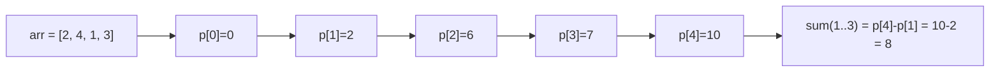

import PracticeProblem from '@site/src/components/PracticeProblem';

import AlgorithmWalkthrough from '@site/src/components/AlgorithmWalkthrough';

# ➕ Prefix Sum

Save a running total at every position. Then find the sum of a range by subtracting two totals instead of adding all its values again.

---

<AlgorithmWalkthrough name="prefixSum" />

## Learning steps

Suppose a reading log stores pages read each day. Saving totals up to each day lets you answer many date-range questions by subtraction.

1. Build the extra leading zero and subtract two prefix totals.
2. Count earlier prefixes for exact-sum ranges, including negative values.
3. Batch range additions with a difference array; study grid sums last.

## 🎯 Concept

A **prefix** is everything from the start up to a chosen boundary. After one pass to build its totals, a fixed array can answer a range-sum query with two reads and one subtraction: O(1) work. Changing the array later requires updating the stored information.

Build a prefix sum array `p` where `p[i] = arr[0] + arr[1] + ... + arr[i-1]` (the extra leading zero makes the same formula work for every range):

```
Range sum [L, R] = p[R + 1] - p[L]   (with p[0] = 0)
```



A **difference array** records where each addition starts and stops. Recording one range addition takes O(1); a final O(n) pass builds the resulting values. This is useful when you do not need an answer between updates.

### 1D vs 2D Prefix Sum

- **1D**: `p[i+1] = p[i] + arr[i]`. Answers `sum(L..R)` in O(1).
- **2D**: `p[i][j]` stores the sum of the rectangle from `(0,0)` to `(i-1,j-1)`. Uses **inclusion–exclusion**: add the upper and left totals, then subtract their overlap so it is not counted twice:

```
p[i][j] = arr[i-1][j-1] + p[i-1][j] + p[i][j-1] - p[i-1][j-1]

rectSum(r1,c1,r2,c2) = p[r2+1][c2+1] - p[r1][c2+1] - p[r2+1][c1] + p[r1][c1]
```

---

## ⚡ Time & Space Complexity

| Operation               | Time   | Space  | Notes               |
| ----------------------- | ------ | ------ | ------------------- |
| Build 1D prefix array   | O(n)   | O(n)   | One pass            |
| 1D range query          | O(1)   | O(1)   | Two lookups         |
| Difference array update | O(1)   | O(n)   | Read values in O(n) |
| Build 2D prefix array   | O(m·n) | O(m·n) | Inclusion–exclusion |
| 2D rectangle query      | O(1)   | O(1)   | Four lookups        |

**Key Insight**: Preprocessing pays off when you have **many queries** on a static array — amortize O(n) build across O(1) queries.

---

## Common Patterns

### Basic Prefix Sum

```javascript
function buildPrefix(arr) {
  const p = new Array(arr.length + 1).fill(0);
  for (let i = 0; i < arr.length; i++) p[i + 1] = p[i] + arr[i];
  return p;
}
function rangeSum(p, l, r) {
  return p[r + 1] - p[l];
}
```

### Subarray Sum Equals K (hash map + prefix)

The map counts **earlier** prefix sums. Before inserting the current sum, each earlier prefix equal to `sum - k` gives one nonempty range ending here. Initialize the empty prefix with count 1 so ranges starting at index 0 are counted. Signed values are allowed; assume sums and result counts stay within JavaScript's safe-integer range.

```js runnable
function subarraySum(nums, k) {
  const map = new Map([[0, 1]]);
  let count = 0,
    sum = 0;
  for (const n of nums) {
    sum += n;
    count += map.get(sum - k) || 0;
    map.set(sum, (map.get(sum) || 0) + 1);
  }
  return count;
}

console.log(subarraySum([1, -1, 1], 1));
console.log(subarraySum([0, 0], 0));
console.log(subarraySum([], 0));
```

```text output
3
3
0
```

For `[0, 0]`, the initial prefix count is 1. The first zero adds 1 answer, and the second adds 2: repeated prefix sums represent different starts. Querying after insertion would incorrectly count an empty range when k is zero.

The expected time is O(n) with expected constant-time map operations; extra space is O(n). See [window versus prefix sum](../patterns.md#contiguous-ranges-window-prefix-sum-or-kadane) before choosing a sum-based window for signed data.

### Difference arrays: many range additions, one final result

Suppose five values start at zero. Add 3 to positions 1 through 3, then add 2 to positions 2 through 4. Updating each covered cell separately takes O(nq) in the worst case for q wide updates. If no intermediate answer is needed, record only where each change starts and stops.

```text
Index:                 0   1   2   3   4   5
Add 3 on [1,3]:        0  +3   0   0  -3   0
Add 2 on [2,4]:        0   0  +2   0   0  -2
Combined differences:  0   3   2   0  -3  -2
Running total:         0   3   5   5   2   0
Result indices:        0   1   2   3   4  (sentinel)
```

Adding at the left boundary starts the effect. Subtracting immediately after the right boundary stops it. The extra cell at index 5 is a **sentinel**, a spare boundary position so an update ending at the last real cell uses the same rule.

```js runnable
function applyRangeAdditions(length, updates) {
  const difference = Array(length + 1).fill(0);
  for (const [left, right, amount] of updates) {
    difference[left] += amount;
    difference[right + 1] -= amount;
  }
  const result = [];
  let current = 0;
  for (let index = 0; index < length; index++) {
    current += difference[index];
    result.push(current);
  }
  return result;
}
console.log(applyRangeAdditions(5, [[1, 3, 3], [2, 4, 2]]).join(','));
console.log(applyRangeAdditions(3, [[0, 2, -1]]).join(','));
console.log(JSON.stringify(applyRangeAdditions(0, [])));
```

```text output
0,3,5,5,2
-1,-1,-1
[]
```

**Contract:** nonnegative integer length; updates have valid inclusive integer boundaries `0 ≤ left ≤ right < length`; amounts and every intermediate sum are safe integers. Input is unchanged. Negative additions are allowed. For an existing base array, add its value at each position to the final running total.

**Why it works:** at a position inside one update, the running sum has included its start but not its stop, contributing exactly `amount`. Before the range it contributes zero; after the range the start and stop cancel. Addition combines these independent effects. Each update takes O(1); initialization and reconstruction take O(n): O(n + q) time, O(n) auxiliary space plus O(n) output. This method batches updates; use a [Fenwick tree](../trees/fenwick-tree/README.md) or [segment tree](../trees/segment-tree/README.md) when updates and queries must interleave.

**Check:** why subtract at `right + 1` instead of `right`?

<details>
<summary>Answer</summary>

The right endpoint belongs to the update. Subtracting there would cancel the effect one position too early. The first excluded position is `right + 1`.

</details>

### 2D Prefix Sum (Matrix Range Query)

```javascript
class NumMatrix {
  constructor(matrix) {
    const m = matrix.length,
      n = matrix[0].length;
    this.p = Array.from({ length: m + 1 }, () => new Array(n + 1).fill(0));
    for (let i = 1; i <= m; i++)
      for (let j = 1; j <= n; j++)
        this.p[i][j] =
          matrix[i - 1][j - 1] + this.p[i - 1][j] + this.p[i][j - 1] - this.p[i - 1][j - 1];
  }
  sumRegion(r1, c1, r2, c2) {
    return this.p[r2 + 1][c2 + 1] - this.p[r1][c2 + 1] - this.p[r2 + 1][c1] + this.p[r1][c1];
  }
}
// Build: O(m*n), Query: O(1)
```

---

## 🧪 Worked Example: Pivot Index

> Find the index where the sum of elements to the left equals the sum to the right.

```javascript
function pivotIndex(nums) {
  const total = nums.reduce((s, x) => s + x, 0);
  let leftSum = 0;
  for (let i = 0; i < nums.length; i++) {
    // right sum = total - leftSum - nums[i]
    if (leftSum === total - leftSum - nums[i]) return i;
    leftSum += nums[i];
  }
  return -1;
}
// A running prefix (leftSum) lets us check the balance point in one pass.
// Time: O(n), Space: O(1)
```

---

## Pitfalls

- Off-by-one: use 1-indexed prefix array to avoid `p[-1]` issues
- 2D prefix sum: remember the inclusion-exclusion formula

---

## Practice Problems

{/* BEGIN GENERATED PRACTICE PROBLEMS */}

| Problem | Level / priority | Practice / notes | Example / answer |
| --- | --- | --- | --- |
| <PracticeProblem id={303} title={"Range Sum Query - Immutable"} text={"Problem statement \u0026 expected result\nConstruct NumArray(nums) for an immutable integer array. Its sumRange(left, right) method returns the total over\nthe inclusive index range. Each query uses the same original array; there is no update operation.\nEXAMPLE 1\nConstruct with nums = [2,-1,4]; call sumRange(0,2), sumRange(1,2).\nQuery results: [5,3]\nExplanation: The inclusive sums are 2-1+4 and -1+4.\nEXAMPLE 2\nConstruct with nums = [7]; call sumRange(0,0).\nQuery result: 7\nExplanation: A one-element range includes that element.\nConstraints \u0026 guarantees\n- 1 \u003c= nums.length \u003c= 10^4\n- -10^5 \u003c= nums[i] \u003c= 10^5\n- 0 \u003c= left \u003c= right \u003c nums.length\n- At most 10^4 calls will be made to sumRange.\nJavaScript starter\nclass NumArray {\nconstructor(nums) { /* TODO */ }\nsumRange(left, right) { /* TODO */ }\n}"} /> | Easy | [LeetCode](https://leetcode.com/problems/range-sum-query-immutable/) | — |
| <PracticeProblem id={724} title={"Find Pivot Index"} text={"Problem statement \u0026 expected result\nReturn the earliest index whose strictly earlier values sum to the same total as its strictly later values. Exclude the\nindexed element from both sums. A missing side has sum zero. Return -1 if no index qualifies.\nEXAMPLE 1\nInput: nums = [1,7,3,6,5,6]\nOutput: 3\nExplanation: At index 3, both excluded-side sums equal 11.\nEXAMPLE 2\nInput: nums = [1,2,3]\nOutput: -1\nExplanation: No index has equal left and right sums.\nConstraints \u0026 guarantees\n- 1 \u003c= nums.length \u003c= 10^4\n- -1000 \u003c= nums[i] \u003c= 1000\n- Note: This question is the same as 1991: https://leetcode.com/problems/find-the-middle-index-in-array/\nJavaScript starter\nfunction pivotIndex(nums) {\n// TODO: write your solution.\n}"} /> | Easy | [LeetCode](https://leetcode.com/problems/find-pivot-index/) | — |
| <PracticeProblem id={1893} title={"Check if All the Integers in a Range Are Covered"} text={"Problem statement \u0026 expected result\nEach input range includes both endpoints. Return whether every integer from left through right belongs to at least\none input range. Coverage outside the target interval is irrelevant.\nEXAMPLE 1\nInput: ranges = [[1,2],[3,4],[5,6]], left = 2, right = 5\nOutput: true\nExplanation: The three intervals collectively include every integer from 2 through 5.\nEXAMPLE 2\nInput: ranges = [[1,10],[10,20]], left = 21, right = 21\nOutput: false\nExplanation: The target integer 21 lies outside both intervals.\nConstraints \u0026 guarantees\n- 1 \u003c= ranges.length \u003c= 50\n- 1 \u003c= starti \u003c= endi \u003c= 50\n- 1 \u003c= left \u003c= right \u003c= 50\nJavaScript starter\nfunction isCovered(ranges, left, right) {\n// TODO: write your solution.\n}"} /> | Easy | [LeetCode](https://leetcode.com/problems/check-if-all-the-integers-in-a-range-are-covered/) | — |
| <PracticeProblem id={238} title={"Product of Array Except Self"} text={"Problem statement\nFor each index i, return the product of every value in nums except nums[i]. The result must have\nthe same length as nums. Do not use division, and finish in O(n) time. Zeros and negative values\nare allowed. Relevant prefix and suffix products fit in a signed 32-bit integer. Seek constant extra\nspace apart from the returned array.\nInput \u0026 expected result\nReturn a new array of products. Excluding an element means excluding that particular index, not\nevery occurrence of the same value. Handle zeros directly; dividing a total product is not allowed.\nEXAMPLE 1\nInput: nums = [2,3,0,4]\nOutput: [0,0,24,0]\nExplanation: Only the position containing zero has a nonzero answer: the other values multiply\nto 24. Every other product includes the zero.\nEXAMPLE 2\nInput: nums = [0,2,0]\nOutput: [0,0,0]\nExplanation: Removing any single position still leaves at least one zero in the product.\nConstraints \u0026 guarantees\n• nums.length: 2 through 10^5 (inclusive)\n• nums[i]: -30 through 30 (inclusive)\n• Every output product fits a signed 32-bit integer\nJavaScript starter\nfunction productExceptSelf(nums) {\n  // TODO: write your solution.\n}"} /> | Medium | [LeetCode](https://leetcode.com/problems/product-of-array-except-self/) | — |
| [LC 325 — Maximum Size Subarray Sum Equals k](https://leetcode.com/problems/maximum-size-subarray-sum-equals-k/) | Medium · Premium | [LeetCode](https://leetcode.com/problems/maximum-size-subarray-sum-equals-k/) | — |
| <PracticeProblem id={370} title={"Range Addition"} text={"Problem statement \u0026 expected result\nBegin with length zero-valued entries. Each update [startIdx, endIdx, inc] adds inc to every index from startIdx\nthrough endIdx, including both endpoints. Return the complete array after accumulating all updates.\nEXAMPLE 1\nInput: length = 5, updates = [[1,3,2],[2,4,3],[0,2,-2]]\nOutput: [-2,0,3,5,3]\nExplanation: Overlapping increments accumulate at each affected index.\nEXAMPLE 2\nInput: length = 10, updates = [[2,4,6],[5,6,8],[1,9,-4]]\nOutput: [0,-4,2,2,2,4,4,-4,-4,-4]\nExplanation: The broad -4 update combines with the two positive ranges.\nConstraints \u0026 guarantees\nReference snapshot limits; current Premium bounds unverified.\n- 1 \u003c= length \u003c= 10^5\n- 0 \u003c= updates.length \u003c= 10^4\n- 0 \u003c= startIdxi \u003c= endIdxi \u003c length\n- -1000 \u003c= inci \u003c= 1000\nJavaScript starter\nfunction getModifiedArray(length, updates) {\n// TODO: write your solution.\n}"} /> | Medium · Premium | [LeetCode](https://leetcode.com/problems/range-addition/) | — |
| <PracticeProblem id={437} title={"Path Sum III"} text={"Problem statement\nCount all nonempty downward paths whose node values total targetSum. A path follows\nparent-to-child edges and may begin or end at any node; it need not reach the root or a leaf.\nDifferent node sequences count separately even when their values match.\nInput \u0026 expected result\nReturn the number of qualifying paths, not a list of paths.\nEXAMPLE 1\nInput: root = [1,1,1], targetSum = 2\nOutput: 2\nExplanation: The root-to-left-child path and root-to-right-child path each total 2.\nEXAMPLE 2\nInput: root = [0,0,0], targetSum = 0\nOutput: 5\nExplanation: Three single-node paths and two root-to-child paths qualify.\nConstraints \u0026 guarantees\n• Tree node count: [0, 1000]\n• -10^9 \u003c= Node.val \u003c= 10^9\n• -1000 \u003c= targetSum \u003c= 1000\nJavaScript starter\nfunction pathSum(root, targetSum) {\n  // TODO: write your solution.\n}"} /> | Medium | [LeetCode](https://leetcode.com/problems/path-sum-iii/) | — |
| <PracticeProblem id={523} title={"Continuous Subarray Sum"} text={"Problem statement \u0026 expected result\nDetermine whether nums contains a contiguous segment of at least two elements whose sum is divisible by\npositive k. Return a boolean. A sum of zero is divisible by k, but a single-element segment is never eligible.\nEXAMPLE 1\nInput: nums = [23,2,4,6,7], k = 6\nOutput: true\nExplanation: The two-element segment [2,4] sums to 6.\nEXAMPLE 2\nInput: nums = [23,2,6,4,7], k = 6\nOutput: true\nExplanation: The segment [2,6,4] sums to 12, a multiple of 6.\nConstraints \u0026 guarantees\n- 1 \u003c= nums.length \u003c= 10^5\n- 0 \u003c= nums[i] \u003c= 10^9\n- 0 \u003c= sum(nums[i]) \u003c= 2^31 - 1\n- 1 \u003c= k \u003c= 2^31 - 1\nJavaScript starter\nfunction checkSubarraySum(nums, k) {\n// TODO: write your solution.\n}"} /> | Medium | [LeetCode](https://leetcode.com/problems/continuous-subarray-sum/) | — |
| <PracticeProblem id={525} title={"Contiguous Array"} text={"Problem statement\nFind the greatest length of a contiguous subarray with the same number of zeros and ones. The\ninput contains only these two values. Elements cannot be rearranged or skipped.\nInput \u0026 expected result\nReturn 0 when no nonempty balanced subarray exists.\nEXAMPLE 1\nInput: nums = [0,1,1,0,1]\nOutput: 4\nExplanation: The first four entries contain two zeros and two ones.\nEXAMPLE 2\nInput: nums = [1,1,1]\nOutput: 0\nExplanation: There are no zeros, so no nonempty interval can be balanced.\nConstraints \u0026 guarantees\n• 1 \u003c= nums.length \u003c= 10^5\n• nums[i] is either 0 or 1\nJavaScript starter\nfunction findMaxLength(nums) {\n  // TODO: write your solution.\n}"} /> | Medium | [LeetCode](https://leetcode.com/problems/contiguous-array/) | — |
| <PracticeProblem id={528} title={"Random Pick with Weight"} text={"Problem statement\nCreate Solution(w), where each positive weight w[i] controls the chance of selecting index i.\npickIndex() must return an index with probability w[i] / sum(w). Repeated calls should follow this\ndistribution.\nInput \u0026 expected result\nRandom output is not a fixed sequence. Examples specify the required probabilities, not exact\nrepeated outcomes.\nEXAMPLE 1\nInput: w = [2,6]\nResult rule: P(index 0) = 1/4; P(index 1) = 3/4\nExplanation: The total weight is 8. Either index is a valid individual result.\nEXAMPLE 2\nInput: w = [5]\nOutput of pickIndex(): 0\nExplanation: The only index receives all of the probability.\nConstraints \u0026 guarantees\n• 1 \u003c= w.length \u003c= 10^4\n• 1 \u003c= w[i] \u003c= 10^5\n• At most 10^4 calls to pickIndex\nJavaScript starter\nclass Solution {\n  constructor(w) { /* TODO */ }\n  pickIndex() { /* TODO */ }\n}"} /> | Medium | [LeetCode](https://leetcode.com/problems/random-pick-with-weight/) | — |
| <PracticeProblem id={560} title={"Subarray Sum Equals K"} text={"Problem statement\nCount the nonempty contiguous subarrays of nums whose sum is k. Negative values and zeros are\nallowed. Count different start/end positions separately, even if the selected values are identical.\nInput \u0026 expected result\nReturn the total count. A subarray contains consecutive elements.\nEXAMPLE 1\nInput: nums = [1,-1,1], k = 1\nOutput: 3\nExplanation: Both single 1 values and the complete array sum to 1.\nEXAMPLE 2\nInput: nums = [0,0], k = 0\nOutput: 3\nExplanation: The two single-element subarrays and the length-two subarray qualify.\nConstraints \u0026 guarantees\n• 1 \u003c= nums.length \u003c= 2 * 10^4\n• -1000 \u003c= nums[i] \u003c= 1000\n• -10^7 \u003c= k \u003c= 10^7\nJavaScript starter\nfunction subarraySum(nums, k) {\n  // TODO: write your solution.\n}"} /> | Medium | [LeetCode](https://leetcode.com/problems/subarray-sum-equals-k/) | — |
| <PracticeProblem id={930} title={"Binary Subarrays With Sum"} text={"Problem statement \u0026 expected result\nCount nonempty contiguous segments of the binary array nums whose sum equals goal. Count segments by\ntheir endpoint positions, so equal-valued segments can contribute separately.\nEXAMPLE 1\nInput: nums = [1,0,1,0,1], goal = 2\nOutput: 4\nExplanation: Four endpoint pairs give a segment with exactly two ones.\nEXAMPLE 2\nInput: nums = [0,0,0,0,0], goal = 0\nOutput: 15\nExplanation: All 5*6/2 nonempty segments have sum zero.\nConstraints \u0026 guarantees\n- 1 \u003c= nums.length \u003c= 3 * 10^4\n- nums[i] is either 0 or 1.\n- 0 \u003c= goal \u003c= nums.length\nJavaScript starter\nfunction numSubarraysWithSum(nums, goal) {\n// TODO: write your solution.\n}"} /> | Medium | [LeetCode](https://leetcode.com/problems/binary-subarrays-with-sum/) | — |
| <PracticeProblem id={974} title={"Subarray Sums Divisible by K"} text={"Problem statement \u0026 expected result\nReturn the number of nonempty contiguous segments whose total is divisible by k. Negative elements and zero\nsums are permitted. Different endpoint pairs count separately.\nEXAMPLE 1\nInput: nums = [4,5,0,-2,-3,1], k = 5\nOutput: 7\nExplanation: Seven distinct segments have sums divisible by 5.\nEXAMPLE 2\nInput: nums = [5], k = 9\nOutput: 0\nExplanation: The sole segment sums to 5, which is not divisible by 9.\nConstraints \u0026 guarantees\n- 1 \u003c= nums.length \u003c= 3 * 10^4\n- -10^4 \u003c= nums[i] \u003c= 10^4\n- 2 \u003c= k \u003c= 10^4\nJavaScript starter\nfunction subarraysDivByK(nums, k) {\n// TODO: write your solution.\n}"} /> | Medium | [LeetCode](https://leetcode.com/problems/subarray-sums-divisible-by-k/) | — |
| <PracticeProblem id={1094} title={"Car Pooling"} text={"Problem statement \u0026 expected result\nFor each trip [passengers, from, to], carry its passengers from the pickup location to the drop-off location while\ntraveling east. Passengers leave before pickups at the same location. Return whether the passenger count\nalways stays within capacity.\nEXAMPLE 1\nInput: trips = [[2,1,5],[3,3,7]], capacity = 4\nOutput: false\nExplanation: The overlapping trips require five seats, exceeding four.\nEXAMPLE 2\nInput: trips = [[2,1,5],[3,3,7]], capacity = 5\nOutput: true\nExplanation: The peak passenger count equals the capacity of five.\nConstraints \u0026 guarantees\n- 1 \u003c= trips.length \u003c= 1000\n- trips[i].length == 3\n- 1 \u003c= numPassengersi \u003c= 100\n- 0 \u003c= fromi \u003c toi \u003c= 1000\n- 1 \u003c= capacity \u003c= 10^5\nJavaScript starter\nfunction carPooling(trips, capacity) {\n// TODO: write your solution.\n}"} /> | Medium | [LeetCode](https://leetcode.com/problems/car-pooling/) | — |
| <PracticeProblem id={1109} title={"Corporate Flight Bookings"} text={"Problem statement \u0026 expected result\nFlights are numbered 1 through n. A booking [first, last, seats] reserves seats on each flight in that inclusive\nrange. Return an n-element array of total reserved seats, with flight 1 at array index 0.\nEXAMPLE 1\nInput: bookings = [[1,2,10],[2,3,20],[2,5,25]], n = 5\nOutput: [10,55,45,25,25]\nExplanation: Flight 2 receives all three bookings; the totals reflect inclusive ranges.\nEXAMPLE 2\nInput: bookings = [[1,2,10],[2,2,15]], n = 2\nOutput: [10,25]\nExplanation: Flight 2 receives 10 plus 15 reserved seats.\nConstraints \u0026 guarantees\n- 1 \u003c= n \u003c= 2 * 10^4\n- 1 \u003c= bookings.length \u003c= 2 * 10^4\n- bookings[i].length == 3\n- 1 \u003c= firsti \u003c= lasti \u003c= n\n- 1 \u003c= seatsi \u003c= 10^4\nJavaScript starter\nfunction corpFlightBookings(bookings, n) {\n// TODO: write your solution.\n}"} /> | Medium | [LeetCode](https://leetcode.com/problems/corporate-flight-bookings/) | — |
| [LC 1248 — Count Number of Nice Subarrays](https://leetcode.com/problems/count-number-of-nice-subarrays/) | Medium | [LeetCode](https://leetcode.com/problems/count-number-of-nice-subarrays/) | — |
| <PracticeProblem id={1943} title={"Describe the Painting"} text={"Problem statement \u0026 expected result\nEach [start,end,color] paints the half-open range [start,end) with a distinct color. Describe painted regions as the\nfewest nonoverlapping segments whose active color sets remain constant. Output each set's color sum rather\nthan its members. Omit unpainted regions. Different color sets must remain separate even when their sums are\nequal.\nEXAMPLE 1\nInput: segments = [[1,4,5],[4,7,7],[1,7,9]]\nOutput: [[1,4,14],[4,7,16]]\nExplanation: The active colors change at 4, producing sums 14 and 16.\nEXAMPLE 2\nInput: segments = [[1,7,9],[6,8,15],[8,10,7]]\nOutput: [[1,6,9],[6,7,24],[7,8,15],[8,10,7]]\nExplanation: Overlap at [6,7) combines 9 and 15; the other ranges use one color.\nConstraints \u0026 guarantees\n- 1 \u003c= segments.length \u003c= 2 * 10^4\n- segments[i].length == 3\n- 1 \u003c= starti \u003c endi \u003c= 10^5\n- 1 \u003c= colori \u003c= 10^9\n- Each colori is distinct.\nJavaScript starter\nfunction splitPainting(segments) {\n// TODO: write your solution.\n}"} /> | Medium | [LeetCode](https://leetcode.com/problems/describe-the-painting/) | — |
| <PracticeProblem id={2381} title={"Shifting Letters II"} text={"Problem statement \u0026 expected result\nFor each [start,end,direction], shift all letters in the inclusive index range by one alphabet position: direction 1\nmoves forward and 0 moves backward. Wrap z to a and a to z as appropriate. Accumulate every shift and return\nthe final lowercase string.\nEXAMPLE 1\nInput: s = \"abc\", shifts = [[0,1,0],[1,2,1],[0,2,1]]\nOutput: \"ace\"\nExplanation: The successive strings are zac, zbd, and ace.\nEXAMPLE 2\nInput: s = \"dztz\", shifts = [[0,0,0],[1,1,1]]\nOutput: \"catz\"\nExplanation: The first letter moves backward and z at index 1 wraps forward to a.\nConstraints \u0026 guarantees\n- 1 \u003c= s.length, shifts.length \u003c= 5 * 10^4\n- shifts[i].length == 3\n- 0 \u003c= starti \u003c= endi \u003c s.length\n- 0 \u003c= directioni \u003c= 1\n- s consists of lowercase English letters.\nJavaScript starter\nfunction shiftingLetters(s, shifts) {\n// TODO: write your solution.\n}"} /> | Medium | [LeetCode](https://leetcode.com/problems/shifting-letters-ii/) | — |
| [LC 2536 — Increment Submatrices by One](https://leetcode.com/problems/increment-submatrices-by-one/) | Medium | [LeetCode](https://leetcode.com/problems/increment-submatrices-by-one/) | — |
| G08 — Determine whether a nonempty subarray sums to zero. | Exercise | Arrays and hashing. Related only: [LC 560](https://leetcode.com/problems/subarray-sum-equals-k/) - Subarray Sum Equals K. Counts target-sum subarrays; setting k = 0 yields the existence test by checking whether the count is positive. | — |
| [LC 1480 — Running Sum of 1D Array](https://leetcode.com/problems/running-sum-of-1d-array/) | Easy | [LeetCode](https://leetcode.com/problems/running-sum-of-1d-array/) |  |
| [LC 304 — Range Sum Query 2D](https://leetcode.com/problems/range-sum-query-2d-immutable/) | Medium | [LeetCode](https://leetcode.com/problems/range-sum-query-2d-immutable/) |  |
| [LC 1171 — Remove Zero Sum Consecutive Nodes](https://leetcode.com/problems/remove-zero-sum-consecutive-nodes-from-linked-list/) | Medium | [LeetCode](https://leetcode.com/problems/remove-zero-sum-consecutive-nodes-from-linked-list/) |  |
| [CC — Sumtastic (SUMTASTIC)](https://www.codechef.com/problems/SUMTASTIC) | Medium | — |  |
| [CC — Chef Segment (CHSEG)](https://www.codechef.com/problems/CHSEG) | Medium | — |  |
| [LC 363 — Max Sum of Rectangle No Larger Than K](https://leetcode.com/problems/max-sum-of-rectangle-no-larger-than-k/) | Hard | [LeetCode](https://leetcode.com/problems/max-sum-of-rectangle-no-larger-than-k/) |  |
| [LC 1031 — Maximum Sum of Two Non-Overlapping Subarrays](https://leetcode.com/problems/maximum-sum-of-two-non-overlapping-subarrays/) | Medium | [LeetCode](https://leetcode.com/problems/maximum-sum-of-two-non-overlapping-subarrays/) |  |
| [LC 1314 — Matrix Block Sum](https://leetcode.com/problems/matrix-block-sum/) | Medium | [LeetCode](https://leetcode.com/problems/matrix-block-sum/) |  |
| [LC 1442 — Count Triplets That Can Form Two Arrays of Equal XOR](https://leetcode.com/problems/count-triplets-that-can-form-two-arrays-of-equal-xor/) | Medium | [LeetCode](https://leetcode.com/problems/count-triplets-that-can-form-two-arrays-of-equal-xor/) |  |
| [LC 1590 — Make Sum Divisible by P](https://leetcode.com/problems/make-sum-divisible-by-p/) | Medium | [LeetCode](https://leetcode.com/problems/make-sum-divisible-by-p/) |  |
| [LC 1658 — Minimum Operations to Reduce X to Zero](https://leetcode.com/problems/minimum-operations-to-reduce-x-to-zero/) | Medium | [LeetCode](https://leetcode.com/problems/minimum-operations-to-reduce-x-to-zero/) |  |
| [LC 1664 — Ways to Make a Fair Array](https://leetcode.com/problems/ways-to-make-a-fair-array/) | Medium | [LeetCode](https://leetcode.com/problems/ways-to-make-a-fair-array/) |  |
| [LC 1732 — Find the Highest Altitude](https://leetcode.com/problems/find-the-highest-altitude/) | Easy | [LeetCode](https://leetcode.com/problems/find-the-highest-altitude/) |  |
| [LC 1991 — Find the Middle Index in Array](https://leetcode.com/problems/find-the-middle-index-in-array/) | Easy | [LeetCode](https://leetcode.com/problems/find-the-middle-index-in-array/) |  |
| [CC — Range Sum Queries (RANGESUM)](https://www.codechef.com/problems/RANGESUM) | Easy | — |  |
| [CC — Prefix Sum Array (PREFSUM)](https://www.codechef.com/problems/PREFSUM) | Easy | — |  |
| [CC — Subarray Queries (SUBARR)](https://www.codechef.com/problems/SUBARR) | Medium | — |  |

{/* END GENERATED PRACTICE PROBLEMS */}

## Related Topics

- [Hashing](../hashing/README.md) — hash map powers subarray sum = K
- [Kadane's Algorithm](../kadanes-algorithm/README.md) — complementary
- [Sliding Window](../sliding-window/README.md)

[← Back to Home](../index.md) · © sparshjaswal

**Next:** [binary-search boundaries](../binary-search/README.md).
