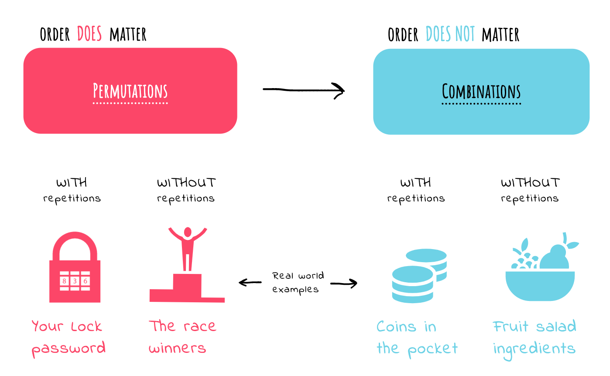
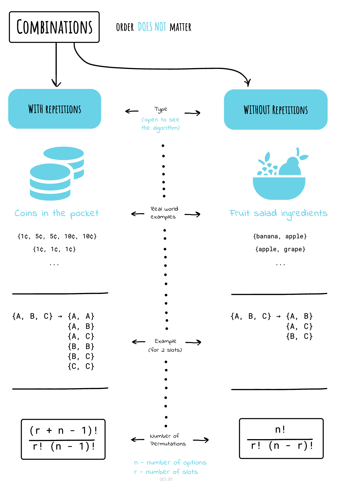
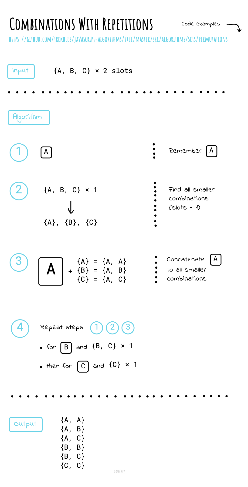
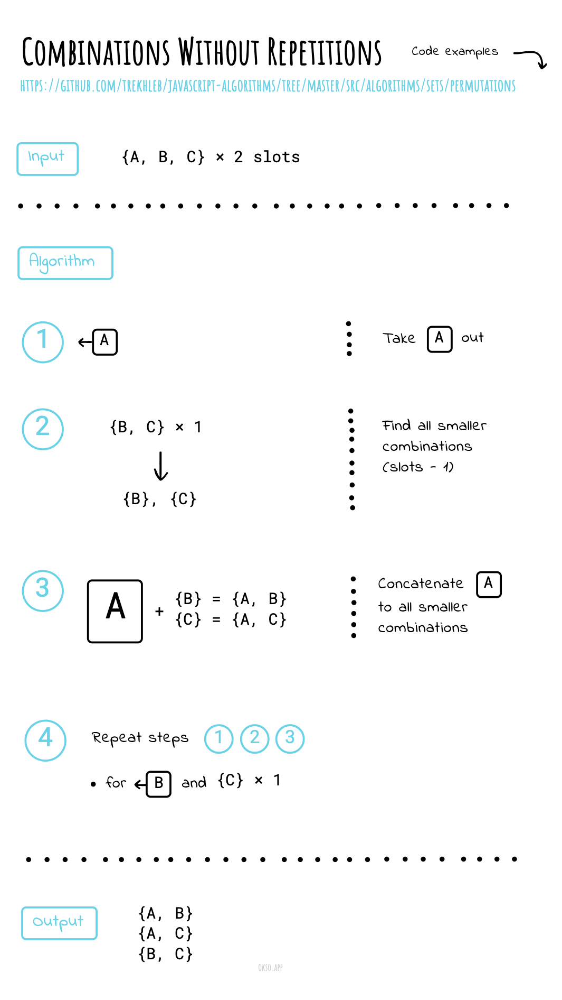

import AlgorithmWalkthrough from '@site/src/components/AlgorithmWalkthrough';

# Combinations

**Read first:** [Backtracking](../../backtracking/README.md).

**Practice focus:** Choose a group in increasing index order so reordered copies are never generated.

A combination chooses a group where order does not matter. Choosing A then B is the same group as choosing B then A. From `{A, B, C}`, the two-item combinations are `{A, B}`, `{A, C}`, and `{B, C}`.

If order matters, use [permutations](../permutations/README.md) instead.

**"My fruit salad is a combination of apples, grapes and bananas"**
We don't care what order the fruits are in, they could also be
"bananas, grapes and apples" or "grapes, apples and bananas",
its the same fruit salad.

## Combinations without repetitions

This is how lotteries work. The numbers are drawn one at a
time, and if we have the lucky numbers (no matter what order)
we win!

No Repetition: such as lottery numbers `(2,14,15,27,30,33)`

**Number of combinations**

where `n` is the number of things to choose from, and we choose `r` of them,
no repetition, order doesn't matter.

It is often called "n choose r" (such as "16 choose 3"). And is also known as the Binomial Coefficient.

## Combinations with repetitions

Repetition is Allowed: such as coins in your pocket `(5,5,5,10,10)`

Or let us say there are five flavours of ice cream:
`banana`, `chocolate`, `lemon`, `strawberry` and `vanilla`.

We can have three scoops. How many variations will there be?

Let's use letters for the flavours: `{b, c, l, s, v}`.
Example selections include:

- `{c, c, c}` (3 scoops of chocolate)
- `{b, l, v}` (one each of banana, lemon and vanilla)
- `{b, v, v}` (one of banana, two of vanilla)

**Number of combinations**

<AlgorithmWalkthrough name="combinationsRepeat" />

Where `n` is the number of things to choose from, and we
choose `r` of them. Repetition allowed,
order doesn't matter.

## Cheatsheet

|                                                                             |                                                                                   |
| --------------------------------------------------------------------------- | --------------------------------------------------------------------------------- |
|  |  |

## References

- [Math Is Fun](https://www.mathsisfun.com/combinatorics/combinations-permutations.html)
- [Permutations/combinations cheat sheets](https://medium.com/@trekhleb/permutations-combinations-algorithms-cheat-sheet-68c14879aba5)

**Next:** [Permutations](../permutations/README.md).
