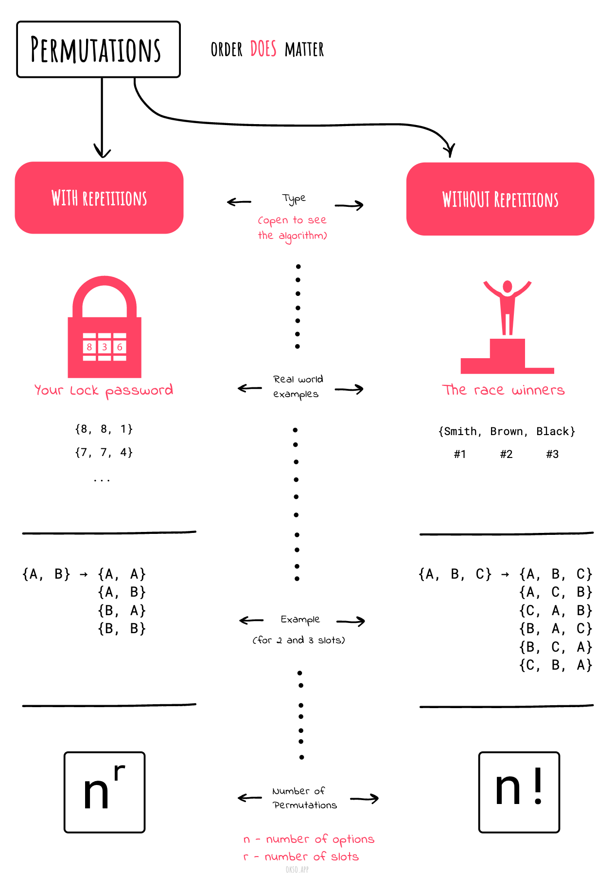
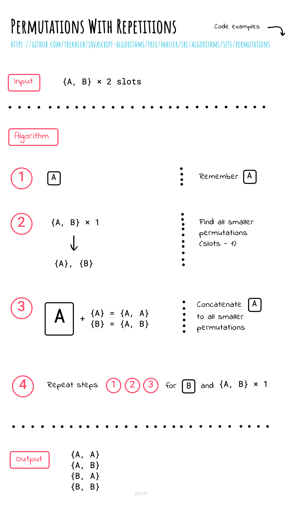
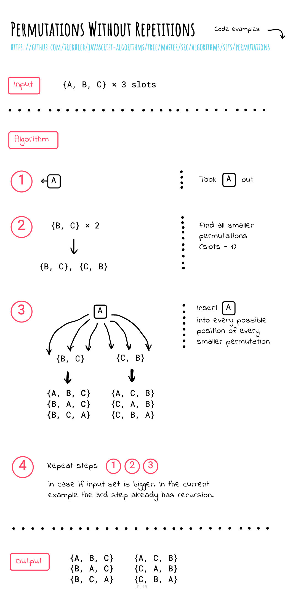

# Permutations

**Read first:** [Backtracking](../../backtracking/README.md).

**Practice focus:** Fill one position at a time using unused items, then decide how duplicate values affect distinct answers.

A permutation is an arrangement where order matters. For `[A, B]`, the arrangements `[A, B]` and `[B, A]` are different. With n distinct items, there are n! full arrangements.

**"The combination to the safe is 472"**. We do care about the order. `724` won't work, nor will `247`.
It has to be exactly `4-7-2`.

## Permutations without repetitions

A permutation, also called an “arrangement number” or “order”, is a rearrangement of
the elements of an ordered list `S` into a one-to-one correspondence with `S` itself.

Below are the permutations of string `ABC`.

`ABC ACB BAC BCA CBA CAB`

Or for example the first three people in a running race: you can't be first and second.

**Number of arrangements**

```
n * (n-1) * (n -2) * ... * 1 = n!
```

## Permutations with repetitions

When repetition is allowed we have permutations with repetitions.
For example, a three-digit lock can accept `333` when repeated digits are allowed.

| Code | First position | Second position | Third position |
| --- | --- | --- | --- |
| `472` | 4 | 7 | 2 |
| `724` | 7 | 2 | 4 |
| `333` | 3 | 3 | 3 |

If each of three positions accepts any of ten digits, there are `10³ = 1000` codes, including codes that begin with zero.

**Number of arrangements**

```
n * n * n ... (r times) = n^r
```

Choosing only `r` distinct items from `n` in order gives `n! / (n - r)!` arrangements. Rearranging a fixed collection with repeated values is a different case: divide `n!` by the factorial of each repeated value's count. For `AAB`, the three distinct arrangements are `AAB`, `ABA`, and `BAA`.

## Cheatsheet




|                                                                             |                                                                                   |
| --------------------------------------------------------------------------- | --------------------------------------------------------------------------------- |
|  |  |

## References

- [Math Is Fun](https://www.mathsisfun.com/combinatorics/combinations-permutations.html)
- [Permutations/combinations cheat sheets](https://medium.com/@trekhleb/permutations-combinations-algorithms-cheat-sheet-68c14879aba5)

**Next:** [Combination Sum Problem](../combination-sum/README.md).
