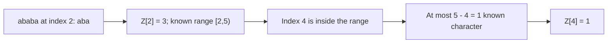

# Z Algorithm

A **prefix** is a part starting at the beginning of a string. For each position `i`, the Z array records how many characters starting there match the beginning of the string. We use `Z[0] = 0` by convention. For `ababa`, the result is `[0, 0, 3, 0, 1]`.

## Learning steps

To spot repeated text, compare each starting position with the beginning of the string. The Z array saves the length of each match.

1. Calculate the five entries for ababa by hand.
2. Reuse the known matching interval, extending only beyond it.
3. Join a pattern and text with a safe separator to find matches.

## Reuse a matching range

Keep a half-open interval `[left, right)` that matches the string's prefix. If `i` is inside that interval, the earlier entry at `i - left` gives a starting match length, capped at `right - i`. Compare new characters only after that known part.

| Position in `ababa` | Initial knowledge | Additional comparisons | Z value |
| --- | --- | --- | --- |
| 1 | No saved range | `b` differs from `a` | 0 |
| 2 | No saved range | `aba` matches the prefix | 3 |
| 3 | Inside `[2, 5)`; reuse Z[1] | `b` still differs from `a` | 0 |
| 4 | Inside `[2, 5)`; cap the reused length at 1 | End of string | 1 |



## Implementation

```js runnable
function zArray(text) {
  const z = Array(text.length).fill(0);
  let left = 0;
  let right = 0;
  for (let i = 1; i < text.length; i++) {
    if (i < right) z[i] = Math.min(right - i, z[i - left]);
    while (i + z[i] < text.length && text[z[i]] === text[i + z[i]]) z[i]++;
    if (i + z[i] > right) {
      left = i;
      right = i + z[i];
    }
  }
  return z;
}
console.log(JSON.stringify(zArray('ababa')));
console.log(JSON.stringify(zArray('aaaa')));
console.log(JSON.stringify(zArray('')));
```

```text output
[0,0,3,0,1]
[0,3,2,1]
[]
```

## Find a pattern

Build `pattern + separator + text` with a separator absent from both inputs. At a combined index `i` after the separator, a Z value at least the pattern length identifies a match at text index `i - pattern.length - 1`. Repeated and overlapping matches are allowed. Handle the empty pattern separately according to your contract. For arbitrary alphabets, choose an out-of-band token in an array instead of assuming `$` is unused.

## Complexity

For a string of length n, the algorithm takes O(n) time and O(n) space for the Z array. For combined pattern and text lengths m and n, both bounds are O(m + n). The right boundary advances at most the string length; comparisons inside an already known range do not restart from zero. This implementation compares UTF-16 code units.

## Practice Problems

{/* BEGIN GENERATED PRACTICE PROBLEMS */}

| Problem | Level / priority | Practice / notes | Example / answer |
| --- | --- | --- | --- |
| G41 — Compute each suffix's common-prefix length with the entire string. | Exercise | Strings | — |

{/* END GENERATED PRACTICE PROBLEMS */}

## References

- [GeeksForGeeks](https://www.geeksforgeeks.org/z-algorithm-linear-time-pattern-searching-algorithm/)
- [YouTube](https://www.youtube.com/watch?v=CpZh4eF8QBw&t=0s&list=PLLXdhg_r2hKA7DPDsunoDZ-Z769jWn4R8&index=70)
- [Z Algorithm by Ivan Yurchenko](https://ivanyu.me/blog/2013/10/15/z-algorithm/)

**Next:** [combining structures in an LRU cache](../../lru-cache/README.md).
