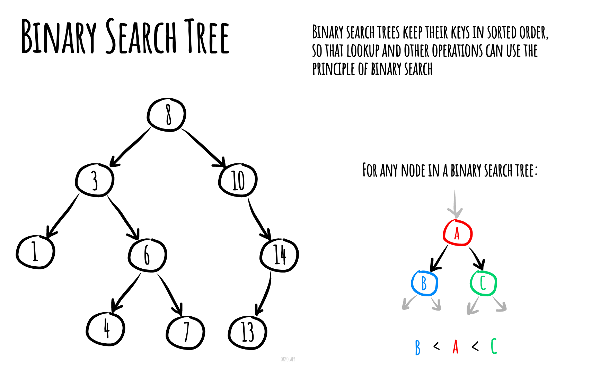

import PracticeProblem from '@site/src/components/PracticeProblem';

# Binary Search Tree

A **binary search tree (BST)** keeps smaller keys in the left subtree and larger keys in the right subtree. This explanation assumes distinct keys; repeated keys need an explicit rule.

For a root of 5 with children 3 and 8, searching for 8 goes right because 8 is greater than 5. Each comparison chooses one subtree. The work depends on the height: O(log n) when balanced, but O(n) when the tree becomes a long chain.



## Learning steps

A branching number index can choose left or right after each comparison. Its speed depends on keeping the branches reasonably short.

1. Follow a lookup and check the rule across each whole subtree.
2. Insert keys, then delete a leaf, a one-child node, and a two-child node.
3. Compare a balanced shape with a chain made by sorted insertions.

## JavaScript for Basic Operations {/* #pseudocode-for-basic-operations */}

This tree stores finite numbers and ignores duplicate insertions. `insert` and `remove` return whether the set changed. An empty tree has `root === null` and `size === 0`. Run this complete example in Node.js or a browser console.

```js runnable
class BinarySearchTree {
  root = null;
  size = 0;

  insert(value) {
    if (!Number.isFinite(value)) throw new TypeError('Use a finite number');
    const node = { value, left: null, right: null };
    if (this.root === null) {
      this.root = node;
    } else {
      let current = this.root;
      while (true) {
        if (value === current.value) return false;
        const side = value < current.value ? 'left' : 'right';
        if (current[side] === null) {
          current[side] = node;
          break;
        }
        current = current[side];
      }
    }
    this.size++;
    return true;
  }

  findNode(value) {
    let current = this.root;
    while (current !== null) {
      if (value === current.value) return current;
      current = value < current.value ? current.left : current.right;
    }
    return null;
  }

  contains(value) {
    return this.findNode(value) !== null;
  }

  findParent(value) {
    let parent = null;
    let current = this.root;
    while (current !== null) {
      if (value === current.value) return parent;
      parent = current;
      current = value < current.value ? current.left : current.right;
    }
    return null;
  }

  findMin() {
    let current = this.root;
    if (current === null) return null;
    while (current.left !== null) current = current.left;
    return current.value;
  }

  findMax() {
    let current = this.root;
    if (current === null) return null;
    while (current.right !== null) current = current.right;
    return current.value;
  }

  remove(value) {
    let removed = false;
    function removeNode(node, target) {
      if (node === null) return null;
      if (target < node.value) {
        node.left = removeNode(node.left, target);
      } else if (target > node.value) {
        node.right = removeNode(node.right, target);
      } else {
        removed = true;
        if (node.left === null) return node.right;
        if (node.right === null) return node.left;
        // The next larger key is the smallest key in the right subtree.
        let successor = node.right;
        while (successor.left !== null) successor = successor.left;
        node.value = successor.value;
        node.right = removeNode(node.right, successor.value);
      }
      return node;
    }
    if (!Number.isFinite(value)) throw new TypeError('Use a finite number');
    this.root = removeNode(this.root, value);
    if (removed) this.size--;
    return removed;
  }

  *inorder(node = this.root) {
    if (node === null) return;
    yield* this.inorder(node.left);
    yield node.value;
    yield* this.inorder(node.right);
  }

  *preorder(node = this.root) {
    if (node === null) return;
    yield node.value;
    yield* this.preorder(node.left);
    yield* this.preorder(node.right);
  }

  *postorder(node = this.root) {
    if (node === null) return;
    yield* this.postorder(node.left);
    yield* this.postorder(node.right);
    yield node.value;
  }
}

const tree = new BinarySearchTree();
[5, 3, 8, 6, 9].forEach(value => tree.insert(value));
console.log(tree.insert(5));
console.log(tree.contains(6), tree.findParent(6).value);
console.log(tree.findMin(), tree.findMax());
console.log([...tree.inorder()].join(','));
console.log([...tree.preorder()].join(','));
console.log([...tree.postorder()].join(','));
console.log(tree.remove(5), tree.size);
console.log(tree.root.value, [...tree.inorder()].join(','));
```

```text output
false
true 8
3 9
3,5,6,8,9
5,3,8,6,9
3,6,9,8,5
true 4
6 3,6,8,9
```

### Insertion

Follow left or right links until the correct empty position is found. Every key on the left remains smaller; every key on the right remains larger. A duplicate returns `false` without increasing `size`.

### Searching

`contains` uses `findNode`. Each comparison rules out one subtree. A missing value or an empty tree returns `false`.

### Deletion

There are three cases: a leaf becomes `null`; a node with one child is replaced by that child; a node with two children takes its successor's key and removes the successor from the right subtree. The helper returns the updated subtree root, so deleting the overall root works too. Only the outer method decreases `size`.

### Find Parent of Node

`findParent` remembers the previous node while searching. It returns `null` for the root and for a value that is absent. This method is useful for inspection; deletion above reconnects subtrees directly.

### Find Node

`findNode` returns the actual node, or `null`. Treat the returned object as read-only: changing its key or links could break the tree's ordering.

### Find Minimum

Follow left links to the end. `findMin` returns the smallest key, or `null` for an empty tree.

### Find Maximum

Follow right links to the end. `findMax` returns the largest key, or `null` for an empty tree.

### Traversal

The generators yield every key once. They do not change the tree; do not insert or remove nodes while iterating.

#### InOrder Traversal

Left, node, right. This produces keys in ascending order: `3, 5, 6, 8, 9` before the removal above.

#### PreOrder Traversal

Node, left, right. This visits a parent before its children: `5, 3, 8, 6, 9`.

#### PostOrder Traversal

Left, right, node. This visits children before their parent: `3, 6, 9, 8, 5`.

## Complexities

### Time Complexity

Let `h` be the tree height and `n` its number of nodes.

| Operation | Time | Reason |
| --- | --- | --- |
| Insert, search, remove | O(h) | Follow a root-to-leaf path; removal may also follow the successor path. |
| Find parent, minimum, maximum | O(h) | Follow one path. |
| Any full traversal | O(n) | Visit every node once. |

A balanced tree has `h = O(log n)`. This implementation does not rebalance: sorted insertions can form a chain with `h = O(n)`.

### Space Complexity

The tree stores O(n) nodes. Iterative insertion and search use O(1) extra space. Recursive removal and traversal use O(h) stack space; collecting a traversal creates an additional O(n) output array. For very deep trees, use an explicit stack or a balanced tree to avoid JavaScript's recursion limit.

## Practice Problems

{/* BEGIN GENERATED PRACTICE PROBLEMS */}

| Problem | Level / priority | Practice / notes | Example / answer |
| --- | --- | --- | --- |
| <PracticeProblem id={108} title={"Convert Sorted Array to Binary Search Tree"} text={"Problem statement\nConvert a strictly increasing integer array nums into a height-balanced binary search tree\ncontaining every value exactly once. At each node, left and right subtree heights must differ by at\nmost one. Return the root. Multiple balanced trees may satisfy the requirement; any is acceptable.\nInput \u0026 expected result\nThe result must satisfy both strict BST ordering and the height-balance condition at every node. A\ndifferent valid shape can be accepted. Example arrays display the returned tree but are not\nthemselves the function's return type.\nEXAMPLE 1\nInput: nums = [1,3,5]\nOne valid returned tree: [3,1,5]\nExplanation: Root 3 separates smaller value 1 and larger value 5, and the two subtrees have\nequal height.\nEXAMPLE 2\nInput: nums = [2,6]\nOne valid returned tree: [2,null,6]\nExplanation: The right child is larger than the root and the subtree heights differ by one.\nConstraints \u0026 guarantees\n• nums.length: 1 through 10^4 (inclusive)\n• nums[i]: -10^4 through 10^4 (inclusive)\n• Values are in strictly increasing order\nJavaScript starter\nfunction sortedArrayToBST(nums) {\n  // TODO: write your solution.\n}"} /> | Easy | [LeetCode](https://leetcode.com/problems/convert-sorted-array-to-binary-search-tree/) | — |
| <PracticeProblem id={530} title={"Minimum Absolute Difference in BST"} text={"Problem statement\nGiven a binary search tree with at least two nodes, return the smallest absolute difference between\nthe values of any two different nodes. The nodes do not have to be adjacent in the tree. Use the\nBST ordering property as appropriate.\nInput \u0026 expected result\nThe minimum is over all pairs of distinct nodes anywhere in the tree. Return a nonnegative integer\ndifference; a structural parent-child pair need not be optimal. The input already satisfies the BST\nproperty.\nEXAMPLE 1\nInput tree: [8,3,10,1,6]\nOutput: 2\nExplanation: The closest values are 6 and 8, or 8 and 10. Each pair differs by 2.\nEXAMPLE 2\nInput tree: [10,4,15,null,9]\nOutput: 1\nExplanation: Values 9 and 10 differ by 1 even though they are not a parent-child pair.\nConstraints \u0026 guarantees\n• Node.val: 0 through 10^5 (inclusive)\n• Tree size: 2 through 10^4 nodes\nJavaScript starter\nfunction getMinimumDifference(root) {\n  // TODO: write your solution.\n}"} /> | Easy | [LeetCode](https://leetcode.com/problems/minimum-absolute-difference-in-bst/) | — |
| <PracticeProblem id={700} title={"Search in a Binary Search Tree"} text={"Problem statement \u0026 expected result\nLocate val in a BST and return the matching node reference, which is the root of the corresponding subtree.\nReturn null if no matching node exists. The displayed output serializes that subtree, rather than returning a new\narray.\nEXAMPLE 1\nInput: root = [4,2,7,1,3], val = 2\nOutput: [2,1,3]\nExplanation: Return the existing node 2 and its descendants.\nEXAMPLE 2\nInput: root = [4,2,7,1,3], val = 5\nOutput: []\nExplanation: No node has value 5; [] displays a null subtree.\nConstraints \u0026 guarantees\n- The number of nodes in the tree is in the range [1, 5000].\n- 1 \u003c= Node.val \u003c= 10^7\n- root is a binary search tree.\n- 1 \u003c= val \u003c= 10^7\nJavaScript starter\nfunction searchBST(root, val) {\n// TODO: write your solution.\n}"} /> | Easy | [LeetCode](https://leetcode.com/problems/search-in-a-binary-search-tree/) | — |
| <PracticeProblem id={98} title={"Validate Binary Search Tree"} text={"Problem statement\nDetermine whether a binary tree satisfies the strict binary-search-tree rule everywhere. Every\nvalue in a node's left subtree must be smaller than that node's value, and every value in its right\nsubtree must be larger. Equal values violate the rule. Checking only direct children is not sufficient.\nInput \u0026 expected result\nThe ordering bounds imposed by every ancestor remain in force for descendants. Return true only\nif the entire tree satisfies them. Values at the signed 32-bit limits are valid inputs and must not be\nrejected merely for being extreme.\nEXAMPLE 1\nInput tree: [5,3,7,null,null,4,8]\nOutput: false, because 4 is in 5's right subtree\nExplanation: Although 4 is a valid left child of 7 locally, it is smaller than ancestor 5 while lying in\n5's right subtree.\nEXAMPLE 2\nInput tree: [2,2,3]\nOutput: false\nExplanation: A left-subtree value equal to its ancestor violates the strict smaller-than\nrequirement.\nConstraints \u0026 guarantees\n• Node.val: -2^31 through 2^31 - 1 (inclusive)\n• Tree size: 1 through 10^4 nodes\nJavaScript starter\nfunction isValidBST(root) {\n  // TODO: write your solution.\n}"} /> | Medium | [LeetCode](https://leetcode.com/problems/validate-binary-search-tree/) | — |
| <PracticeProblem id={99} title={"Recover Binary Search Tree"} text={"Problem statement \u0026 expected result\nExactly two node values in a binary search tree were exchanged. Restore the BST by correcting the values in\nplace while keeping every node and child connection in its original position. This operation has no return value.\nEXAMPLE 1\nInput: root = [1,3,null,null,2]\nAfter the call: root = [3,1,null,null,2]\nExplanation: Exchange values 1 and 3 while keeping the child links.\nEXAMPLE 2\nInput: root = [3,1,4,null,null,2]\nAfter the call: root = [2,1,4,null,null,3]\nExplanation: Exchange values 3 and 2 to restore the ordering.\nConstraints \u0026 guarantees\n- The number of nodes in the tree is in the range [2, 1000].\n- -2^31 \u003c= Node.val \u003c= 2^31 - 1\nJavaScript starter\nfunction recoverTree(root) {\n// TODO: write your solution.\n}"} /> | Medium | [LeetCode](https://leetcode.com/problems/recover-binary-search-tree/) | — |
| <PracticeProblem id={173} title={"Binary Search Tree Iterator"} text={"Problem statement\nImplement BSTIterator for a binary search tree. The constructor places an imaginary cursor before\nthe smallest value. next() advances and returns the next inorder value; hasNext() indicates\nwhether another value exists. next is called only when valid. Target average O(1) time per\noperation and O(h) space, where h is tree height.\nInput \u0026 expected result\nSuccessive next calls must return all node values in increasing inorder sequence without skipping\nor repeating nodes. hasNext is a query and must not advance the cursor. The space target refers to\niterator storage rather than the input tree.\nEXAMPLE 1\nFor tree [5,2,8]: next(), next(), hasNext(), next(), hasNext()\nResults: 2, 5, true, 8, false\nExplanation: The inorder sequence is 2,5,8. After the third next call no values remain, so\nhasNext becomes false.\nEXAMPLE 2\nFor tree [4]: hasNext(), next(), hasNext()\nResults: true, 4, false\nExplanation: The cursor starts before the only element; reading it exhausts the iterator.\nConstraints \u0026 guarantees\n• Node.val: 0 through 10^6 (inclusive)\n• Tree size: 1 through 10^5 nodes. Combined query calls: at most 10^5\nJavaScript starter\nclass BSTIterator {\n  constructor(root) { /* TODO */ }\n  next() { /* TODO */ }\n  hasNext() { /* TODO */ }\n}"} /> | Medium | [LeetCode](https://leetcode.com/problems/binary-search-tree-iterator/) | — |
| <PracticeProblem id={230} title={"Kth Smallest Element in a BST"} text={"Problem statement\nReturn the kth smallest node value in a binary search tree, counting from 1. k is valid and does not\nexceed the number of nodes. The order is numerical order, not the order in which nodes appear in\na level traversal.\nInput \u0026 expected result\nk uses one-based rank: k = 1 requests the smallest value. Return the numeric value rather than a\nnode reference. As a follow-up, consider how repeated queries could be supported when insertions\nand deletions occur frequently.\nEXAMPLE 1\nInput tree: [5,3,7,2,4], k = 3\nOutput: 4\nExplanation: The sorted values are 2,3,4,5,7, making 4 the third smallest.\nEXAMPLE 2\nInput tree: [4,2,6,1,3], k = 1\nOutput: 1\nExplanation: Rank 1 selects the smallest value anywhere in the tree.\nConstraints \u0026 guarantees\n• 1 \u003c= k \u003c= n \u003c= 10^4\n• Node.val: 0 through 10^4 (inclusive)\n• n denotes the tree's node count\nJavaScript starter\nfunction kthSmallest(root, k) {\n  // TODO: write your solution.\n}"} /> | Medium | [LeetCode](https://leetcode.com/problems/kth-smallest-element-in-a-bst/) | — |
| <PracticeProblem id={235} title={"Lowest Common Ancestor of a Binary Search Tree"} text={"Problem statement\nGiven a binary search tree and distinct existing nodes p and q, return their lowest common\nancestor. It is the deepest node whose subtree contains both, and a node may be its own\ndescendant. Node values are unique. Return the existing node rather than a copy.\nInput \u0026 expected result\nAll descendants on the left of a BST node have smaller values, and those on the right have larger\nvalues. The two targets are provided as node references. An ancestor may itself be one of the\ntarget nodes.\nEXAMPLE 1\nInput tree: [6,2,8,1,4], p = node 1, q = node 4\nOutput: node 2\nExplanation: Both targets lie below node 2, and they fall into its different child branches, so\nnode 2 is the deepest common ancestor.\nEXAMPLE 2\nInput tree: [6,2,8,1,4], p = node 2, q = node 4\nOutput: node 2\nExplanation: A node counts as its own descendant, and node 4 lies in node 2's subtree.\nConstraints \u0026 guarantees\n• Node.val: -10^9 through 10^9 (inclusive)\n• p != q\n• Tree size: 2 through 10^5 nodes. Values are distinct\n• both targets belong to the BST\nJavaScript starter\nfunction lowestCommonAncestor(root, p, q) {\n  // TODO: write your solution.\n}"} /> | Medium | [LeetCode](https://leetcode.com/problems/lowest-common-ancestor-of-a-binary-search-tree/) | — |
| [LC 255 — Verify Preorder Sequence in Binary Search Tree](https://leetcode.com/problems/verify-preorder-sequence-in-binary-search-tree/) | Medium · Premium | [LeetCode](https://leetcode.com/problems/verify-preorder-sequence-in-binary-search-tree/) | — |
| <PracticeProblem id={285} title={"Inorder Successor in BST"} text={"Problem statement\nGiven a binary search tree and a reference p to one of its nodes, return the node that immediately\nfollows p in inorder traversal. With distinct values, this is the node holding the smallest value\nstrictly greater than p.val. Return null if p has no successor.\nInput \u0026 expected result\nReturn a node reference, not its numeric value. Examples show the returned node's value for\nreadability.\nEXAMPLE 1\nInput: root = [8,4,12,2,6], p = node 6\nOutput node: 8\nExplanation: The next value after 6 in sorted traversal order is 8.\nEXAMPLE 2\nInput: root = [8,4,12], p = node 12\nOutput: null\nExplanation: The largest value has no following node.\nConstraints \u0026 guarantees\n• The tree is a BST with distinct values.\n• p is a reference to a node in the tree.\nPremium source: current numeric bounds could not be publicly verified.\nJavaScript starter\nfunction inorderSuccessor(root, p) {\n  // TODO: write your solution.\n}"} /> | Medium · Premium | [LeetCode](https://leetcode.com/problems/inorder-successor-in-bst/) | — |
| <PracticeProblem id={450} title={"Delete Node in a BST"} text={"Problem statement \u0026 expected result\nRemove the node whose value equals key from a BST and return the resulting root reference. Retain every other\nvalue and the BST ordering property. If key is absent, retain the tree. Several resulting tree shapes can be valid.\nEXAMPLE 1\nInput: root = [5,3,6,2,4,null,7], key = 3\nOne valid returned tree: [5,4,6,2,null,null,7]\nExplanation: This is one valid BST after removing value 3.\nEXAMPLE 2\nInput: root = [5,3,6,2,4,null,7], key = 0\nOne valid returned tree: [5,3,6,2,4,null,7]\nExplanation: Value 0 is absent, so the tree retains its values and shape.\nConstraints \u0026 guarantees\n- The number of nodes in the tree is in the range [0, 10^4].\n- -10^5 \u003c= Node.val \u003c= 10^5\n- Each node has a unique value.\n- root is a valid binary search tree.\n- -10^5 \u003c= key \u003c= 10^5\nJavaScript starter\nfunction deleteNode(root, key) {\n// TODO: write your solution.\n}"} /> | Medium | [LeetCode](https://leetcode.com/problems/delete-node-in-a-bst/) | — |
| [LC 701 — Insert into a Binary Search Tree](https://leetcode.com/problems/insert-into-a-binary-search-tree/) | Medium | [LeetCode](https://leetcode.com/problems/insert-into-a-binary-search-tree/) | — |
| [LC 1305 — All Elements in Two Binary Search Trees](https://leetcode.com/problems/all-elements-in-two-binary-search-trees/) | Medium | [LeetCode](https://leetcode.com/problems/all-elements-in-two-binary-search-trees/) | — |
| G45 — Find a key's inorder predecessor and successor. | Exercise | Trees and BSTs. Related only: [LC 285](https://leetcode.com/problems/inorder-successor-in-bst/) - Inorder Successor in BST. Covers the inorder successor only, not both predecessor and successor. | — |
| G29 — Construct an ordered search tree minimizing expected lookup cost. | Exercise | Dynamic programming | — |

{/* END GENERATED PRACTICE PROBLEMS */}

## References

- [Wikipedia](https://en.wikipedia.org/wiki/Binary_search_tree)
- [Inserting to BST on YouTube](https://www.youtube.com/watch?v=wcIRPqTR3Kc&list=PLLXdhg_r2hKA7DPDsunoDZ-Z769jWn4R8&index=9&t=0s)
- [BST Interactive Visualisations](https://www.cs.usfca.edu/~galles/visualization/BST.html)

**Next:** [heaps](../../heap/README.md).
