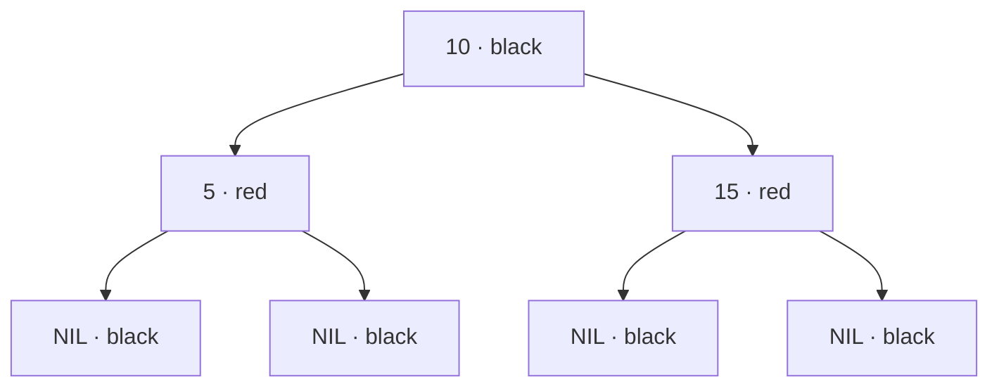

# Red–Black Tree

**Practice focus:** Read each color rule and compare equal black heights with AVL’s height-difference rule.

A red–black tree is a binary search tree with color rules that keep its height logarithmic. Search follows ordinary BST comparisons. Insert and delete may rotate and recolor nodes to restore the rules.

**Before you start:** understand [binary search trees](../binary-search-tree/README.md) and the [rotation shapes](../avl-tree/README.md#avl-tree-rotations). Red and black are state labels; the diagrams include those labels in text.

## Properties

- Every real node is red or black, and the root is black.
- Missing children are treated as black NIL leaves.
- A red node cannot have a red child.
- Every path from a node to a descendant NIL leaf has the same number of black nodes.
- The usual BST ordering still holds; choose a consistent duplicate-key policy.

The last two color rules prevent a path from being more than twice as long as another comparable path. Consequently, height is O(log n), and search, insertion, and deletion take O(log n) time. Storage is O(n).

Each path from 10 to a NIL leaf has the same black count. Neither red child has a red child of its own.

## Balancing during insertion

Insert as in a BST and color the new node `x` red. This preserves black counts but may put two red nodes next to each other. Let `p` be its parent, `g` its grandparent, and `u` its uncle, the sibling of `p`. A missing uncle is black. If `p` is black, no repair is needed.

### If uncle is RED

Color `p` and `u` black and `g` red. The subtree's black count stays the same, but `g` may now conflict with its parent. Continue the repair at `g`. Make the root black when finished.

Example: insert 1 into a tree with black root 10 and red children 5 and 15. Parent 5 and uncle 15 become black; 10 is recolored and finally kept black as the root.

### If uncle is BLACK

Convert a bent path into a straight path if necessary, then rotate the grandparent. Color the promoted middle key black and the old grandparent red. The following table names the original three nodes:

| Shape | First change | Final change |
| --- | --- | --- |
| Left-left: `p` left of `g`, `x` left of `p` | None | Rotate right at `g`; promote `p`. |
| Left-right: `p` left of `g`, `x` right of `p` | Rotate left at `p` | Rotate right at `g`; promote `x`. |
| Right-right: `p` right of `g`, `x` right of `p` | None | Rotate left at `g`; promote `p`. |
| Right-left: `p` right of `g`, `x` left of `p` | Rotate right at `p` | Rotate left at `g`; promote `x`. |

For insertion order 10, 5, 1, the final local tree has black root 5 and red children 1 and 10. Inorder traversal remains `[1, 5, 10]`: a rotation changes shape without changing key order.

## Balancing during deletion

First reduce deletion to removing a node with at most one real child, using its successor when needed. Track the color of the node actually removed. Removing a red node does not change black counts. A red replacement can be colored black. Otherwise a missing black contribution must be repaired upward.

For the case where the replacement `x` is the left child, let its sibling be `s`. The right-child case mirrors these directions.

| Case | Repair |
| --- | --- |
| `s` is red | Recolor `s` black and the parent red; rotate left at the parent. Recompute `s`. |
| `s` is black and both its children are black | Color `s` red and move the missing-black problem to the parent. A red parent can absorb it by becoming black. |
| `s` is black, its right child is black, and its left child is red | Color the left child black and `s` red; rotate right at `s`. Recompute `s`. |
| `s` is black and its right child is red | Give `s` the parent's color; color the parent and `s`'s right child black; rotate left at the parent. The local repair is complete. |

NIL sentinels and parent references need consistent handling in an implementation. These cases explain the invariant repair; they are not a drop-in deletion function. Finish with a black root.

## Verify the invariants

After each mutation, check sorted inorder traversal, a black root, no red-red edge, and equal black counts on paths to NIL. Test sorted insertions, deleting the root, deleting black leaves, and alternating insert/delete operations. Compare stored keys against a simple sorted-set model for small randomized sequences.

## References

- [Wikipedia](https://en.wikipedia.org/wiki/Red%E2%80%93black_tree)
- [Red Black Tree Insertion by Tushar Roy (YouTube)](https://www.youtube.com/watch?v=UaLIHuR1t8Q&list=PLLXdhg_r2hKA7DPDsunoDZ-Z769jWn4R8&index=63)
- [Red Black Tree Deletion by Tushar Roy (YouTube)](https://www.youtube.com/watch?v=CTvfzU_uNKE&t=0s&list=PLLXdhg_r2hKA7DPDsunoDZ-Z769jWn4R8&index=64)
- [Red Black Tree Insertion on GeeksForGeeks](https://www.geeksforgeeks.org/red-black-tree-set-2-insert/)
- [Red Black Tree Interactive Visualisations](https://www.cs.usfca.edu/~galles/visualization/RedBlack.html)

**Next:** [Trees: follow branches without losing your place](../README.md).
