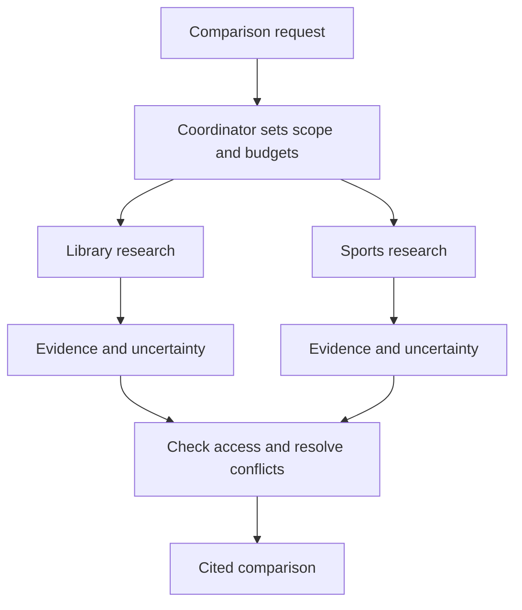

# Multiple agents: divide work only when it helps

**Before this lesson:** [The agent loop: state, actions, and stopping](02-agent-loop-and-state.md).

A **multi-agent system** coordinates more than one model-driven worker. A **coordinator** divides work and combines results. A worker may have a separate context and tool set, even when every worker uses the same underlying model.

Think of a school group project. Splitting independent research can help. Asking five students to rewrite the same sentence while all editing one file can create more work than it saves. The same question applies to agents: what useful independence does the split provide?

## Start with a single-agent baseline

Suppose the assistant must compare the library’s current borrowing rules with the sports equipment rules. Two researchers could inspect separate approved collections in parallel. A coordinator can then compare the evidence. In contrast, answering one loan-date lookup needs no team.

Before adding workers, measure a single agent or fixed workflow. Record answer quality, source coverage, permission failures, time, and total calls. A multi-agent design should improve the chosen objective enough to justify its coordination and resource costs. A published success on one research workload is not a guarantee for yours; the [multi-agent research-system report](https://www.anthropic.com/engineering/multi-agent-research-system) is a useful case study, not a universal ranking.

## Give each worker a bounded job

A task description should include the question, allowed sources, expected output fields, a stopping condition, and a budget. Ask for evidence and uncertainty, not just a polished conclusion.

| Role | Input | Output |
| --- | --- | --- |
| Library researcher | Loan-policy question and library-source access | Claims with source IDs, versions, and unresolved points |
| Sports researcher | Equipment-policy question and sports-source access | Same evidence format for equipment |
| Coordinator | Both evidence packages | Supported comparison, with disagreements retained |

Do not silently grant every worker all permissions. A summary of restricted data is still restricted data. The coordinator may combine only information that the final recipient is allowed to receive.



## Avoid shared-state collisions

Prefer independent read-only work where possible. If workers edit files or records, assign clear ownership or use isolated copies and a reviewed merge. Track operation IDs so separate workers cannot accidentally perform the same external action twice. Shared budgets belong to the coordinator as well as each worker; otherwise a small per-worker limit can become a large total.

Parallel work can reduce waiting time without reducing total work. If two workers each use three model calls and coordination uses two more, the total is eight calls. The slowest worker and merge step still affect the completion time. Add cancellation when the user stops the task or enough evidence has been found.

## Agreement is not independent evidence

Workers using the same model and sources can share the same error. A majority vote does not make an unsupported claim true. Debate can expose mistakes on some tasks, as studied in the [multi-agent debate paper](https://arxiv.org/abs/2305.14325), but it can also spread a plausible false answer. Verify against source evidence and objective checks where available.

A reviewer should have a concrete job: verify each policy claim, check versions, identify missing exceptions, or run tests. “Review carefully” is weaker than a rubric with observable failure conditions. The coordinator should preserve disagreement when the evidence does not settle it.

## Trade-offs and common mistakes

Use a team for separable subtasks, distinct access scopes, or an independently checkable review. Use a single agent for tightly dependent work with frequent shared-state changes. Use ordinary parallel functions when the tasks do not require model decisions.

Avoid spawning workers by default, giving them overlapping write ownership, treating one worker’s message as a new user instruction, or hiding failed workers behind a smooth combined answer.

## Practice

Design workers for “Compare the current library and sports borrowing policies.” Then explain why “Renew my one book” should use a different design.

<details>
<summary>Check your answer</summary>

Assign separate researchers to the two approved collections, require source IDs and versions, and let one coordinator compare only supported claims. A renewal is a narrow operation with user-specific state and authorization. A small checked workflow is easier to control than several agents competing to perform the same write.

</details>

## Depth lab: calculate the critical path and preserve conflicts

A dependency graph tells you which work can run simultaneously. Suppose planning takes one second, two independent investigations take four and seven seconds, and merging takes two seconds. Sequential completion takes 14 seconds; ideal parallel completion takes 10 seconds: planning plus the slower investigation plus merging. Total worker time does not decrease.

Real performance also includes scheduling, queueing, context transfer, and stragglers. Parallel work can contend for the same model quota and become slower. Measure latency and total calls independently.

A coordinator also needs a deterministic merge policy. Concatenating worker prose can erase contradictions. This fixture groups incompatible values instead of letting the last worker silently win:

```python runnable
reports = [
    {"claim": "loan_days", "value": 21, "source": "handbook-v2"},
    {"claim": "loan_days", "value": 14, "source": "notice-v1"},
]
grouped = {}
for report in reports:
    grouped.setdefault(report["claim"], []).append(report)
for claim, evidence in grouped.items():
    values = {item["value"] for item in evidence}
    print(claim, "conflict" if len(values) > 1 else "agreement")
    print(sorted(item["source"] for item in evidence))
```

```text output
loan_days conflict
['handbook-v2', 'notice-v1']
```

The code detects different values, not which source is authoritative. Resolve applicability, dates, and authority through an explicit policy; otherwise retain the conflict. Two workers repeating one source count as one evidence origin, not two independent confirmations.

**Implementation exercise:** define a worker output with task ID, source/version, claims, unresolved questions, consumed budget, and terminal status. Give each task a bounded source scope. Merge only completed, validated results, while reporting missing work. Cancellation should reach child workers when the parent stops.

**Debugging and production:** correlate child traces with the parent run. Detect overlapping writes and repeated external actions. A coordinator's timeout does not prove a worker stopped. Use a single authoritative owner for a shared write or a storage mechanism that rejects conflicting updates.

**Optimization:** compare the team with a single agent and an ordinary parallel workflow using the same task set and total budget. Add workers only for an observed benefit. A reviewer that sees the first answer may inherit its assumptions; independent initial assessment can reduce that particular influence without guaranteeing independent errors.

<details>
<summary>Interview defense: when does adding agents fail to improve throughput?</summary>

When subtasks are dependent, shared quotas or hardware are saturated, coordination dominates, or rework from conflicts exceeds the benefit. More workers can increase total load without shortening the critical path. Identify the bottleneck and measure under representative concurrency.

</details>

**Teach-back:** draw the timing graph, then make the seven-second investigation depend on the four-second one. Explain why the parallel speedup disappears.

**Previous:** [The agent loop: state, actions, and stopping](02-agent-loop-and-state.md) · **Next:** [Agent evaluation and a bounded offline project](04-agent-evaluation.md)
