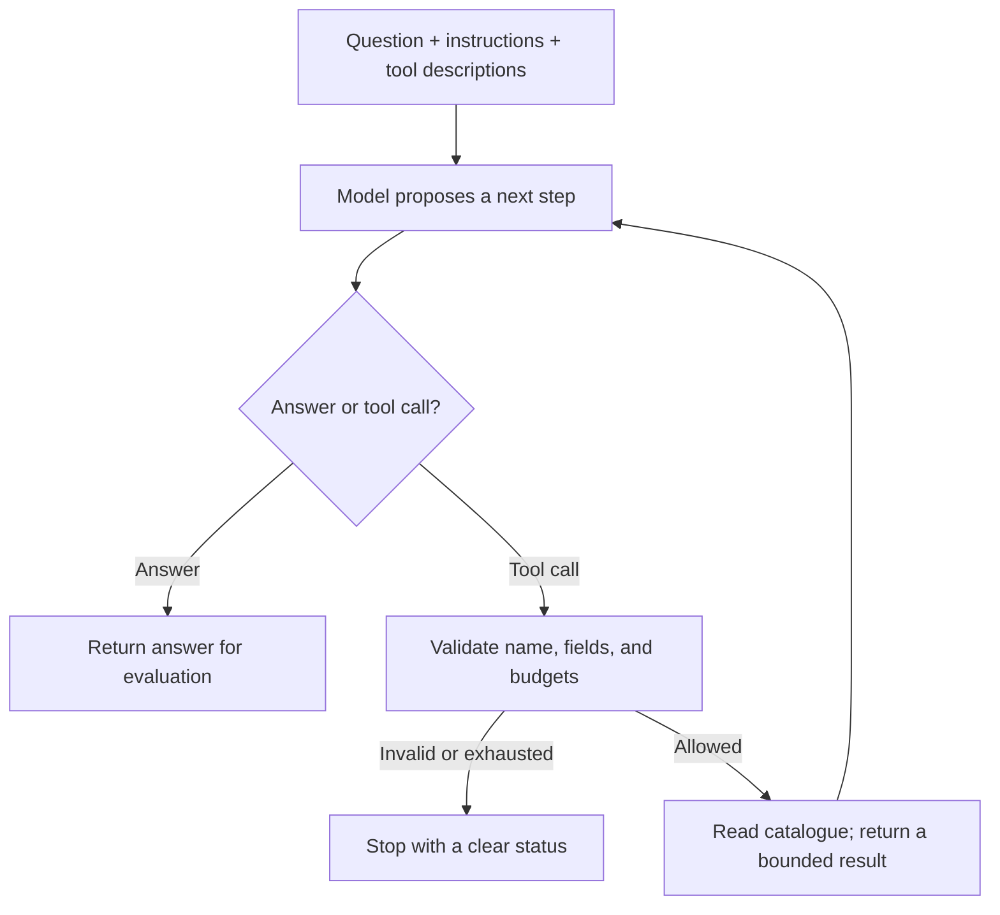

import useBaseUrl from '@docusaurus/useBaseUrl';

# Build an agent that uses a real model

**Before this lesson:** complete [agent evaluation](./04-agent-evaluation.md). You already know how to check proposed actions and stop a loop. Now replace the scripted decision-maker with a language model while keeping those checks.

**You will build:** a library helper that searches books, checks availability, and answers with book IDs. The same program runs with a predictable offline fixture or a local model. It cannot reserve a book, edit a file, or send a message.

## 1. Separate the four jobs

The **model** proposes a tool call or writes a final answer. The **application loop** decides whether a proposal is allowed. A **tool** reads a small piece of data. A **model adapter** translates the application's request into one provider's message format. Keeping these jobs separate makes a model change easier to test.



The useful distinction is **choosing** versus **executing**. A model can request `get_book`, but only your Python code can run it. Never turn a returned tool name into arbitrary code with `eval` or an unrestricted shell command.

## 2. Run the complete offline project

Download <a href={useBaseUrl('/examples/ai/agents/model_agent.py')} download>model_agent.py</a>. It needs Python 3.10 or newer and uses only Python's standard library. In the download folder, run:

```bash
python3 model_agent.py
python3 model_agent.py --self-test
```

The first command prints:

```text
Decision-maker: scripted fixture; no LLM
Tool: search_catalogue
Tool: get_book
Status: complete
Answer: Python for Gardeners is available. [B1]
```

On systems where Python is named `python`, use that command instead. The fixture deliberately makes the same choices even if you change the question. It tests the plumbing; it does not understand language. The self-test exercises the message sequence, malformed arguments, unknown tools, repeated calls, limits, reported usage, and the HTTP adapter with a fake response. It does not contact a server.

Read these functions in order:

| Function | What to notice |
| --- | --- |
| `validate_call` | Only two tool names and their exact argument fields are accepted. |
| `execute_tool` | A small fictional catalogue supplies facts; missing IDs return `not_found`. |
| `parse_response` | Empty, oversized, wrong-role, or truncated answers are rejected. |
| `run` | Budgets and validation belong to the application. Every tool response stays with its call. |
| `ollama_client` | Only this adapter makes a network request. |

## 3. Connect a local language model

Ollama is one way to run a downloaded model on your own computer. Install it using its [official setup guide](https://docs.ollama.com/quickstart), choose a **local model with tool-calling support**, and check that it fits your computer's memory. Model downloads may be several gigabytes. Local requests do not need a cloud API key. A model with a cloud suffix uses a different deployment path; this exercise uses local weights.

For local-only model execution, set `OLLAMA_NO_CLOUD=1` in the **Ollama server's environment** and restart Ollama. Follow the platform-specific [server configuration and cloud settings](https://docs.ollama.com/faq); setting it only for this Python client does not reconfigure an already running server.

Start the configured Ollama application. In a terminal, list installed models:

```bash
ollama list
```

If the list is empty, follow Ollama's model installation instructions first. Copy an installed tool-capable model's exact name from that list. Replace `YOUR_INSTALLED_MODEL` below with that name, including its tag:

```bash
python3 model_agent.py --live --model YOUR_INSTALLED_MODEL --question "Find an available Python book."
```

The adapter sends `messages`, the two tool descriptions, and `stream: false` to `http://127.0.0.1:11434/api/chat`. This is an **HTTP request**: a program sends a structured message to a server at an address and receives a response. Here both programs run on your machine. The API returns an assistant message that may contain tool calls. See the [chat API contract](https://docs.ollama.com/api/chat) for its fields.

If a tool is requested, the application appends the assistant message, runs the validated tool, and adds a `tool` message containing its result. The next model request includes that updated conversation. This follows Ollama's [tool-calling protocol](https://docs.ollama.com/capabilities/tool-calling). Preserve the original assistant message, including optional fields the model needs; do not rebuild history from displayed text alone.

Live answers vary. A successful run should look up a relevant record and give a supported answer. A fluent sentence alone does not show that it used the catalogue correctly. Inspect the printed tool names and repeat the quality cases below.

## 4. Understand the limits before extending it

The default run allows four model requests, four tool calls, and a 90-second overall budget checked between operations. The HTTP client uses a socket timeout of at most 30 seconds and refuses redirects and environment proxies. It bounds request text, response bytes, result size, and generated output. These are small teaching limits, not a hard token-accounting or billing system.

An HTTP timeout is not a guaranteed whole-job deadline, and abandoning a request does not prove a remote server stopped its work. Production workers need cancellation and resource limits. Likewise, this in-memory program has no restart recovery or user authentication. Use [integration boundaries](./06-agent-integrations.md) before connecting personal or external data.

When Ollama reports token usage, the program adds the input and output counts across model calls. A repeated conversation can be counted again on each call. A fixture's missing usage is not “zero tokens used by a real model.” Learn accurate budgeting in [tokens and context](../engineering/05-token-and-context-budgets.md).

| Status | Likely cause | Next step |
| --- | --- | --- |
| `connection_error` | Server unavailable, request failure, or timeout | Check the local app, installed model, and available memory. |
| `invalid_response_or_tool` | Unexpected format, wrong arguments, empty answer, or generation cutoff | Inspect the model's tool support and the adapter contract; keep validation enabled. |
| `repeated_action` | Same read requested again | Examine the tool description and whether the result answered the question. |
| `round_limit` or `tool_limit` | No final answer within the budget | Study the trace before raising a limit. A loop may be stuck. |
| `time_limit` | The overall deadline was reached between operations | Inspect slow calls and reduce the task before increasing the time budget. |
| `tool_result_limit` | Tool returned too much text | Return selected fields or use retrieval. |

## 5. Evaluate the actual task

Create a table of at least ten questions before changing the prompt. Include a Python-book request, an unavailable book, an unknown topic, a misspelled title, and a request to reserve a book. Record the expected facts and whether an action is allowed. Run each question several times with the model and settings recorded.

Measure supported-answer rate, false availability claims, unsupported action claims, calls per completed task, latency, and stopping statuses. Compare with a direct catalogue search. An agent is useful only if its flexible language handling justifies the added complexity.

For an extension, add `get_opening_hours` with a fixed source record. Define its schema, validate it in Python, add an offline failure case, then run the same live evaluation. Do not give the model permission to invent new tools.

## Practice

The model proposes `reserve_book` and writes “the user has approved.” Should your application run it?

<details>
<summary>Check your answer</summary>

No. It is not an allowed tool, and model-written approval is not a user authorization record. Stop or return a controlled error. A future reservation feature needs an authenticated user, a validated record, an explicit approval boundary where appropriate, and protection against duplicate writes. The earlier [bounded-agent project](./04-agent-evaluation.md) lets you practice approval checks with simulated actions.

</details>

## Depth lab: define the model adapter as a replaceable contract

The controller should consume a small set of typed outcomes rather than provider-specific response dictionaries. Useful outcomes include a final-answer proposal, a tool-call proposal, refusal, incomplete generation, unavailable service, and invalid response. Only the first two are proposals to continue normal task processing.

For a read-only catalogue agent, trace these cases:

| Provider observation | Adapter outcome | Controller response |
| --- | --- | --- |
| Completed tool call with valid arguments | Proposed tool call | Validate scope and execute within budget. |
| JSON text cut off by the token limit | Incomplete | Follow a bounded recovery policy; never execute partial arguments. |
| Completed text with an invented book ID | Final proposal | Reject unsupported IDs or report missing support. |
| Refusal or service error | Explicit non-success outcome | Preserve status and choose the declared fallback. |
| Extra unexpected tool call alongside an answer | Contract violation unless supported | Reject rather than silently ignore an operation. |

**Implement from scratch:** write a fake adapter that emits each case and pass it to the unchanged controller. Then connect one live adapter and run the same contract tests using recorded, sanitized responses. Provider compatibility does not imply semantic equivalence; field names, stopping conventions, role templates, and tool formats require explicit mapping.

**Debugging drill:** compare four artifacts: the request your application intended, the serialized provider request, the raw response, and the normalized outcome. This locates schema translation mistakes separately from poor model decisions. Keep request identifiers and timing while redacting credentials and unnecessary private text.

**Production design:** distinguish a client timeout from confirmed remote cancellation. Set response-size limits before loading unbounded content. Preserve a stable run ID and tool-call ID for correlation. A tool-call proposal has no authority beyond the surrounding application.

**Optimization:** measure model latency separately from tool latency and validation. Reduce redundant catalogue content or use narrower tools before increasing autonomy. Compare the fixed-workflow baseline; a model that selects between two deterministic branches may add cost without improving outcomes.

<details>
<summary>Interview defense: can offline fixture success validate the live model?</summary>

It validates how the application responds to the supplied fixture proposals. It does not show that a real model will choose those proposals, use tools correctly, or handle unseen wording. Live trials need representative tasks and repeated-run reporting. Keep both test layers because they answer different questions.

</details>

**Portfolio extension:** implement a second adapter without changing the controller, then compare task success, unsupported IDs, refusal behavior, latency, and cost. Label unavailable integrations as planned rather than presenting fixture results as measurements from them.

**Previous:** [Agent evaluation and a bounded offline project](04-agent-evaluation.md) · **Next:** [Connect agents to real applications](06-agent-integrations.md)
