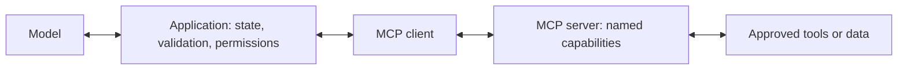
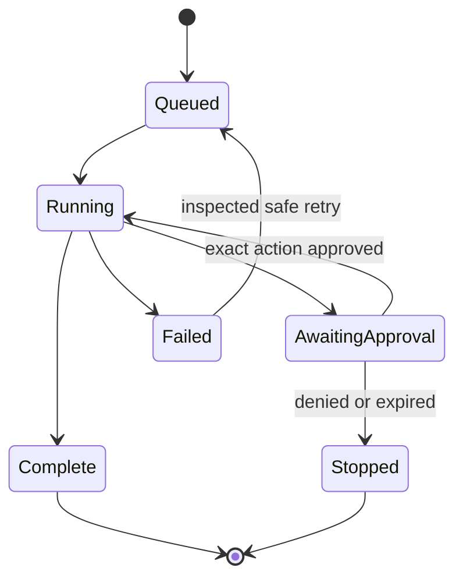

# Connect agents to real applications

**Before this lesson:** run [the model-agent project](./05-build-a-model-agent.md). You have seen a local tool call. Now decide how the same pattern connects to documents, databases, other programs, and a bot interface.

**You will learn:** where adapters, frameworks, MCP, saved state, and background workers fit. These solve different problems. Start with the smallest part your application actually needs.

## 1. Choose the boundary you are connecting

An **adapter** translates between two agreed formats. A travel plug is a useful analogy: it changes the connection, not the appliance's purpose. In software, an adapter might translate one provider's model response into your application's `answer` or `tool_calls` structure.

| Boundary | What it carries | What your code must still check |
| --- | --- | --- |
| User interface → application | Text, user identity, conversation ID | Input limits, authentication, and which conversation the user owns. |
| Application → model | Instructions, relevant context, tool descriptions | Model support, response shape, timeouts, usage, and task quality. |
| Application → retrieval | A question and access rules | Which documents this user may read and whether the evidence is relevant. |
| Application → business tool | A validated action and arguments | Permission, current record state, approval, and duplicate execution. |
| Application → another agent | A bounded subtask and expected result | Shared budgets, source evidence, and the parent's final responsibility. |

Changing a model provider should mainly affect the model adapter. Changing from web chat to a messaging channel should mainly affect the interface adapter. Different providers have different tool IDs, error formats, usage fields, and streaming events; similar-looking APIs are not proof of identical behavior. Keep contract tests using recorded or artificial responses.

## 2. Connect useful tools without giving away control

A school assistant might search approved policy documents, read book availability, and draft a notice. Use [retrieval](../rag/03-grounded-answers.md) for long text and a narrow structured lookup for exact facts such as an account balance or inventory count.

| Integration | A useful first version | Common mistake |
| --- | --- | --- |
| Documents | Retrieve a few authorized passages with source IDs | Loading every document into each request. |
| Database | A named function with parameterized SQL and user-level access checks | Letting the model execute arbitrary SQL with administrator access. |
| Files | Read specific project files inside an allowed directory | Accepting an unrestricted path supplied by generated text. |
| Browser | Read an allowed page and return relevant content | Treating page instructions as trusted application instructions. |
| Code execution | A separate restricted worker with time, memory, and network limits | Running generated code inside the application process with credentials. |
| External messages | Draft, preview, approve, then send once | Retrying a timed-out send without checking whether it already succeeded. |

The application attaches identity and permissions from its trusted session. A model argument such as `user_id: "admin"` must not choose whose permissions apply. Search results and tool output are data, even when they contain sentences that look like commands.

## 3. Understand where MCP fits

An **SDK**, or software development kit, supplies libraries and helper tools for using a service or protocol. It can handle message details while your application retains its own rules.

**Model Context Protocol (MCP)** is a standard way for AI applications and external tool or data servers to exchange information. It can reduce the need to write a different custom connection for every application. It does not train a model or decide which action is appropriate. See the [official introduction](https://modelcontextprotocol.io/docs/getting-started/intro).

The **host** is the AI application. Its **client** connects to an MCP **server**, which exposes capabilities. Servers can offer tools to call, resources to read, and reusable prompt templates. Local connections can use a process's standard input/output; remote connections can use HTTP. The [architecture guide](https://modelcontextprotocol.io/docs/learn/architecture) explains these participants and transport choices.

For the two-function catalogue project, ordinary Python functions are enough. To offer the catalogue to several compatible applications, you could wrap `search_catalogue` and `get_book` in an MCP server. Use the official [server-building guide](https://modelcontextprotocol.io/docs/develop/build-server) for your chosen SDK, expose only those functions, test them with sample arguments, and configure one client. Then verify denied access, missing records, and oversized results. Keep authorization in the server as well as the application; a second client may call the server without your original interface. For a standard-input/output server, send diagnostic logs to standard error: standard output carries protocol messages, so ordinary `print` debugging can corrupt the connection.

Installing a server does not make its output trustworthy. Review who runs it, what it can access, and which credentials it receives. Start with read-only capabilities. The protocol is a connection mechanism, not an approval record or an injection defense.

## 4. Decide whether a framework helps

A **framework** supplies reusable program structure. A **workflow graph** represents steps as boxes and allowed transitions as arrows. A fixed graph is helpful when certain steps must always happen in order; a model can still choose a bounded step within it.

Keep the small Python loop while you are learning or have one simple workflow. Consider a framework when you repeatedly need saved state, streaming, background jobs, approvals, or restart recovery. For example, [LangGraph documents durable execution, stateful workflows, and human review](https://docs.langchain.com/oss/python/langgraph/overview). Learn the underlying loop first so you can inspect what a framework runs.

Evaluate a framework with one existing test case. Check whether you can export state, trace calls, enforce your budgets, pin versions, and replace the model adapter. Framework defaults are not a substitute for application-specific authorization or evaluations. A visual builder can speed up a prototype; inspect its data flow and failure behavior before connecting real users.

## 5. Save enough state to resume safely

**Persistence** means saving information outside process memory so it survives a restart. A **worker** is a process that performs a job, often after another process has accepted it. A long document task can return a job ID immediately and let a worker process it while the interface displays progress.

Save a run ID, owner, current step, model and prompt versions, remaining budget, selected source IDs, tool request IDs, results, and pending approval. Do not store unnecessary private conversation text forever. Set retention and deletion rules.

An **idempotency key** identifies one intended external operation so repeating the same request need not repeat its effect. If a payment or send times out, its outcome may be unknown. Record the key before calling, query the external status where possible, and reuse the same key for a safe retry. A local “done” flag cannot by itself guarantee exactly-once behavior across systems. Read-only lookups are simpler; keep that advantage in early projects.

## Project extension: one application, two interfaces

Keep the catalogue tools unchanged. Define a function that takes a question and returns `status`, `answer`, and a short trace. Use it first from the command line, then from the browser bot in the next stage. Keep conversation state separate for each user. Add a fixed list of retrieval sources only after both interfaces pass the same ten task cases.

Your evidence should include a small architecture diagram, an adapter contract, an access-denied case, a timeout case, and a restart design. Mark features that are designed but not implemented. Do not claim production recovery from an in-memory demo.

## Practice

You already have a tested database lookup. Should you replace it with an agent, a framework, and an MCP server immediately?

Check your answer

Only add a component for a concrete need. A simple lookup may remain the best solution. Add a model when language interpretation helps, a framework when repeated workflow needs justify it, and MCP when shared tool integration helps. Preserve the tested lookup and its permission checks whichever interface you choose.

## Depth lab: keep protocol compatibility separate from business correctness

An MCP server has two responsibilities: speak the selected protocol correctly and enforce the domain operation correctly. Test these layers separately. A catalogue lookup should give the same authorized result whether called through a local function, an HTTP application endpoint, or an MCP adapter.

The official architecture documentation currently describes protocol version **2026-07-28**, with request-level protocol/capability metadata and `server/discover`. Earlier examples may use a different lifecycle. Record the protocol and SDK versions you actually test; do not combine message fragments from incompatible revisions. [MCP architecture, version 2026-07-28](https://modelcontextprotocol.io/docs/2026-07-28/learn/architecture).

| Layer | What to test | Failure the next layer cannot repair |
| --- | --- | --- |
| Transport and protocol | Framing, supported version, capabilities, IDs, result/error mapping | Malformed messages or unsupported operations |
| Authentication | Verified caller and intended service audience | Impersonation or a token for the wrong service |
| Authorization | Caller, operation, resource, current policy | A valid caller reading another user's record |
| Business handler | Types, limits, missing records, versions | Wrong catalogue result |
| Model interpretation | Correct use of bounded returned evidence | Unsupported final answer |

**Implementation exercise:** extract the catalogue's domain function behind a trusted context object carrying caller identity. Write direct tests for found, missing, denied, and oversized requests. Wrap that function with the chosen SDK. Run protocol-level tests through a client, comparing domain results and failures with the direct tests. Do not let a model-supplied argument overwrite trusted context.

**Debugging:** for standard-input/output transport, ordinary stdout logging can corrupt protocol messages. Send diagnostics to stderr and preserve request IDs. For remote use, distinguish transport success from an operation-level failure; a successful HTTP exchange can carry a rejected tool result.

**Production and optimization:** keep secrets outside tool-visible payloads, bound results, and enforce authorization at the server even when the original host also checks it. Validate tokens for their intended service rather than passing an incoming token unchanged to arbitrary downstream systems. The [MCP security guidance](https://modelcontextprotocol.io/docs/2026-07-28/tutorials/security/security_best_practices) explains audience validation and token-passthrough risks.

Interview defense: when would MCP be unnecessary?

A single application with a few internal functions may gain little from another protocol boundary. MCP is useful when compatible clients need a shared interface to capabilities. It does not replace domain tests, authorization, workflow state, or model evaluation.

**Teach-back:** diagram host, client, server, and downstream data service. Mark where identities are verified, where authorization is enforced, and where untrusted text enters. Explain how a second client can bypass a check placed only in the first host.

**Previous:** [Build an agent that uses a real model](05-build-a-model-agent.md) · **Next:** [Resume an agent without repeating its actions](07-durable-workflows.md)
