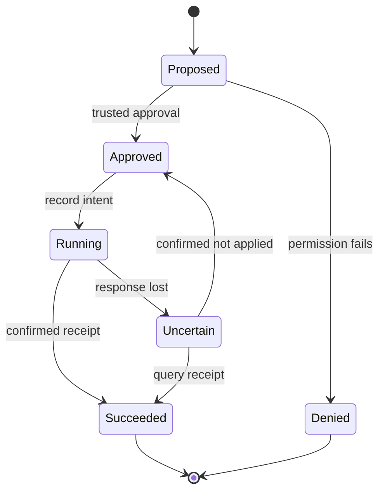

# Resume an agent without repeating its actions

**Before this lesson:** [agent integrations](./06-agent-integrations.md), [bounded state](./02-agent-loop-and-state.md), and [SQL](../foundations/07-data-tables-and-sql.md).

A successful demonstration follows one happy path. A useful long-running system must also handle a crash after an action succeeds but before the caller receives its result. Repeating a lookup may be harmless; repeating a reservation may create a second reservation.

## State is a record of what the application knows

Save structured state, not just a transcript. A job record can contain a job ID, user ID, current step, proposed action, approval reference, remaining budget, attempt count, and last observed result. **Durable** means the record survives a process restart.

Choose explicit transitions: proposed → approved → running → succeeded. Other endings include denied, failed, cancelled, and uncertain. “Uncertain” matters: a timeout after sending a request does not prove the remote system did nothing.



On resume, recheck current authorization. A user may have lost permission since the job began. Bind approval to the specific action, arguments, user, and relevant version. A changed destination or amount is a changed action, not the same approval.

## Idempotency is a contract

An **idempotent operation** has the same intended effect when repeated. An idempotency key identifies one logical action across retries. The receiver should associate that key with both the request contents and the result. Reusing the same key with different contents must fail.

The strongest boundary is at the system performing the side effect. Saving “completed” in the agent's database after a remote write leaves a crash gap between the two systems. It cannot by itself guarantee exactly one external effect.

The offline [durable action lab](pathname:///examples/ai/agents/durable_action.py) uses SQLite to perform a local reservation and save its receipt in one database transaction:

```bash
python durable_action.py
python durable_action.py --self-test
```

Save the downloaded file locally first. It uses a temporary database by default and removes it after the demonstration. The program simulates a lost response, reopens the database, retries with the same action key, and verifies that only one reservation exists. Tests also reject a changed payload and an unauthorized user.

This is a local atomic transaction. For a real external tool, require that tool's idempotency or receipt-query contract. If neither exists, pause uncertain actions for reconciliation rather than guessing that retry is safe.

## Coordinate records and messages

A **transactional outbox** stores an intended outgoing message in the same database transaction as the local state change. A separate worker sends it and records delivery. A crash can still cause repeat delivery, so consumers need deduplication. This separates “we owe a message” from “the network happened to be available.”

The [AWS outbox pattern](https://docs.aws.amazon.com/prescriptive-guidance/latest/cloud-design-patterns/transactional-outbox.html) explains the dual-write problem. It is an architecture pattern, not a reason to add a queue to every beginner project.

Retries need a limit and a delay. **Exponential backoff** increases delays across attempts; **jitter** adds variation so many clients do not retry together. Retry temporary failures, not invalid requests or explicit denials. Keep the original deadline and resource budget across resumed attempts.

## Memory needs purpose, ownership, and expiry

Conversation history is a record of turns. Working state tracks the current job. A long-term memory store retains selected facts or preferences across jobs. These stores need different permissions and retention.

Store a remembered preference with its source, owner, timestamp, and scope. Do not turn a sentence in a retrieved document into an authorized user preference. Let people inspect, correct, and remove durable memories. Summaries can omit qualifications, so preserve a link to the relevant source when the decision depends on it.

The alternative is a stateless workflow that asks for the necessary information each time. It may be less convenient but simpler to debug and easier to keep consistent. Add persistence because a user task requires it, not because every agent diagram includes “memory.”

## Case study: the reservation that timed out

A student approves reserving B17. The reservation service saves it, but the network drops the reply. The agent records “uncertain,” queries the receipt using the action key, and learns the reservation succeeded. It reports that receipt without making a new reservation.

If no receipt can be queried, the correct next step is a controlled reconciliation. A confident model-generated “failed” message would create false certainty about external state.

## Practice and completion gate

Your application saves an approval for B17, but a model later changes the argument to B18. Should a retry use the original approval?

<details>
<summary>Check the boundary</summary>

No. Approval was for a concrete action. Reject the changed payload, obtain the appropriate new authorization if needed, and use a new logical action key. The model cannot silently expand the approved scope.

</details>

**Deliver:** a crash/restart trace, evidence that a duplicate request creates one effect, a changed-payload rejection, a permission-revocation case, and a diagram naming the component that guarantees deduplication. Preserve the earlier bounded-loop and model-agent tests.

## Depth lab: reason about every crash boundary

A durable design needs a recovery answer for each point where execution can stop. Consider an action whose receiver supports an idempotency key and a receipt lookup:

| Crash point | What local state proves | Recovery action |
| --- | --- | --- |
| Before saving intent | No durable request was scheduled | Accept a new authorized action normally. |
| After saving intent, before sending | An action is pending | Recheck authorization, then send with its original key. |
| After sending, before a response | The receiver may have applied it | Query the receipt or retry under the receiver's documented deduplication contract. |
| After receiving success, before saving it | Local state is incomplete | Recover the same receipt; do not create a new logical action. |
| After saving success | A receipt was observed | Return the saved result with appropriate current access checks. |

A negative receipt query is only conclusive if the receiver's contract makes it so. Eventual consistency can make a recent success temporarily invisible. Likewise, an expired idempotency record may no longer protect a late retry. Document the receiver's retention and lookup semantics.

### Handle competing workers

A **lease** gives a worker temporary ownership of a job. If it pauses long enough, another worker may take over while the first later resumes. Merely checking a lease once cannot prevent the old worker from writing.

A **fencing token** is an increasing ownership number. A cooperating storage service rejects writes carrying older numbers. Alternatively, a compare-and-swap update accepts a change only when the stored version still equals the version the worker read. Both require enforcement at the resource boundary; adding a number to a prompt provides no protection.

**Implementation project:** extend the SQLite lab with two simulated workers reading the same job version. Let the first complete a conditional update and assert that the second is rejected. Then inject a crash before and after receipt storage. Keep transaction boundaries visible in the source.

**Debugging and optimization:** distinguish queue delivery attempts, worker attempts, and logical action IDs in traces. Repeated queue delivery is normal in many systems; repeated business effects are a separate concern. Batch independent reads when useful, but retain per-action idempotency and authorization for writes.

<details>
<summary>Interview defense: can a transactional outbox guarantee exactly one remote effect?</summary>

The outbox atomically records local state and intent to send. A dispatcher can still send twice after losing an acknowledgment. The receiver must deduplicate or provide an equivalent transactional contract. State the exact boundary of the guarantee rather than claiming end-to-end exactly-once behavior from a local transaction alone.

</details>

**Teach-back:** draw two databases with a network between them. Place a crash after the remote effect and before the local receipt. Explain why a local completed flag cannot close that gap, and identify which receiver capability makes recovery possible.

**Previous:** [Connect agents to real applications](06-agent-integrations.md) · **Next:** [Choose and design the right kind of bot](../bots/01-bot-types-and-design.md)
