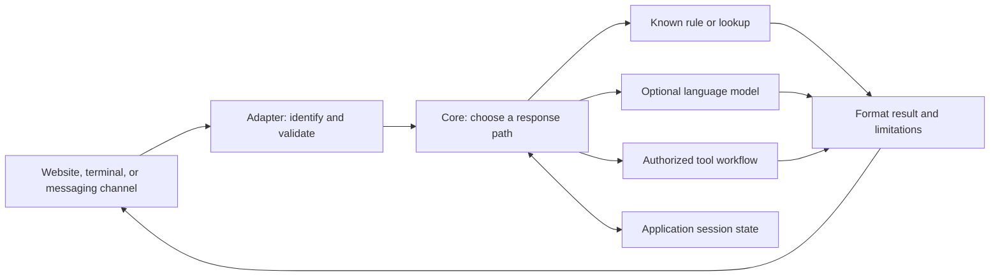

# Choose and design the right kind of bot

**Prerequisites:** [durable agent workflows](../agents/07-durable-workflows.md), Python functions and dictionaries, and the distinction between generated text and an authorized tool action. This stage supplies the web concepts you need; you do not need to finish production engineering first.

A **bot** is a program that responds to messages or events automatically. A chatbot talks through a conversation. A scheduled reminder bot may never hold a conversation at all. The word describes the application's behavior, not how intelligent its underlying model is.

An **LLM** is a model that processes and generates language. It can be one component inside a bot. An **agent** chooses actions while working toward a goal. An agent can power a chatbot, but a chatbot that returns opening hours from a dictionary does not need an agent loop. Adding a model changes how responses are produced; adding tools changes what the application can do.

## Choose from the job, not the label

Imagine four requests to a school library. “What time do you close?” needs a current fact. “Explain this borrowing rule” may need a short explanation. “Renew my book” needs identity, eligibility checks, and a confirmed state change. “Tell staff when this printer fails” begins with a machine event rather than a chat message.

| Design | How it works | A useful first task | Main limitation |
| --- | --- | --- | --- |
| Rule or command bot | Matches commands and returns known results. | `/hours`, `/help`, a status lookup. | Unrecognized phrasing needs a fallback. |
| AI chatbot | Uses a model to interpret or generate language. | Explain a supplied rule in simpler words. | Fluent responses can be wrong. |
| Tool-using bot | Runs a checked workflow or bounded agent. | Find an eligible loan, propose renewal, confirm its result. | Permissions and partial failures need explicit handling. |
| Voice bot | Converts speech to text, handles a request, then produces speech. | Read an accessible status update. | Noise, timing, and transcription mistakes affect the whole exchange. |
| Event bot | Responds to a schedule or incoming system event. | Notify staff of a device failure. | Repeated events can create repeated actions. |

These categories overlap. A voice interface can use rules for exact commands and a model for explanations. A messaging bot can receive both a user's question and a scheduled event. Choose the smallest combination that meets the task.

## Separate the conversation from the decision

A **channel** is the place people interact: a terminal, website, Telegram chat, Discord server, or Slack workspace. A **channel adapter** translates that platform's messages into an internal format and translates responses back. Keep it separate from the bot's core logic so that changing platforms does not require rewriting every rule.



Use an internal record such as `channel`, `conversation_id`, `user_id`, `message_id`, and `text`. Those identifiers must come from the verified channel connection. A sentence saying “I am the administrator” is message content, not identity evidence. Two messages can have identical text while being separate requests; one retried event can have the same identifier and require only one action.

The local project starts with a simpler boundary: a browser session gets a random identifier, and the bot has no external tools. A session identifier keeps conversations apart; it does not prove a real person's identity.

## Design the conversation before implementing it

Write a short **conversation contract**: supported tasks, accepted inputs, useful outputs, available memory, failure behavior, and actions that require confirmation. Then draw one successful exchange and two failures.

For our first bot, the contract is deliberately small:

1. Answer the fictional library's opening-hours command from a fixed value.
2. Save a display name for the current session and answer a later name question.
3. Explain its available commands when it cannot handle a request.
4. Clear that session's memory on reset.
5. Optionally ask a local model to explain a programming idea; never claim to renew a book or send a message.

A **fallback** is the next useful response when the preferred path cannot complete. “I handle hours and session names; try `hours`” is useful in rule mode. Pretending that a failed lookup succeeded is not. When several interpretations are plausible, ask one focused question. When an operation changes something, show the object, proposed change, and confirmation state.

A **human handoff** transfers responsibility to a person. A bot should say whether a handoff was requested, actually queued, or accepted by staff. Collect only the context needed to continue, tell the user what will be shared, and stop automated replies when a person owns the conversation. A link to a support address is useful, but it is not proof that someone received a ticket.

## Plan memory and voice deliberately

Conversation history is the recent exchange. Application memory is stored information, such as a chosen language or a pending form field. A model's weights are a third, separate thing. Saving a name in a dictionary does not train a model.

Decide which memory expires, what reset removes, and whether a shared device should retain anything. Longer history can help resolve “that one,” but increases processing and the amount of private information sent onward. Save only what the task needs.

A voice bot adds **speech recognition** before the conversation and **speech synthesis** after it. Confirm consequential names, dates, and amounts when the transcription is uncertain. Let users interrupt playback, repeat a response, switch to text, and cancel. The browser's [Web Speech API overview](https://developer.mozilla.org/en-US/docs/Web/API/Web_Speech_API) describes recognition and synthesis as separate facilities; availability and processing location depend on the implementation. This stage's project remains text based so its state transitions are easy to inspect.

## Practice: choose a first implementation

Design a bot for “Tell students today's club room, explain how to join, and book a place.” Identify which part can use a lookup, which might use generation, and which needs a checked action. Write a fallback for each.

<details>
<summary>Compare a concrete design</summary>

Use a current room record for the exact location. Explain approved joining instructions, preserving their conditions. Booking needs the authenticated student, available capacity, explicit confirmation, and a recorded result. Missing room data should produce an honest unavailable message; missing policy evidence should lead to a source or staff contact; a booking timeout should trigger a status check before another write.

</details>

**Deliverable:** keep your conversation contract beside the code. In the next lesson, build the complete local bot first, then change one behavior and show the corresponding test. Platform frameworks can help with delivery, but the core decisions remain yours; [Telegram's official tutorial](https://core.telegram.org/bots/tutorial) provides a concrete example of that separation.

## Depth lab: model a conversation as explicit state

A conversational interface still needs a precise task model. For a reservation draft, distinguish collecting a book, reviewing a complete draft, and awaiting execution results. Natural language can propose an event, but the application determines which transitions are valid.

```python runnable
def advance(state, event):
    stage, book = state
    kind, value = event
    if kind == "cancel":
        return ("idle", None)
    if kind == "choose_book":
        return ("review", value)
    if kind == "confirm" and stage == "review":
        return ("ready", book)
    raise ValueError("event is not valid in this state")

state = ("idle", None)
state = advance(state, ("choose_book", "B17"))
state = advance(state, ("choose_book", "B18"))  # Correction replaces the draft.
print(state)
state = advance(state, ("confirm", None))
print(state)
print(advance(state, ("cancel", None)))
```

```text output
('review', 'B18')
('ready', 'B18')
('idle', None)
```

This is a conversation fixture, not a reservation service. It does not authenticate, approve a consequential action, or execute a write. “Ready” means the draft is complete enough for the application's action checks. Production code must validate the selected ID and bind any required approval to the final draft.

**Design exercise:** write transitions for corrections, ambiguous references such as “that one,” cancellation, a stale book version, and a user changing topics. Decide whether a correction invalidates prior confirmation. Avoid inferring a new action from an old “yes” attached to another question.

**Debugging:** save structured stage, draft version, unresolved fields, and last processed event ID. Inspect these before reading a long transcript. A fluent reply can conceal a wrong transition, such as confirming B17 after the user changed it to B18.

**Production and optimization:** use forms or buttons for exact choices when they reduce ambiguity, with text for explanation and flexible questions. Ask only for genuinely missing information. Fewer conversation turns can reduce latency and abandonment, but skipping a necessary disambiguation can increase wrong actions.

<details>
<summary>Interview defense: is conversation history the same as application state?</summary>

No. History records what was said, including mistakes, corrections, and quoted material. State records the application's current interpretation and verified facts. Derive state through controlled transitions, retain relevant provenance, and keep approvals and operation receipts in authoritative records.

</details>

**Teach-back:** role-play a student who changes the book twice and then cancels. After each turn, explain the state and the one action the application is allowed to take next.

**Previous:** [Resume an agent without repeating its actions](../agents/07-durable-workflows.md) · **Next:** [Build a working local chatbot, then connect a model](02-build-a-chatbot.md)
