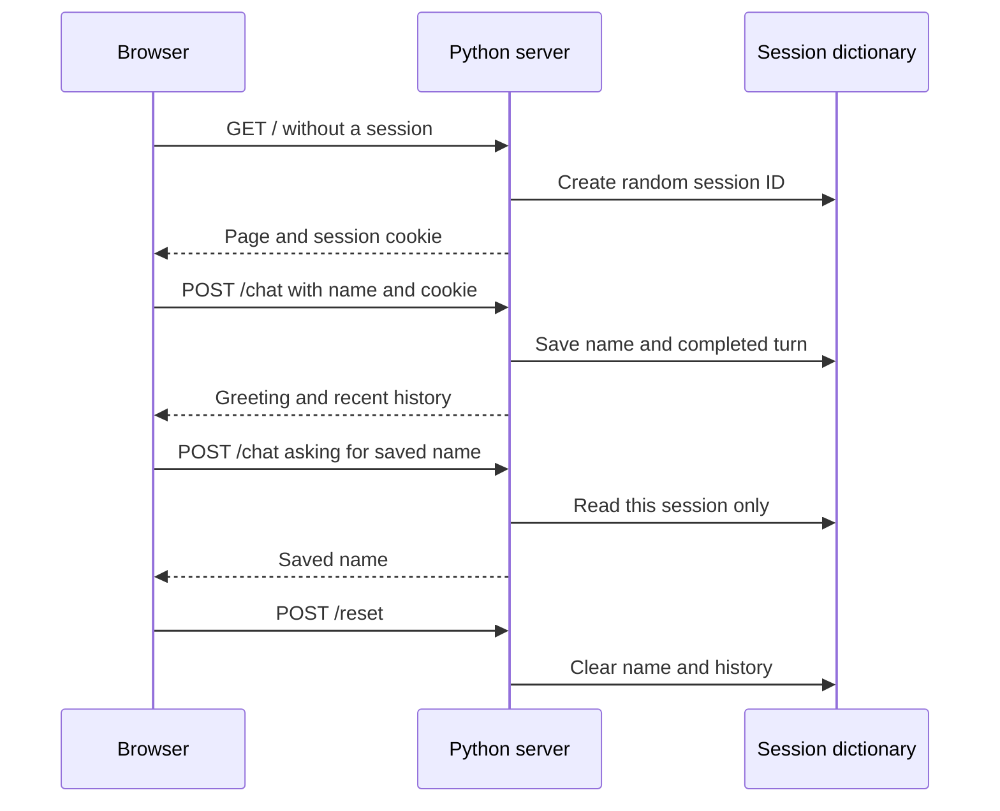

# Build a working local chatbot, then connect a model

**Prerequisites:** [bot design](./01-bot-types-and-design.md), running Python scripts, dictionaries, and tests. You will use the same bot core through a terminal and a browser. No account or external package is needed for the default project.

Download [chatbot.py](pathname:///examples/ai/bots/chatbot.py) and save it in your practice folder. The file contains the response rules, session store, tests, web server, and webpage. Its default replies are fixed application rules. An optional mode connects an actual local language model after you explicitly enable it.

## Run the complete offline program

From the folder containing the download:

```sh
python3 chatbot.py
```

```text
Mode: fixed replies; no LLM or network
You: my name is Ada
Bot: Hello, Ada. I will remember that in this session.
You: what is my name
Bot: Your saved name is Ada.
You: hours
Bot: Fictional library hours: Monday-Friday, 09:00-17:00.
You: /reset
Bot: Session memory cleared.
You: what is my name
Bot: You have not saved a name in this session.
Self-tests: 46 checks passed; no model calls
```

Now run `python3 chatbot.py --cli` for an interactive terminal conversation. Try the same messages, an unsupported request, and `/quit`. `python3 chatbot.py --self-test` runs only the offline checks. These modes write no files. If your working Windows command is `py -3`, substitute it for `python3`.

## Understand a browser request before running the website

**HTTP** is a request-and-response protocol. A **client**, here the browser, asks a **server**, here our Python process, to do something. A request has a method such as `GET` or `POST`, a path such as `/chat`, headers describing the request, and sometimes a body containing data. A response includes a status code and a body. `200` means this request succeeded; `400` means this application rejected its input. [MDN's HTTP overview](https://developer.mozilla.org/en-US/docs/Web/HTTP/Guides/Overview) explains the same exchange.

Our webpage sends JSON, for example `{"message":"hours"}`. An **endpoint** is a supported method/path combination. `GET /` returns the webpage, `GET /history` returns the current conversation, `POST /chat` sends a turn, and `POST /reset` clears session memory. **Loopback**, `127.0.0.1`, refers to this computer; it does not publish the site on the internet.

```sh
python3 chatbot.py --serve
```

Open the printed address, `http://127.0.0.1:8002`, in a browser. Enter a message and press **Send**. Use **Reset session** to clear the transcript and saved name. Stop the server with Ctrl+C. If the port is occupied, choose another, for example `python3 chatbot.py --serve --port 8012`, and use its printed address.

## Trace state through two turns

A **session** groups interactions that belong to one conversation. The server creates a random session identifier and sends it in a **cookie**, a small value the browser returns with later requests. The transcript stays in the Python process; it is not stored in the cookie.



Two ordinary tabs in one browser normally share this cookie and therefore this conversation. To test isolation, use separate browser profiles or an ordinary window and a private window. A cookie identifies a session; it is not a user account or authorization system.

Read the file in this order:

1. `validate_message` accepts a nonempty string of at most 500 characters.
2. `Chatbot.create_session` creates an isolated name, history, and last-use time.
3. `Chatbot.chat` routes known commands before calling any optional backend.
4. A successful turn appends one user message and one assistant reply. Only the latest four complete turns remain.
5. `handler_for` translates HTTP requests into core calls; `PAGE` displays their results.

The Python `class` groups related state and methods. `self` refers to the particular bot instance. Changing `self.sessions` changes that bot's store. The browser uses JavaScript `fetch` to send HTTP requests and `textContent` to display replies as text, rather than executing them as HTML. You can understand and modify the Python core before studying the [optional JavaScript track](../../javascript/index.md).

## Connect a real local model

Install Ollama using its [official quickstart](https://docs.ollama.com/quickstart). Choose and download a **local chat model** that fits your memory, disk space, and permitted use. Downloads can be large. Check its model page and try it directly in Ollama before integrating it; there is no universal model size suitable for every computer.

Keep this exercise local: configure `OLLAMA_NO_CLOUD=1` for the Ollama service and restart it, following its [local-only configuration instructions](https://docs.ollama.com/faq#how-do-i-disable-ollamas-cloud-features). Run `ollama list` to obtain the exact installed name. In the following command, replace `YOUR_LOCAL_MODEL` with that name; it is not a model to download literally.

```sh
python3 chatbot.py --serve --live --model YOUR_LOCAL_MODEL
```

Use `--cli` instead of `--serve` for terminal chat. Ask “Explain a Python loop in two sentences,” which is outside the fixed commands. The response now comes from your model and will vary. The bot sends bounded history, the saved display name, and your message to `http://127.0.0.1:11434/api/chat`. It requests `stream: false` and reads `message.content`, following the [Ollama chat API](https://docs.ollama.com/api/chat).

The request limits predicted output to 128 tokens using `num_predict`; the accepted reply must also fit 1,200 characters. These are different units. See the [parameter reference](https://docs.ollama.com/modelfile#valid-parameters-and-values). The adapter requires a completed response with a normal `stop` reason. A token-limit stop, unexpected tool call, oversized reply, malformed response, or 30-second network timeout produces an error and leaves that turn out of history. It does not silently present a cut-off answer as complete. The client timeout does not guarantee cancellation of work already running inside Ollama.

## Boundaries and practice

The server holds at most 100 sessions. An hour of inactivity expires a session when the next request triggers cleanup. Restarting the process removes all sessions. It has no database, accounts, tools, external messaging, or public deployment configuration. Python's [HTTP server documentation](https://docs.python.org/3/library/http.server.html) explains why this server is for local teaching rather than production service.

**Exercise:** save a name, send enough turns to remove its original message from the four-turn history, and ask for the name again. Then reset and repeat the question. Explain both results.

<details>
<summary>Expected explanation</summary>

The separate `name` field survives history trimming, so the first question still returns the saved name. Reset clears both fields, so the second says no name is saved. Neither behavior updates model weights. Add a tested `/forget-name` command if you want to clear the name while preserving recent chat.

</details>

## Depth lab: prevent a late response from restoring reset state

A user can reset a conversation while a model request is still running. If the old response later appends to the new history, the reset appears to fail. A **generation number** identifies the version of a session; a response may commit only to the version that started it.

```python runnable
session = {"generation": 0, "history": []}
request_generation = session["generation"]

# Reset occurs while the model is working.
session["generation"] += 1
session["history"].clear()

def commit_reply(session, expected_generation, reply):
    if session["generation"] != expected_generation:
        return False
    session["history"].append(reply)
    return True

print("old response accepted:",
      commit_reply(session, request_generation, "An old answer"))
print("history:", session["history"])
print("new response accepted:",
      commit_reply(session, session["generation"], "A new answer"))
```

```text output
old response accepted: False
history: []
new response accepted: True
```

This is a single-process fixture. A real concurrent service needs an atomic version check and append, such as a transaction or compare-and-swap. A normal check followed by an unlocked write can race with another reset.

**Extend the local project:** add a controllable fake backend that pauses before returning. Start a turn, reset its session, then release the fake response. Assert that the old turn does not reappear. Repeat with two sessions and verify that resetting one does not affect the other.

**Debugging:** distinguish request arrival order, completion order, and committed conversation order. Two tabs can share one session and issue overlapping messages. Decide whether to serialize turns, reject overlap, or implement explicit branching. Appending whichever response finishes first can make the next prompt contain a conversation that never happened.

**Production design:** authenticate accounts separately from session IDs; use trusted ownership checks for every session read and mutation. Limit history and active requests per user. Rendering model text as HTML adds another boundary; display plain text or use a reviewed rendering/sanitization policy for supported markup.

**Optimization:** summarize older discussion only after preserving necessary facts and unresolved decisions. Keep a reference to the source state and invalidate derived summaries after correction or reset. A shorter prompt that silently reintroduces an obsolete preference is a correctness regression.

<details>
<summary>Interview defense: does cancelling the HTTP request guarantee the model stopped?</summary>

No. Client cancellation may only stop waiting. The remote computation can continue unless cancellation is supported and confirmed. Prevent stale responses from committing, propagate cancellation where possible, and account for work already consumed.

</details>

**Teach-back:** draw a timeline with request, reset, and late response. Show why clearing a list once is insufficient when another process can write afterward.

**Previous:** [Choose and design the right kind of bot](01-bot-types-and-design.md) · **Next:** [Connect a bot to messaging channels](03-connect-messaging-channels.md)
