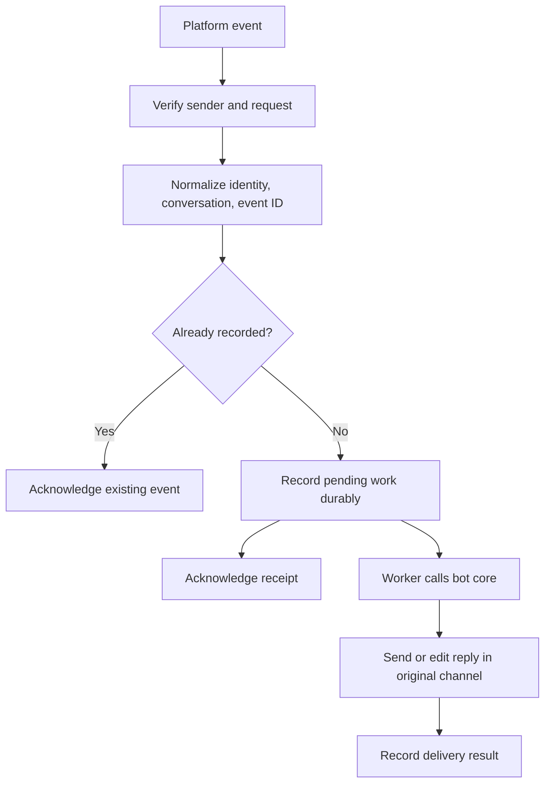

# Connect a bot to messaging channels

**Prerequisites:** run the [local chatbot](./02-build-a-chatbot.md) and explain its HTTP request, session cookie, and response. This lesson shows how an external channel replaces the local browser. Account creation, app installation, and public hosting are separate actions you choose when ready; the exercises here run offline.

A platform message does not arrive as just a string. It includes a conversation, sender, event identifier, and platform-specific metadata. Your **adapter** verifies the event, converts it to your internal request, calls the bot core, and sends the reply to the correct destination. Keep the same tested response rules behind every adapter.

## Receiving events: polling, webhooks, and connections

With **polling**, your application repeatedly asks the platform for new events. **Long polling** lets the platform wait for an event before completing that request, reducing empty checks. Your program needs to remember its position so a restart does not skip or repeatedly process messages.

A **webhook** reverses the direction: the platform sends an HTTP request to your application's registered address when an event occurs. That usually requires a reachable HTTPS endpoint. HTTPS encrypts traffic and verifies the server connection; it does not replace checking who sent the event. A local `127.0.0.1` address is unreachable from the platform's servers.

Some platforms offer a persistent connection, often a **WebSocket**, over which events arrive. The application keeps that connection alive and reconnects when needed. Delivery method and bot reasoning are independent choices.



An **acknowledgment** says the event was received. It is not the final answer. A **queue** stores work for later processing; a **worker** takes that work and executes it. Record the work before acknowledging if a crash would otherwise lose the request.

## Choose one platform and one small command

Start with a private test conversation and a read-only `/hours` command. Do not request access to every message or workspace resource when a command is sufficient.

| Channel | First integration path | Platform-specific checks |
| --- | --- | --- |
| Telegram | Create a bot with BotFather, keep its token server-side, then receive updates with `getUpdates` or a webhook. | Polling and a configured webhook are alternatives. Track `update_id`; for webhooks, verify the configured secret-token header. |
| Discord | Create an application, register a slash command, and install it in an authorized test context. Receive interactions through the selected connection method. | HTTP interactions need the documented signature verification. Respond or defer within the platform's deadline. |
| Slack | Create and install an app with narrow scopes. Subscribe to chosen events through HTTP or Socket Mode. | Verify HTTP request signatures, handle the setup challenge, and ignore events from your own bot when appropriate. |

Follow the current official setup flows: [Telegram tutorial](https://core.telegram.org/bots/tutorial), [Discord first bot](https://docs.discord.com/developers/quick-start/getting-started), and [Slack Events API](https://docs.slack.dev/apis/events-api/). Their consoles, permissions, and delivery formats change; the adapter boundary stays the same.

Map a verified event to a stable conversation key. Include the platform, installation/workspace, channel or chat, and thread when relevant. For a private per-person assistant in a group, also include the verified sender. Otherwise two users in a shared channel could accidentally share private memory. Do not use a display name as a unique identifier.

## Verify the request before trusting its contents

**Authentication** checks where a request came from. **Authorization** checks what that sender may do. A valid platform signature establishes the event's origin and integrity under that mechanism; it does not authorize every action mentioned in the message.

Telegram's webhook `secret_token` is checked through `X-Telegram-Bot-Api-Secret-Token`. It is a shared secret, not a cryptographic signature over the body. Its [Bot API reference](https://core.telegram.org/bots/api#setwebhook) describes delivery and retry behavior. Discord documents verification using the timestamp, raw body, signature, and application's public key in its [interaction overview](https://docs.discord.com/developers/interactions/overview). Use a maintained implementation of its required cryptography.

Slack uses an **HMAC**, a keyed authentication calculation. Preserve the exact raw bytes: parsing and re-serializing JSON can change the bytes and invalidate the check. This offline example follows Slack's [request-signing recipe](https://docs.slack.dev/authentication/verifying-requests-from-slack/) with a fictional secret and fixed clock.

```python runnable
import hashlib
import hmac

secret = b"fictional-test-secret"
body = b'{"event_id":"E1","text":"hours"}'
timestamp = "1700000000"

def signature(raw, sent_at):
    signed = b"v0:" + sent_at.encode("ascii") + b":" + raw
    return "v0=" + hmac.new(secret, signed, hashlib.sha256).hexdigest()

def valid(raw, sent_at, supplied, now):
    if abs(now - int(sent_at)) > 300:
        return False
    return hmac.compare_digest(signature(raw, sent_at), supplied)

supplied = signature(body, timestamp)
print(valid(body, timestamp, supplied, 1700000000))
print(valid(body + b" ", timestamp, supplied, 1700000000))
print(valid(body, timestamp, supplied, 1700000400))
```

```text output
True
False
False
```

The changed body and old request fail. A real handler also rejects missing or malformed headers before this calculation, loads the secret outside source code, limits request size, and checks event structure. Never print a bot token or signing secret in a diagnostic response.

## Retries, slow models, and streaming

Platforms can deliver an event more than once. **Deduplication** recognizes a previously recorded event ID. Store its processing status, result, and outgoing operation identifier. A crash after sending but before recording success creates an uncertain state: check delivery status or use the platform's supported idempotency mechanism before retrying. A local `seen` set disappears on restart and cannot provide that guarantee.

An **asynchronous** design accepts work now and completes it later. It does not mean everything runs simultaneously. Acknowledge promptly, then let a worker call the model. Discord interactions currently require an initial response within three seconds; a deferred response is appropriate for longer work under its [interaction-response rules](https://docs.discord.com/developers/interactions/receiving-and-responding). Do not make a slow model call before acknowledging.

**Streaming** shows output in pieces. A webpage can receive chunks continuously; a messaging platform may require updating one message at intervals. Batch updates and mark incomplete output clearly. Never execute a tool action from a partial generated sentence. The local chatbot intentionally waits for a complete reply; adding streaming requires a cancellation and interrupted-output policy.

A **rate limit** caps request frequency. Respect returned retry timing, bound retries, and avoid making every waiting conversation retry at once. Read the current [Slack limits](https://docs.slack.dev/apis/web-api/rate-limits/) and [Discord rate-limit headers](https://docs.discord.com/developers/topics/rate-limits), rather than hard-coding one global sending rate. Escape the platform's formatting and suppress unintended mentions so model text cannot unexpectedly notify an entire group.

## Practice: trace a retried event

A verified event arrives twice. Its first worker starts an expensive model call; before it finishes, the platform retries delivery. Draw the event record and expected acknowledgments. Then describe what changes if staff take over the conversation.

<details>
<summary>A workable answer</summary>

Record one pending job under the event's stable ID. Acknowledge both deliveries, but create no second job. Save completion and reply status when the first worker finishes. A staff handoff changes the conversation owner; the worker checks that ownership before sending, so a late automated response does not interrupt the person handling the request.

</details>

**Deliverable:** write an adapter contract for one platform, including identity mapping, verification, event IDs, retry policy, output destination, and handoff state. Connect it to your tested bot core only after its read-only command works in a private test channel.

## Depth lab: design an inbox before acknowledging an event

Messaging channels can redeliver events after a timeout. An **inbox record** stores that an event was accepted. An **outbox record** stores a reply that still needs delivery. They solve different sides of the integration.

Use this sequence for a durable adapter:

1. Verify the platform's request authentication using the original bytes and required freshness rules.
2. Map the verified sender and conversation to an application identity and authorized destination.
3. In one local transaction, insert the event under a unique key and create a pending job. A duplicate key returns the existing acceptance state.
4. Acknowledge after durable acceptance, within the platform's documented deadline.
5. Process the job with bounded model work and record a reply intent.
6. Deliver the reply using the channel's supported deduplication or reconciliation mechanism.

Acknowledging before step 3 can lose a message if the process crashes. Waiting for the model before acknowledging can cause redelivery when generation is slow. The inbox alone does not guarantee one external reply: the send/receipt crash gap still needs the channel's contract.

**Ordering exercise:** the user sends “use B17,” then “actually B18.” If the second arrives or finishes first, arrival order may not express intended order. Use platform sequence information when available, serialize within a conversation where necessary, and define a policy for edits and late events. A timestamp by itself may be ambiguous or insufficient.

**Debugging:** correlate platform event ID, internal job ID, conversation revision, model request ID, and outgoing message ID. Keep the original logical event ID across retries; a new worker-attempt ID should not turn a duplicate into a new action. Reject a reused event ID with conflicting authenticated payload where the platform contract requires immutable events.

**Optimization and production:** partition work by conversation to preserve its ordering while processing independent conversations concurrently. Bound queue size and job age. When a channel throttles outgoing messages, combine safe progress updates rather than repeatedly retrying every token. Revalidate the destination and authorization before sending a delayed result.

<details>
<summary>Interview defense: does a valid webhook signature authorize an action in the message?</summary>

It establishes the request's origin and integrity under that platform mechanism. The sender still needs an application identity and permission for the requested operation. A signed event can contain an unauthorized request or hostile text; authentication and authorization are separate decisions.

</details>

**Mini-project and teach-back:** simulate duplicate delivery, a crash after acceptance, an edited message, and a lost send acknowledgment. Produce a timeline showing which IDs deduplicate which effects. Label any delivery guarantees the chosen channel cannot provide.

**Previous:** [Build a working local chatbot, then connect a model](02-build-a-chatbot.md) · **Next:** [Test whole conversations and operate a bot responsibly](04-test-and-operate-bots.md)
