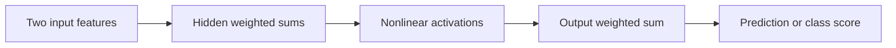

import AlgorithmWalkthrough from '@site/src/components/AlgorithmWalkthrough';

# Build a neural network from small operations

**Before this lesson:** [Trust scores, thresholds, and forecasts](../machine-learning/08-calibration-and-time.md).

A **neural network** combines weighted sums with functions that change their outputs. Those functions are called **activations**. A group of such computations forms a **layer**; layers between the inputs and final outputs are **hidden layers**. Deep learning uses networks with multiple layers to learn useful intermediate representations.

The starting idea is the regression model you already trained. A weighted sum combines features; an activation allows a layer to express more than another straight-line transformation. These are mathematical models, not detailed simulations of a human brain.

## Follow one unit

A unit receives a feature vector, computes a dot product with weights, adds a bias, and applies an activation. **ReLU**, short for rectified linear unit, returns `max(0, value)`. **Tanh** maps values into the range from -1 to 1. A sigmoid maps a logit into the range from 0 to 1.

An **affine transformation** is a weighted sum plus a bias. If every layer were only a linear or affine transformation, their composition would still be affine. Nonlinear activations are what let a network represent a wider family of relationships. More layers are not automatically better: the data, objective, optimization, and evaluation still decide whether extra complexity helps.



## Represent a pattern a single line cannot separate

**XOR**, exclusive OR, is true when exactly one of two binary inputs is one. A single straight-line boundary cannot separate its two positive corners from its two negative corners in the two-dimensional input plane. Two hidden ReLU units can construct the pattern:

```python runnable
def relu(value):
    return max(0, value)

for x1, x2 in [(0, 0), (0, 1), (1, 0), (1, 1)]:
    h1 = relu(x1 + x2)
    h2 = relu(x1 + x2 - 1)
    prediction = h1 - 2 * h2
    print(f"{x1} {x2} -> {prediction}")
```

```text output
0 0 -> 0
0 1 -> 1
1 0 -> 1
1 1 -> 0
```

Here the weights were chosen by us. This proves that this small network can represent the four cases; it does not show that training discovered them or that the rule applies outside binary inputs. The next lesson's project learns a related nonlinear pattern from separate training examples.

## Connect a prediction to a gradient

A **forward pass** computes intermediate values and a prediction. A **loss** measures how the prediction differs from a target. **Backpropagation** applies the chain rule backward through those operations to calculate parameter gradients. An **optimizer** uses those gradients to choose an update.

<AlgorithmWalkthrough name="aiTraining" />

In the walkthrough, distinguish calculating a gradient from changing a weight. Backpropagation does the first; the optimizer does the second. The validation data should not supply the gradients used to fit the network. PyTorch automates the differentiation and provides the optimizer, but the mathematical roles remain separate. [PyTorch optimization loop](https://docs.pytorch.org/tutorials/beginner/basics/optimization_tutorial.html).

## Count shapes and parameters

A **tensor** stores numbers with a shape: it may be a scalar, a vector, or an array with more dimensions. A batch of five records with two features has shape `(5, 2)`. A dense layer with two inputs and three outputs uses six weights and three biases. Each record is transformed by the same parameters; the batch size does not multiply the parameter count.

Match output and loss to the task. A numeric prediction can use squared error. Binary classification can use one logit with binary cross-entropy, which penalizes confident wrong predictions. Several mutually exclusive classes commonly use one logit per class with a multiclass cross-entropy loss.

## Recognize failure before adding more layers

A network can memorize a small training set. Keep the baseline and split from the ML stage. Inspect training and validation loss, input scaling, label quality, and whether gradients are finite. If a tiny known example cannot be fitted, debug shapes, the objective, and the update before blaming insufficient model size.

## Practice

How many parameters does a dense layer with four inputs and two outputs have when each output has a bias? Why does multiplying the batch size by ten not change that answer?

<details>
<summary>Check your reasoning</summary>

There are eight weights and two biases, for ten parameters. The same layer is applied to every example in the batch. A bigger batch changes the amount of computation and the gradient estimate, not the definition of the layer's parameters.

</details>

---

## Depth lab: derive a dense layer's backward pass

Let one input row be x, weights be W with one row per output, and biases be b. For output j, compute `z[j] = sum(W[j][i]*x[i]) + b[j]`. If the loss sends gradient g[j] to that output, then `dW[j][i] = g[j]*x[i]`, `db[j] = g[j]`, and `dx[i] = sum(g[j]*W[j][i])`. Every use of an input contributes to its gradient.

```python runnable
x = [2.0, -1.0]
weights = [[3.0, 4.0], [-2.0, 1.0]]
bias = [1.0, 0.0]
upstream = [0.5, -1.0]
z = [sum(w*v for w,v in zip(row,x))+b
     for row,b in zip(weights,bias)]
dw = [[g*v for v in x] for g in upstream]
dx = [sum(upstream[j]*weights[j][i] for j in range(2))
      for i in range(2)]
print(z)
print(dw)
print(dx)
assert dx == [3.5, 1.0]
```

```text output
[3.0, -5.0]
[[1.0, -0.5], [-2.0, 1.0]]
[3.5, 1.0]
```

Check the first output: 3×2 + 4×(-1) + 1 = 3. Its incoming gradient is 0.5. The first input affects both outputs, so its derivative is 0.5×3 + (-1)×(-2) = 3.5. For ReLU after this layer, multiply the incoming gradient by the positive-preactivation indicator before the dense backward calculation. The second output's path would then stop because its preactivation is negative.

### Debug and make it useful

Add a scalar objective `sum(g[j]*z[j])` and finite-difference each input and weight. This checks a vector-to-vector layer using an independently computed scalar. Check one example before introducing a batch; batch parameter gradients combine contributions across examples according to the loss reduction.

A dense layer with d inputs and h outputs uses d×h+h parameters and roughly d×h multiply-add contributions per example. Batching reuses weights; it does not create new parameters. Use tested array kernels for production, but retain the scalar implementation as a small oracle. Save feature order, dtype, activation, and shape contracts with the model.

If predictions stay constant, inspect preactivations, activation outputs, and parameter gradients separately. More hidden units cannot repair disconnected gradients or a feature-order mismatch. Profile tensor operations and data conversion before optimizing.

<details>
<summary>Expert defense: why does multiplying two weight matrices not replace a nonlinear network?</summary>

Without an intervening nonlinearity, affine layers compose into another affine map. ReLU changes which paths are active depending on the input, so one fixed matrix generally cannot reproduce the resulting piecewise mapping. Show two inputs that activate different hidden units instead of relying only on the word “nonlinear.”

</details>

**Teach and demonstrate:** derive the three gradients above, deliberately omit one input-gradient contribution, show the finite-difference failure, and explain why an optimized library should agree within a stated tolerance.

**Previous:** [Trust scores, thresholds, and forecasts](../machine-learning/08-calibration-and-time.md) · **Next:** [Backpropagation, one multiplication at a time](02-backpropagation.md)
