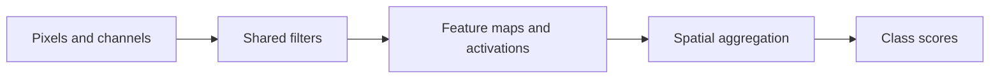

# Learn visual patterns with convolutions

**Before this lesson:** [Train carefully with and without PyTorch](02-training-and-pytorch.md).

An image can be represented as a grid of numbers. A grayscale image has one intensity value per pixel; a color image commonly has several **channels**, such as red, green, and blue. A vision model must connect these measurements to a task: classify an image, locate objects, or label individual pixels.

A **convolutional neural network**, or CNN, reuses small learned filters across image locations. This makes nearby relationships and shared patterns part of the model's design. The same filter can respond to an edge in several places without learning a separate parameter for every position.

## Slide one small filter

A **kernel** is a small weight array. Place it over an image patch, multiply corresponding values, and sum them. Move it to the next position and repeat. In common deep-learning APIs, the operation called convolution uses cross-correlation, meaning the kernel is not flipped. [PyTorch Conv2d definition](https://docs.pytorch.org/docs/stable/generated/torch.nn.Conv2d.html).

```python runnable
image = [[0, 0, 1], [0, 1, 1], [1, 1, 1]]
kernel = [[1, -1], [1, -1]]
output = []
for row in range(2):
    values = []
    for col in range(2):
        value = sum(image[row + i][col + j] * kernel[i][j]
                    for i in range(2) for j in range(2))
        values.append(value)
    output.append(values)
for row in output:
    print(row)
```

```text output
[-1, -1]
[-1, 0]
```

The filter compares neighboring columns in each patch. It was chosen by hand for the demonstration; a trained CNN learns filter values from its loss. Four positions use the same four weights.

**Stride** is the number of positions moved each time. **Padding** adds a boundary around the input. With width 3, kernel width 2, stride 1, and no padding, the output width is 2. A filter covering several input channels sums contributions across those channels too.



A **feature map** is the grid of responses produced by a filter. Pooling or other aggregation can reduce spatial resolution. This can provide some tolerance to small changes, but it does not guarantee that every translation, crop, or rotation leaves a prediction unchanged.

## Check shapes and parameter counts before training

For an ordinary undilated convolution (no gaps between kernel entries), one spatial output size is:

`floor((input size + 2 × padding − kernel size) / stride) + 1`

**Floor** means round down to the nearest integer. Apply the formula separately to width and height. Padding here means the amount added on each side; the kernel must fit the padded input.

A 5-by-5 image, 3-by-3 kernel, padding 1, and stride 2 produce a 3-by-3 feature map. Moving the kernel in steps of two reduces the number of positions. Increasing the number of filters changes the number of output channels, not this spatial calculation.

Suppose the image has three color channels and the layer uses eight output filters. Each filter needs `3 × 3 × 3 = 27` weights: nine for each input channel. Eight filters need 216 weights, plus eight biases if the layer uses one bias per filter: **224 learned numbers**. The same weights are reused at every spatial position.

```python runnable
width, kernel, padding, stride = 5, 3, 1, 2
output_width = (width + 2 * padding - kernel) // stride + 1
input_channels, filters = 3, 8
parameters = filters * (kernel * kernel * input_channels + 1)
print("Output width:", output_width)
print("Parameters including biases:", parameters)
```

```text output
Output width: 3
Parameters including biases: 224
```

A common mistake is multiplying the parameter count by the number of image positions. That would describe separate weights at each position, losing the weight-sharing property we chose a convolution for. Another mistake is assuming all libraries use the same axis order; inspect the expected batch, channel, height, and width dimensions.

## Choose a vision task and its metric

Image classification chooses a label for a whole image. **Object detection** predicts locations and labels. **Segmentation** assigns labels to pixels. Accuracy alone cannot evaluate all three tasks. For a package-defect classifier, inspect missed defects and false alarms; for localization, evaluate the predicted regions against the annotated ones.

Split by the source of related images when necessary. Frames from one video, near-duplicate photos, or images of the same physical item can otherwise leak across partitions. Apply random training **augmentation**, such as valid crops or brightness changes, only when it preserves the target meaning. Flipping a digit or a directional sign can change its label.

### A correct label can have the wrong location

For object detection, compare predicted and reference boxes using **intersection over union**, or IoU:

`IoU = overlapping area / area covered by either box`

Two 4-by-4 boxes can overlap in a 2-by-4 strip. Their intersection is 8, their union is `16 + 16 − 8 = 24`, and their IoU is 1/3. The object label can be correct while its location is poor. Real detection evaluation also considers class labels, confidence ordering, missed objects, and duplicate predictions.

For segmentation, compare pixel sets and inspect small objects separately. A background-heavy image can have high pixel accuracy even when the model misses every small defect. Decide what error would hurt the real task before choosing a summary metric.

**Try it:** with input width 7, kernel width 3, stride 2, and no padding, how many horizontal positions fit? Which corners begin them?

<details>
<summary>Check the geometry</summary>

Three positions fit, starting at columns 0, 2, and 4. The last window covers columns 4, 5, and 6. A start at 6 would need pixels beyond the input.

</details>

## Reuse a learned representation

**Transfer learning** starts from knowledge learned on another dataset. A pretrained **backbone** extracts features; a **head** maps those features to your task. Compare three baselines: a simple non-neural model where feasible, a frozen backbone with a trained head, and selected layers fine-tuned on the new task.

**Fine-tuning** updates some pretrained parameters, often with a smaller learning rate than a new head. Freezing parameters and choosing evaluation behavior for layers with running statistics are distinct decisions. Follow the selected model's preprocessing and inspect whether the pretraining data resembles the new domain. [PyTorch transfer-learning tutorial](https://docs.pytorch.org/tutorials/beginner/transfer_learning_tutorial.html).

Transfer can save data and training work, but it can also carry unsuitable features or biases. Compare models on the same held-out task data and record the weight source, allowed use, input resolution, and normalization. Training from scratch is an alternative when sufficient appropriate data and compute justify it.

## Practice

A training set contains 20 frames from each of 50 videos. Why might a random frame split look better than a video-level split? Would a horizontal flip always be a valid augmentation for traffic signs?

<details>
<summary>Check your reasoning</summary>

Nearby frames can share almost all content, so random splitting can test near-copies of training examples. A video-level split is better evidence for new videos when that is the intended use. Flipping can reverse directional meaning, so augmentation must be justified by the task, not applied merely because an image library offers it.

</details>

---

## Depth lab: implement stride and dilation explicitly

For one spatial dimension, the output length is `floor((input + 2*padding - dilation*(kernel-1) - 1)/stride) + 1` when the configuration fits. Dilation spaces the kernel's sampled positions; stride spaces successive output positions. They solve different problems.

```python runnable
def correlate(signal, kernel, stride=1, dilation=1):
    if stride < 1 or dilation < 1 or not kernel:
        raise ValueError("Positive stride/dilation and a kernel required")
    span = dilation*(len(kernel)-1)+1
    return [sum(kernel[j]*signal[start+j*dilation]
                for j in range(len(kernel)))
            for start in range(0, len(signal)-span+1, stride)]

print(correlate([1, 2, 3, 4, 5], [1, -1]))
print(correlate([1, 2, 3, 4, 5], [1, -1], stride=2))
print(correlate([1, 2, 3, 4, 5], [1, -1], dilation=2))
```

```text output
[-1, -1, -1, -1]
[-1, -1]
[-2, -2, -2]
```

This is cross-correlation, the operation commonly called convolution in neural-network layers: the kernel is not reversed. A two-dimensional implementation adds a second spatial loop; multiple input channels contribute to each output channel. With a 3×3 kernel, three input channels, and eight output channels, there are 216 weights plus eight biases if enabled. Spatial dimensions affect work and activation memory, not that parameter count.

### Debug a vision pipeline end to end

Use an asymmetric image with distinctive values to reveal swapped axes or kernel orientation. Test padding, stride, channel order, and normalization separately. A shape-correct tensor can still have red and blue exchanged or pixel values normalized twice.

Detection and segmentation also need coordinate contracts. If an image is resized or cropped, labels and predicted locations must use compatible transformations. Test a known rectangle through preprocessing and inverse coordinate mapping. A correct class with an incorrect location is not a successful detection.

Batching, lower resolution, transfer learning, quantization, and optimized kernels have different cost/quality effects. Measure errors on small objects, unusual lighting, and domain shifts after changing resolution or preprocessing. Keep a scalar-loop oracle for small fixtures and use maintained kernels in production.

<details>
<summary>Expert defense: is a convolution automatically translation invariant?</summary>

Weight sharing supports translation equivariance under appropriate boundary and sampling conditions: shifting input can shift features. Padding, stride, cropping, pooling, and the final task head affect the result. Invariance means the output stays unchanged, which is a different claim. Demonstrate both with a shifted synthetic image.

</details>

**Teach and demonstrate:** derive an output shape, implement a tiny multi-channel kernel, debug a coordinate mismatch, and compare a measured optimization under fixed evaluation slices.

**Previous:** [Train carefully with and without PyTorch](02-training-and-pytorch.md) · **Next:** [Understand sequences and calculate attention](04-sequences-and-attention.md)
