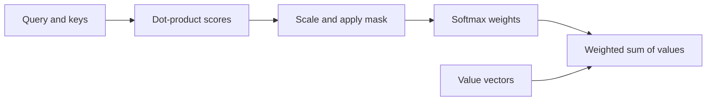

# Understand sequences and calculate attention

**Before this lesson:** [Learn visual patterns with convolutions](03-vision-and-convolutions.md).

A **sequence** is a list whose order matters. “Dog bites person” and “Person bites dog” contain the same words but mean different things. Text, audio, and sensor readings all contain sequential structure, though their useful units and timing differ.

A **token** is a unit chosen to represent a sequence. In text it might be a word, part of a word, or another learned unit. A token ID is an identifier, not a meaningful numeric measurement. An **embedding** maps that ID to a vector used by the model.

## Compare two ways of sharing context

A recurrent model updates a hidden state one step at a time, passing a summary forward. It can be a useful baseline for streams, but long relationships must travel through repeated updates. Convolutions can also process local sequence windows.

**Attention** lets one position combine information from several positions according to computed weights. A **query** represents what the current position is matching against; a **key** represents what another position offers for matching; a **value** is the information to combine. These are vectors, usually produced by learned linear projections.

This is a computation, not proof that a model understands a sentence. Attention weights are also not automatically faithful explanations of a prediction's cause.

## Calculate a two-item attention result

For a query `q`, compute its dot product with each key. Divide by the square root of key dimension, then apply **softmax**, which turns scores into nonnegative weights summing to one. Finally, take the weighted sum of value vectors. This is scaled dot-product attention. [Original Transformer attention definition](https://arxiv.org/html/1706.03762v7#S3.SS2).

```python runnable
import math

query = [1.0, 0.0]
keys = [[1.0, 0.0], [0.0, 1.0]]
values = [[10.0, 0.0], [0.0, 20.0]]
scores = [sum(q * k for q, k in zip(query, key)) / math.sqrt(len(query))
          for key in keys]
maximum = max(scores)
exps = [math.exp(score - maximum) for score in scores]
weights = [value / sum(exps) for value in exps]
result = [sum(weight * value[j] for weight, value in zip(weights, values))
          for j in range(2)]
print("Weights: " + ", ".join(f"{x:.3f}" for x in weights))
print("Result: " + ", ".join(f"{x:.3f}" for x in result))
```

```text output
Weights: 0.670, 0.330
Result: 6.698, 6.605
```

Subtracting the maximum before exponentiation improves numerical stability without changing softmax's mathematical result. The query matches the first key more strongly, but both values contribute. These vectors are hand-chosen teaching inputs, not learned language representations.



## State which positions may be used

In **self-attention**, queries, keys, and values come from the same sequence representation. In **cross-attention**, the queries come from one sequence and keys/values from another, such as a translation decoder attending to an encoded source sentence.

A **mask** blocks selected connections. A causal mask prevents a position from using later positions when predicting a next token. A padding mask prevents artificial padding positions from contributing. These masks solve different problems; using the wrong one can leak the answer or make a batch depend on irrelevant padding.

Attention alone does not supply a reliable notion of position. Models add positional information or modify attention to represent order. The next lesson shows how attention fits inside a Transformer rather than treating it as the whole model.

## Apply the mask before normalizing

Suppose the current token is allowed to use the first position but not the second. The second position happens to have a very large score. It must still contribute nothing. Masking is a rule about available information; a high score cannot override it.

One implementation treats blocked scores as negative infinity before softmax. The following equivalent teaching calculation assigns zero weight to blocked positions and normalizes only allowed ones. It rejects a row with no allowed position, because there is no valid distribution to normalize.

```python runnable
import math

def masked_weights(scores, allowed):
    if len(scores) != len(allowed) or not any(allowed):
        raise ValueError("need matching inputs and at least one allowed position")
    maximum = max(score for score, keep in zip(scores, allowed) if keep)
    weights = [math.exp(score - maximum) if keep else 0.0
               for score, keep in zip(scores, allowed)]
    return [weight / sum(weights) for weight in weights]

print(masked_weights([1.0, 100.0], [True, False]))
print(masked_weights([1.0, 1.0], [True, True]))
```

```text output
[1.0, 0.0]
[0.5, 0.5]
```

If you apply ordinary softmax first and only then set the second weight to zero, the remaining weights no longer sum to one. Renormalizing over the allowed positions would be necessary, and numerical underflow can make that route fragile. Prevent blocked positions from entering the normalization in the first place.

For three input positions, a causal self-attention mask allows these connections:

| Query position | Read position 0? | Read position 1? | Read position 2? |
| --- | --- | --- | --- |
| 0 | Yes | No | No |
| 1 | Yes | Yes | No |
| 2 | Yes | Yes | Yes |

The diagonal is allowed: the current input token is already known while predicting the next token. Padding is a separate concern. If position 2 is padding, it should not supply useful evidence to any real query.

**Lab extension:** change the second value vector in the earlier example while masking out its position. The result for the first query should not change. Then change an allowed value and verify that the result does change. This tests the information boundary more directly than checking only whether the output has the expected shape.

## Choose a useful comparison

For a small text classifier, compare a simple word-count or feature-based model with an embedding model before training a large sequence model. For a short sensor window, a compact recurrent or convolutional model may meet the task's constraints. Evaluate the same split, including time and source grouping, and compare latency and memory as well as accuracy.

## Practice

If both key scores are equal, what are the two weights? What happens if the second position is masked out? Why is seeing a later target token during next-token training a problem?

<details>
<summary>Check your reasoning</summary>

Equal scores give weights 0.5 and 0.5. If only the first position remains allowed, it receives weight 1 and the second receives zero. Future target access supplies information unavailable when generating that token, so training or evaluation may look successful without learning the intended conditional prediction task.

</details>

---

## Depth lab: separate an LSTM's cell state from its output

A basic recurrent update repeatedly transforms its hidden state. During backpropagation through time, a long chain of derivatives can shrink or grow sharply. A modern LSTM introduces a cell state c with a gated additive update: `c_new = forget*c_old + input*candidate`, followed by `h_new = output*tanh(c_new)`. Gates are commonly sigmoid outputs between zero and one.

```python runnable
import math
def lstm_step(cell, forget, input_gate, candidate, output_gate):
    new_cell = forget*cell + input_gate*candidate
    hidden = output_gate*math.tanh(new_cell)
    return new_cell, hidden

cell, hidden = lstm_step(2.0, 0.75, 0.5, -1.0, 0.8)
print(round(cell, 3), round(hidden, 3))
print(round(0.75**10, 6), round(1.0**10, 6))
```

```text output
1.0 0.609
0.056314 1.0
```

The cell keeps 1.5 from the past and adds -0.5, leaving 1.0. The hidden output exposes a gated, squashed view. Along the direct cell-state path, fixed forget factors multiply across steps: ten factors of 0.75 give about 0.056. Learned gates depend on inputs and hidden states, so the full derivative contains additional paths. The gated additive path helps preserve information; it does not guarantee perfect memory or eliminate every gradient problem.

To implement the complete cell, concatenate the current input and previous hidden state, compute four affine projections, apply sigmoid to the three gates and tanh to the candidate, then apply the update above. State all weight shapes before coding. Verify one step by hand before unrolling three steps.

### Attention offers a different access pattern

A recurrent model compresses history into state. Attention compares a query with accessible keys and combines their values. Neither mechanism automatically identifies truth. Inspect scores, masks, normalization, and weighted values separately. Padding and causal masks have different meanings; an all-masked row needs explicit handling to avoid invalid normalization.

Production sequence systems need length bounds, reset boundaries, batching policy, and state isolation. Accidentally carrying one user's recurrent state into another user's sequence is a correctness and privacy failure. Truncated backpropagation reduces training history and changes what dependencies can receive gradients.

<details>
<summary>Expert defense: why keep both c and h?</summary>

The cell provides an additive memory path, while h is the exposed representation used by other computations. The output gate can limit exposure without necessarily erasing the retained cell value. Explain this with the numeric example, then change only the output gate and observe that c stays fixed.

</details>

**Teach and demonstrate:** implement the full cell, check a parameter by finite differences on a short sequence, compare state-reset policies, and explain when attention or a simpler recurrent model fits the workload.

**Previous:** [Learn visual patterns with convolutions](03-vision-and-convolutions.md) · **Next:** [Put attention inside a Transformer](05-transformers.md)
