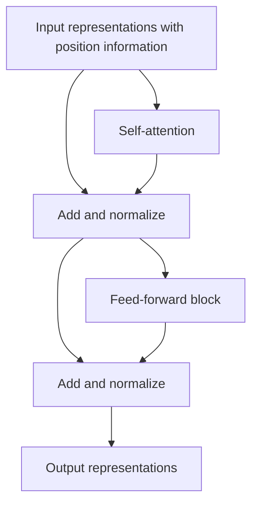

# Put attention inside a Transformer

**Before this lesson:** [Understand sequences and calculate attention](04-sequences-and-attention.md).

A **Transformer** is a network architecture that combines attention with other operations. Attention mixes information across positions. A **feed-forward block** transforms each position's representation using learned layers. Repeating these blocks lets the network build progressively different representations of a sequence.

Start from the two-item attention calculation, not from a large language model's product interface. A Transformer describes a model structure; its training data, objective, size, and evaluation determine what it can do.

## Trace one block

A **residual connection** adds a block's input to its transformed output, providing a direct path for information and gradients. **Layer normalization** rescales a position's features using statistics across its feature dimension, with learned adjustments. It differs from fitting a dataset-wide feature scaler.

One common arrangement is attention, residual addition and normalization, then a feed-forward transformation with another residual path and normalization. Other arrangements place normalization before sublayers. The details matter when reproducing a model; do not mix formulas from different designs and assume equivalence.



**Multi-head attention** uses several learned query/key/value projections. Each head produces a result; the results are combined through another projection. Heads provide several learned ways to mix information, not a guarantee that each head has one human-interpretable role. The original architecture specifies these components and residual/normalization operations. [Attention Is All You Need](https://arxiv.org/html/1706.03762v7#S3).

## Follow the shapes through one small block

Use four token positions and eight features per token. The input table is 4-by-8. In this example, two attention heads each use four query/key features and four value features.

| Step | Shape | Meaning |
| --- | --- | --- |
| Input representations | 4 by 8 | Four positions, eight numbers each. |
| One head's queries, keys, values | Each 4 by 4 | A learned projection gives four features per position. |
| Query–key scores | 4 by 4 | Every query position scores every key position. |
| One head's combined values | 4 by 4 | Four weighted value summaries. |
| Two heads placed side by side | 4 by 8 | The position count stays four. |
| Projected attention output | 4 by 8 | A learned projection mixes the head outputs. |
| Residual addition | 4 by 8 | Input and transformed output have matching shapes. |

The score matrix's second dimension counts **positions**, not vocabulary entries. The **vocabulary** is the set of tokens a language model can predict. If it contains six tokens, the final vocabulary projection produces a 4-by-6 table of **logits**, raw scores before softmax. That projection is outside the attention score calculation.

A feed-forward block operates on each row, often expanding eight features to a wider temporary representation and reducing back to eight. It changes features within a position. Attention is the part that mixes information between positions in this block.

### Calculate the normalization on one row

Take the features [2, 4, 6]. Their mean is 4. Their variance using this row's three values is `(4 + 0 + 4)/3 = 8/3`. Subtract the mean and divide by the square root of variance plus a small positive constant. The constant prevents division by zero when all features are equal.

```python runnable
import math

features = [2.0, 4.0, 6.0]
mean = sum(features) / len(features)
variance = sum((value - mean) ** 2 for value in features) / len(features)
normalized = [(value - mean) / math.sqrt(variance + 1e-5) for value in features]
print([round(value, 3) for value in normalized])
```

```text output
[-1.225, 0.0, 1.225]
```

This illustrates layer normalization with scale one and offset zero. A learned layer can adjust those values. This row-wise normalization is not an instruction to refit the dataset's preprocessing statistics on test data.

**Checkpoint:** explain why the residual addition would fail if the attention output were 4-by-6. A projection can change the feature width, but addition requires compatible shapes with a deliberate meaning. Do not “fix” a shape mismatch by reshaping until the error disappears.

## Match the architecture to the objective

| Form | Allowed information | Example use |
| --- | --- | --- |
| Encoder | Usually both earlier and later input positions. | Build representations for classification or retrieval. |
| Causal decoder | Current and earlier positions only for next-token prediction. | Continue a sequence one token at a time. |
| Encoder–decoder | Encode a source; decode a target with causal self-attention and source cross-attention. | Translate one sequence into another. |

These are architecture patterns, not a list of every modern variation. An encoder reading an entire supplied document is different from a decoder seeing future answer tokens during generation.

## Build the training pairs before the model

For next-token learning, the target is shifted one position after the input. Consider a sequence with three tokens:

```python runnable
tokens = ["read", "one", "lesson"]
for position in range(len(tokens) - 1):
    context = " ".join(tokens[:position + 1])
    target = tokens[position + 1]
    print(f"{context!r} -> {target!r}")
```

```text output
'read' -> 'one'
'read one' -> 'lesson'
```

A causal mask lets training compute many positions together while respecting each position's allowed context. A vocabulary projection produces one logit per possible next token; softmax converts them into a distribution, and a cross-entropy objective compares it with the observed next token. At inference time, parameters stay fixed while the system chooses a token and extends the context.

A **context window** limits how many positions the model can use in a particular computation. Conventional dense self-attention compares every query position with every key position: a length-`n` sequence has `n * n` score pairs per head. Doubling length therefore quadruples that pair count, although optimized implementations can reduce memory use and different attention designs change the tradeoff.

## Start from a sensible baseline

For a small labeled text task, compare simple features, a frozen pretrained encoder with a small head, and limited fine-tuning. A large model trained from scratch is not automatically a fair or practical baseline. Use a consistent tokenizer, input processing, split, and metric. Keep duplicate documents and future information out of the held-out evaluation.

A model optimized for likely continuations is not thereby optimized for factual correctness, helpfulness, or your application's constraints. The generative-AI stage covers objectives, prompting, retrieval, and evaluation for those uses. This lesson supplies the architecture needed to understand that discussion.

## Practice

How many dense score pairs does one head use for lengths 16 and 32? Why does a causal mask remain necessary even when all training tokens are already available in the input file?

<details>
<summary>Check your reasoning</summary>

The counts are 256 and 1,024. The file containing the labels does not mean the prediction is allowed to use them. The mask preserves the same left-to-right information boundary that will exist when a new token is generated.

</details>

---

## Depth lab: test causal behavior, not only a triangular shape

A causal attention head uses `QKᵀ/sqrt(d_k)` for scores, removes forbidden key positions before softmax, and uses the resulting probabilities to mix V. This tiny head uses scalar queries, keys, and values derived directly from input values so the masking effect is easy to inspect.

```python runnable
import math
def head(tokens):
    output = []
    for position, query in enumerate(tokens):
        scores = [query*key for key in tokens[:position+1]]
        peak = max(scores)
        weights = [math.exp(s-peak) for s in scores]
        output.append(sum(w*v for w,v in zip(weights,tokens))
                      /sum(weights))
    return output

a = head([1.0, 2.0, 3.0])
b = head([1.0, 2.0, -100.0])
print([round(v, 3) for v in a])
print(a[:2] == b[:2])
```

```text output
[1.0, 1.881, 2.948]
True
```

Changing the final token cannot affect earlier outputs because those queries never access its key/value. Extend this invariance test to a whole decoder in deterministic evaluation mode. A correct triangular array is not enough if the mask is broadcast over the wrong axis.

For a real multi-head block, project each token to queries, keys, and values, split the feature dimension into heads, compute each head, concatenate, then apply the output projection. Residual paths require compatible shapes. A position-wise feed-forward network applies the same function at each position; attention performs cross-position mixing. Positional information is needed to distinguish order beyond the allowed-position structure.

### Debug, optimize, and deploy

Check token/position alignment, batch/head/sequence axes, padding masks, label shifts, and train/evaluation behavior independently. Start with one head, two tokens, and small dimensions. Compare cached one-token decoding with full-prefix decoding under the same positions and numerical tolerance.

Attention score storage in a naive full-sequence implementation grows quadratically with sequence length. Optimized attention kernels may avoid materializing the full score matrix, but that does not make every underlying computation linear. KV caching avoids recomputing previous keys/values during decoding while consuming memory that grows with active context and requests. Keep cache ownership and model/configuration compatibility explicit.

The [Transformer paper](https://arxiv.org/abs/1706.03762) provides the original architecture. Modern variants change normalization, positions, attention heads, and feed-forward blocks; inspect the actual configuration before transferring assumptions.

<details>
<summary>Expert defense: why can training process many positions at once while generation is sequential?</summary>

During teacher-forced next-token training, the input tokens are already known and a causal mask restricts each prediction's access. During autoregressive generation, a newly selected token becomes an input to the next step. Parallel training computations do not mean future target tokens are permitted as input to earlier predictions.

</details>

**Teach and demonstrate:** draw the allowed token dependencies, break the mask deliberately, show the invariance test fail, and defend a cache/sequence-length policy using measured memory and latency.

**Previous:** [Understand sequences and calculate attention](04-sequences-and-attention.md) · **Next:** [Learn actions from rewards and finish the stage](06-reinforcement-learning.md)
