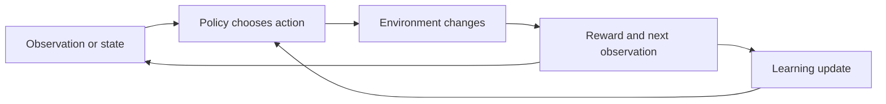

# Learn actions from rewards and finish the stage

**Before this lesson:** [Put attention inside a Transformer](05-transformers.md).

**Reinforcement learning**, or RL, studies an agent choosing actions in an environment and learning from their consequences. An **observation** is what the agent receives. A **state** is a representation containing the information needed to predict the relevant next-step behavior. These need not be the same: a camera view may hide important parts of the world.

A **policy** chooses actions from the information available. The environment returns a **reward**, a number describing one step's outcome, and a new observation. An **episode** is a sequence that ends or is stopped under a specified rule. Unlike ordinary supervised learning, the agent's actions influence which examples it will encounter.



## Distinguish reward from return

**Return** combines rewards across time. A discounted return is `r0 + gamma * r1 + gamma**2 * r2 + ...`, where `gamma` controls how future rewards are weighted. A high immediate reward can lead to poor later outcomes, so choosing the biggest next reward is not generally enough.

A **Q-value** estimates expected return after choosing an action in a state and then following the relevant future decision rule. In tabular Q-learning, store one estimate per state/action pair. Update it toward `reward + gamma * max(next Q-values)` for a nonterminal transition; a terminal transition has no future bootstrap term.

```python runnable
old_q = 0.2
reward = 0.0
next_best_q = 0.8
gamma, learning_rate = 0.9, 0.5
target = reward + gamma * next_best_q
new_q = old_q + learning_rate * (target - old_q)
print(f"Target: {target:.2f}; updated Q: {new_q:.2f}")
```

```text output
Target: 0.72; updated Q: 0.46
```

This is one update, not a proof of convergence. A neural Q-network replaces the lookup table with a fitted function. The original deep-Q work connected convolutional networks to action-value learning; it did not make every control problem safe or easy. [Playing Atari with Deep Reinforcement Learning](https://arxiv.org/abs/1312.5602). For a larger implementation, inspect the [official PyTorch DQN tutorial](https://docs.pytorch.org/tutorials/intermediate/reinforcement_q_learning.html).

## An ending and a pause teach different things

**Bootstrapping** means using an existing value estimate in a new learning target, as the Q update above does. Distinguish two reasons a rollout stops:

- **Termination:** the task reaches a terminal state, such as a goal or a defined failure. There is no future return after that state.
- **Truncation:** an external collection limit stops a task that could continue. The next state's estimated value can still contribute to the target.

For this Q-learning rule, omit the future term on termination, but retain it on an external truncation. Use the actual next observation before reset, not the first observation of a new episode. Gymnasium explains this distinction in its [guide to time limits](https://gymnasium.farama.org/v0.26.3/tutorials/handling_time_limits/).

Consider a transition with reward `0.1`, discount `0.9`, and next-state estimate `0.8`:

```python runnable
def learning_target(reward, next_best_q, gamma, terminated):
    if terminated:
        return reward
    return reward + gamma * next_best_q

print(f"Task ended: {learning_target(0.1, 0.8, 0.9, True):.2f}")
print(f"Collection paused: {learning_target(0.1, 0.8, 0.9, False):.2f}")
```

```text output
Task ended: 0.10
Collection paused: 0.82
```

The second target is larger because the estimate includes possible future rewards. It is still an estimate; it is not an additional reward the environment actually paid.

A deadline that is part of the task itself can instead define a true terminal condition. In a task with a fixed time horizon, remaining time may need to be part of the state. “A timer expired” alone is not enough information to classify the event.

**Practice:** the library robot must deliver a book within ten moves. Separately, a researcher saves a training trace after six moves so collection can resume later. Which stopping rule belongs to the task?

<details>
<summary>Check the distinction</summary>

The ten-move delivery deadline belongs to the task definition; its expiry ends that attempt. The six-move recording limit is external and does not establish that future rewards are impossible. Include remaining allowed moves in the task state, and record the stopping reason so the learning update can treat it correctly.

</details>

## Explore during learning, evaluate deliberately

**Exploration** tries actions that may reveal useful information. **Exploitation** chooses according to current estimates. In epsilon-greedy exploration, the agent chooses a random action with probability epsilon and otherwise chooses a highest-valued action.

Compare policies using a declared evaluation procedure, several seeds where randomness matters, and a simple baseline. Keep training exploration distinct from the deployed policy. A **bandit** problem is a simpler alternative when actions have immediate feedback without meaningful long-term state transitions; ordinary rules or supervised prediction may also fit the real requirement better.

## Run a small offline environment

Download [line_world.py](pathname:///examples/ai/deep-learning/line_world.py). Positions run from 0 to 4. Left and right are actions; reaching 4 gives reward 1 and ends the episode. Other steps cost 0.02. The script uses standard-library tabular Q-learning, not a neural network.

Open a terminal in the folder containing the downloaded file:

```sh
python3 line_world.py
```

```text
Training: 300 episodes; epsilon=0.2; evaluation exploration=0
Untrained greedy baseline: reached_goal=False; return=-0.144
Learned path: 0 -> 1 -> 2 -> 3 -> 4
Learned policy: reached_goal=True; return=0.675
Checks passed: greedy goal path, baseline comparison
```

Read `transition`, the update, and `rollout` separately. Evaluation freezes the table and removes random exploration. Its success shows the policy solved this known tiny environment; it does not test unseen environments or real-world interaction costs.

## Complete the neural-network project report

Run [xor_network.py](pathname:///examples/ai/deep-learning/xor_network.py) from [the training lesson](./02-training-and-pytorch.md). Submit its baseline, split, gradient check, selected checkpoint, and final test result. Then compare it with line-world learning: supervised targets describe coordinate labels; RL targets combine rewards with an estimate of future outcomes.

For a controlled extension, change one neural-network setting using validation only, or change the line-world reward rule and describe the behavior it encourages. Preserve the original experiment as a comparison. Neither script is a usable production model.

## Practice and limits

Suppose an agent earns a reward every time it approaches the goal but no special reward for finishing. What behavior might it learn? Why should a successful simulator policy not be deployed directly on equipment?

<details>
<summary>Check your reasoning</summary>

It may repeatedly collect approach rewards without finishing if the reward and transition rules permit that. The reward is an imperfect specification of the intended behavior. A simulator may omit delays, failures, hidden state, or physical costs. Validate the model of the environment, evaluate under changed conditions, and use the application's appropriate controls before considering real interactions. More training alone does not resolve a wrong objective or an inaccurate simulator.

</details>

---

## Depth lab: solve a tiny Bellman equation

Suppose a state has two actions. Exit gives reward 1 and ends the episode. Wait gives reward 0.2 and returns to the same state. With discount 0.9, the optimal value satisfies `V = max(1, 0.2 + 0.9*V)`. Repeated Bellman updates approach 2: choosing wait forever gives the geometric return 0.2/(1-0.9).

```python runnable
value = 0.0
for _ in range(200):
    value = max(1.0, 0.2 + 0.9*value)
print(round(value, 3))
print("wait" if 0.2 + 0.9*value > 1.0 else "exit")
```

```text output
2.0
wait
```

The result follows the reward specification. If the intended task was “finish quickly,” the reward design incentivizes the wrong behavior. This is a useful lesson for agents and preference optimization: a maximized score is only as appropriate as the objective and environment.

### From a known model to sampled learning

Value iteration uses known transition/reward rules. Tabular Q-learning uses sampled transitions and updates toward `reward + discount*max(next Q)` for nonterminal transitions. A terminal transition has no future reward term. An external time limit may truncate an otherwise continuing process, so treat its bootstrapping semantics according to the environment contract.

Implement a tiny transition table, then compare value iteration with sampled learning over repeated seeds. Keep exploration during learning separate from the declared evaluation policy. Report return distributions, completion/failure counts, and environment versions, not only the best episode.

### Production and research boundaries

Debug state encoding, action validity, terminal flags, reward scaling, and reset behavior before increasing model capacity. Optimize sample efficiency and wall-clock cost separately; a method using fewer samples may compute more per sample. Reward shaping can change the task unless its properties are understood.

A policy used in a real system needs action limits, supervision, a fallback, and evaluation under relevant shifts. Simulation is useful evidence but not a guarantee of physical or operational reliability. “Self-improvement” requires a controlled candidate-evaluation-and-release loop, not unrestricted modification of the deployed policy.

<details>
<summary>Expert defense: why is high reward not the same as task success?</summary>

The reward may omit an important cost, be exploitable, or be measured incorrectly. In this example, waiting achieves the largest return although it never finishes. Define the desired outcome independently and test whether reward maximization is aligned with it.

</details>

**Teach and demonstrate:** derive the value 2, change the waiting reward or discount and predict the new policy, implement the sampled learner, and explain the observed variation.

**Previous:** [Put attention inside a Transformer](05-transformers.md) · **Next:** [Language models: predicting the next piece](../generative-ai/01-language-models.md)
