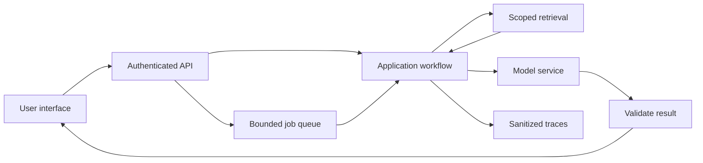

# AI system design, vector infrastructure, GPUs, and inference

**Prerequisites:** [MLOps/LLMOps](17-mlops-llmops.md), API architecture, RAG, Transformer computation, and basic distributed-system concepts. Read [architecture and cost](../engineering/04-architecture-and-cost.md), [inference systems](../engineering/07-inference-systems.md), and [training at scale](../research/02-training-at-scale.md).

For general request flow, data, reliability, and distributed-state mechanisms, use the canonical [System Design course](../../system-design/README.md). This lesson applies those mechanisms to model workloads.

## What it is and why it matters

System design turns workload requirements into components, capacity estimates, and failure behavior. Begin with users, task quality, traffic, data access, response time, availability, and budget. “Use a vector database and a large GPU” is a component list, not a design.

## Learn in this order

### Scalable application architecture

Separate interactive requests from long jobs. Use bounded queues, deadlines, backpressure, and cancellation. Cache only where ownership, freshness, and the output contract allow reuse. A semantic cache needs quality and permission checks, not only a similarity threshold.

Keep model adapters, retrieval, business tools, and state storage independently inspectable. Decide what the system does when each dependency is unavailable. Retries across several layers can multiply total work.



**Practice:** design a document assistant for two tenants. Specify where identity enters, how documents are filtered, how jobs resume, and which cached outputs may be shared.

### Vector databases as an operational system

Choose indexes using corpus size, update rate, filtering, recall, latency, durability, and cost. Learn sharding, replication, consistency, backup, and deletion behavior. A vector index is one part of a database system; embedding generation and document extraction are separate pipelines.

Version embeddings and query encoders together. Replacing an embedding model may require rebuilding the index; vectors from different spaces are not automatically comparable. Test filtered retrieval and recovery from partial ingestion.

**Practice:** estimate rebuild time, then measure it on a sample. Demonstrate an update and deletion becoming visible within a stated freshness target.

### GPU infrastructure and memory

GPU selection depends on memory, compute, memory bandwidth, interconnect, software support, and workload. Training stores gradients and optimizer state; inference stores weights, working buffers, and often an attention key/value (KV) cache.

For a simplified decoder cache, storage is `2 × layers × KV heads × head dimension × bytes × cached tokens` per sequence. The two accounts for keys and values. Grouped-query attention can use fewer KV heads than query heads. Actual implementations add overhead and may use different storage formats.

```python runnable
layers, kv_heads, head_dimension = 32, 8, 128
bytes_per_value, tokens, sequences = 2, 4096, 8
cache_bytes = (
    2 * layers * kv_heads * head_dimension
    * bytes_per_value * tokens * sequences
)
print(f"Estimated KV cache: {cache_bytes / 1024**3:.2f} GiB")
print("Weights, buffers, and runtime overhead are additional.")
```

```text output
Estimated KV cache: 4.00 GiB
Weights, buffers, and runtime overhead are additional.
```

**Practice:** double the active sequence count and then the context length. Explain why a model that fits at one request can fail under concurrency.

### Inference optimization

**Prefill** processes input context; **decode** generates subsequent tokens. Measure time to first token, time per output token, total latency, throughput, and cost per useful result. An optimization helping long prompts may have a different effect on short interactive requests.

Study continuous batching, efficient attention kernels, KV-cache management, quantization, prefix caching, speculative decoding, and distillation. Quantization changes numerical representation and needs quality checks. Speculative decoding uses draft proposals plus verification; its benefit depends on acceptance and overhead. Distillation trains a smaller model using a larger model's supervision.

**Practice:** benchmark one small model at several input/output lengths and concurrency levels. Change one optimization at a time and rerun the quality set. Use [vLLM documentation](https://docs.vllm.ai/en/latest/) for a current serving implementation.

### Distributed training and serving

Data parallelism divides examples; tensor/model parallelism divides computation; pipeline parallelism divides layers; state sharding divides stored state. Communication and synchronization can dominate. For unequal batches, combine gradients according to the intended example or token weighting.

Serving needs routing, queue management, failure isolation, and sensible scaling signals. More replicas do not fix an overloaded data source or excessive prompt lengths.

**Practice:** produce a capacity plan and mark each value as measured, assumed, or estimated. Compare hosted inference, one self-hosted model, and a simpler model under the same task requirements.

## Mastery lab: derive capacity from an explicit workload

Suppose accepted traffic averages 4 requests per second and each request spends an average of 3 seconds in the system. Under stable conditions, Little's Law gives an average of 12 requests in the system: arrival rate multiplied by average time. This includes queueing if the time includes queueing. It is not a GPU batch-size recommendation or a tail-latency guarantee.

If one worker serves 2 requests per second on the measured workload, two workers have no nominal average headroom at 4 requests per second. Bursts, variance, failures, and long generations make that a fragile design. Measure service-time distributions and load-test admission and queueing rather than sizing from averages alone.

### Implement a scheduler model before a cluster

Build a discrete-event simulation with arrival time, service duration, worker availability, queue limit, and deadline. Calculate waiting time and completion time separately. Check a hand-worked case: two jobs arriving at time zero, one worker, durations 2 and 3. Their completion times are 2 and 5; the second waits 2 units. Then add a queue bound and record rejection instead of pretending all requests complete.

For vector search, implement exact similarity on a small corpus as the oracle before evaluating an approximate index. For GPU memory, separate weights, activations, KV cache, runtime overhead, and temporary workspace. For inference, distinguish prefill, per-token decoding, and end-to-end time.

### Debug and optimize with a bottleneck hypothesis

| Symptom | Evidence to collect | Candidate change |
| --- | --- | --- |
| Low GPU use and high latency | Queue, CPU preprocessing, transfer, and batch timings | Improve the measured upstream bottleneck. |
| Out-of-memory on long requests | Context length, active sequences, KV-cache and workspace peaks | Limit admission/context or revise memory management. |
| Good throughput, poor interactive latency | Time to first token and inter-token delay under load | Revisit batching and scheduling policy. |
| Approximate search misses evidence | Recall against exact search with the same filters | Tune index/search parameters or choose another structure. |

Batching trades waiting time for efficiency. Quantization trades precision and implementation constraints for potential memory/throughput benefits. Prefix caching requires compatible model/context state and a policy for isolation. Speculative decoding has overhead and depends on acceptance behavior; measure it on the actual workload.

### Defend the architecture and teach the tradeoffs

Draw the API, admission control, queue, scheduler, workers, source/index stores, evaluation, and observability. Assign ownership of deadlines, cancellation, access control, and retry decisions. Decide which degradation is acceptable during overload: reject new work, shorten a supported output, or use an evaluated fallback. Never silently change a quality-critical behavior just to improve a latency graph.

**Interview defense:** “How many GPUs do we need?” Ask for model, precision, context/output lengths, traffic distribution, latency target, concurrency, quality requirement, and failure headroom. Give an estimate with assumptions and identify the benchmark needed to narrow it.

**Teach it:** use the two-job timeline, then add a long job before several short jobs. Ask the learner to compare FIFO with another scheduling policy and identify starvation/fairness risks. Deliver the simulator, measured workload, memory budget, architecture, and a defended optimization.

## Mini project and real-world use

Write and validate a design for a multi-tenant developer assistant. Run a local or permitted small-scale load test, measure the bottleneck, and revise one architectural choice. Include deletion, backup, outage, and rollback scenarios.

Uses include enterprise search, high-volume assistants, batch generation, recommendation services, and shared model platforms.

**Completion evidence:** architecture diagram, workload model, quality target, capacity/memory budget, measured latency distribution, failure tests, and a defensible cost comparison.

## Interview questions

1. Why do prefill and decode have different bottlenecks?
2. How can longer context reduce concurrency even when weights are unchanged?
3. When is an embedding-model change a data migration?
4. Why can an approximate index benchmark fail to predict filtered production performance?
5. What does each parallelism strategy divide?
6. How would you preserve tenant isolation through caches and traces?

## Curated resources

- **Course:** [Stanford CS336](https://cs336.stanford.edu/), for language-model training and systems assignments after the earlier foundations.
- **Books:** [Designing Data-Intensive Applications](https://dataintensive.net/) for distributed data systems and [Machine Learning Systems](https://mlsysbook.ai/) for ML-specific architecture.
- **Papers:** [PagedAttention](https://arxiv.org/abs/2309.06180) and [FlashAttention](https://arxiv.org/abs/2205.14135), for concrete memory and attention optimizations.
- **GitHub:** [vLLM](https://github.com/vllm-project/vllm) and [llama.cpp](https://github.com/ggml-org/llama.cpp), for contrasting serving environments and implementation tradeoffs.

**Previous:** [MLOps/LLMOps](17-mlops-llmops.md) · **Next:** [Advanced AI and research](19-advanced-research.md).
