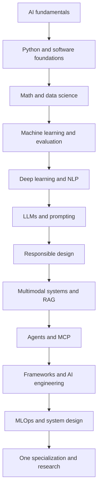

# Full-stack developer to AI expert

Use your software-engineering experience as a starting point. Add the mathematics, data judgment, model understanding, and experimental discipline needed to build reliable AI systems. This route covers the 19 requested areas and connects them to the portal's worked lessons, runnable examples, and professional studios.

**Start with the [study plans](study-plans.md) and [portfolio roadmap](portfolio.md), then work through the modules below in order.** If you are new to programming as well as AI, begin with the [beginner lessons](../orientation.md).

## What “zero to expert” means here

Zero means no prior AI knowledge, not that your full-stack skills disappear. Expert practice means independently defining a problem, choosing and testing alternatives, explaining failures, operating a system responsibly, and contributing a reproducible investigation in a specialization.

No finite roadmap contains every research topic, and a calendar cannot guarantee expertise. This is a broad shared foundation with explicit routes into deeper fields. The six-month plan targets practical engineering foundations; the longer plans provide more time for mathematical depth, deployment experience, and research. Choose one main role after the core rather than trying to become seven specialists at once.

## The learning order

Python comes before numerical implementation. Probability and gradients come before model training. Evaluation comes before model comparison. Responsible AI comes before sensitive retrieval and external actions. Plain tools and agent loops come before orchestration frameworks. Deployment comes before infrastructure optimization.

Each module includes what the area is, why it matters, prerequisites, explanations of its named subtopics, hands-on practice, a mini project, real-world applications, interview questions, and selected courses, books, papers or primary specifications, and GitHub repositories.

### Foundation: understand, calculate, and evaluate

| Order | Module | Evidence before moving on |
| --- | --- | --- |
| 1 | [AI fundamentals](01-ai-fundamentals.md): AI, ML, DL, GenAI, narrow AI, AGI, ASI, history, ecosystem | A testable problem and a non-AI baseline. |
| 2 | [Python for AI](02-python-for-ai.md): fundamentals, OOP, DSA, patterns, APIs, async | A tested data/API service with bounded concurrency. |
| 3 | [Mathematics](03-mathematics.md): linear algebra, probability, statistics, calculus, optimization | Hand calculations checked against code. |
| 4 | [Data science](04-data-science.md): NumPy, Pandas, cleaning, EDA, visualization | A reproducible data audit and report. |
| 5 | [Machine learning](05-machine-learning.md): regression, classification, clustering, features, evaluation | A leakage-safe baseline comparison. |

### Models: understand representations and generation

| Order | Module | Evidence before moving on |
| --- | --- | --- |
| 6 | [Deep learning](06-deep-learning.md): neural networks, CNN, RNN, LSTM, attention, Transformers | A gradient check and controlled training experiment. |
| 7 | [NLP](07-nlp.md): text processing, embeddings, BERT, GPT, LLaMA | Classical, encoder, and decoder task comparisons. |
| 8 | [LLMs](08-llms.md): tokenizers, pretraining, fine-tuning, RLHF, DPO | A saved model/adaptation and honest evaluation. |
| 9 | [Prompt engineering](09-prompt-engineering.md): zero-shot, few-shot, chain-of-thought research, ReAct, structured outputs | A repeatable prompt experiment with failure cases. |
| 10 | [Responsible AI](10-responsible-ai.md): safety, bias, privacy, security, governance | A risk and data-flow review with concrete controls. |
| 11 | [Generative and multimodal AI](11-generative-multimodal.md): text, image, audio, video | Modality-specific evaluation and source checking. |

### Applications: retrieve, act, and integrate

| Order | Module | Evidence before moving on |
| --- | --- | --- |
| 12 | [RAG](12-rag.md): embeddings, chunking, vector databases, hybrid search, reranking | A source-grounded assistant with retrieval and answer scores. |
| 13 | [AI agents](13-ai-agents.md): architecture, planning, memory, tools, multiple agents | A bounded loop with recovery and repeated-trial evaluation. |
| 14 | [MCP](14-mcp.md): architecture, servers, tools, resources, security | A working versioned client/server integration. |
| 15 | [Frameworks](15-frameworks.md): LangChain, LangGraph, CrewAI, AutoGen, Semantic Kernel, successor guidance | One justified framework choice against a plain-code baseline. |
| 16 | [AI engineering](16-ai-engineering.md): function calling, workflows, evaluation, observability, guardrails | A complete full-stack product path and failure-state UI. |

### Production and expert practice

| Order | Module | Evidence before moving on |
| --- | --- | --- |
| 17 | [MLOps and LLMOps](17-mlops-llmops.md): MLflow, Docker, Kubernetes, CI/CD, monitoring, deployment | A versioned release, quality gate, and rollback drill. |
| 18 | [AI system design](18-system-design.md): scale, vector infrastructure, GPUs, inference optimization | A measured workload and defensible capacity design. |
| 19 | [Advanced AI and research](19-advanced-research.md): multimodal systems, graphs, RL, robotics, controlled improvement | A reproduced baseline and independently reviewed extension. |

## Choose depth without skipping foundations

For **AI Engineer**, emphasize data, ML, evaluation, APIs, and operations. For **LLM Engineer**, add tokenizer/data work, adaptation, alignment experiments, and inference. For **RAG Engineer**, deepen retrieval, evidence evaluation, ingestion, and access control. For **Agent Developer**, deepen tools, state, recovery, and task evaluation.

For **GenAI Engineer**, deepen modality-specific data and evaluation. For **AI Researcher**, spend more time on mathematics, replication, ablations, uncertainty, and a narrow research field. For **AI Architect**, deepen workload analysis, distributed systems, governance, and measured design tradeoffs. The existing [seven professional studios](../careers.md) supply independent capstone requirements.

Advanced branches include causal inference, Bayesian modeling, time-series forecasting, recommendations, self-supervised learning, active/continual learning, federated/private learning, and graph neural networks. Their entry requirements and first experiments are mapped in [module 19](19-advanced-research.md).

## Use the resources without creating another backlog

“Best” means well matched to this stage and task, not a universal ranking. Selections favor original authors, university material, official documentation, established textbooks, and inspectable implementations. Choose one main course and one book per stage; read the relevant chapters instead of buying or finishing every listed resource. Several books recur because they span multiple subjects.

Papers are for understanding claims after the prerequisite lesson, not for your first introduction to every concept. For Python and MCP, primary design documents or specifications are more useful than pretending there is one definitive research paper. Older courses remain useful for concepts, but their code may need current dependency/API documentation.

Framework and protocol guidance was reviewed on **25 October 2026**. Pin versions in executable projects and recheck maintenance status before adopting a dependency. In particular, module 15 explains the current successor guidance for AutoGen and Semantic Kernel.

## Your first week

Complete module 1's problem proposal and module 2's Python diagnostic. Create a learning log, an environment, and a repository with setup and verification instructions. Choose a permitted or synthetic support/document dataset. Set a fixed weekly time budget and use [week 1 of your selected plan](study-plans.md).

**Continue:** [Study plans and daily schedule](study-plans.md) · [Portfolio projects](portfolio.md) · [First module](01-ai-fundamentals.md).
