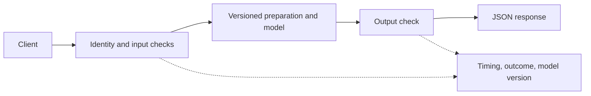

import useBaseUrl from '@docusaurus/useBaseUrl';

# Serve a model through an API

**Before this lesson:** finish [bot testing and operation](../bots/04-test-and-operate-bots.md). You already know how to run a model or workflow and check its output. Now another program needs to use it reliably.

An **API**, or application programming interface, is an agreed way for programs to communicate. A **server** waits for requests; a **client** sends them. A web API commonly uses HTTP, a protocol that carries a request method, a path, headers, and an optional body. The response has a status code and a body.

For example, a delivery planner sends `POST /predict` with `{"distance_km": 6}`. A service checks the input, runs a versioned predictor, and returns its result as JSON. `POST` submits data; the path chooses an operation. JSON is the text format you used in the foundations stage.

## Separate the model from the service



**Authentication** checks who is making a request. **Authorization** checks what that person or program may do. In a private retrieval service, authorization must also constrain which sources are retrieved. The model should not make this access decision.

A model artifact is the saved material needed to run a model: its weights, input preparation, label meanings, and version. Load it once when a worker starts when possible. Re-loading it for every request wastes time. Keep the training and serving transformations identical; otherwise a correctly trained model receives a different kind of input at runtime.

## Define the contract before deployment

| Case | Expected behavior |
| --- | --- |
| Valid request | `200` with result, units, and model version. |
| Missing field, wrong type, or invalid number | `400` with a useful input error. |
| Unknown operation | `404`; do not silently run another operation. |
| Request exceeds the service's size limit | `413`; reject it before model work. |
| Dependency unavailable | A controlled failure or documented fallback, with a retry policy. |

Check ranges as well as types. A boolean is a subclass of integer in Python, but `true` is not a sensible distance. Reject infinite and non-finite values. Document units: six miles and six kilometres are different inputs.

**Latency** is the time one request takes. **Throughput** is how many requests the service completes per unit of time. Batching several inputs can improve throughput while making an individual user wait longer. A nightly report may suit batch processing; a live assistant usually needs a response to each request.

## Run a complete local service

Download <a href={useBaseUrl('/examples/ai/engineering/service.py')} download>service.py</a>. It uses only Python's standard library. Its predictor is an explicitly labelled, hand-written distance baseline, not a trained AI model. The example isolates the service boundary so you can later replace the predictor with your trained model without changing the contract.

```sh
python3 service.py
python3 service.py --serve
```

The first command runs contract checks and prints `Service contract: 8 checks passed`. The second listens only on `127.0.0.1:8001`. In another terminal:

```sh
curl -X POST http://127.0.0.1:8001/predict -H 'Content-Type: application/json' -d '{"distance_km":6}'
```

The JSON result contains `estimate_minutes: 5.0` and `model_version: distance-rule-v1`. Try a negative distance and a missing field. Stop the server with Ctrl+C. This local example has no account system, TLS, or production traffic controls. Python's `http.server` is intended for simple server work, not a production deployment stack. [Python server reference](https://docs.python.org/3/library/http.server.html).

## Prepare a real release

A **container** packages a process and its software dependencies into a repeatable environment. It helps reduce “works on my machine” differences, but does not freeze outside APIs or guarantee identical hardware results. Pin dependencies, record the model artifact checksum, and test the built artifact rather than only a development notebook. [Container fundamentals](https://docs.docker.com/get-started/docker-concepts/the-basics/what-is-a-container/).

Use separate development, test, and production environments. Store credentials outside source code, set request timeouts, cap concurrency, and define behavior when the model is unavailable. Start with one service; a distributed architecture adds more failure modes to understand.

**Practice:** replace the baseline with your regression-stage predictor. What must travel with its weights?

<details>
<summary>Check your answer</summary>

Its feature order, transformations fitted on training data, expected units and ranges, output meaning, runtime dependencies, and version must travel with it. Test saved-and-reloaded predictions against the training code on fixed examples. A matching file name alone does not prove the artifacts match.

</details>

## Depth lab: propagate a deadline through the request

An end-to-end deadline belongs to the request, not separately to every dependency. If each of three calls gets the full two-second timeout, the request can take far longer than two seconds. Pass the remaining allowance to each stage and reserve time for validation and returning a response.

```python runnable
def remaining_timeout(deadline, now, response_reserve, stage_cap):
    remaining = deadline - now - response_reserve
    if remaining <= 0:
        return None
    return min(remaining, stage_cap)

deadline = 2.0  # Simulated monotonic-clock seconds.
for now in [0.2, 1.4, 1.95]:
    timeout = remaining_timeout(deadline, now, 0.1, 1.0)
    print(None if timeout is None else round(timeout, 2))
```

```text output
1.0
0.5
None
```

Use a monotonic clock for elapsed durations; ordinary wall time can jump when clocks are adjusted. This arithmetic plans limits but does not interrupt work. Each client and worker needs supported timeout/cancellation behavior, and downstream computation may continue after the caller stops waiting.

**Design the lifecycle:** validate request size and identity before expensive work. Apply per-caller quotas and a bounded queue. Admit only work the system can reasonably process, then record accepted, rejected, cancelled, failed, and successful outcomes separately. For long jobs, return a job ID and expose an authorized status endpoint instead of holding a connection indefinitely.

**Debugging drill:** make retrieval slow while inference remains fast. Record queue wait, retrieval, model, validation, and response time. If the user sees three seconds, a one-second model measurement cannot explain the whole request. Trace the same request ID across stages.

**Production contract:** version inputs, preprocessing, model, and outputs together. Define readiness as the worker being able to serve its required dependencies, and liveness as the process being responsive. Avoid making a temporary external outage cause endless process restarts. Drain or cancel in-flight work deliberately during deployment.

**Optimization:** batch compatible requests when throughput is the bottleneck, but bound batch waiting time. Measure short and long requests together: long inputs can delay small ones. Separate queues or workload classes may help, at the cost of scheduling complexity.

<details>
<summary>Interview defense: why is an unbounded queue dangerous even if no request is dropped?</summary>

When arrivals exceed service capacity, waiting work grows, consumes memory, and becomes stale. Users may retry, increasing overload. Bound admission, return a clear overload response, and preserve deadline and idempotency semantics. A queue delays work; it does not create compute capacity.

</details>

**Teach-back project:** demonstrate normal load, a burst, a slow dependency, and client cancellation. Explain every terminal status and which work can still be running after the user disconnects.

**Previous:** [Test whole conversations and operate a bot responsibly](../bots/04-test-and-operate-bots.md) · **Next:** [Evaluate releases and monitor real use](02-evaluation-and-monitoring.md)
