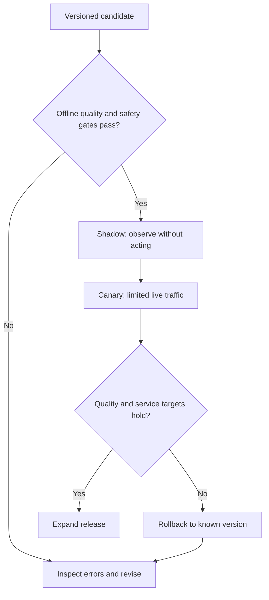

# Evaluate releases and monitor real use

**Before this lesson:** [serving and APIs](./01-serving-and-apis.md), plus the earlier model, RAG, and agent evaluations. This lesson connects those checks to a release process.

An **offline evaluation** runs on saved examples before release. **Online monitoring** measures the live system. Offline success is necessary evidence, but new users, changing data, and broken dependencies can create failures that the saved examples did not contain.

Begin with a **baseline**: the system you would use if the proposed change did not exist. Compare the candidate against it on the same examples, using the same scoring rules and resource budget. Version the dataset, prompt, model, retrieval index, and tool definitions. Changing several at once makes a regression harder to explain.

## Measure the right layer

| Layer | Example measure | What it does not establish |
| --- | --- | --- |
| Predictor | Error or classification metrics by meaningful subgroup | That a downstream decision is useful. |
| Retriever | Whether needed evidence appears in the retrieved set | That the answer uses it correctly. |
| Generated answer | Supported claims, completeness, useful abstention | That every future answer will be correct. |
| Agent | Task success, invalid actions, unnecessary tool calls | That unlimited autonomy is appropriate. |
| Service | Error rate, latency, cost per successful task | That low latency means high answer quality. |

A **slice** is a meaningful subset, such as short requests or a particular language. Suppose overall success rises from 90% to 92%, but one supported language falls from 85% to 60%. The average hides a material regression. Keep enough cases per slice and report uncertainty; a one-example slice cannot support a reliable percentage.

## Always name the denominator

Consider a fictional day with 1,000 incoming requests:

1. The service rejects 100 requests before processing.
2. Of the 900 accepted requests, 875 return a response and 25 time out.
3. Reviewers assess all 875 responses; 800 meet the task's usefulness rubric.

The **denominator** is the group you divide by. Choosing a different group changes the question:

| Measure | Calculation | What it tells you |
| --- | --- | --- |
| Response rate among accepted requests | `875 / 900 = 97.2%` | How often accepted work returns a response. |
| Useful responses among returned responses | `800 / 875 = 91.4%` | Quality conditional on receiving a response. |
| Useful responses among all incoming requests | `800 / 1000 = 80.0%` | Useful output across the full incoming cohort. |
| Rejected share | `100 / 1000 = 10.0%` | How much incoming traffic never enters processing. |

The 97.2% response rate can coexist with an 80% useful-output rate. Neither is a substitute for the other. Investigate rejected requests by reason: rejecting invalid or unauthorized input can be correct behavior, while rejecting eligible work because of overload is a capacity problem. Decide which requests belong in each service target before comparing versions.

Suppose serving all these requests costs 120 teaching currency units, including unsuccessful processing:

```python runnable
total_cost = 120
incoming_requests = 1000
useful_results = 800
print(f"Cost per incoming request: {total_cost / incoming_requests:.2f}")
print(f"Cost per useful result: {total_cost / useful_results:.2f}")
```

```text output
Cost per incoming request: 0.12
Cost per useful result: 0.15
```

In a real service, usefulness labels may be delayed or available only for a sample. Report the labeled sample size and how it was selected. Do not silently count unlabeled responses as correct, or treat a review of only happy users as a representative quality measure. Define a useful result to include a correct refusal when that is the task's expected outcome.

## Release gradually and keep a way back



**Shadow traffic** runs the candidate alongside the current system without letting its output drive user actions. A **canary release** exposes a small, controlled share of live traffic to the candidate. A **rollback** restores a previous known version. These approaches reveal different problems and do not replace a fair offline evaluation.

Set release thresholds before viewing final results. For example: no unauthorized tool actions in the test set, no critical supported-slice regression, and a latency target under a defined test load. A failure count of zero on 100 tests is an observation, not proof of zero risk.

## Observe without collecting everything

**Logs** describe events. **Metrics** summarize measurements over time. **Traces** connect steps belonging to a request, such as retrieval, model generation, and tool execution. Record versions, durations, result categories, and sanitized request identifiers. Raw prompts can contain private information; keep only what is justified, protected, and subject to retention rules. [OpenTelemetry signals](https://opentelemetry.io/docs/concepts/signals/).

**Data drift** means incoming data changes. **Concept drift** means the relationship between input and the desired output changes. A new school term can change borrowing patterns; a catalogue update can change the available books. Input changes are a signal to investigate, not an automatic command to retrain. Labels may arrive late, so short-term service metrics and later outcome metrics must be joined carefully.

## Investigate the failing layer

Start from a specific failed request and its recorded versions. Compare its behavior with a known working case, then test one explanation:

| Observation | First investigation | A focused experiment |
| --- | --- | --- |
| Required evidence is missing from retrieval | Source freshness, access filters, query, and ranking | Run the saved query against the known relevant document. |
| Evidence is retrieved but the answer contradicts it | Actual context sent, instructions, and answer checks | Hold the context fixed while comparing answer generation. |
| Tool output says “failed,” final text says “complete” | State transitions and completion checks | Replay that failure result through the agent loop. |
| Answers are useful but waiting time increases | Queue time, model time, tool time, and load | Repeat a fixed request set at measured concurrency. |

Changing the model for every symptom can hide the real cause. Capture a regression case once you reproduce the failure, and use it to verify the repair. When replaying an agent trace, replace external writes with recorded or simulated results so diagnosis does not repeat the original action.

## Worked latency example

```python runnable
from math import ceil

latencies_ms = sorted([80, 90, 95, 100, 105, 110, 115, 120, 130, 900])
p95 = latencies_ms[ceil(0.95 * len(latencies_ms)) - 1]
print(f"Mean: {sum(latencies_ms) / len(latencies_ms):.1f} ms")
print(f"Nearest-rank p95: {p95} ms")
```

```text output
Mean: 184.5 ms
Nearest-rank p95: 900 ms
```

The **95th percentile**, or p95, describes the high end of measured waiting times; the example uses the stated nearest-rank rule. Ten requests are far too few to estimate a stable production tail. Measure enough requests under representative load, including cold starts and dependency failures.

**Practice:** a service gets faster after an update, but users ask more follow-up questions. Is the release better?

<details>
<summary>Check your reasoning</summary>

Maybe not. Measure whether tasks are completed correctly and how many total interactions they require. An answer that omits key facts may be fast but increase total time and cost. Compare supported slices and inspect failed conversations with appropriate privacy controls.

</details>

For a broader view of why model code is only one part of an application, read [production ML systems](https://developers.google.com/machine-learning/crash-course/production-ml-systems).

## Depth lab: monitor delayed labels without inventing success

A service knows immediately whether it returned a response. It may learn later whether the response was useful. Join outcomes to the original prediction by stable identifiers, preserving model version and prediction time. Do not treat an absent outcome as a correct prediction.

```python runnable
predictions = {"r1": "model-a", "r2": "model-a", "r3": "model-b", "r4": "model-b"}
reviewed_outcomes = {"r1": True, "r2": False, "r3": True}
joined = [(version, reviewed_outcomes[request_id])
          for request_id, version in predictions.items()
          if request_id in reviewed_outcomes]
print("label coverage:", len(joined) / len(predictions))
print("success among reviewed:", sum(ok for version, ok in joined) / len(joined))
print("unreviewed:", sorted(set(predictions) - set(reviewed_outcomes)))
```

```text output
label coverage: 0.75
success among reviewed: 0.6666666666666666
unreviewed: ['r4']
```

The reviewed subset may be biased: users might report only bad answers, or staff might review only easy cases. Coverage and the sampling rule belong beside quality scores. Compare versions on matched task populations or a justified experiment, not merely whatever labels happen to arrive first.

**Operational drill:** simulate a release that reduces latency by truncating long inputs. The service remains available, but task quality falls on long documents. Monitor request-length slices, truncation status, and later supported-answer scores. Availability and quality are separate signals.

**Design an alert:** name its population, time window, threshold, minimum evidence, owner, and immediate response. An alert should lead to an action such as disabling a failing tool, restoring a prior prompt/index/model bundle, or serving verified search results. Repeated alerts without a runbook create noise rather than reliability.

**Debugging:** compare failure traces before and after a release while controlling for workload changes. Distinguish data drift from concept drift and pipeline breakage. A sudden unknown-category spike may reflect a new user population or a broken parser; retraining is only one possible response.

**Optimization:** sample detailed traces under appropriate controls while retaining aggregate counts for all requests. Avoid using user IDs or arbitrary prompt strings as metric labels; excessive label cardinality can overwhelm monitoring storage. Keep request IDs in trace/log systems with suitable access.

<details>
<summary>Interview defense: why can a canary look better while the full rollout fails?</summary>

Its traffic may be easier, lower-volume, or assigned differently. Full rollout changes concurrency, cache behavior, and dependency load. Compare assignment, task mix, saturation, and outcome delay. A small canary provides evidence under its conditions, not proof for every scale.

</details>

**Teach-back:** show a dashboard with excellent HTTP success and poor task outcomes. Explain which observations distinguish model quality, missing evidence, and overload, then demonstrate a rollback trigger.

**Previous:** [Serve a model through an API](01-serving-and-apis.md) · **Next:** [Protect data and define responsibility](03-security-and-governance.md)
