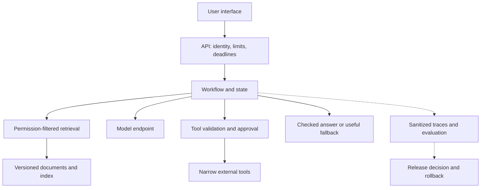

import useBaseUrl from '@docusaurus/useBaseUrl';

# Design an AI system and release it deliberately

**Before this lesson:** [security and governance](./03-security-and-governance.md). An **architecture** is a description of the major parts of a system, their responsibilities, and how they communicate.

Choose architecture from requirements. “Use the largest model” is not a requirement. “Help students find supported catalogue information within a measured waiting-time target” is. List expected traffic, data sensitivity, response quality, failure behavior, operating budget, and the team that will maintain it.

For general request flow, data, reliability, and distributed-state mechanisms, use the canonical [System Design course](../../system-design/README.md). This lesson applies those mechanisms to model workloads.

## A reference architecture you can simplify



For a small catalogue search, remove the model and tool branches if they add no value. Keep responsibilities clear even when everything runs in one process. Split into multiple services only when separate scaling, ownership, or isolation justifies the extra coordination.

## Compare alternatives with the same task

| Choice | Strength | Cost or limitation |
| --- | --- | --- |
| Rule or exact lookup | Predictable, cheap, easy to inspect | Cannot cover every fuzzy language request. |
| Hosted model | Managed infrastructure and easy access | Network dependency, recurring cost, data-handling constraints. |
| Self-hosted model | More control over serving and deployment | Hardware, capacity planning, patching, and operational work. |
| RAG | Can use changing, permissioned evidence | Retrieval errors, index maintenance, extra latency. |
| Fine-tuning | Can change a model's learned behavior | Training data and evaluation cost; not a live document database. |
| Multi-agent system | Can separate specialized roles | More messages, failure paths, and coordination cost. |

No choice is universally cheapest or best. Benchmark representative tasks on permitted data. Include engineering and maintenance work, not only per-request model charges.

## Estimate cost before spending

Use hypothetical prices to learn the calculation; verify actual provider prices before a real purchase. If a task uses several calls, count all of them, including failed attempts and retries.

```python runnable
requests = 1000
input_tokens = 800
output_tokens = 200
price_per_million_input = 1.0  # hypothetical currency units
price_per_million_output = 4.0
cost = requests * (input_tokens * price_per_million_input
                   + output_tokens * price_per_million_output) / 1_000_000
successful_tasks = 800
print(f"Model-call cost: {cost:.2f}")
print(f"Cost per successful task: {cost / successful_tasks:.4f}")
```

```text output
Model-call cost: 1.60
Cost per successful task: 0.0020
```

This excludes retrieval, storage, compute, people, and other charges. A smaller model that needs three retries may cost more per successful task than a larger one that succeeds once.

**Caching** reuses a previous result. Include model, prompt, index, and permission context in cache design; otherwise an old answer or another user's result may be returned. **Quantization** stores numbers with fewer bits to reduce memory and sometimes speed inference. It can also change quality, so measure the actual deployment hardware and task. **Routing** sends easy tasks to a cheaper method and difficult ones to a more capable one; the routing decision itself needs evaluation.

## Stage project: run a release gate

Download <a href={useBaseUrl('/examples/ai/engineering/release_gate.py')} download>release_gate.py</a> and run:

```sh
python3 release_gate.py
```

The script compares two candidate releases against fixed fictional task outcomes. One improves the headline success rate but fails a supported slice and contains an unsafe action. The other meets this exercise's predeclared thresholds. It prints:

```text
Unsafe candidate: HOLD
Safer candidate: RELEASE
Release gate: all checks passed
```

The fixture demonstrates release logic; it is not a benchmark result for a real model. Replace it with outcomes from your own RAG or agent evaluation. Keep a separate final test set. Submit the data version, candidate configuration, slice report, cost estimate, and rollback procedure alongside the decision.

**Practice:** your model host fails for 15 minutes. Write the user-visible behavior, retry limit, and recovery condition. For a library helper, showing verified search results without a generated summary may be more useful than inventing an answer.

<details>
<summary>Review criteria</summary>

The fallback must preserve permissions, avoid unsupported claims, and state its limits. Bound retries by both count and deadline. Do not retry an external write blindly. Recover only after health and task-level checks pass; a reachable endpoint alone does not establish useful output.

</details>

System complexity creates long-term maintenance obligations. Read the original [Hidden Technical Debt in Machine Learning Systems](https://research.google/pubs/hidden-technical-debt-in-machine-learning-systems/) for examples to compare with your design.

## Depth lab: calculate cost per accepted useful outcome

A request-level price can hide retries, discarded generations, human review, and failures. Choose a useful-outcome definition first, then divide total relevant cost by outcomes meeting it.

```python runnable
systems = {
    "A": {"model": 40, "retrieval": 10, "review": 50, "useful": 800},
    "B": {"model": 70, "retrieval": 15, "review": 15, "useful": 900},
}
for name, record in systems.items():
    total = record["model"] + record["retrieval"] + record["review"]
    print(name, f"total={total}", f"per useful={total / record['useful']:.3f}")
```

```text output
A total=100 per useful=0.125
B total=100 per useful=0.111
```

These are invented monetary units for the same evaluation period and workload. B has higher model cost but lower cost per useful result. A real comparison must include all relevant expenses, including infrastructure, retries, storage, operation, and any fixed development costs amortized over a declared horizon.

### Trace a request across failure domains

A **failure domain** is a set of components that can fail together. Put identity, retrieval, inference, action execution, and result storage on a diagram. For each dependency, specify timeout, retry rule, fallback, data exposure, and recovery owner. A model-host outage should not accidentally grant broader data access through a fallback.

**Debugging drill:** disable one dependency at a time. Confirm that the user-visible status matches what the system knows. If retrieval fails, a fluent answer from model memory may conceal the outage rather than provide an acceptable fallback. If a write's outcome is uncertain, preserve that state.

**Optimization:** compare caching, routing, shorter context, and smaller models as controlled changes. For a router, evaluate the routing decision itself: misclassifying a difficult request as easy can erase the apparent savings through retries and corrections. For caches, bind the key to identity scope and relevant versions, and recheck current authorization.

**Release design:** maintain a compatible rollback bundle and database/index migration plan. A model rollback cannot restore deleted source data or undo every external action. Distinguish reversible configuration changes from effects requiring reconciliation.

<details>
<summary>Interview defense: how would you choose between one large service and several smaller services?</summary>

Start with ownership, scaling needs, reliability boundaries, and operational capacity. Splitting components can isolate scaling and releases but adds network failures, version contracts, and tracing work. A small team may benefit from a modular single service until measurements justify separation.

</details>

**Teach-back:** change the expected useful-outcome rate and review cost in the calculation. Explain how these assumptions can reverse a decision even when the model's per-token price stays constant.

**Previous:** [Protect data and define responsibility](03-security-and-governance.md) · **Next:** [Manage token and context budgets](05-token-and-context-budgets.md)
