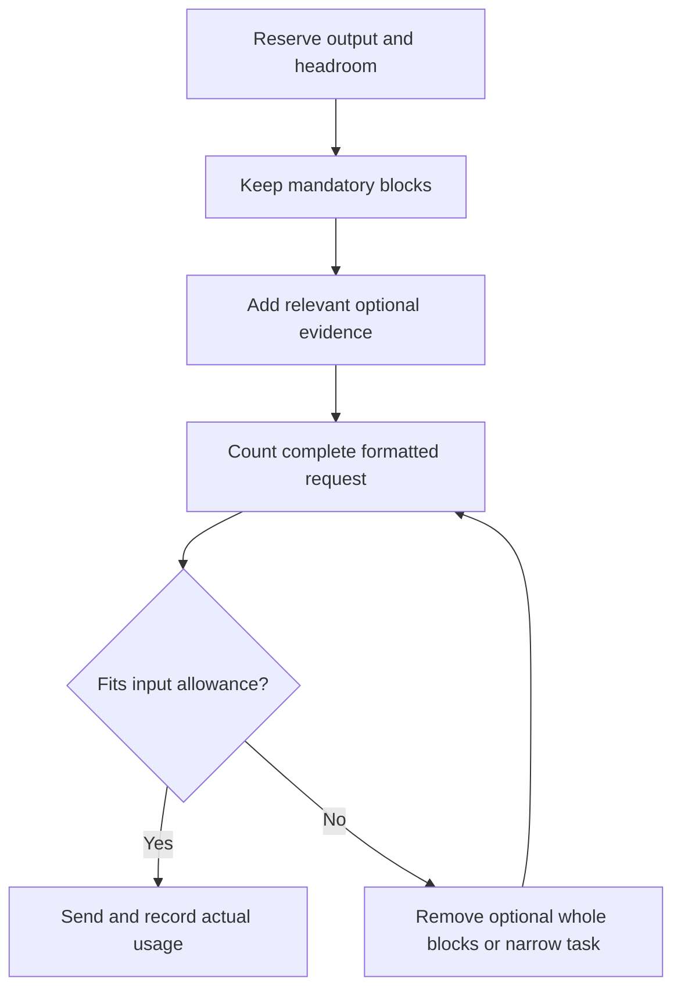

import useBaseUrl from '@docusaurus/useBaseUrl';

# Manage token and context budgets

**Before this lesson:** [Design an AI system and release it deliberately](04-architecture-and-cost.md).

A **token budget** limits how much model input and output a task may use. A **context budget** allocates the model's working space among instructions, evidence, conversation, tools, and its response. The useful goal is a correct completed task within resource limits, not the shortest possible prompt.

Start with the [architecture and cost calculation](./04-architecture-and-cost.md). This lesson explains what to count and how to reduce unnecessary material without silently removing the answer's requirements.

## Tokens are not words, characters, or bytes

A **tokenizer** converts content into the model's numbered units. One word can use several tokens; punctuation, code, whitespace, language, and the selected tokenizer change the count. A character ratio is an estimate, not a reliable limit check. A **byte** is a storage unit. UTF-8 encodes different characters using different numbers of bytes:

```python runnable
text = "é🙂"
print(f"Python characters: {len(text)}")
print(f"UTF-8 bytes: {len(text.encode('utf-8'))}")
```

```text output
Python characters: 2
UTF-8 bytes: 6
```

Neither number tells you the model-token count. Count the actual request format. Chat templates add role and boundary markers; tool definitions and results also take space. Hugging Face documents why the correct model's template matters. [Chat templates](https://huggingface.co/docs/transformers/v5.20.2/chat_templating).

Images and audio require model-specific processing; counting a filename, transcript, or base64 string with a text tokenizer is not a valid general estimate of their model usage. Inspect the selected model's processor and provider accounting. [Multimodal chat templates](https://huggingface.co/docs/transformers/main/en/chat_templating_multimodal).

## Measure the complete request

Track **input tokens**, generated **output tokens**, and any separately reported cache reads or writes. Some models also account for internal reasoning within output or context limits. Check current model and endpoint rules: context capacity, output maximum, request byte limits, and tool/media support can differ. Do not assume a large context window permits an equally large response. [Context accounting](https://platform.claude.com/docs/en/build-with-claude/context-windows).

Use a provider's counting endpoint where supported, then record actual usage from the response. For example, Claude's counter accepts structured messages and several other input types, but has documented exceptions. Count the supported representation rather than guessing around unsupported content. [Token counting API](https://platform.claude.com/docs/en/build-with-claude/token-counting).

For a local text-only model, this optional example requires `transformers` and its matching tokenizer files already saved in `./tokenizer`; it makes no model request:

```python
from transformers import AutoTokenizer

tokenizer = AutoTokenizer.from_pretrained("./tokenizer", local_files_only=True)
messages = [{"role": "user", "content": "Explain this delivery estimate briefly."}]
ids = tokenizer.apply_chat_template(
    messages, tokenize=True, add_generation_prompt=True
)
print(len(ids))
```

The directory must include the correct chat template. Tools and media need their matching request processing too. Pin the tokenizer revision with the model; a different tokenizer can produce a different answer to “does it fit?”

## Reserve the response before selecting evidence

For a hypothetical model, let the context limit be 1,000 tokens. Reserve 200 for output and 50 as **headroom**, an explicit margin for known counting uncertainty:

`input allowance = 1,000 - 200 - 50 = 750`

Suppose the complete initial input counts as 900. Selecting shorter relevant evidence brings it to 700. The planned total is now `700 + 200 + 50 = 950`, leaving 50 unallocated. These are invented counts for arithmetic, not a provider's advertised limits. Headroom does not replace accounting for tools or reasoning. Independently check the endpoint's maximum output setting.



## Trim deliberately, preserving meaning and order

Mark instructions, the current question, and essential evidence as mandatory. Remove duplicated or irrelevant optional material first. Use a deterministic policy, meaning the same inputs produce the same selection. Keep retained messages in their original order. Treat a tool call and its matching result as one removable group; leaving an orphan result can break the protocol or its meaning.

If mandatory content alone exceeds the allowance, stop and narrow or divide the task. Do not silently delete instructions or cut the current request. Keep a small selection report showing what was dropped.

For [retrieval](../rag/02-indexing-and-search.md), filter to the permitted task scope, retrieve candidates, then **rerank** them by usefulness. Deduplicate overlapping passages. Preserve source IDs, units, dates, exceptions, and enough surrounding text to interpret a statement. Cutting a paragraph just before “except” can reverse the answer.

A summary can replace old discussion, but may lose facts or turn uncertainty into certainty. Store its source/version and important unresolved decisions. **Semantic compression**, rewriting content more compactly, needs checks that meaning survives. It is not lossless storage.

## Reduce repeated work, not essential detail

Request only the fields the application consumes, using a small [output contract](../generative-ai/02-prompts-and-structured-output.md). Avoid asking for the same answer as prose, a table, and JSON unless each serves a purpose. Remove repeated instructions. Keep a few contrasting examples when they resolve real ambiguity; dropping every example to save tokens may increase retries.

**Prompt caching** reuses processing of an eligible repeated prefix. Keep genuinely stable material stable and place changing task data afterward where the provider's scheme permits. Cache creation, hits, and expiry affect charges and latency. Cached content still occupies context; a discount does not enlarge the window. Response caching, which reuses a previous answer, is a separate feature with freshness and permission concerns. [Prompt caching](https://platform.claude.com/docs/en/build-with-claude/prompt-caching).

## Run the offline budget planner

Download <a href={useBaseUrl('/examples/ai/engineering/token_budget.py')} download>token_budget.py</a>. In its download folder, run:

```sh
python3 token_budget.py
python3 token_budget.py --self-test
```

The default runs checks and this demonstration:

```text
Budget planner: 12 tests passed
Counter: UTF-8 bytes, NOT real model tokens
Input allowance: 190; used: 168
Kept: rules, lookup, question
Dropped: old-note
No API calls or files written
```

Its teaching tokenizer assigns one unit per UTF-8 byte, including artificial block headers. It is **not an estimate of a real model**. `plan_context` accepts a replacement `count_blocks` function that counts each complete candidate. Its atomic two-part tool block illustrates grouping; a production adapter must also validate real tool IDs and message roles.

Read `plan_context`, then the tests: negative budgets, reservation overflow, exact fits, required evidence, original order, complete exchanges, and invalid counter results. The planner removes oldest optional blocks; it does not determine relevance or prove answer quality.

## Practice: measure the tradeoff

Compare original and shortened prompts on the same saved cases. Record task success, omitted facts, actual input/output/cache usage, retries, latency, and cost per successful task. Include summary or reranking costs. Report measured results rather than promising a universal saving percentage.

A 600-token cached prefix and a 300-token question face a 750-token input allowance. Does the cache make them fit? What if shortening the prompt makes the model miss an exception?

<details>
<summary>Check your reasoning</summary>

No: their 900-token total still exceeds 750 before any additional formatting. Select less optional context or change the task. Restore the missing exception, add that failure to the evaluation fixture, and compare the revised prompt again. Lower token use is useful only when the required behavior survives.

</details>

## Depth lab: see why greedy evidence selection can fail

After mandatory content and output reservation, optional evidence competes for the remaining budget. A simple score-per-token rule can miss a better combination. This is related to the **knapsack problem**: select indivisible items maximizing value under a size limit.

```python runnable
from itertools import combinations

items = [("A", 6, 12), ("B", 5, 9), ("C", 5, 9)]  # ID, units, value.
budget = 10
feasible = []
for size in range(len(items) + 1):
    for subset in combinations(items, size):
        if sum(units for name, units, value in subset) <= budget:
            feasible.append(subset)
best = max(feasible, key=lambda subset: sum(value for name, units, value in subset))
print([name for name, units, value in best])
print("value:", sum(value for name, units, value in best))
```

```text output
['B', 'C']
value: 18
```

A has the best value per unit, but selecting it leaves insufficient room for B or C, yielding only 12. Exhaustive enumeration finds 18. It costs exponentially many subsets and is suitable only for this small teaching case. Integer-size dynamic programming offers another approach, but a production context planner has extra constraints.

Evidence value is rarely additive: two passages can be duplicates or jointly necessary to interpret an exception. Tool calls and results may form inseparable groups. Complete formatted token counts can also differ from summed isolated text counts. Use the model's actual request representation and recount the final selection.

**Implement further:** group a policy with its exception and treat the group as one candidate. Add mandatory instructions and the current user question outside optional selection. Reject an impossible mandatory budget instead of deleting required information.

**Debugging:** save selected and omitted source IDs, counted sizes, and the reason for exclusion. When a shortened prompt gives a wrong answer, inspect the removed units, dates, negations, and exceptions before adjusting temperature. Compare answer quality on the same cases.

**Production and optimization:** start with a deterministic baseline and optimize only after measuring context selection as a bottleneck. Reranking, summarization, and exhaustive search consume resources too. Report total cost and task success, not just fewer input tokens.

<details>
<summary>Interview defense: does the mathematically optimal subset guarantee the best answer?</summary>

Only for the simplified objective and constraints you supplied. If values misrepresent relevance, dependencies are missing, or the generator ignores evidence, optimal selection can still fail. Validate sufficient evidence and downstream answers, and distinguish planning estimates from actual model-token counts.

</details>

**Teach-back:** solve the three-item example with paper cards, then add a rule that B only makes sense with C. Explain why independent ranking cannot represent every evidence dependency.

**Previous:** [Design an AI system and release it deliberately](04-architecture-and-cost.md) · **Next:** [Develop reliable AI applications and code with AI](06-effective-ai-development.md)
