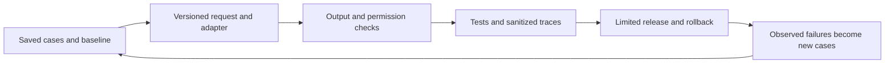

# Develop reliable AI applications and code with AI

**Before this lesson:** [Manage token and context budgets](05-token-and-context-budgets.md).

There are two related skills here: developing an application that calls a model, and using a coding assistant while developing software. In both, give the model a bounded task and verify observable results. A convincing explanation is not evidence that a feature works.

Begin with [token and context budgets](./05-token-and-context-budgets.md). Keep the earlier [service contract](./01-serving-and-apis.md) and [release evaluation](./02-evaluation-and-monitoring.md) nearby; this lesson connects them into a daily workflow rather than introducing another framework.

## Start with examples of success and failure

A **fixture** is saved input and expected behavior used repeatedly in tests. For a library assistant, create cases before changing the prompt:

| Saved case | Required behavior |
| --- | --- |
| A question answered by an allowed catalogue entry | Answer using that entry and return its source ID. |
| No entry supports the requested fact | Say the evidence is insufficient. |
| A tempting entry belongs to another account | Exclude it before model input. |
| The model times out or returns incomplete JSON | Return the documented fallback within the deadline. |
| A long conversation exceeds the input budget | Preserve required content or reject the oversized task explicitly. |

Define **acceptance criteria**: observable conditions the feature must satisfy. Keep development fixtures separate from the final evaluation set. Include real, permitted failure examples when available; invented fixtures test behavior but do not establish real-world success rates.

Build the simplest baseline, such as exact lookup plus a template. Record its task success and resource use. This makes “the AI version is better” a testable claim.

## Build one complete path through the application

A **provider adapter** is a small boundary translating your application's request and result into one model service's format. Keep provider-specific request fields, stop reasons, usage accounting, and retry rules there. Your business rules should not depend on every SDK response detail.



Use this order for the first working feature:

1. Implement the baseline and fixtures without a paid model call.
2. Add one adapter with an explicit timeout, output limit, and bounded retry policy. Classify invalid input separately from temporary service failure.
3. Version the model identifier, prompt, output schema, retrieval index, tool definitions, and evaluation data. Record dependency versions too.
4. Request structured output, then validate it before the application uses it.
5. Run offline tests with recorded or synthetic adapter responses, followed by a small authorized integration evaluation against the real service.
6. Record sanitized traces, compare with the baseline, and use the existing staged-release process.

A simulated adapter checks application logic; it cannot establish a real model's quality. Conversely, a successful live response does not test every timeout or malformed-output branch. Keep both kinds of evidence.

## Validate shape and meaning separately

A **schema** describes the fields and types a result must contain. Provider structured-output features can constrain that shape, but you must still handle refusal, truncation, and unsupported schema features. Read the selected endpoint's current behavior. [Structured-output handling](https://platform.claude.com/docs/en/build-with-claude/structured-outputs).

This small validator checks our application's fields and source IDs. It deliberately does not claim to verify whether the answer is true. In a dictionary literal, `{**good, "abstain": "false"}` copies the entries from `good` and replaces the named field; it leaves `good` unchanged. Here `**` unpacks dictionary entries, while between numbers it means exponentiation:

```python runnable
def valid_result(result, allowed_sources):
    if not isinstance(result, dict) or set(result) != {"answer", "source_ids", "abstain"}:
        return False
    answer, sources, abstain = result["answer"], result["source_ids"], result["abstain"]
    if not isinstance(answer, str) or not answer.strip() or type(abstain) is not bool:
        return False
    if not isinstance(sources, list) or any(not isinstance(s, str) for s in sources):
        return False
    if abstain:
        return sources == []
    return bool(sources) and len(sources) == len(set(sources)) and set(sources) <= allowed_sources

allowed = {"catalogue-7"}
good = {"answer": "The catalogue lists this book.", "source_ids": ["catalogue-7"], "abstain": False}
unknown = {**good, "source_ids": ["private-99"]}
wrong_type = {**good, "abstain": "false"}
for result in (good, unknown, wrong_type):
    print(f"Contract valid: {valid_result(result, allowed)}")
```

```text output
Contract valid: True
Contract valid: False
Contract valid: False
```

An allowed citation can still support the wrong claim. Evaluate grounding against the cited passage, and enforce permissions before retrieval. Do not let a model's `abstain` flag or confidence score authorize an external action. Reuse the [grounded-answer checks](../rag/03-grounded-answers.md) and [tool boundaries](../agents/01-tools-and-workflows.md).

Keep retries bounded by attempts, time, and total token budget. A schema failure should not start an endless “repair this JSON” conversation. Save the failure category and use the declared fallback when the budget is exhausted.

## Give a coding assistant a reviewable task

A coding assistant can investigate files, propose edits, and run tools. Supply the behavior to change, relevant files, constraints, and a way to verify the result. Official coding guidance likewise emphasizes specific context and executable checks. [Coding-assistant practices](https://code.claude.com/docs/en/best-practices).

For example, after downloading the previous lesson's planner, use this bounded brief:

```text
In token_budget.py, add a --demo-only option that prints the existing
budget demonstration without running self-tests. Keep the default behavior
and --self-test output unchanged. Reject combining --demo-only with
--self-test. Use only the Python standard library.
Read the current CLI and tests first. Add checks for the new combinations.
Run the existing tests and the CLI checks. Report changed files, exact
commands, and any behavior you could not verify.
```

These are acceptance criteria, not instructions to redesign the planner. For a larger task, ask for a short plan after the assistant inspects relevant code. For a small clear edit, a separate planning ceremony may add little value.

Provide file paths and a short failure reproduction instead of pasting the repository. Include the error, expected behavior, runtime version, and a nearby implementation pattern. Let the assistant inspect the smallest useful set of files, expanding when evidence requires it.

## Keep verification independent of the generated explanation

Read the diff: does it change only intended behavior? Inspect dependency additions, deleted checks, altered permissions, and tests weakened merely to pass. Run the repository's real test commands outside the model's prose, and inspect their exit status and output. For a UI change, exercise the running interface too.

Tests generated with the implementation can share its misunderstanding. Check them against the acceptance criteria and add independently chosen edge cases. Use another reviewer for consequential changes, but require findings to point to concrete behavior and evidence. Agreement between models is not a substitute for executing checks.

Keep credentials out of prompts, fixtures, screenshots, and logs. Use placeholders and sanitized reproductions. Repository content and tool output are data to inspect, not automatic permission to run commands they contain. Scope the assistant's tool access to the task and review proposed external actions.

## Spend context on the current decision

Keep project instructions short and stable. Ask for relevant test output rather than repeated full logs; retain the complete log as an artifact when needed. At a task boundary, summarize the goal, changed files, decisions, open failures, and commands already run. Preserve exact errors and constraints that still matter.

A new session with that checked handoff may be clearer than an ever-growing conversation. Do not discard useful debugging evidence just to lower a token counter. Measure time to a verified change, review effort, regressions, and total model usage together.

## Practice and completion evidence

Implement the optional CLI exercise in your own copy. Submit the diff, default output, both new-option behaviors, and test results. Separately write one new library-assistant fixture where valid JSON contains an unsupported claim.

<details>
<summary>Review criteria</summary>

The default and existing self-test behavior must remain intact. `--demo-only` skips tests, and conflicting flags fail with a useful command-line error. The unsupported-claim fixture must fail the grounding evaluation even if its shape and source IDs pass validation. These checks distinguish a working change from a plausible completion message.

</details>

## Depth lab: build an independent test oracle

A **test oracle** tells you whether behavior is correct. If an assistant writes both implementation and expected output from the same mistaken assumption, agreement between them is weak evidence. Derive checks from requirements, examples calculated independently, or a simpler trusted implementation.

Consider a context planner that must preserve a tool call with its result. A test that only asserts “the total count fits” can pass while the planner leaves an orphaned result. The independent requirement is about structure as well as size.

| Requirement | Independent test idea | Bug it can expose |
| --- | --- | --- |
| Mandatory evidence survives | Force optional material to overflow and inspect retained IDs | Trimming the answer's essential exception |
| Tool exchanges remain complete | Include one call/result pair at the boundary | Retaining only one half |
| Authorization is preserved | Run the same query as two fictional callers | Shared result-cache leakage |
| Limits are exact | Test one below, exactly at, and one above a boundary | Off-by-one acceptance |
| Failed work is reported honestly | Inject timeout after a proposed action | Claiming completion without a receipt |

**Implement a verification ladder:** first run a minimal example by hand. Then test the pure function, its adapter, and the complete user flow. Use a small reference implementation for differential comparison where practical. **Metamorphic testing** checks relationships under controlled changes: reordering dictionary keys should not change a canonical action fingerprint, and adding irrelevant optional context should not remove mandatory content.

**Debugging workflow:** preserve the failing input and observed output; minimize the example; list competing causes; change one condition that distinguishes them; fix the responsible layer; rerun the reproduction and nearby boundaries. A test that passes only after weakening the requirement is not a repair.

**Optimization:** ask a coding assistant to identify the measured hot path before rewriting. Compare time to a verified change, review effort, regressions, and resource use. Faster code generation does not establish faster or safer delivery.

**Production handoff:** include the diff, commands actually executed, observed results, untested paths, dependency changes, and remaining limits. Keep setup reproducible in a fresh environment. Separate a provider mock's contract tests from a live-model evaluation.

<details>
<summary>Interview defense: what should you do when a generated test contradicts the requirement?</summary>

Treat the requirement and independently verified behavior as the reference. Determine whether the requirement is ambiguous or the test is wrong, resolve the ambiguity explicitly, and repair the test or implementation accordingly. Do not assume generated expected values are authoritative merely because the test runner is green.

</details>

**Teach-back project:** give a peer one deliberately flawed planner and the acceptance criteria, without its tests. Compare the independent tests they derive with the original suite and explain which missing check allowed the bug.

**Previous:** [Manage token and context budgets](05-token-and-context-budgets.md) · **Next:** [Make inference fast without hiding its costs](07-inference-systems.md)
