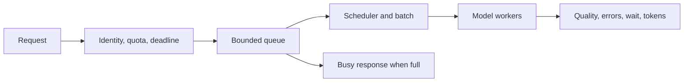

# Make inference fast without hiding its costs

**Before this lesson:** [Transformers](../deep-learning/05-transformers.md), [serving](./01-serving-and-apis.md), [token budgets](./05-token-and-context-budgets.md), and [measured development](./06-effective-ai-development.md).

A model that fits on a machine may still respond too slowly. An optimization that increases total throughput may make one user's request wait longer. Begin with a workload and a quality target, then measure the bottleneck.

## Separate prefill from decoding

**Prefill** processes the input tokens. **Decoding** produces new tokens step by step. **Time to first token** includes the delay before the first output appears. **Inter-token latency** measures gaps during output. **Throughput** measures completed work per unit time. A streaming interface can improve perceived responsiveness without reducing total computation.

In causal attention, earlier tokens have keys and values that later tokens reuse. A **KV cache** stores these values so the system does not recompute them at every generation step. It consumes memory that grows with sequence length and concurrent requests.

For a conventional full-attention decoder with a uniform cache, a rough cache estimate in bytes is:

`2 × layers × KV heads × head dimension × cached tokens × bytes per value × sequences`

The factor two accounts for keys and values. Grouped-query attention shares fewer KV heads across more query heads, reducing cache size. Sliding-window and other architectures can have different cache behavior.

```python runnable
layers, kv_heads, head_dimension = 24, 8, 64
tokens, bytes_per_value, sequences = 2048, 2, 4
cache_bytes = 2 * layers * kv_heads * head_dimension * tokens * bytes_per_value * sequences
print(f"estimated KV cache: {cache_bytes / (1024 ** 3):.3f} GiB")
```

```text output
estimated KV cache: 0.375 GiB
```

This excludes model weights, temporary activations, allocator overhead, and the runtime. It is an estimate for the stated layout, not a hardware purchasing recommendation.

## Compare optimizations by what they trade

| Technique | Why it can help | What to measure |
| --- | --- | --- |
| Weight quantization | Store weights with fewer bits | Quality changes, memory, supported hardware, actual latency. |
| KV-cache quantization | Reduce cache memory | Long-context quality and quantization overhead. |
| Continuous batching | Add/remove active requests as they progress | Throughput, waiting time, fairness, tail latency. |
| Prefix caching | Reuse a matching input prefix | Hit rate, invalidation, permission boundaries, memory. |
| Speculative decoding | A cheaper draft proposes tokens that a target verifies | Acceptance rate and total end-to-end speed. |
| Distillation | Train a smaller model from a larger teacher's outputs | Task quality, data rights, regression, total training cost. |

**Quantization** maps values to a smaller set of representable numbers. It introduces approximation error and may need extra metadata. Four-bit weights do not make the whole process four times smaller or faster; other memory and computation remain. A full-precision baseline is needed to measure the trade.

The [Transformers cache guide](https://huggingface.co/docs/transformers/kv_cache) describes cache options and notes that quantizing a cache can hurt latency when its extra work outweighs the saved memory. Treat each optimization as an experiment on your workload.

## A service needs backpressure

**Backpressure** limits accepted work when downstream capacity is full. Use bounded queues, request deadlines, cancellation, and per-user quotas. A queue that grows forever converts overload into increasingly late answers.



A **service-level objective**, or SLO, is a target such as “95% of accepted requests finish within two seconds under this workload.” State whether rejected requests count toward success. Otherwise dropping difficult requests can make latency look artificially good.

A **canary release** sends a limited share of real traffic to a candidate. A **rollback** returns to a known version. Shadow evaluation can run a candidate without using its answer, but still consumes resources and must honor data permissions.

## Worked capacity estimate

Suppose requests arrive at 5 per second and spend an average of 2 seconds inside a stable system. Roughly 10 requests are in flight on average. This is an application of Little's law: average in-flight work equals arrival rate times average time. It assumes a stable flow and consistently defined boundaries; an overloaded growing queue violates the steady-state premise.

Do not infer the 95th-percentile latency from the average. Benchmark short and long inputs, short and long outputs, warm and cold caches, and bursts. Record hardware, model revision, precision, input sizes, concurrency, and errors so another person can interpret your numbers.

## Practice and completion gate

A quantized model uses less memory but takes longer on short prompts. Is the measurement necessarily wrong?

<details>
<summary>Compare the costs</summary>

No. Conversion overhead, kernel support, batching, and the original bottleneck can outweigh memory savings. Recheck the benchmark conditions, then report the result honestly. Smaller storage is a benefit even when latency does not improve, but it is a different benefit.

</details>

**Project extension:** create a benchmark report with an unoptimized baseline and one changed setting. Use at least three workload shapes and a held-out quality set. Include p50/p95 latency, accepted/rejected/error counts, memory, and cost per accepted useful result. If hardware is unavailable, submit the explicit capacity calculation and a reproducible benchmark plan, labeling estimates as estimates.

## Depth lab: quantize values and inspect decision margins

A simple symmetric integer quantizer chooses a scale, rounds values to integer levels, and reconstructs them by multiplying by the scale. Here the largest absolute value maps to 127. Real systems can use different formats, groups, calibration, zero points, and kernels.

```python runnable
values = [-1.0, 0.1, 0.5, 1.0]
maximum = max(abs(value) for value in values)
scale = maximum / 127 if maximum else 1.0
integers = [max(-127, min(127, round(value / scale))) for value in values]
restored = [integer * scale for integer in integers]
print(integers)
print([round(value, 4) for value in restored])
print(f"maximum error: {max(abs(a-b) for a, b in zip(values, restored)):.4f}")
```

```text output
[-127, 13, 64, 127]
[-1.0, 0.1024, 0.5039, 1.0]
maximum error: 0.0039
```

Small value errors can change a decision when two output scores are close. Layer errors can also interact through later computation. Measure task quality and important slices rather than assuming a small average weight error implies an unchanged model.

**Debugging exercise:** construct two nearly tied classification scores and perturb them by the measured error scale. Show a changed argmax. Then test saturation with a value outside the calibrated range. Calibration based only on easy short inputs can miss outliers in production workloads.

**System design:** account separately for weights, temporary activations, KV cache, runtime buffers, and allocator overhead. Weight compression does not proportionally reduce each part. Continuous batching can improve utilization while increasing live KV memory and queueing; bind concurrency to measured capacity.

**Optimization experiment:** retain a full-precision baseline and compare one quantization setting on the same hardware, inputs, batch policy, and warm/cold conditions. Measure time to first token, generation speed, end-to-end latency, throughput, memory, and quality. Include conversion overhead and unsupported-kernel fallbacks. A smaller stored file is not proof of faster execution.

<details>
<summary>Interview defense: when might speculative decoding be slower?</summary>

A draft model must produce proposals and the target must verify them. If few proposals are accepted, the added draft and coordination work may outweigh saved target steps. Hardware, batch size, sequence lengths, and implementation affect the result. Correct speculative algorithms can preserve the target distribution; arbitrary acceptance rules do not establish that property.

</details>

**Teach-back:** explain why an optimization can improve throughput but worsen the first user's waiting time. Present a workload-specific result and identify the condition under which you would revert it.

**Previous:** [Develop reliable AI applications and code with AI](06-effective-ai-development.md) · **Next:** [Read a paper and test its claim](../research/01-papers-and-experiments.md)
