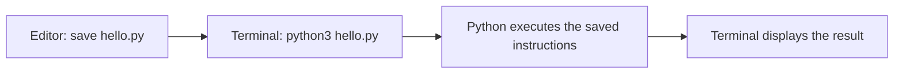

# Computers, files, and your first program

**Prerequisites:** the [numbers and notation](./00-numbers-and-notation.md), ordinary arithmetic, and a computer on which you can save a text file. No programming experience is needed.

An AI system is still a computer program. It receives data, performs operations, and produces a result. A model may supply part of the decision, but someone must still load the data, run the model, check the result, and store useful output. We begin with those ordinary computing skills.

## Know which tool does which job

A **file** is a saved collection of data. A **folder** groups files. A **path** tells the computer where a file is. An **editor** changes a text file; a **terminal** accepts commands; the **Python interpreter** executes instructions written in Python. These are separate jobs even when one application provides several of them.

Your program's temporary working values live in **memory** while it runs. Saving a file keeps data after the program exits. Printing a value displays it; printing does not automatically save it in a reusable data file.



## Set up one small workspace

Install a supported Python 3 release from the [official Python downloads page](https://www.python.org/downloads/). These lessons use Python 3.10 or newer and the **standard library**: modules supplied with a normal Python installation. You do not need a GPU, an AI account, or paid software for this stage.

Create a folder named `ai-practice` using your file manager. Open a plain-text editor and save a file named `hello.py` inside it. A word processor may add hidden formatting; use a code or plain-text editor instead.

Open a terminal in that folder. On macOS or Linux, check the interpreter with:

```sh
python3 --version
```

On Windows, use `py -3 --version`. Throughout this course, substitute `py -3` for `python3` if that is your working command. The printed version varies; a Python 3.10+ version is sufficient. If the command is unavailable, complete the installer instructions for your operating system before continuing.

## Run and trace the program

Put this complete program in `hello.py`:

```python runnable
print("Hello, AI learner!")
print("Minutes in three half-hour sessions:")
print(3 * 30)
```

```text output
Hello, AI learner!
Minutes in three half-hour sessions:
90
```

Run `python3 hello.py` in the terminal. Python reads the saved file from top to bottom. Quotation marks identify literal **text**; `3 * 30` is an **expression**, a calculation that produces a value. Parentheses pass a value to `print`, an operation that displays it. The [Python introduction](https://docs.python.org/3/tutorial/introduction.html) uses the same distinction between text and arithmetic.

Change `3` to `4`, save, and run again. Predict 120 before checking. If the output did not change, confirm that you saved the file you are actually running.

## Practice before continuing

Print your study goal on one line and the number of minutes in five 20-minute sessions on the next. Explain which text is interpreted as an instruction and which text is displayed literally.

<details>
<summary>Check your answer</summary>

Use `print("Learn to inspect data")` and `print(5 * 20)`. The second line prints 100. Writing `print("5 * 20")` prints the characters `5 * 20` instead of calculating them.

</details>

## Mistakes and choices

“File not found” usually means the terminal is in a different folder or the name is misspelled. A syntax error means Python could read the file but could not understand an instruction; inspect the reported line. Do not paste the terminal command into the Python file.

A browser notebook is convenient for exploration, but cells can run in a different order from their appearance. A small script gives us a repeatable start-to-finish run. We will use scripts first and add other tools when they solve a specific problem.

## Depth lab: reproduce a program in a clean folder

A program depends on more than its source text: the interpreter, working directory, input files, arguments, and environment can change behavior. A **working directory** is the folder used to resolve relative file paths. It can differ from the folder containing the script.

**Implement:** create a small program that receives an input filename as an argument, reads three numbers, and prints their total. Run it from its own folder and from its parent using an explicit path. Record the Python version and exact commands. Keep the input fixture with the exercise, so another learner can reproduce the total.

### Diagnose the failure in layers

| Symptom | First check | Why |
| --- | --- | --- |
| Command not found | Interpreter installation and command name | The program has not started. |
| File not found | Working directory and resolved input path | Source code can be correct while the path is wrong. |
| Permission denied | File/folder permissions and requested operation | Changing the calculation cannot repair access. |
| Wrong total | Parsed values and arithmetic | Execution succeeded; investigate the logic. |

Avoid “fixing” a missing file by silently using an empty dataset. A plausible zero hides the failure. Report the missing input clearly and stop the calculation.

### Production habits and measured improvement

Make required inputs explicit, keep generated output separate from source, and do not store credentials in scripts or example files. Bound input size if the program reads user-provided files. For a large file, compare reading all content with processing one line at a time; measure peak memory as well as elapsed time. Streaming still needs a clear rule for malformed lines.

<details>
<summary>Interview and teaching answer: why does it work only on one machine?</summary>

The source may depend on an undeclared file, different interpreter, package version, path, locale, or environment value. Reproduce in a fresh folder with only documented inputs. Add one dependency at a time until the failure is explained. Teaching this investigation is more useful than telling a learner to reinstall everything.

</details>

**Evidence:** a reproducible command, a known input/output pair, a missing-file case, and a memory comparison using the same data and result.

**Previous:** [Numbers, units, and the symbols you will meet](00-numbers-and-notation.md) · **Next:** [Python values, names, and clear calculations](02-python-values.md)
