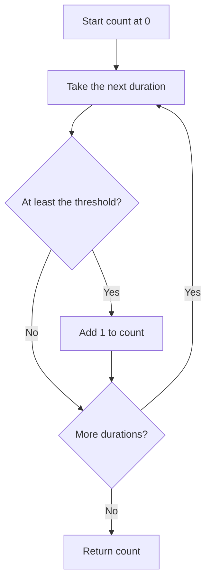

# Decisions, loops, and reusable functions

**Prerequisites:** [values, names, and comparisons](./02-python-values.md).

A report might count only reading sessions lasting at least 20 minutes. We need a decision for each session, a way to repeat it, and a named operation we can reuse. These are the same building blocks that later prepare data for a model.

## Decide with an explicit rule

An `if` statement runs an indented block only when its condition is true. An optional `else` handles the other case. Python uses indentation to group instructions; use four spaces consistently. A colon starts the block.

A `for` loop visits each item in a collection. The notation `[15, 25, 20]` creates a **list**, an ordered collection of three values. We will examine collections in detail next; for now, think of a row of session lengths.



## Package the rule as a function

A **function** is a named set of instructions. **Parameters** name its inputs; **arguments** are the actual values supplied in a call. `return` sends a result back to the caller. It does not print that result unless the caller asks to print it.

```python runnable
def count_long_sessions(durations, minimum):
    count = 0
    for minutes in durations:
        if minutes >= minimum:
            count = count + 1
    return count

sessions = [15, 25, 20, 10]
print(count_long_sessions(sessions, 20))
print(count_long_sessions(sessions, 25))
print(count_long_sessions([], 20))
```

```text output
2
1
0
```

For threshold 20, the count stays 0 after 15, becomes 1 after 25, becomes 2 after 20, and stays 2 after 10. The comparison includes equality, so a 20-minute session qualifies. An empty list performs no loop visits and returns the initial count, zero.

This function assumes its durations are nonnegative numbers. An **input contract** states what the caller may supply and what the function promises to return. A contract may be enforced with checks or documented as an assumption. Do not confuse the two.

## Separate calculating from reporting

Returning a count makes the function useful in a printed report, a test, or a later calculation. Putting all output inside the function would tie it to one display format. The local `count` belongs to each call; two calls begin with independent counts. Python's [function tutorial](https://docs.python.org/3/tutorial/controlflow.html#defining-functions) explains this call-and-return behavior.

A `while` loop repeats while a condition stays true. Use it when the stopping point depends on changing state. Make sure the state moves toward termination. For a fixed collection, a `for` loop often expresses the intention more directly.

## Read objects and classes before using model libraries

Later libraries use expressions such as `model.predict(values)`. The dot means “look up something belonging to this object.” An **object** bundles values and operations. An **attribute** is a value attached to it. A **method** is a function attached to its type.

A **class** defines a kind of object. Calling the class creates an **instance**. Here, each reading counter owns its own total:

```python runnable
class ReadingCounter:
    def __init__(self):
        self.total = 0

    def record(self, pages):
        if pages < 0:
            raise ValueError("pages cannot be negative")
        self.total = self.total + pages
        return self.total

first = ReadingCounter()
second = ReadingCounter()
print(first.record(5))
print(first.record(3))
print(second.total)
```

```text output
5
8
0
```

`__init__` runs when an instance is initialized. `self` names the particular instance receiving the call: `first.record(5)` supplies `first` as `self` and 5 as `pages`. The second counter remains zero because we placed `total` on each instance. `raise ValueError(...)` stops the operation with an explicit error; the [debugging lesson](./05-debugging-and-tests.md) teaches how to handle and test errors.

A line such as `class MyModel(BaseModel):` means that `MyModel` inherits behavior from `BaseModel`. You do not need to design a class hierarchy now. Recognizing the syntax will help you read the later PyTorch example. Python's [class tutorial](https://docs.python.org/3/tutorial/classes.html) provides further practice.

Choose a plain function for a calculation that needs no stored state. A class can help when several operations share state, but extra classes do not automatically make a program clearer. Keep the counter example separate from a statistical model: it stores a running total; it does not learn.

You may also see `def double(value: int) -> int:`. The annotations describe an intended integer input and output. Ordinary Python does not enforce these hints automatically. Input checks and tests still matter.

**Predict before running:** after `second.record(2)`, what are the two totals?

<details>
<summary>Trace the state</summary>

The first counter remains 8 and the second becomes 2. Each call changes the instance named before the dot. Replacing both variables with references to the same instance would share that state instead.

</details>

## Practice: handle an undefined rate

Write `completion_rate(completed, assigned)` for nonnegative counts with completed no greater than assigned. Return `None` when assigned is zero; otherwise return the fraction. Explain why `print` and `return` are not interchangeable.

<details>
<summary>One answer and a trace</summary>

```python
def completion_rate(completed, assigned):
    if assigned == 0:
        return None
    return completed / assigned
```

`completion_rate(3, 4)` returns 0.75, while `completion_rate(0, 0)` returns `None`. The caller decides how to display “no assignments.” This version relies on the stated count contract; it does not validate every argument. A function that only prints a fraction would give the caller `None` when it reaches the end without returning a value.

</details>

## Mistakes and choices

Returning inside the loop ends the whole function after that iteration. Resetting the count inside the loop forgets earlier matches. Using `>` instead of `>=` changes the boundary rule. Trace a value exactly on the threshold to expose the difference.

A short function is useful when it gives a rule a clear name or lets you test that rule independently. Splitting every single expression into a function can instead make a simple calculation harder to follow. Start with one meaningful responsibility.

## Depth lab: separate a decision from its effects

Suppose a script sends a reminder for every reading session shorter than 20 minutes. A decision function can return whether a reminder is needed; another function performs the send. Keeping these jobs separate lets you test the rule without sending messages.

**Implement:** define a function that accepts validated minutes and returns a boolean. Test 0, 19.9, 20, and 20.1. Explain why the boundary result depends on whether the rule says “shorter than” or “at most.” Then implement a loop that collects reminder proposals rather than executing them immediately.

A function should state inputs, output, permitted effects, and failure behavior. An object or class is useful when several operations must preserve shared state, such as an account's balance or a worker's lifecycle. A pure calculation often needs only a function.

### Debug a loop by stating what remains true

To total durations, use the invariant: before iteration i, the accumulator equals the sum of the first i validated values. Initially i=0 and the sum is zero. Adding the next value preserves the invariant. When all values have been processed, the accumulator is the required total.

A loop that skips a row after an exception needs a documented policy. “Continue” can mean legitimate rejection reporting, or it can hide missing evidence. Keep accepted and rejected counts so the final report reconciles with input count.

### Production and optimization

Validate before side effects, and make the execution layer responsible for permission and duplicate handling when reminders become a real integration. For large collections, keep decision logic independently testable while measuring I/O and calculation separately. Replacing a clear loop with a compact expression does not establish better performance.

<details>
<summary>Expert follow-up: why can a retry send two reminders?</summary>

If sending succeeds but the script fails before recording completion, rerunning can send again. A decision function being deterministic does not make its external effect safe to repeat. A production integration needs an operation identity and a documented duplicate/recovery policy. At this stage, preserve proposals as data and trace the failure timeline before implementing the external action.

</details>

**Teach it:** ask a learner to trace four boundary values, explain the accumulator invariant, and identify which line would create an external effect. Keep tests, a trace, and the decision/execution boundary as evidence.

**Previous:** [Python values, names, and clear calculations](02-python-values.md) · **Next:** [Collections, records, and files](04-collections-and-files.md)
