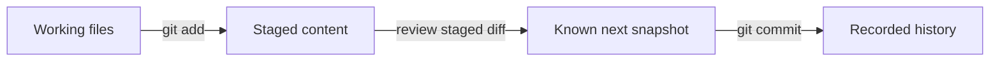

# Save your work and reproduce your environment

**Prerequisites:** [run and test a Python script](./05-debugging-and-tests.md). Keep using your own `ai-practice` folder.

Three different things can change an experiment: the code, the data, and the installed software. Saving only the final output does not explain how it was produced. Git records code changes; a Python environment keeps a project's installed packages separate. Neither automatically records every detail of an experiment.

## Record a small, reviewable change

**Git** is a version-control tool. A **repository** stores a project's history. A **commit** is a saved snapshot plus a message. Git runs locally; hosting a repository on a website is a separate choice.

Install Git using its [official instructions](https://git-scm.com/book/en/v2/Getting-Started-Installing-Git). In your practice folder, with your existing `hello.py`, run these terminal commands one at a time:

```sh
git init
git status
git add hello.py
git diff --cached
git commit -m "Add first Python program"
```

Git may ask you to configure your author name and email before the first commit; follow the [first-time setup guide](https://git-scm.com/book/en/v2/Getting-Started-First-Time-Git-Setup) with your chosen identity. Do not run `git init` inside someone else's existing project for this exercise.

`git add` stages the current file contents. `git diff --cached` shows what the next commit will record. If you edit the file after staging it, the new edit is not automatically part of that staged snapshot. `git status` shows the difference. These distinctions are documented in [Recording Changes](https://git-scm.com/book/en/v2/Git-Basics-Recording-Changes-to-the-Repository).



## Keep project packages separate

A **module** is code that can be imported. A **package** often groups modules. Some come with Python's standard library; other packages must be installed. Different projects may need different package versions.

A **virtual environment** gives a project its own installed-package area. It does not create another computer or secure untrusted code. From the practice folder, create one:

```sh
python3 -m venv .venv
```

On macOS/Linux, activate it with `source .venv/bin/activate`. In Windows PowerShell, use `.venv\Scripts\Activate.ps1`. If activation is unavailable, run the environment's interpreter directly: `.venv/bin/python` on macOS/Linux or `.venv\Scripts\python.exe` on Windows. Activation mainly changes which interpreter a short command finds. The [Python venv guide](https://docs.python.org/3/library/venv.html) explains the directory and platform commands.

Inside the activated environment, inspect the package tool with `python -m pip --version`. `python -m pip` ties installation to that interpreter. You do not need to install anything for the first two course stages. Later lessons name the required packages explicitly.

Add these lines to a plain-text `.gitignore` file so generated environment files stay out of commits:

```text
.venv/
__pycache__/
```

Record dependencies when you introduce them, together with the Python version and run command. A version list alone does not capture input data, operating-system differences, or randomness. The [Python Packaging guide](https://packaging.python.org/en/latest/guides/installing-using-pip-and-virtual-environments/) explains package installation and requirements files.

## Practice: recover an explanation, not just a file

Change the message in `hello.py`. Inspect `git diff`, run the script, stage the change, inspect the staged diff, and commit it with a message explaining why it changed. Name two things this commit still does not record automatically.

<details>
<summary>Check your answer</summary>

The commit records the staged file, not every untracked dataset or installed package. It also does not record whether you actually ran the test. Keep run instructions, dependency information, and a small verification record with the project when needed.

</details>

## Mistakes and tradeoffs

Small commits are easier to inspect than one snapshot combining unrelated edits. Avoid committing a virtual environment, passwords, or API keys; this stage requires none. A shared global package installation is initially convenient but makes project conflicts harder to diagnose. Separate environments cost some disk space and reduce that coupling.

## Depth lab: reproduce behavior, not only source files

Two learners check out the same commit but obtain different results. The input file, package versions, interpreter, random seed, or environment configuration may differ. A commit identifies source state; it does not automatically capture every dependency of an experiment.

**Implement:** create a small reproducibility record containing source revision, Python version, package versions actually used, input-data fingerprint, command, seed where relevant, and expected output/tolerance. Recreate the environment in a fresh folder and run using only that record. Keep credentials and private datasets out of public artifacts.

### Debug a reproduction failure in order

First verify input bytes and command arguments. Then compare interpreter and dependency versions, preprocessing, configuration, and randomness. A fixed seed helps control a particular source of randomness but does not guarantee identical results across every device and library. Later numerical-computing lessons explain why precision and operation order can matter.

A package pin says which version was selected; it does not establish that the package is trustworthy or that system-level dependencies are identical. Keep a small dependency set and inspect the documented installation path. Separate optional accelerator/model packages from the standard-library exercises.

### Production and optimization

Use reviewable changes, preserve a known working artifact, and verify restoration rather than assuming a backup or tag is sufficient. A code rollback may also need compatible data, model, and configuration versions. Avoid rebuilding an environment on every small test if a measured cache can safely reuse unchanged dependencies, but invalidate the cache when relevant inputs change.

<details>
<summary>Interview and teaching answer: why did the same seed produce a different result?</summary>

The algorithm, input ordering, library/runtime, hardware, precision, or parallel operation order may differ. The seed controls a specified random generator; it is not a universal experiment identifier. Compare the full reproduction record and distinguish acceptable numerical differences from changed conclusions.

</details>

**Teach it:** give another learner the record without extra verbal instructions. Have them reproduce one result and one intentional failure. The missing steps they discover are gaps in the reproducibility contract.

**Previous:** [Debugging, input checks, and useful tests](05-debugging-and-tests.md) · **Next:** [Data tables, SQL, and a complete data-audit project](07-data-tables-and-sql.md)
