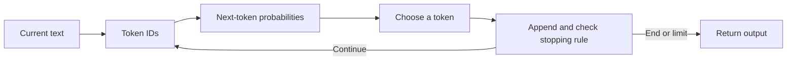

# Language models: predicting the next piece

**Before this lesson:** [Learn actions from rewards and finish the stage](../deep-learning/06-reinforcement-learning.md).

A **language model** assigns probabilities to pieces of language. A probability is a number describing how likely a choice is under the model. A model can use those probabilities to continue text, one piece at a time.

Imagine a school library assistant completing “Please return the…”. “Book” may fit better than “mountain.” A model learns patterns from training examples, but a likely continuation is not automatically a true statement. Confident writing is not evidence of knowledge.

## From text to predictions

A **token** is a unit the model handles. It may be a word, part of a word, punctuation, or a byte-based unit. **Tokenization** converts text into these units and then into numeric IDs. Different tokenizers can split the same sentence differently. Character count and word count are therefore not exact token counts. The [Hugging Face tokenizer lesson](https://huggingface.co/learn/llm-course/en/chapter6/5) explains how learned pieces are built.

During next-token training, the text supplies both the input and its next piece. For “the robot reads,” the model can learn to predict “robot” after “the,” then “reads” after “the robot.” The training loss measures how much probability it assigned to the actual next token. Training adjusts its weights to reduce that loss across examples.

During generation, the actual next token is unknown. The system selects one from the model’s distribution, appends it, and repeats. This is **autoregressive generation**: new output becomes part of the input for the next step.



## Work through a tiny count model

A **bigram model** looks at only the previous token. This teaching example counts the word after “robot.” It has no neural network or understanding of books.

```python runnable
from collections import Counter

examples = ["robot reads", "robot reads", "robot sorts", "robot reads"]
counts = Counter(sentence.split()[1] for sentence in examples)
for word in sorted(counts):
    print(f"{word}: {counts[word] / sum(counts.values()):.2f}")
```

```text output
reads: 0.75
sorts: 0.25
```

**Greedy decoding** chooses the highest-probability token. **Sampling** draws a token using the probabilities. A **temperature** setting changes how concentrated a sampling distribution is: a lower positive temperature usually favors already likely tokens more strongly. **Top-p sampling** keeps a high-probability set whose combined mass reaches a chosen threshold. These are selection rules, not truth controls. Check the [generation reference](https://huggingface.co/docs/transformers/main_classes/text_generation) for precise parameter meanings in one implementation.

## Context is not permanent memory

The **context window** is the amount of input and generated material a model can use in a call, subject to its serving rules. Instructions, conversation, retrieved passages, tool results, and output all compete for that budget. Longer input also adds processing work; including everything is not always useful.

Weights are learned during training. Context is supplied for the current call. A saved user preference in a database is application memory. A system must retrieve that preference and include it when needed; merely having had an earlier conversation does not update model weights.

A transformer uses more context than the one-word model above, but access to a passage does not prove that it used the right part. Test important facts, especially when documents are long, contradictory, or missing.

## Choices and mistakes

Use a language model when flexible language is useful. Use a lookup or ordinary function for an exact timetable or arithmetic rule. Avoid assuming fluent output is correct, increasing temperature to “improve facts,” or treating a larger context window as reliable long-term memory. Keep a small evaluation set of real tasks before comparing models or decoding settings.

## Practice

1. Add one “robot sorts” example. What are the two probabilities now?
2. A student’s name was removed from the context. Which application feature could supply it again without training?

<details>
<summary>Check your answer</summary>

There are three “reads” and two “sorts” examples, so the probabilities are 0.60 and 0.40. An authorized lookup from saved application state can supply the name. That is retrieval, not a weight update.

</details>

## Depth lab: calculate sequence likelihood without underflow

To score a sequence, multiply the conditional probabilities of its tokens, including the end marker if that is part of the evaluation contract. The chain rule justifies this multiplication; a bigram model approximates each conditional using only the preceding token.

Products quickly become too small for floating-point arithmetic. Work with logarithms instead: a product becomes a sum. **Negative log-likelihood**, or NLL, is the negative of that sum. Divide by the number of evaluated tokens to obtain mean NLL, then exponentiate to obtain perplexity.

```python runnable
import math

probabilities = [0.5, 0.25, 0.5]
total_nll = -sum(math.log(p) for p in probabilities)
mean_nll = total_nll / len(probabilities)
print(f"sequence probability: {math.prod(probabilities):.4f}")
print(f"mean NLL: {mean_nll:.3f}")
print(f"perplexity: {math.exp(mean_nll):.3f}")
batch_nll_and_tokens = [(2.0, 2), (6.0, 3)]
print(sum(loss for loss, n in batch_nll_and_tokens)
      / sum(n for loss, n in batch_nll_and_tokens))
```

```text output
sequence probability: 0.0625
mean NLL: 0.924
perplexity: 2.520
1.6
```

A zero probability makes NLL infinite. For a count model, smoothing assigns mass to unseen events. For a neural model, compute log-probabilities with a stable log-softmax rather than taking logarithms of probabilities that may already have rounded to zero. These address different problems: missing statistical support and numerical representation.

**Debugging drill:** insert an unknown word into held-out text. Follow its tokenizer, unknown-token policy, probability calculation, and denominator. Silently dropping unknown words can make evaluation look better precisely when the model handles less.

**Production and optimization:** store tokenizer revision, document boundaries, loss mask, and evaluated token count with every score. Sum losses and counts across workers before dividing. A faster implementation must preserve those semantics within a stated numerical tolerance. Perplexities across different tokenizers are not directly comparable because their prediction units differ.

<details>
<summary>Interview defense: does lower perplexity imply a better assistant?</summary>

It indicates better average prediction of the evaluated tokens under the stated tokenizer and context policy. It does not directly measure instruction following, supported claims, permission handling, or user success. Compare held-out likelihood and task outcomes separately, including important rare cases.

</details>

**Build and teach:** extend the count-model project to report per-document NLL and token count. Include an empty document, an unseen pair, and an end marker. Explain why averaging a two-token document and a hundred-token document equally answers a different question from token-weighted perplexity.

**Previous:** [Learn actions from rewards and finish the stage](../deep-learning/06-reinforcement-learning.md) · **Next:** [Prompts and structured output](02-prompts-and-structured-output.md)
