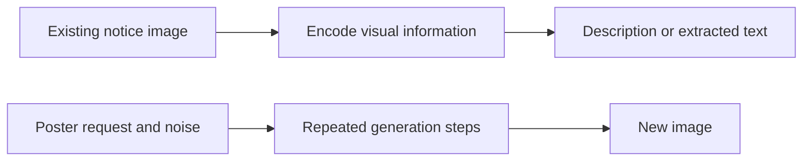

# Multimodal generation and a tiny language-model project

**Before this lesson:** [Adaptation: prompts, retrieval, and fine-tuning](03-adaptation-and-fine-tuning.md).

A **modality** is a kind of input or output, such as text, an image, audio, or video. A **multimodal model** works across more than one kind. Reading a timetable photo and producing text is different from generating a new timetable illustration.

For the school assistant, first identify the job: transcribe a notice, describe a diagram, recognize speech, or create a poster. These tasks need different outputs and different checks. One impressive picture is not a test of reading accuracy.

## How the pieces connect

An **encoder** turns input into a representation the system can process. Image inputs may be represented as patches; audio can be represented as samples or time-frequency features. A language component can use the resulting information to produce text. The exact arrangement depends on the model.

Some systems learn aligned representations: a picture and a matching caption receive related representations. That can support search or classification without generating an image. The [image–text contrastive-learning paper](https://arxiv.org/abs/2103.00020) is an example of this distinction.

**Diffusion generation** learns to reverse a noise-adding process. During generation, it repeatedly transforms a noisy representation toward an output, often guided by text. A **latent representation** is a learned compressed form; latent diffusion does this work in that form before decoding an image. It is not simply a language model choosing the next word. See the [latent diffusion paper](https://arxiv.org/abs/2112.10752).



## Work through a school notice

A blurry notice says “Club meets at 16:00.” A model reports “18:00.” The sentence looks reasonable, yet the useful detail is wrong. Check the extracted time against the source, retain the original image, and ask for a clearer input when it is unreadable. For audio, check names, numbers, and speaker changes. For generated posters, check text, layout, required objects, and whether the output could be mistaken for a real event photograph.

Use ordinary OCR for a narrow text-extraction job when it meets the need. Use templates for exact branded layouts. Model generation helps with flexible descriptions and creative variations, but adds uncertainty, processing work, and review. Use material you may process, and do not treat text embedded in an image as trusted instructions to execute.

## Stage project: observe generation without a paid service

Download [tiny_language_model.py](pathname:///examples/ai/generative-ai/tiny_language_model.py). It needs Python 3.10 or later, uses only the standard library, and downloads nothing. Save the file and run these commands in its folder:

```sh
python3 tiny_language_model.py
python3 tiny_language_model.py --self-test
```

The first command prints:

```text
Model: word bigram; context = one previous token
Greedy: the robot reads books
Sample (seed 7): the robot sorts books
Train perplexity: 3.902
Held-out perplexity: 4.743
Limits: counts only; no semantic understanding or factual guarantee
```

This is an honest word-count language model, **not a transformer or a multimodal generator**. It provides a small experiment you can inspect fully before using larger systems. Read `TRAIN`, `HELD_OUT`, `probability`, and `generate` in that order. Generation follows observed word pairs; evaluation adds one to each count so unseen pairs still receive a probability.

**Perplexity** summarizes next-token prediction surprise: lower is better on the same tokenization and evaluation data. It is not a general measure of factuality or usefulness. The held-out sentences contain known words in new pairs, so the higher score reveals weaker predictions on those combinations.

## Extend and explain

Change a training sentence, rerun, and explain which counts changed. Compare greedy output with several random seeds. A seed makes this small experiment repeatable; it does not prove a model’s quality. Then set a shorter maximum output length and observe the limit. The self-test checks probabilities, evaluation separation, invalid settings, and bounded output.

## Practice

Could this script answer the latest school opening hours or describe a photograph? What would each task additionally need?

<details>
<summary>Check your answer</summary>

No. The count model has neither authoritative school evidence nor an image encoder. Current hours need an approved data source and a reliable retrieval or lookup path. Image understanding needs a model or extractor designed for image inputs, followed by task-specific checking. More random sampling adds neither capability.

</details>

## Depth lab: derive one diffusion noise step

Diffusion training creates noisy versions of clean examples at known noise levels. In a common formulation:

`x_t = sqrt(alpha_bar) * x_clean + sqrt(1 - alpha_bar) * noise`.

Here `alpha_bar` controls retained signal across the forward process. Real examples are pixel or latent tensors; one number lets you inspect the algebra. A model receives noisy input and the time/noise level and learns a target such as added noise. The [DDPM paper](https://arxiv.org/abs/2006.11239) develops this approach.

```python runnable
import math

clean, noise, alpha_bar = 2.0, -1.0, 0.64
signal_scale = math.sqrt(alpha_bar)
noise_scale = math.sqrt(1 - alpha_bar)
noisy = signal_scale * clean + noise_scale * noise

def estimate_clean(predicted_noise):
    return (noisy - noise_scale * predicted_noise) / signal_scale

print(f"noisy: {noisy:.2f}")
print(f"with exact noise: {estimate_clean(noise):.2f}")
print(f"with wrong noise: {estimate_clean(0.0):.2f}")
```

```text output
noisy: 1.00
with exact noise: 2.00
with wrong noise: 1.25
```

This reconstructs a value using supplied noise estimates; it is not a trained denoiser or complete sampler. Real generation starts from noise without the original example. A learned model and a specified reverse process produce successive estimates. At very low retained signal, reconstruction becomes sensitive to noise-prediction errors.

An image pipeline may denoise compressed latents and decode pixels. Audio also needs a sample rate and timeline; transcription, speech synthesis, and sound generation are distinct tasks. Video needs temporal consistency as well as frame quality. A sharp frame does not prove stable identities, smooth motion, or synchronized speech.

**Debugging drill:** deliberately change an audio fixture's declared sample rate or an image's normalization range. Explain the symptom. For diffusion, check that training and sampling agree on prediction target, noise schedule, tensor scale, and model configuration before changing weights.

**Optimization and architecture:** compare fewer sampling steps at fixed resolution using the same prompts and multiple seeds. Measure quality, latency, and memory. Fewer steps are a tradeoff to evaluate. Keep original media, transformations, provenance, and outputs linked by identifiers without placing sensitive media in unrestricted logs.

<details>
<summary>Interview defense: why is a captioning model not automatically an image generator?</summary>

Captioning produces text from image information. Image generation requires an output representation and trained generation components, such as a denoising process and decoder. Aligned representations help connect modalities but do not supply every missing component.

</details>

**Mini-project:** evaluate a spoken timetable announcement for correct dates, intelligibility, pronunciation, and duration. Add a video version with timeline alignment. Teach which failures a text-only score misses.

**Previous:** [Adaptation: prompts, retrieval, and fine-tuning](03-adaptation-and-fine-tuning.md) · **Next:** [Choose tokens and teach preferred behavior](05-decoding-and-alignment.md)
