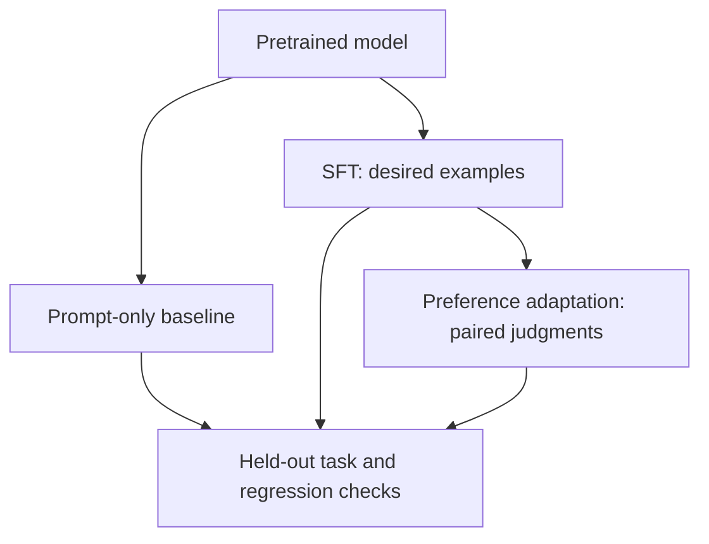

# Choose tokens and teach preferred behavior

**Before this lesson:** [language models](./01-language-models.md), [adaptation](./03-adaptation-and-fine-tuning.md), [multimodal generation](./04-multimodal-generation.md), and [cross-entropy](../mathematics/05-bayes-and-information.md).

A language model supplies scores for possible next tokens. A **decoding rule** chooses tokens from those scores. **Alignment training** changes model parameters to encourage desired behavior. Changing the decoding rule and changing the model are different interventions.

## Turn scores into a distribution

A raw model score is called a **logit**. **Softmax** exponentiates logits and divides each result by their sum to make probabilities. Subtract the largest logit first for numerical stability; this leaves the mathematical probabilities unchanged.

**Temperature** divides logits before softmax. A positive temperature below one sharpens the distribution; above one spreads it out. A zero-temperature setting in a service usually means greedy selection by convention; do not divide by zero in your own implementation.

```python runnable
import math

def probabilities(logits, temperature):
    if temperature <= 0:
        raise ValueError("temperature must be positive")
    shifted = [(x - max(logits)) / temperature for x in logits]
    weights = [math.exp(x) for x in shifted]
    return [w / sum(weights) for w in weights]

for temperature in [0.5, 1.0, 2.0]:
    values = probabilities([2, 1, 0], temperature)
    print(temperature, [round(p, 3) for p in values])
```

```text output
0.5 [0.867, 0.117, 0.016]
1.0 [0.665, 0.245, 0.09]
2.0 [0.506, 0.307, 0.186]
```

## Choose an output for the job

**Greedy decoding** chooses the highest-probability token at each step. **Sampling** draws from a distribution. **Top-k** sampling keeps a fixed number of candidates. **Top-p**, or nucleus sampling, keeps the smallest high-probability prefix whose cumulative probability reaches a chosen threshold, then renormalizes it.

Beam search keeps several candidate sequences while extending them. It can help some constrained sequence tasks, but the highest-scoring sequence is not necessarily the most useful open-ended answer.

For creative alternatives, controlled sampling can help diversity. For a structured extraction task, first define a schema and validate meaning. Lower temperature does not establish factuality, and a fixed seed does not guarantee identical results across hardware or service versions.

## From examples to preferences

**Supervised fine-tuning**, or SFT, trains on desired example responses. A **preference pair** instead contains the same prompt with two responses and a judgment of which is better. Define “better” before collecting labels: correct facts, relevant content, respectful wording, and valid structure are distinct criteria.

In **reinforcement learning from human feedback**, or RLHF, one common approach fits a reward model to preferences and uses it to guide policy updates. A penalty can discourage excessive change from a reference model. A learned reward can be exploited: optimizing “sounds confident” can reward unsupported certainty.

**Direct preference optimization**, or DPO, learns from preferred and rejected response pairs relative to a reference model without the separate reward-model-and-RL loop used in that common RLHF recipe. It still depends on preference data quality and evaluation. The [original DPO paper](https://arxiv.org/abs/2305.18290) derives its objective and reports the experiments used to assess it.



## Work through a library example

Prompt: “When does the library close?” Evidence: no opening-hours document is available. Response A invents 18:00. Response B says that the information is missing and identifies the source needed.

If the rubric prioritizes evidence, B should win. A rubric that rewards only directness may select A. Fixing data and labels matters more than choosing a fashionable optimizer. Include answerable questions too, so the model is not rewarded for refusing everything.

Keep prompts from the same source document in the same split when overlap could leak answers. Record annotator disagreement. Use a blind review where possible; otherwise people may prefer the answer from the system they expect to win.

## Practice and project extension

A sampled answer is fluent and passes JSON validation. What additional checks are needed before it updates a catalogue? Why is a preferred response not automatically a true response?

<details>
<summary>Compare your reasoning</summary>

Verify source support, field meaning, identity, permission, and the intended action. Preferences reflect a rubric and judgments, which can be mistaken or biased. A parser checks format; it cannot prove a factual claim or grant permission.

</details>

**Checkpoint:** build ten permissioned or fictional preference pairs. Include missing evidence, conflicting evidence, unnecessary refusal, and a structurally valid but wrong answer. Have a second reviewer apply the rubric if available. Report disagreements instead of treating your own labels as universal truth.

**Remember:** decoding controls selection from a model; adaptation changes the model. Neither substitutes for evaluation of the whole application.

## Depth lab: implement nucleus filtering and inspect its boundary

Top-p filtering sorts candidates, keeps the shortest prefix reaching the threshold, and renormalizes the retained mass. Include the token crossing the threshold; removing it is an off-by-one mistake.

```python runnable
import math

def nucleus(probabilities, threshold):
    if not 0 < threshold <= 1:
        raise ValueError("threshold must be in (0, 1]")
    if not probabilities or any(not math.isfinite(p) or p < 0 for p in probabilities):
        raise ValueError("expected finite nonnegative probabilities")
    if abs(sum(probabilities) - 1) > 1e-9:
        raise ValueError("probabilities must sum to one")
    ranked = sorted(enumerate(probabilities), key=lambda item: (-item[1], item[0]))
    kept, mass = [], 0.0
    for token, probability in ranked:
        kept.append((token, probability))
        mass += probability
        if mass >= threshold:
            break
    return [(token, round(probability / mass, 3)) for token, probability in kept]

print(nucleus([0.6, 0.3, 0.1], 0.8))
print(nucleus([0.6, 0.3, 0.1], 0.5))
```

```text output
[(0, 0.667), (1, 0.333)]
[(0, 1.0)]
```

The function returns a filtered distribution; sampling is another step. Test ties, threshold one, a single candidate, zeros, and invalid inputs. Specify whether temperature is applied before filtering: changing the order can change which tokens survive. Floating-point boundary comparisons also need a documented convention.

SFT increases target-response likelihood. Preference learning compares responses. DPO compares the chosen response's log-probability improvement over a reference with the rejected response's improvement. Its loss rewards a larger relative margin. Read the [DPO derivation](https://arxiv.org/abs/2305.18290), then use the [numeric DPO lab](../developer-roadmap/08-llms.md) for the arithmetic.

Sequence log-probability normally sums log-probabilities of scored response tokens. Masks identify those tokens. Incorrect masking can train on prompts or padding. Replacing the sum with a length-normalized average changes the objective; it is not simply a numerical optimization.

**Debugging and production:** inspect one encoded preference pair: identical prompt, distinct responses, correct masks, and the intended reference checkpoint. Check whether gains reflect useful behavior or merely verbosity. Compare task success, unsupported claims, refusal errors, and response length under fixed decoding settings. Tune inference settings in a separate experiment.

<details>
<summary>Interview defense: can greedy decoding repair poor alignment?</summary>

Greedy decoding chooses locally highest-probability tokens under the existing model. If unsupported responses have high probability, it may produce them consistently. Training, evidence, application constraints, and evaluation address different causes; selection alone cannot establish correctness.

</details>

**Teach-back:** show the two thresholds using counters representing probability mass. Explain why discarding unlikely tokens changes diversity without verifying the remaining candidates.

**Previous:** [Multimodal generation and a tiny language-model project](04-multimodal-generation.md) · **Next:** [Choose what to build, train, and run](../model-building/01-choose-a-model-strategy.md)
