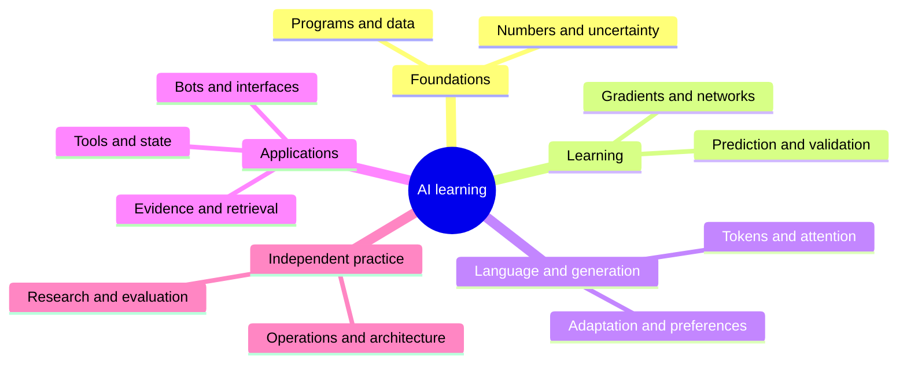

# Concept map and glossary

Use this as an index to the main explanations. The short descriptions help you find a term; follow its lesson for worked examples, limitations, and exercises. Start with [AI fundamentals](./orientation.md) when learning for the first time.

## Programs, data, and mathematics

| Term | Plain meaning | Main lesson |
| --- | --- | --- |
| Program / input / output | Instructions, information received, and information produced. | [Orientation](./orientation.md) |
| Variable / function | A name for a value; a reusable calculation or action. | [Values](./foundations/02-python-values.md), [functions](./foundations/03-control-and-functions.md) |
| Test | A repeatable check of expected behavior. | [Debugging and tests](./foundations/05-debugging-and-tests.md) |
| Environment | An isolated collection of project dependencies. | [Packages and environments](./foundations/06-git-environments-and-packages.md) |
| Join / missing value | Combining keyed tables; information not observed. | [Data tools](./foundations/08-data-tools.md) |
| Scalar / vector / matrix | One number, an ordered list, and a rectangular table of numbers. | [Vectors and matrices](./mathematics/01-vectors-and-matrices.md) |
| Parameter / gradient | An adjustable model number; local loss slopes for those numbers. | [Functions and gradients](./mathematics/02-functions-and-gradients.md) |
| Probability / uncertainty | A quantified chance; what remains unknown about a result. | [Probability](./mathematics/03-probability-and-statistics.md), [experiments](./mathematics/04-experiments-and-uncertainty.md) |
| Prior / posterior | A probability before and after new evidence. | [Bayes](./mathematics/05-bayes-and-information.md) |
| Entropy / cross-entropy | Expected surprise; surprise scored with another distribution. | [Information](./mathematics/05-bayes-and-information.md) |
| Rank / projection / PCA | Independent directions; keeping a component; data-based variance-preserving directions. | [Transformations](./mathematics/06-transformations-and-compression.md) |

## Models and generation

| Term | Plain meaning | Main lesson |
| --- | --- | --- |
| Training / inference | Learning parameters from examples; using a learned model. | [Orientation](./orientation.md) |
| Feature / target | Information used to predict; the outcome being predicted. | [Problem framing](./machine-learning/01-problem-framing.md) |
| Leakage | Evaluation information entering development improperly. | [Data and features](./machine-learning/02-data-and-features.md) |
| Loss / regularization | A training penalty; a constraint or penalty that controls fitting. | [Regression](./machine-learning/03-regression-and-optimization.md) |
| Precision / recall | How many selected cases were right; how many relevant cases were found. | [Classification](./machine-learning/04-classification-and-metrics.md) |
| Calibration | Agreement between predicted probabilities and observed frequencies. | [Calibration](./machine-learning/08-calibration-and-time.md) |
| Activation / backpropagation | A unit's transformation; composing derivatives backward through a network. | [Networks](./deep-learning/01-neural-networks.md), [backpropagation](./deep-learning/02-backpropagation.md) |
| Attention / Transformer | Content-dependent mixing; a model architecture built around attention blocks. | [Attention](./deep-learning/04-sequences-and-attention.md), [Transformers](./deep-learning/05-transformers.md) |
| Reward / policy | Feedback for an action; a rule for choosing actions. | [Reinforcement learning](./deep-learning/06-reinforcement-learning.md) |
| Token / context | A model's text unit; information included in the current model input. | [Language models](./generative-ai/01-language-models.md) |
| Embedding | A numerical representation learned for useful relationships. | [Retrieval basics](./rag/01-retrieval-basics.md) |
| Fine-tuning / LoRA | Further parameter training; a method using low-rank updates. | [Adaptation](./generative-ai/03-adaptation-and-fine-tuning.md), [release lab](./model-building/04-fine-tune-and-release.md) |
| Modality / diffusion | A kind of input/output; generation through learned denoising. | [Multimodal generation](./generative-ai/04-multimodal-generation.md) |
| Temperature / DPO | A decoding control; a preference-training method. | [Decoding and alignment](./generative-ai/05-decoding-and-alignment.md) |
| Perplexity | Exponentiated average token surprise on a specified dataset and tokenizer. | [Generation project](./generative-ai/04-multimodal-generation.md) |

## Applications, operations, and research

| Term | Plain meaning | Main lesson |
| --- | --- | --- |
| RAG | Finding source material before generating an answer. | [Retrieval basics](./rag/01-retrieval-basics.md) |
| Chunk / index / reranker | A source segment; a search structure; a second relevance scorer. | [Indexing](./rag/02-indexing-and-search.md), [hybrid lab](./rag/05-hybrid-search-lab.md) |
| Grounding / abstention | Supporting claims with evidence; declining an unsupported answer. | [Grounded answers](./rag/03-grounded-answers.md) |
| Tool / workflow / agent | A callable capability; a fixed procedure; a program that chooses actions. | [Tools and workflows](./agents/01-tools-and-workflows.md) |
| MCP | A protocol for connecting applications to tools and context sources. | [Integrations](./agents/06-agent-integrations.md) |
| Idempotency / durable state | Repeated requests preserve one intended effect; state survives restart. | [Durable workflows](./agents/07-durable-workflows.md) |
| Webhook / session | An incoming event notification; a bounded conversation context. | [Channels](./bots/03-connect-messaging-channels.md), [chatbot](./bots/02-build-a-chatbot.md) |
| Prompt injection | Untrusted content attempting to change system behavior. | [Security](./engineering/03-security-and-governance.md) |
| SLO / rollback | A measurable service target; restoring a known version. | [Monitoring](./engineering/02-evaluation-and-monitoring.md), [inference systems](./engineering/07-inference-systems.md) |
| Prefill / KV cache / quantization | Processing input; reusing attention values; representing numbers with fewer levels. | [Inference systems](./engineering/07-inference-systems.md) |
| Ablation / reproducibility | Testing a component's contribution; providing enough detail to repeat a result. | [Research practice](./research/01-papers-and-experiments.md) |
| Confounding / bootstrap | A competing influence on cause and outcome; resampling observed units. | [Defensible studies](./research/04-causal-and-reproducible-studies.md) |

**Return:** [Syllabus](./syllabus.md) · [Stage checkpoints](./assessments.md)
