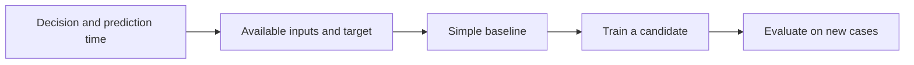

# Frame a problem before choosing a model

**Before this lesson:** [Linear transformations and useful compression](../mathematics/06-transformations-and-compression.md).

A **model** is a rule that turns inputs into a prediction. In machine learning, some parts of that rule are fitted from examples instead of written by hand. **Training** means adjusting those parts using data. The goal is useful behavior on new cases, not remembering the training rows.

You already know how to write Python functions and reason about uncertainty. Now connect those skills: a model is a function, training is an optimization problem, and evaluation is an experiment. Throughout this stage, use a delivery-time example. All numerical data in the downloadable project is invented for learning.

## Start with the decision

Suppose a dispatcher must estimate delivery duration before a driver leaves. Write the prediction contract before opening a model library:

| Question | Answer for this example |
| --- | --- |
| One example represents what? | One delivery, observed at dispatch time. |
| What do we predict? | Minutes from dispatch to completion. |
| What inputs are available then? | Planned distance and number of pickup stops. |
| What action uses the prediction? | Display an estimated duration and review unusually long jobs. |
| What counts as improvement? | Lower error than a simple baseline, within an acceptable response time. |

The value to predict is the **target**, often written `y`. An input measurement is a **feature**, often part of a vector `x`. The completion time is a valid training target but an invalid input at dispatch: it belongs to the future.



## Choose the kind of task

**Regression** predicts a number, such as minutes. **Classification** predicts a category or a score for a category, such as whether a delivery will be late. **Clustering** groups examples without supplied category labels. **Ranking** orders candidates, such as books a reader may want next. These tasks need different outputs and evaluation rules.

A rule may be enough. If eligibility is fully determined by an agreed policy, implement and test that policy. Machine learning becomes useful when examples contain a pattern that is difficult to specify completely. Start with a simple comparison system, called a **baseline**. Google's engineering guidance explicitly recommends simple systems and sound measurement before complex models. [Rules of Machine Learning](https://developers.google.com/machine-learning/guides/rules-of-ml).

## Work through a baseline

A mean baseline always predicts the average training duration. **Mean absolute error**, or MAE, averages the distance between prediction and observed target. It keeps the target's units, so an MAE of four here means four minutes.

```python runnable
training_minutes = [10, 14, 18]
validation_minutes = [12, 20]
prediction = sum(training_minutes) / len(training_minutes)
mae = sum(abs(prediction - y) for y in validation_minutes) / len(validation_minutes)
print(f"Baseline prediction: {prediction:.1f} minutes")
print(f"Validation MAE: {mae:.1f} minutes")
```

```text output
Baseline prediction: 14.0 minutes
Validation MAE: 4.0 minutes
```

The average comes from training targets only. The separate validation cases tell us how the baseline behaves on other observations. A more complex model must justify its extra data, maintenance, and compute costs against this comparison.

## Define success without fooling yourself

Prediction accuracy and usefulness are different. An estimate might be accurate on average but badly wrong on long rural routes. Report those cases separately. Decide whether underestimating and overestimating cost the same; MAE treats equal-sized errors symmetrically.

A predictive relationship is not automatically causal. If rainy days correlate with longer deliveries, the model has not proved that changing a recorded weather field changes the trip. Likewise, observing historical decisions does not reveal outcomes for choices that were never made.

## Practice

1. Frame “predict late library returns” with a prediction time, target, three allowable inputs, and one unavailable future input.
2. A complicated model has validation MAE 4.1 minutes. Should it replace the baseline above?

<details>
<summary>Check your reasoning</summary>

One contract predicts a late return at checkout, using loan duration, item type, and prior returns available before checkout. The eventual actual return date is future information. A model with MAE 4.1 does not improve this measured objective over 4.0; first inspect uncertainty and any other predeclared requirement rather than choosing it because it is more complex.

</details>

---

## Depth lab: a prediction is not the intervention

A library predicts which loans will be late so staff can send reminders. The model predicts an outcome; sending a reminder is an action that may change it. If only high-risk borrowers receive reminders, later outcomes reflect both risk and treatment. A model evaluated without recording that intervention can be misinterpreted.

Write a problem contract with the decision owner, prediction time, available inputs, target definition, action, error costs, and feedback delay. A “late return” label needs a due-date rule and a time when it becomes known. Rows whose due date has not passed are not automatically negative examples.

### Implement a baseline and its evaluator

Build an always-majority baseline and a simple rule based only on permitted information. For each, save one row per attempted case: ID, prediction, actual outcome when available, failure status, and action taken. Compute counts independently from this table. Include abstentions and failed requests in clearly named denominators.

**Worked choice:** if 95 of 100 records are ordinary, predicting ordinary achieves 95% accuracy while finding none of the five late returns. A useful decision may instead require identifying enough true late returns within ten review slots. Define that target before selecting a classifier.

### Debug, optimize, and design

Investigate who is absent from the dataset and whether labels exist only after a previous decision. A system that reviews only flagged cases may never learn how many unflagged positives it missed. Design representative evaluation or an appropriate review process rather than assuming observed labels are unbiased.

Optimize the simplest baseline that meets the decision requirement. A model's lower error is useful only if its action costs, latency, and failure behavior fit the workflow. Preserve a fallback and a human correction path without overwriting original predictions.

<details>
<summary>Expert defense: can a highly accurate risk model prove reminders work?</summary>

No. Prediction estimates patterns; an intervention claim needs a design addressing how treatment is assigned and what comparison supports the causal effect. Record treatment and outcomes, and use an appropriate controlled or justified causal study for that question.

</details>

**Teach it:** ask a learner to distinguish target, prediction, action, and outcome in the reminder example. Deliver the problem contract, two baselines, a complete outcome table, and a decision metric.

**Previous:** [Linear transformations and useful compression](../mathematics/06-transformations-and-compression.md) · **Next:** [Build features without leaking the answer](02-data-and-features.md)
