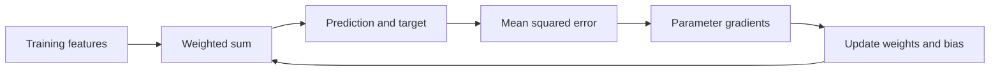

# Fit a regression model with gradients

**Before this lesson:** [Build features without leaking the answer](02-data-and-features.md).

A **regression model** predicts a numeric target. A useful first model is a weighted sum: multiply each feature by a learned weight, add the results, and add a constant called the **bias** or **intercept**. For one feature, write the prediction as `prediction = w * x + b`.

This connects the mathematics to a program: the feature vector supplies numbers, the dot product combines them, and an error function tells training what to improve. Begin with a linear model before adding layers or interactions.

## Define the error you will minimize

A **residual** is the difference between a prediction and its observed target. **Mean squared error**, or MSE, averages squared residuals. Squaring makes signs disappear and gives large errors more influence. MAE, used for the delivery report, instead keeps a direct minutes interpretation.

The training objective may differ from the reporting metric if that choice is deliberate. Least-squares regression minimizes squared residuals; ridge regression adds a penalty on coefficient size. [Scikit-learn linear-model objectives](https://scikit-learn.org/stable/modules/linear_model.html#ordinary-least-squares).

## Make one update by hand

For two examples `(x, y) = (1, 3)` and `(2, 5)`, start with `w = 1` and `b = 0`. Predictions are 1 and 2, residuals are -2 and -3, and MSE is 6.5.

A **gradient** gives the local change of the objective with respect to each parameter. The MSE gradients here are `mean(2 * residual * x)` for `w` and `mean(2 * residual)` for `b`: -8 and -5. **Gradient descent** subtracts a small multiple of the gradient. That multiple is the **learning rate**.

```python runnable
xs, ys = [1.0, 2.0], [3.0, 5.0]
w, b = 1.0, 0.0
errors = [w * x + b - y for x, y in zip(xs, ys)]
before = sum(e * e for e in errors) / len(errors)
grad_w = sum(2 * e * x for e, x in zip(errors, xs)) / len(xs)
grad_b = sum(2 * e for e in errors) / len(xs)
w -= 0.1 * grad_w
b -= 0.1 * grad_b
after = sum((w * x + b - y) ** 2 for x, y in zip(xs, ys)) / len(xs)
print(f"MSE: {before:.2f} -> {after:.2f}")
print(f"w={w:.1f}, b={b:.1f}")
```

```text output
MSE: 6.50 -> 0.65
w=1.8, b=0.5
```

One update helps this example. A learning rate that is too large can overshoot and increase loss; one that is too small can make learning slow. Inspect the loss curve rather than assuming every update improves every metric.



## Fit useful patterns rather than every fluctuation

**Underfitting** means the chosen model or training process cannot capture useful structure. **Overfitting** means fitting details of the training sample that do not carry to new cases. Compare training and validation performance, not training loss alone.

**Regularization** adds constraints or preferences to discourage overly flexible solutions. Ridge adds `lambda * sum(weight ** 2)` to the objective. Choose `lambda` with validation data. A large penalty can reduce overfitting but also erase useful signal. Scaling features changes the meaning of this penalty, so fit the scaler on training data and keep it with the weights.

Linear regression is a useful baseline for numeric tabular data. It can miss curves and interactions; an interaction means the effect of one input depends on another. A feature such as distance times stops can represent one interaction, but only if both inputs exist at prediction time. Trees are an alternative when threshold-shaped relationships fit the problem better.

## Practice

1. Why must all gradients in the worked step be calculated from the same old parameters?
2. What would a negative learning rate do to the local update direction?
3. Training error falls while validation error rises. Name two changes to investigate.

<details>
<summary>Check your reasoning</summary>

Mixing old and already-updated parameters would no longer implement this simultaneous gradient step. A negative learning rate moves in the gradient's direction instead of against it. For a widening training/validation gap, inspect leakage and split validity, reduce flexibility or training duration, try regularization, and gather more representative training examples. Do not choose settings by repeatedly inspecting the test set.

</details>

---

## Depth lab: derive the full linear-regression update

For n rows with feature vectors xᵢ, weights w, bias b, and targets yᵢ, prediction is `xᵢ·w+b`. With mean squared error, each row contributes `2*(prediction-target)*xᵢ/n` to the weight gradient and `2*(prediction-target)/n` to the bias gradient. Sum contributions before updating parameters.

**Implement:** extend the one-feature example to two features with explicit shape checks. Calculate a tiny batch by hand, compare analytic gradients with central finite differences, and train on a synthetic plane with known coefficients. Evaluate predictions on new points, not only whether the training loss fell.

### Diagnose failure from evidence

| Observation | Competing explanations | Check |
| --- | --- | --- |
| Loss explodes | Large step, bad scale, incorrect derivative | Gradient check, input ranges, smaller controlled step. |
| Training and validation both poor | Insufficient features/capacity, wrong target, failed optimization | Compare constant baseline and a known synthetic task. |
| Training good, validation poor | Leakage, overfitting, shift | Audit split, learning curves, feature availability. |
| Error concentrated at high targets | Objective or representation mismatch | Inspect residuals by target range and compare MAE/RMSE. |

L2 regularization adds a penalty proportional to squared weights, with a gradient determined by the stated coefficient convention. Feature scaling changes how that penalty treats coefficients, so document both. A closed-form solution can be a useful small-problem reference, but solving normal equations naively may be numerically fragile for ill-conditioned features.

### Production and optimization

Version the target unit and transforms. Converting minutes to seconds at serving time can break a correct model. Use a maintained solver or numerical library for production and compare it against the small implementation. Measure preprocessing, matrix multiplication, and batch overhead separately before increasing model complexity.

<details>
<summary>Expert defense: why can a model have negative R² on held-out data?</summary>

Under the usual definition, its squared error exceeds the error of predicting the evaluation targets' mean. The score is not restricted to zero through one on arbitrary held-out predictions. Explain the baseline and denominator rather than treating a negative result as a software exception.

</details>

**Teach it:** derive one two-feature gradient, show a deliberately wrong feature scale, and explain the residual pattern. Deliver the checked implementation, baseline comparison, error slices, and measured optimization.

**Previous:** [Build features without leaking the answer](02-data-and-features.md) · **Next:** [Classify outcomes and choose useful metrics](04-classification-and-metrics.md)
